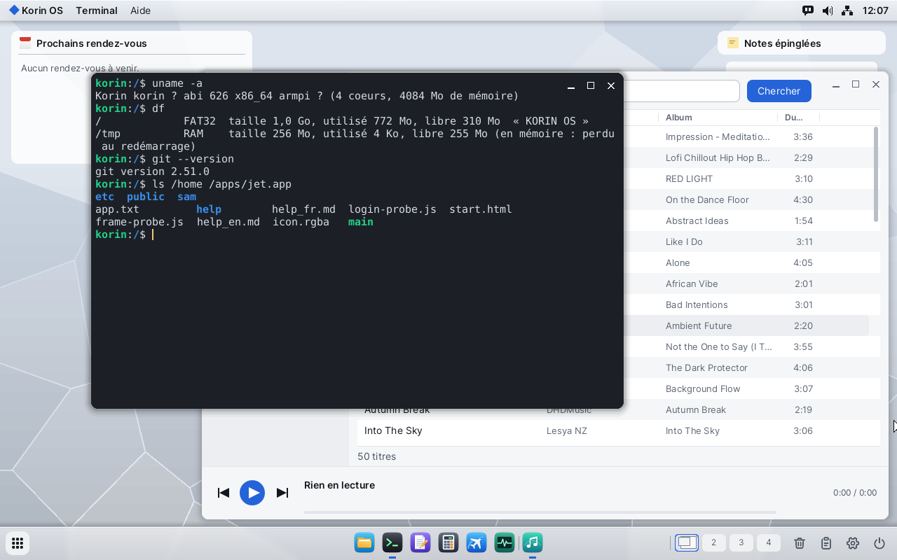
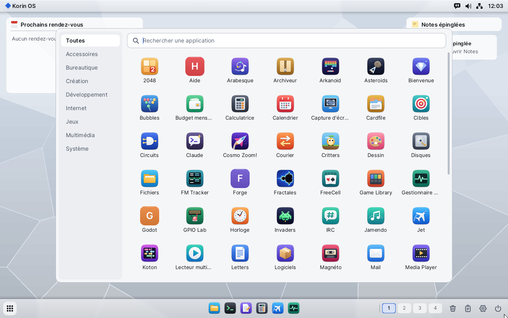

# Korin OS

Anciennement ARMPI : les noms internes gardent ce nom. Pour tout reconstruire : [docs/CONSTRUIRE.md](docs/CONSTRUIRE.md). Licences : [docs/LICENCES.md](docs/LICENCES.md).

Système d'exploitation de bureau **64 bits**, écrit depuis zéro, pour les **PC x86-64** (UEFI) et le
**Raspberry Pi 4**. Ce n'est ni Linux ni un BSD : micronoyau, services, bureau et kits sont les siens ; des
logiciels libres connus sont portés par-dessus. Né sur le Pi en assembleur AArch64 (FASMARM), il tourne aussi sur
PC depuis novembre 2026 ; l'essentiel du système est depuis passé en C, commun aux deux machines.



## Ce qu'il y a dedans

* **Micronoyau** : process isolés (ELF64, un espace d'adressage chacun), ordonnanceur préemptif **SMP** (les
  4 cœurs du Pi, tous ceux du PC), threads, futex ; pilotes, systèmes de fichiers, réseau et serveur graphique
  sont des process : un pilote qui tombe est relancé, pas le système ([docs/MICRO-NOYAU.md](docs/MICRO-NOYAU.md)).
* **Un seul arbre de fichiers**, à la Unix : `/` (FAT32), `/media/usb0`…, `/tmp` en mémoire, `/net/…` pour les
  partages ; `HOME:/` est le dossier de l'utilisateur ([docs/FICHIERS.md](docs/FICHIERS.md)).
* **Matériel** : PC (développé sur un HP ZBook Fury 17 G8 : NVMe, USB, Wi-Fi Intel AX201, son HD Audio, GPU Intel
  par Mesa, pavé tactile, batterie), Pi 4 (USB, Ethernet, Wi-Fi, son, GPU V3D par Mesa, broches GPIO).
* **Elegant**, le bureau : serveur graphique composité, panneau, lanceur, quatre bureaux, widgets, thèmes Givre et
  Onyx Noir ; écran de connexion, comptes, `sudo`.
* **Kits** partagés par les apps (UIKit, NetKit, AudioKit, MediaKit, GlKit, VkKit…, [docs/KITS.md](docs/KITS.md)).
* **POSIX** (newlib + `libposix`, [docs/POSIX.md](docs/POSIX.md)) assez pour porter bash, git, CPython, WebKit,
  Godot, .NET et bien des bibliothèques ; **GCC 14.2 dans le système**, avec FASM, FreeBASIC, le SDK .NET, Python.
* **Plus de cent paquets signés** ([docs/PAQUETS.md](docs/PAQUETS.md)) : le navigateur Jet (WebKit), la
  bureautique (Letters, Spreadsheet, Slides : DOCX, XLSX, PPTX, OpenDocument), le courrier, la musique (Jamendo,
  Spotify, Koton, FM Tracker), des jeux et émulateurs, la CAO Forge (OpenCASCADE), Godot 4.7, Avalonia.
* Les apps s'écrivent en **assembleur, C, C++, C#, BASIC** ; les commandes de `/bin` sont en assembleur et en C.



## Raspberry Pi 4 : réglages de la carte

Wi-Fi : firmware dans `/firmware/` (copié par `build.ps1`), connexion automatique si `/etc/wifi.txt` existe
(modèle : `wifi.example.txt`), ou depuis le terminal : `wifi scan`, `wifi connecter SSID clé`, `wifi`,
`wifi quitter` ; sur PC, le menu Wi-Fi du panneau ([docs/WIFI.md](docs/WIFI.md)).

## Construire et lancer

Tout, dans l'ordre (Pi et PC, le C et le C++ dans WSL) : [docs/CONSTRUIRE.md](docs/CONSTRUIRE.md). Pour le Pi 4 :

```powershell
.\build.ps1          # applications + noyau + image SD (build\sd.img)
.\build.ps1 run      # QEMU raspi4b, carte SD, clavier et tablette USB
.\build.ps1 sd E:    # copie firmware + noyau sur une carte FAT32 pour un vrai Pi 4
.\build.ps1 test     # démarre QEMU sans affichage et vérifie le démarrage sur l'UART (comme la CI)
```

Intégration continue (GitHub Actions : assemblage et démarrage sous QEMU à chaque push) : [docs/CI.md](docs/CI.md).

La carte préparée par `sd` est en 800×600 (comme Onyx sur le PocketTerm) ; `-Ecran 640x480` ou
`-Ecran 1024x768`
pour une autre résolution. QEMU reste en 1024×768.

Les programmes lancés au démarrage sont listés dans `/etc/startup.txt`. Sur matériel réel,
`/etc/options.txt` désactive des pilotes pour isoler un problème : `no_wifi`,
`no_ethernet`, `no_gpu`, `no_rng200`, `no_dispdma` (Elegant copie l'écran par le processeur au lieu
du DMA 2D ; un mot par ligne), `no_pwmaudio` (pas de son sur la prise jack), `no_hdmiaudio` (pas de son HDMI),
`no_highmem` (le noyau n'utilise que le 1er Go de RAM, docs/ARCHITECTURE.md § Mémoire), `no_preload`
(les exécutables de `/etc/preload.txt` ne sont pas préchargés : un chemin par ligne, leurs
lancements reprennent les pages déjà chargées, docs/ABI.md). Le son est le service
`sound` et ses pilotes (docs/SON.md) ; `sound_virtual=2` ajoute une seconde sortie virtuelle
(essai du routage). L'USB est le service `usbd` (docs/USB.md). L'écran tactile est un pilote en service, lancé
par `hwmanager` d'après `/etc/drivers.txt` (mettre la ligne en commentaire pour s'en passer).
`keyb=US` y choisit la disposition du clavier : fichiers texte `/res/keyb/<NOM>.txt` (FR, US),
modifiables et complétables sans reconstruire le noyau. AZERTY intégré par défaut.

**Waveshare PocketTerm35** (testé) : clavier RP2040 sur le port USB-C (`keyb=US`), écran tactile
GT911 comme pointeur (toucher = clic, glisser vertical = défilement, glisser de côté ou appui long =
déplacer, deux doigts = molette). Tout clavier ou souris USB est reconnu d'après son descripteur HID.

Diagnostic sans liaison série : ajouter `/bin/journal` à `/etc/startup.txt` ; le journal
du noyau est écrit dans `/journal.txt` après 20 s puis 60 s. Les sources du système
sont copiées dans `/src` : depuis le terminal d'ARMPI, `cd /src` puis
`fasmarm kernel.asm kernel8.img` reconstruit le noyau.

## Documentation

* [Architecture](docs/ARCHITECTURE.md) — modules, mémoire, ordonnancement, GUI
* [Interface des applications](docs/ABI.md) — appels système, événements
* [Couche POSIX](docs/POSIX.md) — programmes C et C++ (newlib, threads, fichiers, sockets)
* [OpenSSL](docs/OPENSSL.md) — `libcrypto.a`, `libssl.a` pour les programmes C et C++
* [MediaKit](docs/MEDIAKIT.md) — vidéo (kit précompilé), lecteur multimédia
* [Suite bureautique](docs/BUREAUTIQUE.md) — Letters, Spreadsheet, Slides, Cardfile ; ArchiveKit et DocumentKit
* [Étude de faisabilité](docs/etude/00-synthese.md) — choix, feuille de route
* [WiFi sur vrai Pi 4](docs/WIFI.md) — préparation de la carte, messages attendus, points fragiles
* [Raspberry Pi 5](docs/PI5.md) — état du portage (`-d ARCH=pi5`), ce qui reste à faire

## Licences

Code sous licence MIT ([LICENSE](LICENSE)), sauf ce qu'une autre licence impose : le lecteur PDF
(AGPL-3.0), les patchs des projets tiers, le firmware, les polices. La liste est dans [docs/LICENCES.md](docs/LICENCES.md).
