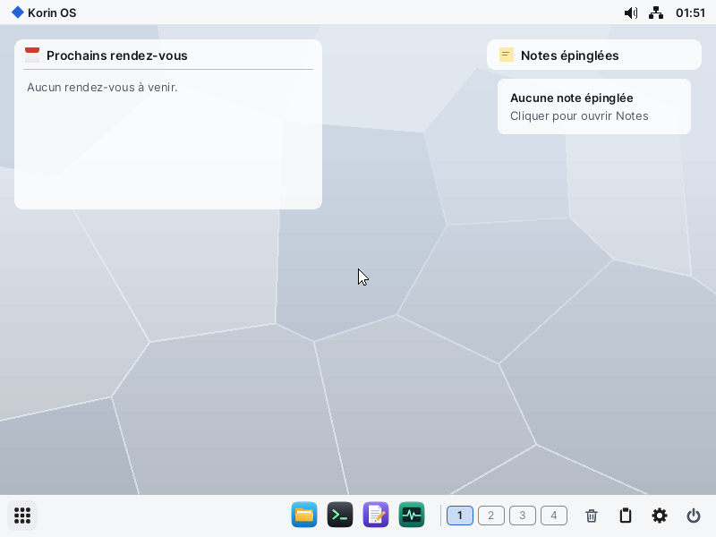
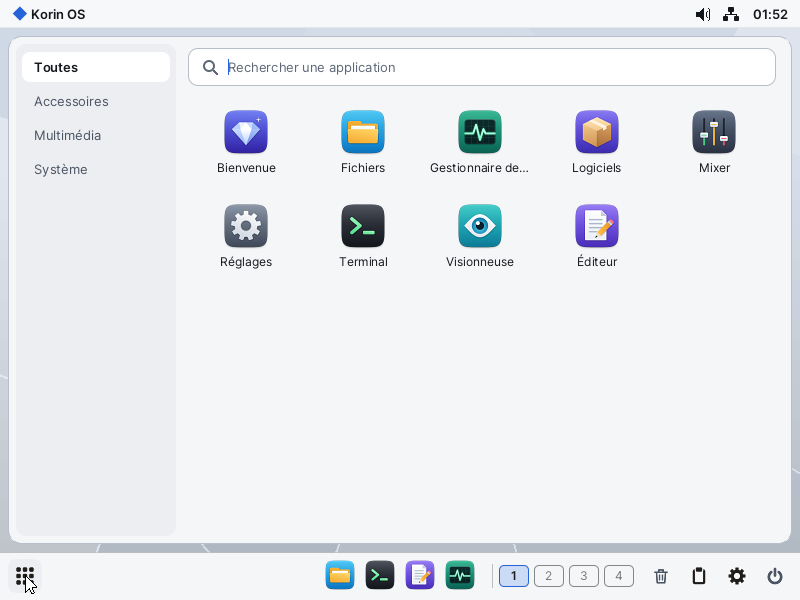

# Korin OS

Anciennement ARMPI : les noms internes gardent ce nom. Pour tout reconstruire : [docs/CONSTRUIRE.md](docs/CONSTRUIRE.md). Licences : [docs/LICENCES.md](docs/LICENCES.md).

Système d'exploitation **64 bits** pour **Raspberry Pi 4**, inspiré de MenuetOS, écrit
entièrement en **assembleur AArch64 avec FASMARM**.



## Ce qui fonctionne (testé dans QEMU raspi4b)

* **Noyau** : EL2→EL1, MMU 4 Ko + caches, **SMP 4 cœurs**, ordonnanceur **préemptif**
  (1 kHz, quantum 10 ms), threads, futex, IPI, **contexte FP/NEON** complet.
* **Process isolés** : exécutables **ELF64**, un espace d'adressage + ASID par process, une
  cinquantaine d'appels système groupés par domaine, process fautif tué sans arrêter le système,
  arguments, `wait`, tubes.
* **Stockage** : carte SD, cache de secteurs, **FAT32** et **exFAT** (lecture, écriture, noms
  longs UTF-8), validés par des outils tiers (pyfatfs, fsck.exfat, noyau Linux).
* **USB** (DWC2) : hub, clavier AZERTY/QWERTY, souris, tablette, réseau CDC-ECM, carte son,
  **clés USB** (stockage de masse, partitions FAT32/exFAT montées en `USB0:`, `USB1:`).
* **Réseau** : pile **TCP/IP** maison (ARP, IPv4, ICMP, UDP, DHCP, DNS, TCP client/serveur), sockets.
* **Son** : mixeur 8 flux, sortie USB audio (440 Hz vérifié), enregistrement (API micro).
* **Interface graphique** en espace utilisateur : **Elegant**, serveur graphique (fenêtres,
  compositeur, barre des tâches, menu), **rastériseur TrueType maison** en assembleur.
* **Auto-hébergement** : **FASMARM porté nativement en AArch64** ; sous ARMPI il réassemble le
  noyau à l'identique, octet pour octet (`SD0:/bin/fasmarm`, `selfhost`).
* **Suite logicielle** (`SD0:/apps`) : terminal (shell), éditeur, fichiers, navigateur web,
  gestionnaire de tâches, calculatrice, horloge, dessin (BMP), piano, magnétophone, jeu Cibles, lecteur multimédia (WebM / MP4 : VP8, VP9,
  AV1 par **MediaKit**, kit précompilé en C, [docs/MEDIAKIT.md](docs/MEDIAKIT.md)).
* **Suite bureautique** ([docs/BUREAUTIQUE.md](docs/BUREAUTIQUE.md)) : Letters (RTF, DOCX, ODT), Spreadsheet (XLSX, ODS), Slides (PPTX,
  ODP), Cardfile, en C++ sur UIKit, compilables sous ARMPI par `pibuild`.



## Écrit pour le vrai Raspberry Pi 4 mais non testable sous QEMU

Ports USB-A (PCIe + xHCI VL805), Ethernet GENET, **WiFi CYW43455** (SDIO, WPA2), son PWM
(jack) et HDMI, micro I2S, GPU V3D. Ces pilotes se désactivent proprement sous QEMU ; leur
validation demande une carte réelle (voir les points à vérifier dans `docs/`).

WiFi : firmware dans `SD0:/firmware/` (copié par `build.ps1`), connexion automatique si
`SD0:/etc/wifi.txt` existe (modèle : `wifi.example.txt`), ou depuis le terminal :
`wifi scan`, `wifi connecter SSID clé`, `wifi`, `wifi quitter`.

## Construire et lancer

```powershell
.\build.ps1          # applications + noyau + image SD (build\sd.img)
.\build.ps1 run      # QEMU raspi4b, carte SD, clavier et tablette USB
.\build.ps1 sd E:    # copie firmware + noyau sur une carte FAT32 pour un vrai Pi 4
.\build.ps1 test     # démarre QEMU sans affichage et vérifie le démarrage sur l'UART (comme la CI)
```

Intégration continue (GitHub Actions : assemblage et démarrage sous QEMU à chaque push) : [docs/CI.md](docs/CI.md).

La carte préparée par `sd` est en 800×600 (comme Onyx sur le PocketTerm) ; `-Ecran 640x480` ou
`-Ecran 1024x768`
pour une autre résolution. QEMU reste en 1024×768.

Les programmes lancés au démarrage sont listés dans `SD0:/etc/startup.txt`. Sur matériel réel,
`SD0:/etc/options.txt` désactive des pilotes pour isoler un problème : `no_wifi`,
`no_ethernet`, `no_gpu`, `no_rng200`, `no_dispdma` (Elegant copie l'écran par le processeur au lieu
du DMA 2D ; un mot par ligne), `no_pwmaudio` (pas de son sur la prise jack), `no_hdmiaudio` (pas de son HDMI),
`no_highmem` (le noyau n'utilise que le 1er Go de RAM, docs/ARCHITECTURE.md § Mémoire), `no_preload`
(les exécutables de `SD0:/etc/preload.txt` ne sont pas préchargés : un chemin par ligne, leurs
lancements reprennent les pages déjà chargées, docs/ABI.md). Le son est le service
`sound` et ses pilotes (docs/SON.md) ; `sound_virtual=2` ajoute une seconde sortie virtuelle
(essai du routage). L'USB est le service `usbd` (docs/USB.md). L'écran tactile est un pilote en service, lancé
par `hwmanager` d'après `SD0:/etc/drivers.txt` (mettre la ligne en commentaire pour s'en passer).
`keyb=US` y choisit la disposition du clavier : fichiers texte `SD0:/res/keyb/<NOM>.txt` (FR, US),
modifiables et complétables sans reconstruire le noyau. AZERTY intégré par défaut.

**Waveshare PocketTerm35** (testé) : clavier RP2040 sur le port USB-C (`keyb=US`), écran tactile
GT911 comme pointeur (toucher = clic, glisser vertical = défilement, glisser de côté ou appui long =
déplacer, deux doigts = molette). Tout clavier ou souris USB est reconnu d'après son descripteur HID.

Diagnostic sans liaison série : ajouter `SD0:/bin/journal` à `SD0:/etc/startup.txt` ; le journal
du noyau est écrit dans `SD0:/journal.txt` après 20 s puis 60 s. Les sources du système
sont copiées dans `SD0:/src` : depuis le terminal d'ARMPI, `cd SD0:/src` puis
`fasmarm kernel.asm kernel8.img` reconstruit le noyau.

## Documentation

* [Architecture](docs/ARCHITECTURE.md) — modules, mémoire, ordonnancement, GUI
* [Interface des applications](docs/ABI.md) — appels système, événements
* [Couche POSIX](docs/POSIX.md) — programmes C et C++ (newlib, threads, fichiers, sockets)
* [OpenSSL](docs/OPENSSL.md) — `libcrypto.a`, `libssl.a` pour les programmes C et C++
* [MediaKit](docs/MEDIAKIT.md) — vidéo (kit précompilé), lecteur multimédia
* [Suite bureautique](docs/BUREAUTIQUE.md) — Letters, Spreadsheet, Slides, Cardfile ; ArchiveKit et DocumentKit
* [Étude de faisabilité](docs/etude/00-synthese.md) — choix, feuille de route
* [WiFi sur vrai Pi 4](docs/WIFI.md) — préparation de la carte, messages attendus, points fragiles
* [Raspberry Pi 5](docs/PI5.md) — état du portage (`-d ARCH=pi5`), ce qui reste à faire

## Licences

Code sous licence MIT ([LICENSE](LICENSE)), sauf ce qu'une autre licence impose : le lecteur PDF
(AGPL-3.0), les patchs des projets tiers, le firmware, les polices. La liste est dans [docs/LICENCES.md](docs/LICENCES.md).
