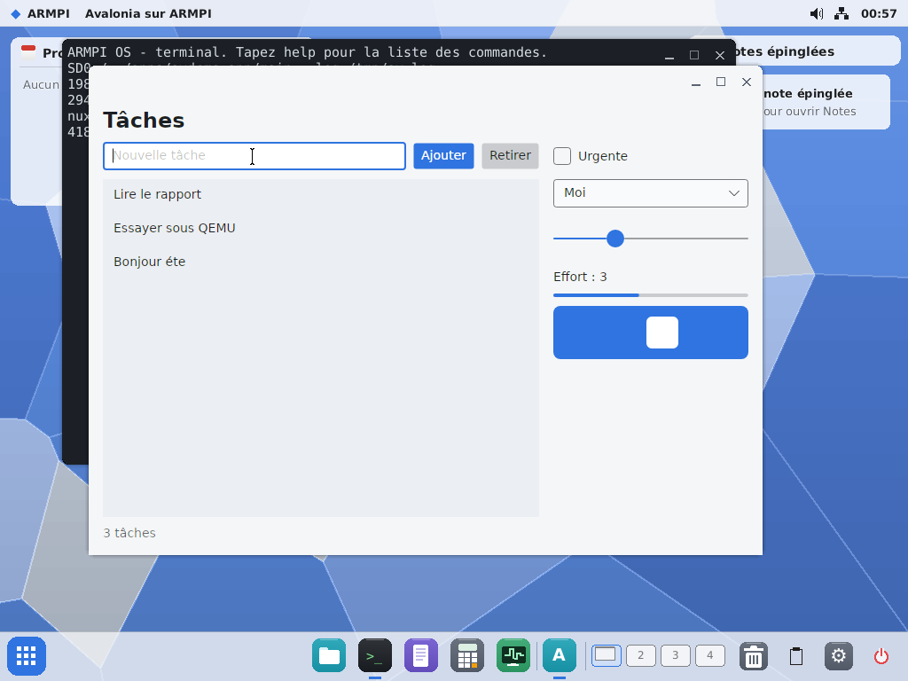
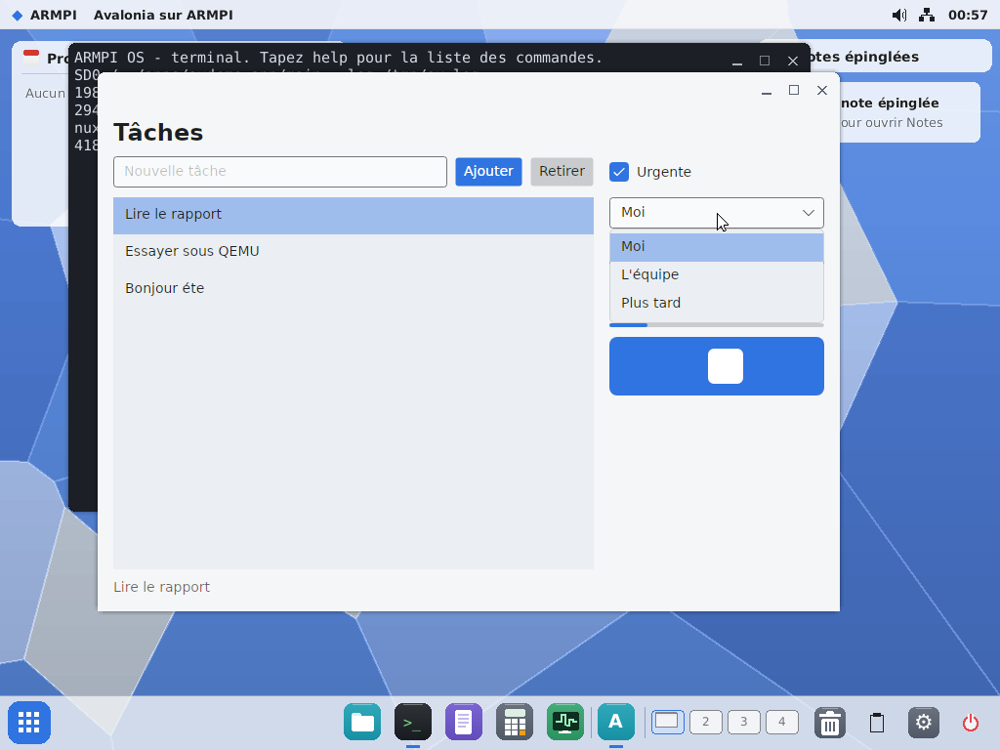
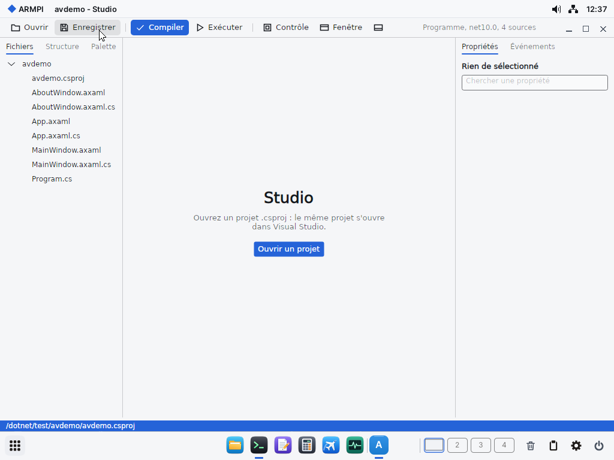
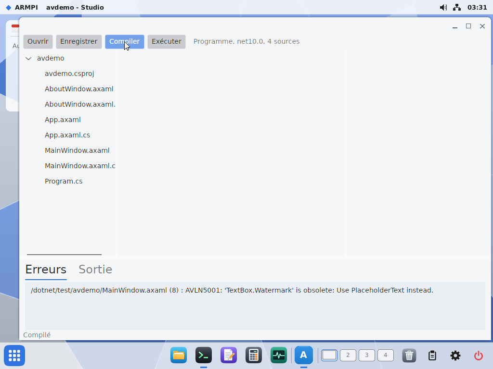
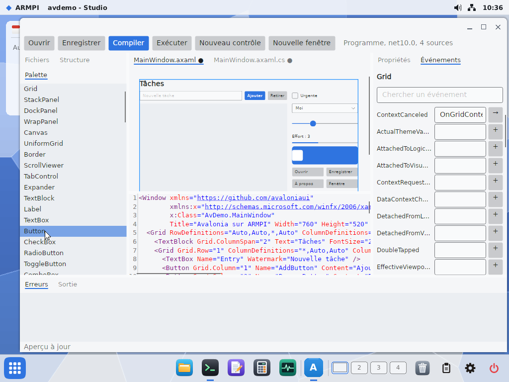

# Avalonia sur ARMPI

Portage du 2 novembre 2026, fusionné dans `main`. Essayé sous QEMU, et sur le Pi par l'utilisateur pour le démarrage et l'animation.

## Conclusion

**Ça marche, et il faut continuer.** Une application Avalonia 12.1.4 ordinaire (XAML compilé, Fluent, liste, saisie, boutons), compilée une fois par `dotnet build` sur le PC, tourne sous Windows et sous ARMPI avec le même `.dll`. Il a fallu très peu de code : environ 700 lignes de C# pour la plateforme et une trentaine de lignes d'assembleur dans AppKit. Le frein reste le démarrage sous QEMU, à mesurer sur le Pi avant toute conclusion.



## Les choix

| Question | Réponse établie sur le code | Décision |
|---|---|---|
| Versions | `Avalonia.Skia` 12.1.4 exige SkiaSharp 3.119.4 (m119) et HarfBuzzSharp 8.3.1.3 | ces versions |
| SkiaSharp vérifie-t-il le natif ? | oui : `SkiaSharpVersion`, milestone dans `[119, 120)`, sinon exception à la première utilisation | pas de mensonge sur la version |
| Greffer l'API C sur notre m154 ? | les 39 fichiers de `src/c` ne compilent pas contre la copie de WebKit, dépouillée (`SkColorPriv.h`, `SkGradientShader.h`, skottie absents) ; l'hôte étant statique, Jet et .NET ne partageraient aucun octet | **écarté** |
| Construire la branche de SkiaSharp | `mono/skia` au commit de `externals/skia` de v3.119.4, GN, notre GCC : se compile avec `-fpermissive` et un petit patch | **retenu** |
| HarfBuzz | 8.3.1, le fichier unique `harfbuzz.cc` | même version qu'à Windows |
| Sans `dlopen` | `gen-table.py` : table triée des 878 fonctions de `SkiaSharp.dll` et des 319 de `HarfBuzzSharp.dll`, consultée par `PINVOKE_OVERRIDE` ; les 8 fonctions GPU absentes rendent 0 | toutes résolues |
| Même `.dll` | `Avalonia.Base` accorde `InternalsVisibleTo` à `Avalonia.Desktop` : notre `Avalonia.Desktop.dll`, de même nom, version et clé publique, remplace `UsePlatformDetect` | l'application ne sait rien d'ARMPI |
| Backend | compilé contre `lib/` : les `ref/` du paquet n'ont pas les API privées | `tools/avalonia/desktop/` |

## Le second hôte

| | taille dépouillée |
|---|---|
| `/dotnet/dotnet` | 14 954 672 octets |
| `/dotnet/dotnet-skia` | 19 538 728 octets, soit +4,6 Mo (+31 %) |

Le gain ne vaut un second hôte que pour les programmes qui n'utilisent pas Skia, et ce sont presque tous. **Recommandation : garder les deux hôtes.** `/dotnet/dotnet` n'a pas changé : `build-host.sh` reprend ses objets et ne recompile qu'une copie d'`armpihost.cpp`.

Choix de l'hôte : AppKit (`fc_spawn_dotnet`) regarde si `<dll>.skia` existe à côté de la DLL. `/apps/avdemo.app/main.skia` suffit, le `.dll` ne change pas.

## La plateforme

`tools/avalonia/desktop/` :

* **Surface** : `ui_surface` attachée à la fenêtre. Skia peint dans un tampon privé, recopié d'un bloc dans la surface, puis `ui_surface_damage` sur toute la surface. Avalonia efface avant de peindre : sans ce tampon, Elegant montrait de grandes zones noires, surtout avec deux fenêtres.
* **Rendu** sur le thread de l'interface (`UiThreadRenderTimer`), seul à parler à UIKit. Sur le Pi, Skia Ganesh rend sur le GPU par Mesa (`ArmpiGl.cs`, [MESA.md](MESA.md)), dans une surface de la taille de l'écran dont seule la zone change. Sans GPU, ou avec `AVALONIA_ARMPI_GPU=0`, on reste sur la surface et le tampon privé. Au démarrage, une ligne dit le chemin : `avalonia : rendu sur le GPU`, ou `le processeur (armgl 0)`.
* **Boucle** : `ui_event` avec une attente de 10 ms au plus, comme Jet. `EV_WAIT` ne se réveille que par un événement d'Elegant, et `WS_POST` est réservé au serveur.
* **Fenêtres** : elles n'existent qu'entre `Show` et `Hide`. Les 32 px du haut restent au cadre, le contenu d'Avalonia commence dessous.
* **Bande du cadre** : `ExtendClientAreaToDecorationsHint="True"` retire la bande vide de 32 px : le contenu monte sur la ligne des boutons de la fenêtre, comme une app native, en laissant libres les 120 px de droite. Le Studio y met sa barre d'outils.
* **Popups** : dans la fenêtre (`CreatePopup` rend null).
* **Clavier** : codes HID, lettre tirée du caractère, donc AZERTY. **Curseurs** : `UC_*`. **Presse-papiers** : texte par `ui_clip_*`, non essayé.
* **Thème** : `ArmpiTheme` met les jetons `TJ_*` dans `FluentTheme.Palettes`, `ArmpiSettings` donne clair ou sombre et l'accent. Le thème est lu au démarrage.
* **Police** : DejaVu Sans par défaut, depuis `SD0:/fonts`. Sans ce réglage, Skia prenait un serif.

## Ce qui est prouvé (QEMU, sauf mention)

| Essai | Résultat |
|---|---|
| `skiatest` sous Windows et sous ARMPI | natif 119.0, mêmes 9 glyphes HarfBuzz, PNG relu sans écart |
| PNG comparés | aucune différence de forme ; texte seul différent : 2 341 pixels sur 256 000 à plus de 8 niveaux ([ARMPI](assets/avalonia-skiatest-armpi.png), [Windows](assets/avalonia-skiatest-windows.png)) |
| `avdemo --auto` sous Windows 11 x64 | fenêtre, journal complet, code 0 |
| `avdemo --auto` sous ARMPI, par telnet | même journal, même état final, code 0 |
| `avdemo` depuis le terminal du bureau, `preload.txt` vidé | fenêtre au thème Givre |
| Même `.dll` | SHA-256 `2b487c07…f35d` identique dans la sortie de `dotnet build` et dans l'arbre de la carte d'essai |
| Souris et clavier réels | saisie AZERTY avec accent, Entrée, clic sur la liste, case à cocher, liste déroulante ouverte, curseur glissé, focus par Tab |
| Fermeture par la croix | `fin`, code 0 |
| Onyx Noir (`theme = Onyx Noir` seul) | variante sombre détectée, couleurs du thème ([capture](assets/avalonia-avdemo-onyx-noir.png)) |
| Presse-papiers | `abc`, Ctrl+A, Ctrl+C, deux Ctrl+V : `abcabc` ajouté à la liste |
| Liste déroulante | choix de « L'équipe » |
| Redimensionnement | au bord, la mise en page suit ([capture](assets/avalonia-avdemo-redim.png)) ; agrandir marche aussi, essayé avant le passage au tampon intermédiaire |
| Base fusionnée avec `main` | `avdemo --auto` depuis le terminal du bureau, code 0 |
| Seconde fenêtre, dialogue modal | ouverts et fermés, sous Windows et sous QEMU ; le modal bloque la fenêtre principale, OK le ferme |
| Dialogues de fichiers | ceux d'UIKit par `IStorageProvider` ; `taches.txt` enregistré |
| XAML lu à l'exécution (`tools/avalonia/xamlload`, style, animation, liaisons, onglets, formes) | chargé sous Windows en 0,65 s, sous QEMU en 33 s la première fois |
| Pi, essai de l'utilisateur, version sans tampon privé | fenêtre en 5 s environ, animation fluide |
| Exception non gérée | trace managée complète dans le terminal, code 134 |



## Le Studio en Avalonia

`tools/avalonia/studio` (`/apps/avstudio.app`) doit remplacer le Studio sur WinForms, qui reste en place tant que le nouveau ne fait pas tout. Même `.dll` pour Windows et ARMPI, projets `.csproj` lus par `Armpi.Project` ([DOTNET.md](DOTNET.md)).



Essayé sous QEMU : arbre du projet, onglets, éditeur AvaloniaEdit coloré en C# et XML, aperçu en direct d'un `.axaml` par `AvaloniaRuntimeXamlLoader`, lancement de `pibuild`.

**Compiler dans l'OS** : un projet Avalonia se construit entièrement sous ARMPI, sans MSBuild ni NuGet, par le bouton Compiler ou `pibuild dossier nom`. `csbuild` lance Roslyn, le générateur `Avalonia.Generators`, puis les deux tâches du paquet (`GenerateAvaloniaResourcesTask`, `CompileAvaloniaXamlTask`), posées dans `/dotnet/avalonia`, avec les références de `/dotnet/ref/packages`. Essayé sous QEMU : `avdemo` compilé dans l'OS, XAML compris, puis lancé depuis le terminal du bureau : `--auto` complet, code 0 ; le même chemin sur le PC donne un `.dll` qui tourne sous Windows. Un `main.skia` est posé à l'installation.



Cet essai a révélé un bug de libposix, corrigé : `pwrite` au-delà de la fin d'un fichier écrivait les zéros du trou à la position courante, donc en tête du fichier avec `FileStream`. Les programmes liés à libposix sont à relier pour en profiter : `tools/posix/build.sh`, `tools/dotnet/build.sh`, et ceux de `tools/webkit` et `tools/office`.

**Éditeur d'interface** : le texte `.axaml` reste la référence. Chaque action visuelle y fait une modification minimale (`XamlText.cs`, essayé par `avstudio --selftest`) : mise en forme, commentaires et ordre des attributs restent, le fichier s'ouvre tel quel dans Visual Studio. Essayé sous QEMU :

| Fonction | Comment |
|---|---|
| Aperçu | le vrai Avalonia : le `.axaml` transformé (`PreviewBuilder`) puis lu par `AvaloniaRuntimeXamlLoader` ; zoom automatique, une fenêtre devient un `Border` |
| Sélection | clic dans l'aperçu, ou curseur dans le texte ; cadre sur le contrôle |
| Propriétés | par réflexion sur Avalonia : tout contrôle est couvert, recherche sur toutes ses propriétés, champ, case ou liste selon le type, propriétés attachées du parent |
| Événements | par réflexion ; `+` pose l'attribut et crée la méthode dans le `.axaml.cs`, avec la signature du délégué |
| Palette | tous les contrôles d'Avalonia ; double-clic dans le conteneur sélectionné |
| User controls | Nouveau contrôle crée `.axaml` et `.axaml.cs` ; le contrôle arrive en tête de palette et se pose dans un autre `.axaml`, avec son `xmlns` ; compilé dans l'OS |



**Écrit, pas essayé** : déposer depuis la palette à la souris, Monter, Descendre, Retirer, Suppr, onglet Structure, aller à une méthode existante. Rien de cela n'a été vu sous Windows, ni sur le Pi. `avdemo3`, compilé avec le user control, n'a pas été lancé.

**Dossiers virtuels** : l'arbre du projet suit `Link` et `Folder` du `.csproj`, comme l'Explorateur de solutions : `Dossier` crée le dossier sur le disque et ajoute `<Folder Include="…\" />` ; `Ranger…` écrit `<Compile Update="…" Link="…" />` pour le fichier choisi, sans le déplacer (un `.axaml` et son code restent ensemble). Essayé sous QEMU : projet ouvert, rangé, recompilé dans l'OS, sortie du programme inchangée.

**Limites** : le premier aperçu est lent (sous QEMU, plus d'une minute où la fenêtre ne répond pas : le compilateur XAML se charge sur le thread de l'interface) ; les liaisons et types C# du projet ne sont pas résolus dans l'aperçu, un contrôle C# sans `.axaml` y paraît comme une boîte à son nom ; un user control d'un autre projet n'est pas repris ; pas de poignées pour déplacer ou redimensionner un contrôle ; `Style`, `Template` et ressources s'éditent en texte ; pas de complétion ; le Studio WinForms reste en place. Les paquets absents de `/dotnet/ref/packages` donnent une erreur : pas de restauration NuGet dans l'OS.

## Mesures sous QEMU

Ce sont des temps de QEMU, pris pendant que d'autres sessions utilisaient la machine. **Ce ne sont pas des temps du Pi.**

| Mesure | Valeur |
|---|---|
| Sur la carte, tout `build/avalonia/sdroot` | 25 Mo, hôte compris |
| Chargement de `dotnet-skia` | 14 à 26 s |
| De `main` à la fenêtre ouverte | 29 à 70 s selon les passages |
| Animation, fenêtre de 760×520, une boîte qui glisse et une barre de progression | environ 15 images par seconde, avec ou sans tampon intermédiaire, un cœur à 100 % |
| Mémoire de l'application ouverte | environ 110 Mo : mémoire libre de 1 921 à 1 812 Mo, relevées dans deux lancements différents |

## Ce qui reste supposé ou manque

* **Windows** : pas de capture de la fenêtre côté Windows, seulement le journal.
* **Non essayés** : effet de la molette (l'essai n'avait rien à faire défiler), `Hide`, choix d'un fichier dans le dialogue d'ouverture (il s'ouvre ; l'enregistrement est essayé jusqu'au bout).
* **Lancement direct** : `/dotnet/dotnet-skia app` depuis le terminal échoue en `8007ff0b` ; il passe par telnet et par AppKit. La cause n'est pas établie (hypothèse : le chemin de l'exécutable). Passer par `main.skia`.
* **Limites connues** : ni déplacement d'une fenêtre ouverte, ni `BeginResizeDrag`, ni icônes, ni glisser-déposer, ni image ou fichier au presse-papiers. Pas de GPU. Pas de suivi du thème à chaud. Tout le rendu est sur un seul thread.
* **Mode invariant** : les essais passent ; une application qui dépend d'une culture réelle n'a pas été essayée.
* **Réveil** : ce qu'un autre thread poste attend jusqu'à 10 ms. Un vrai réveil demanderait que `WS_POST` accepte un process vers lui-même.
* **Identité d'assembly** : notre DLL porte le nom et la clé publique d'Avalonia, sans signature réelle. Même remarque que pour WinForms avant une publication.
* **Taille** : toutes les DLL du paquet sont sur la carte, y compris OpenGL, Vulkan et Metal. Non élagué.

## Suite recommandée

1. Essayer sur le Pi : c'est le temps de démarrage réel qui décide de l'usage quotidien.
2. Finir les essais ci-dessus, fenêtres multiples et dialogues d'abord.
3. Essayer ReadyToRun (crossgen2 dans WSL) sur les DLL d'Avalonia, qui font l'essentiel du JIT.

## Refaire

Dans WSL, depuis la racine du dépôt, avec `build/dotnet` et `build/posix` présents :

```bash
sh tools/avalonia/build-skia.sh
sh tools/avalonia/build-host.sh
```

Sous Windows, puis dans WSL :

```bash
AVALONIA_TELEMETRY_OPTOUT=1 dotnet build tools/avalonia/avdemo -c Release --artifacts-path build/avalonia/avdemo-art
```

```bash
sh tools/avalonia/stage.sh
```

Sous Windows, après `build.ps1` (Git Bash : `MSYS_NO_PATHCONV=1`) :

```bash
python -I tools/avalonia/testimage.py
```

```bash
python -I tools/avalonia/desk.py essai "/apps/avdemo.app/main --log /tmp/av.log" until:fenetre shot:3 log
```

`AVALONIA_TELEMETRY_OPTOUT=1` coupe la télémétrie de construction d'`Avalonia.BuildServices`.
