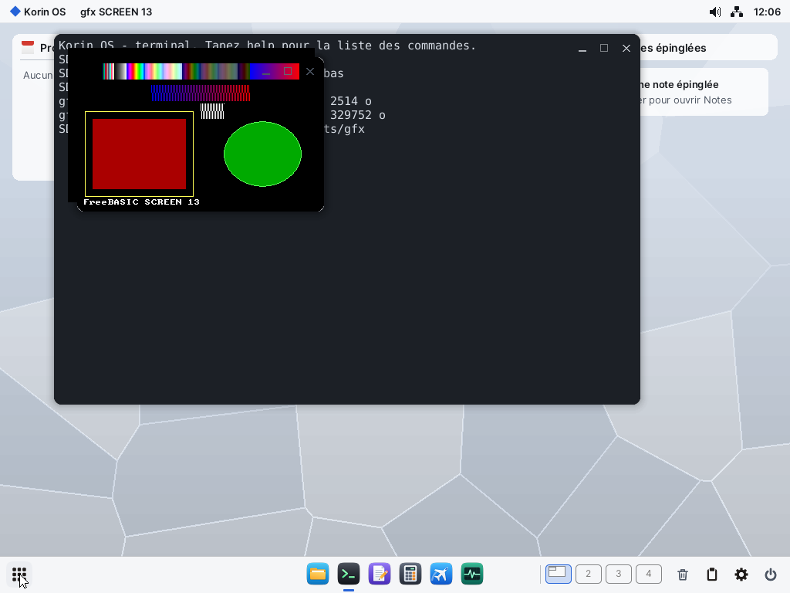

# GCC et G++ sous ARMPI

ARMPI compile du C et du C++ sur lui-même : **GCC 14.2** et **binutils 2.43**, dans `SD0:/gcc`,
vus des programmes comme `/gcc` (chemin virtuel : [FICHIERS.md](FICHIERS.md)). L'OS reste en
assembleur et dans le selfhost ; GCC est un programme ordinaire, **précompilé sur le PC, hors du
selfhost**, comme WebKit. Feuille de route : section 8 ter.

```sh
/gcc/bin/gcc hello.c -o /tmp/hello
/gcc/bin/g++ -std=gnu++20 -O2 hello.cpp -o /tmp/hello
```

Sans autre option : `crt0posix.o`, `libposix.a`, newlib et `libstdc++` sont liés d'office, et le
résultat est un ELF d'ARMPI, statique. Une fois compilé, un programme se lance par son chemin ou
se copie dans `SD0:/bin`.

**Bit d'exécution** (10/11/2026, [FICHIERS.md](FICHIERS.md)) : `/gcc/bin`, `/gcc/libexec` et
`/gcc/aarch64-onyx-elf/bin` sont dans `SD0:/etc/exec.txt` (le pilote trouve `cc1`, `as`, `ld` par
`access(X_OK)`). Le programme lié est rendu exécutable par l'éditeur de liens (`open(O_CREAT, 0777)`,
puis `chmod` de `bfd`) **si `ld` est lié à la libposix d'après le bit d'exécution** ; le paquet `gcc`
1.0.8 l'est à l'ancienne : `chmod +x` avant de lancer le résultat ailleurs que dans `SD0:/bin` (pibuild
installe dans `/bin`, `/apps/<nom>.app/main` ou `SD0:/sys` : rien à faire), jusqu'à ce que le paquet
soit refait par `tools/gcc/build.sh`.

## Ce qui marche (QEMU, 30/10/2026)

Compilés sous ARMPI, puis lancés : `test/hello.c`, `test/hello.cpp` (STL, héritage, lambda,
exception) et `test/posixtest-cxx.cpp` (C++20, threads, `filesystem`, `future`) : **82 réussis,
0 échec**. Premier chargement sous QEMU (carte émulée lente) : `cc1` 25 à 29 s, `cc1plus` 20 à
22 s ; `preload` les garde en mémoire.

## Sur le Pi (PocketTerm, Pi 4 de 8 Go, 30/10/2026)

Mesuré du PC, par telnet : `tools/gcc/pibench.py`. Les mêmes programmes compilés sur le Pi
tournent, et `posixtest-cxx` compilé sur place donne **82 réussis, 0 échec**. Une quarantaine
de lancements de `gcc` et `g++` à la suite sans incident ; mémoire libre stable (8,03 Go sur 8,24).

| Compilation | Outils lus sur la carte | Outils en mémoire (`preload`) |
|---|---|---|
| `gcc --version` | 0,19 s | 0,08 s |
| `hello.c` | 4,3 s | **2,1 s** |
| `hello.cpp`, `-E` (en-têtes) | 3,2 s | 1,5 s |
| `hello.cpp`, `-O0` | – | 8,5 s |
| `hello.cpp`, `-O2` | 11 s | **8,7 s** |
| `posixtest-cxx.cpp`, `-O2` (675 lignes) | – | **39 s** |

| Étape, outils en mémoire | Temps |
|---|---|
| `preload` de `cc1plus` (32,7 Mo) | 1,7 s, soit ≈ 19 Mo/s |
| `hello.c` : `-c`, puis lien | 0,3 s, puis 1,9 s |
| `hello.cpp` : `-c`, puis lien | 5,1 s, puis 3,4 s |
| `hello.cpp`, `-fsyntax-only` | 4,4 s |
| le même, déjà préprocessé (sans lire les en-têtes) | 3,3 s |

Ce que cela montre :

* **Le temps d'une compilation C++ vient de l'analyse du code**, pas de la carte : lire les
  en-têtes ne coûte que 1,1 s sur 4,4. Copier les en-têtes dans `RAM0:` gagnerait donc peu.
* **`-O2` coûte à peine plus que `-O0`** sur un petit fichier : ce sont les 2 Mo d'en-têtes de la
  STL qui pèsent. Le C reste très rapide (0,3 s).
* **L'édition de liens est le gain possible** : 1,9 à 3,4 s, à cause de `libc.a` et `libstdc++.a`
  et de `--gc-sections`. Sur un projet de plusieurs fichiers, elle ne se fait qu'une fois.
* **`preload`** gagne 2 à 3 s par compilation : à épingler dans `SD0:/etc/preload.txt` pour qui
  compile souvent.

`RAM0:` est le `/tmp` de GCC : il y écrit ses fichiers temporaires à chaque compilation. C'est ce
qui a demandé de refaire la mémoire de `ramfs` : ses fichiers ont désormais chacun leur région du
noyau, rendue à l'effacement, et le volume passe de 16 Mo à 1 Go (une limite : la mémoire ne sert
qu'à l'usage). Avant, `/tmp` se remplissait au bout de quelques compilations (« No space left on
device »).

## GNU make

**GNU make 4.4.1** (`/gcc/bin/make`, 412 Ko) lance ses commandes par `posix_spawn`, faute de
`fork`, et le `sh` d'ARMPI quand une ligne en a besoin ([SHELL.md](SHELL.md)). `tools/gcc/test/maketest.sh`,
sous QEMU, sur un petit projet C et C++ (`test/projet`) : 11 réussis, 0 échec, soit construction,
rien à refaire, un seul fichier recompilé, en-tête modifié, `clean`, `-C` et `-j`.

Sur le Pi (30/10/2026), `python -I tools/gcc/pitest.py` joue le même essai, le shell, les outils et
`posixtest`, et écrit tout dans `build/pitest.txt`. Dernier passage complet : shell 45 réussis,
outils 71, `make` 11 sur `RAM0:` (72 s) et 11 sur la carte (97 s), `posixtest` 14, 27, 28 et 29, sans
échec ; `make -j2` : 35 tours sans échec au total. Une coupure du réseau a eu lieu une fois, au
premier passage, pendant `posixtest proc` : environ deux minutes sans telnet ni ARP, le Pi n'ayant
pas redémarré, puis retour tout seul. Elle n'est pas revenue en huit lancements de `posixtest proc`,
et sa cause n'est pas trouvée.

`-j2` lance vraiment deux commandes à la fois : `test/projet/par.mk` ne réussit que si c'est le
cas, et échoue sans `-j`. Deux points ont dû être réglés pour lui :

* `make` dort dans `pselect` et attend `SIGCHLD`. `libposix` l'émule pendant ces attentes
  ([POSIX.md](POSIX.md)).
* Un pid mort était repris par le lancement suivant, avant que `make` n'ait relevé le fils : deux
  fils au même numéro, puis « wait: No children » (1 tour sur 25). `proc_register` donne désormais
  les pid en tournant, et un pid ne revient qu'après un tour de la table (64) : 125 tours de suite
  sans échec, pid revenus à 1 compris. La cause de fond reste : le noyau ne garde pas un pid
  réservé jusqu'au `wait`.

La file nommée du jobserver n'existe pas (`mkfifo` → `ENOSYS`) : `make` le dit à chaque `-j`, puis
se replie sur un tube.

## FreeBASIC

**FreeBASIC 1.10.1** s'installe dans `/gcc`, à côté de GCC : `fbc` traduit le BASIC en C (`-gen gcc`, le
défaut), que le GCC d'ARMPI compile ; `as` et `gcc` font le reste. Cible : `armpi-aarch64`.

```sh
/gcc/bin/fbc hello.bas -x /tmp/hello
/gcc/bin/fbc -O 2 gfx.bas -x /tmp/gfx
```

Sans `-x`, `fbc` écrit l'exécutable à côté du source. Le résultat est un ELF statique d'ARMPI, comme avec `gcc`.

| Dans `/gcc` | Quoi |
|---|---|
| `bin/fbc` | le compilateur, 1,8 Mo |
| `lib/freebasic/armpi-aarch64/` | `fbrt0.o`, `libfb`, `libfbmt`, `libfbgfx`, `libfbgfxmt` |
| `include/freebasic/` | `fbgfx.bi`, `file.bi`, `dir.bi`, `crt/`... (les `.bi` de premier niveau et `crt/`, sans les liaisons rangées en sous-dossiers : GTK, X11, Windows) |
| `include/freebasic/kits/` | les kits : `uikit.bi`, `netkit.bi`, `audiokit.bi`, `gpukit.bi`, `mediakit.bi`, `archivekit.bi`, `documentkit.bi` |
| `test/basic/` | les essais |

### Les kits depuis BASIC

`tools/gcc/kits.sh` génère un `.bi` par kit depuis son `.abi` (`tools/kits/abi2bi.py`), à côté de ses relais
`/gcc/lib/lib<kit>.a`. Chaque `.bi` porte un `#inclib` : il suffit de l'inclure, et l'édition de liens prend le `.a`.

```basic
#include once "kits/uikit.bi"
dim shared ui as ui_vars
if( uikit_open( @ui ) = 0 ) then end 1
ui_window( 420, 200, kit_str( "Titre" ) )
ui_fill( 0, 0, ui.w, ui.h, &hF0F2F5 ) : ui_update_all( )
while( ui_event( 100 ) <> WEV_CLOSE )
wend
```

Comme en C, tout argument est un entier de 64 bits : `kit_str( s )` passe une chaîne, `kit_ptr( p )` un pointeur.
Quand un commentaire du `.abi` renvoie à une autre fonction (« comme », « idem »), le nombre d'arguments ne se lit
pas : la déclaration en prend huit, facultatifs. `tools/kits/bi/uikit.bi` ajoute à la main les variables de
l'interface (`ui_vars`) ; les aides `kit_str` et `kit_ptr` y sont aussi. Un kit ajouté à `kits.sh` a son `.bi` sans
rien de plus. FreeBASIC ne distingue pas les majuscules : une constante du même nom qu'une fonction du kit n'est pas
écrite, et le script le dit. Essai : `test/basic/kitui.bas`. Les `.bi` d'AudioKit, GPUKit et MediaKit compilent ; leurs
fonctions n'ont pas été appelées.

### Ce qui marche (QEMU, 31/10/2026)

Sous ARMPI, `fbc` compile puis lance :

* `test/basic/hello.bas` ;
* `test/basic/filethread.bas` : **18 réussis, 0 échec** (fichiers texte et binaires, `dir`, `name`, `kill`, dossiers,
  4 threads et mutex, `condwait`, `exec`, `shell`, dates, nombres, `wstring`) ;
* `test/basic/gfx.bas` en `SCREEN 13` et en 640x480 32 bits : `LINE`, `PSET`, `CIRCLE`, `PAINT`, `PALETTE`,
  `DRAW STRING`, `PRINT`, `GETMOUSE`, `INKEY`, `MULTIKEY`, Échap, case de fermeture. Changer de mode en cours de
  programme (`SCREEN 13`, `SCREENRES` 32 bits, `SCREEN 0`, `SCREEN 13`) marche aussi ;
* `test/basic/kitui.bas` : UIKit et NetKit appelés directement.



Temps sous QEMU, carte émulée : `hello.bas` 42 s, `gfx.bas` 58 s, `gfx.bas -O 2` 73 s.

Sur le vrai Pi (31/10/2026), les mêmes essais compilés sur place et lancés : `filethread` **18 réussis, 0 échec** ;
`gfx` en `SCREEN 13` et en 640x480 32 bits, avec capture VNC ; `kitui`. Compiler et lier : `hello.bas` 3,3 s, `gfx.bas`
4,0 s, `gfx.bas -O 2` 4,2 s, `filethread.bas -mt` 3,8 s. Souris, touches et case de fermeture ont été envoyées par
VNC, pas par le vrai clavier. Le système du Pi datait d'avant `tcgetpgrp` et `__posix_exe_path` : ces deux fonctions
étaient fournies à part dans un `.o` d'essai, le reste par sa libposix. La libposix de cette branche n'a donc pas
tourné sur le Pi ; il faut l'installer avec `fbc`.

Pas essayé : les modes à deux lignes par point (`SCREEN 1`, 2, 7, 9, 11, 12), les modes 15, 16 et 24 bits, un mode
plus grand que l'écran (le pilote copie alors une image coupée), le tactile, le clavier et la souris physiques.

### Le pilote graphique

`gfxlib2` est intacte ; seul le pilote est neuf, de type fbdev (`tools/gcc/fbc/gfxlib2/armpi`) :

* `gfx_driver_uikit.c` : le pilote. Un thread copie les lignes modifiées du tampon de FreeBASIC dans une fenêtre
  d'UIKit, comme le pilote X11, puis appelle `ui_update`.
* `gfx_uikit.c` : le seul fichier qui voie UIKit (`uikit.h` et `fb.h` définissent tous deux `KEY_*`).
* Les modes à palette sont convertis à la copie (`fb_hGetBlitter`) : la fenêtre reste en `0x00RRGGBB`, et un
  changement de palette redessine tout.
* Le cadre et la barre de titre sont ceux d'Elegant, donc du thème du bureau.
* Les codes HID deviennent des codes de touche FreeBASIC (`MULTIKEY`) ; le caractère vient d'ARMPI, donc de la
  disposition du clavier. Les modificateurs sont déduits de `EV_MODS`.

Limites : `SETMOUSE` est sans effet (UIKit ne déplace ni ne cache le pointeur), pas de double-clic dans
`SCREENEVENT`, pas d'OpenGL, pas de plein écran.

### La console

Le terminal d'ARMPI ne connaît pas les séquences d'échappement : `rtlib` y voit une console sans terminal. `PRINT`
et `INPUT` passent par `stdout` et `stdin` ; `CLS`, `LOCATE` et `COLOR` sont sans effet en mode texte, et `INKEY` ne
sert qu'en mode graphique.

### Construire

Dans WSL, après `tools/gcc/build.sh` et `tools/gcc/kits.sh` :

```sh
sh tools/gcc/fbc.sh
```

Les sources officielles sont dans `src/extra/FreeBASIC-1.10.1`, hors du dépôt, reprises du paquet officiel si elles
manquent. Le script fait un `fbc` pour le PC depuis le C du paquet, recompile avec lui le compilateur modifié, puis
traduit ce compilateur en C pour ARMPI, compilé par la chaîne d'Onyx. Ce qui change est dans `tools/gcc/fbc/` :
`armpi.patch` (compilateur, makefile, en-têtes), `rtlib/armpi`, `gfxlib2/armpi`, `inc/crt/armpi`.

| Point | Choix |
|---|---|
| Lien | par `gcc`, pas `ld` : ses specs donnent `crt0posix.o`, `libposix` et `posix.ld` |
| `as` | `fbc` le prend dans `/gcc/aarch64-onyx-elf/bin` : `/gcc/bin` n'a que les pilotes |
| `.fbctinf` | désactivé (pas de `fbextra.x` avec `posix.ld`) : `#inclib` d'une bibliothèque `.a` faite par `fbc` est à répéter dans le programme |
| `fork` | absent : `EXEC` passe par `posix_spawnp` |
| `SHELL` | `system` de libposix coupe aux espaces, sans `sh` ni guillemets |
| `/proc` | absent : `EXEPATH` par `__posix_exe_path` de libposix |
| `ThreadCall` | absent : il lui faudrait libffi |
| Volumes | `VOL:/...` compte pour un chemin absolu, comme `/...` : le dossier courant s'écrit ainsi |

## pibuild : construire un programme sous ARMPI

```sh
pibuild [app|bin|sys|svc|lib] dossier nom
```

| Type | Installé dans |
|---|---|
| `app` (sans type aussi) | `/apps/nom.app/main`, avec `app.txt` et les fichiers de `data/` |
| `bin` | `/bin/nom` |
| `sys` | `SD0:/sys/nom` |
| `svc` | `SD0:/sys/svc/nom` |
| `lib` | `/dotnet/nom.dll`, sa référence dans `/dotnet/ref/user/` (C# seulement) |

Un type inconnu est refusé par `pibuild.mk`. Un programme de `SD0:/sys` lancé depuis un shell passe par `init2`, avec les
droits de `SD0:/sys` : sa sortie va au journal, pas au terminal. Seules les apps reçoivent `app.txt` et `data/`.

`pibuild` regarde le dossier et son nom (`xx`), pas le nom de l'application : `xx.asm` est assemblé par `fasmarm` ; sinon
`main.cpp`, `main.c`, `xx.cpp` ou `xx.c` doit exister, et tous les `.c` et `.cpp` du dossier et de ses sous-dossiers sont
compilés et liés. Les objets vont
dans `/tmp/pibuild/nom` : seul ce qui a changé est refait, en-têtes compris, tant que `RAM0:` n'est pas vidé.

`main.bas` ou `xx.bas` : tous les `.bas` du dossier et de ses sous-dossiers sont compilés par `fbc -O 2`, `main.bas` ou
`xx.bas` en module principal, et liés. Une seule commande pour tous : `fbc` ne garde les `#inclib`, donc les kits et
`fbgfx`, que d'une passe à l'autre. Un `.bas` ou un `.bi` changé refait donc tout le programme. Rien n'est écrit à côté
des sources. Essai : `test/basic/pibasic`.

Un dossier avec un `.csproj` passe par `csbuild` : c'est le projet qui décide ([DOTNET.md](DOTNET.md), « Projets .csproj »). Sinon, un dossier avec des `.cs` est compilé par Roslyn de `/dotnet` ([DOTNET.md](DOTNET.md)), en une DLL installée comme
un programme (`/apps/nom.app/main`, `/bin/nom`) ; ses `.ui` sont compilés avec lui (`uigen`) et ne sont pas installés. Pour une app, chaque dossier `lib/nom` devient une
bibliothèque `nom.dll`, installée à côté de lui ; `lib/nom/refs.txt` donne les noms des bibliothèques de `lib/` dont elle
dépend, et seul ce qui a changé est recompilé. Pour les autres types, `lib/` est compilé dans le programme : un seul
fichier. Essai : `tools/dotnet/libdemo`.

`pibuild` (`src/bin/pibuild`, en assembleur) ne fait que lancer `make -j4` dans le dossier avec le Makefile générique
`/gcc/share/pibuild.mk` (`tools/gcc/pibuild.mk`) : c'est là que tout se décide. La fenêtre **PiBuild** (`src/apps/builder`)
lance la commande et montre sa sortie ; elle a une liste du type, devinée du dossier (`.../bin/nom`, `.../sys/nom`, `.../svc/nom`, sinon `app`).

Les kits depuis le C : `tools/gcc/kits.sh` met dans `/gcc/lib/lib<kit>.a` des relais générés depuis les `.abi`, et leurs
en-têtes dans `/gcc/include/kits`. `pibuild` donne `-I/gcc/include -I/gcc/include/kits` et tous les `.a` de `/gcc/lib` : `ld`
n'en prend que ce que le programme appelle.

Essai (QEMU, 30/10/2026) : un programme C en deux fichiers, `calculator` en assembleur (2 s), et **Koton entier** (12
fichiers C++, 20 minutes sous QEMU), qui tourne ensuite. Un second `pibuild` ne recompile rien. Sur le Pi : **Koton
construit en 2 minutes** depuis la fenêtre PiBuild, et il tourne (l'essai final du chantier). Sans `preload` de `cc1plus`, `as` et `g++`, chaque fichier relit les outils sur la carte.

Essai du BASIC (QEMU, 31/10/2026) : `pibasic` (deux modules, un sous-dossier, UIKit, un thread) en `bin`, `gfx.bas` en
`app` et lancé, second passage sans recompilation, `.bi` modifié recompilé. Pas essayé sur le Pi.

Essai des types (QEMU, 31/10/2026) : assembleur (`calculator`, `true`, `netd`, `menubar`) et C, pour chacun des quatre types,
sans type, type inconnu, second passage sans recompilation. Pas essayé sur le Pi.

Pas encore : un fichier de réglages à la racine du dossier (options, bibliothèques). `make` dit « jobserver mkfifo » à
chaque lancement : c'est sans effet (voir plus haut).

## Construire la chaîne

Dans WSL, depuis la racine du dépôt, avec la chaîne d'Onyx (`/opt/toolchains/aarch64-onyx-elf-14.2`) :

```sh
sh tools/posix/build.sh
sh tools/gcc/build.sh
sh tools/gcc/make.sh
sh tools/gcc/kits.sh
sh tools/gcc/fbc.sh
```

`tools/gcc/build.sh` reprend où il en était (`~/.cache/armpi-gcc/stamps`). `RELINK=1` refait les
liens après un changement de libposix. Résultat : `build/gcc/sdroot/gcc`, 127 Mo, que `build.ps1`
met sur la carte. `STAGES=posix` ne refait que libposix, ses en-têtes et les specs de `/gcc` (12/11/2026,
avec `dlmod.o`, `dlhost.ld` et `dlhost-cxx.ld` de [POSIX.md](POSIX.md) « dlopen » ; et `libgcc_mod.a`, la libgcc des
modules sans le dérouleur, depuis le 12/11/2026 : oubliée à l'étape 4 de Rust, son absence empêchait `gcc -shared` de
relier un module sur la carte, `ld: cannot find -lgcc_mod`) : sur la carte, `gcc -fPIC
-shared` fait un module et `gcc -rdynamic` un hôte de `dlopen`. Essai : un module Python en C compilé sur la carte
par pip ([PYTHON-PORT.md](PYTHON-PORT.md) « Étape 3 »).

C'est une compilation croisée « canadienne » : construits sur le PC, les outils tournent sur ARMPI
et produisent de l'AArch64. Seuls les outils sont refaits : en-têtes, newlib, libstdc++ et libgcc
viennent tels quels de la chaîne d'Onyx (même version de GCC, même cible).

| Dans `/gcc` | Quoi |
|---|---|
| `bin/` | `gcc`, `g++`, `cpp`, `ar`, `ranlib`, `nm`, `objcopy`, `objdump`, `readelf`, `size`, `strip`, `make`, `fbc` |
| `libexec/gcc/aarch64-onyx-elf/14.2.0/` | `cc1` (30,6 Mo), `cc1plus` (32,7 Mo), `collect2` |
| `aarch64-onyx-elf/bin/` | `as`, `ld` |
| `aarch64-onyx-elf/include`, `lib` | newlib, libstdc++ |
| `aarch64-onyx-elf/armpi/` | libposix : `crt0posix.o`, `libposix.a`, `posix.ld`, ses en-têtes |
| `include/c++/` | en-têtes de libstdc++ |
| `lib/gcc/aarch64-onyx-elf/14.2.0/specs` | les options d'ARMPI, fondues dans celles de GCC (`tools/gcc/mkspecs.awk`) |
| `test/` | sources d'essai |

## Ce qu'il a fallu adapter

| Point | Choix |
|---|---|
| Lancement des outils | pas de `fork` : `posix_spawn` (`libiberty/pex-unix.c`) ; `configure` le sait par `ac_cv_func_*` |
| Lignes de commande | `collect2` dépasse 1 024 octets : `argv` et environnement par objet partagé ([POSIX.md](POSIX.md)) |
| Pile | `cc1plus` est très récursif : 64 Mo pour tous les programmes, à la demande |
| Séparateur `:` | `GCC` coupe `COMPILER_PATH` aux `:` : chemins sans volume (`/gcc`) |
| `O_BINARY` | sans effet sous ARMPI (`binary-io.h`, comme BeOS) |
| Modules C++20 | lecture et écriture ordinaires (`cp/module.cc`) : pas de `MAP_SHARED` en écriture |
| `-mcpu=native` | désactivé (`aarch64.h`) : il lit `/proc/cpuinfo` de Linux |
| Hors de la chaîne | LTO, greffons (pas de `dlopen`), `gcov-tool` (pas de `ftw`) |

Les corrections de sources sont faites par `sed` dans `tools/gcc/build.sh`, à chaque lancement.
