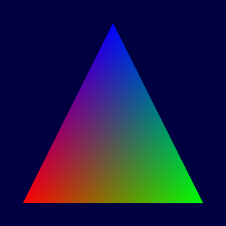
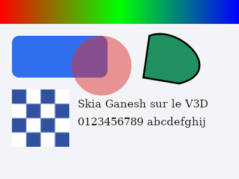
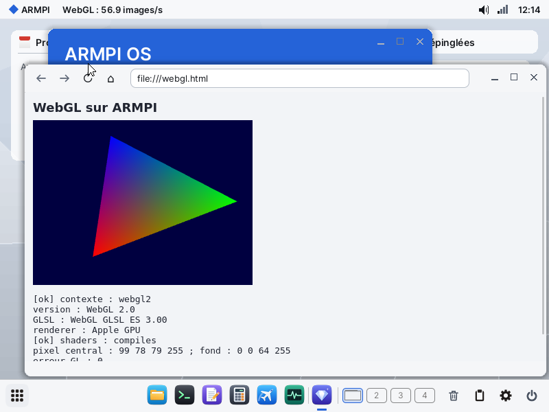
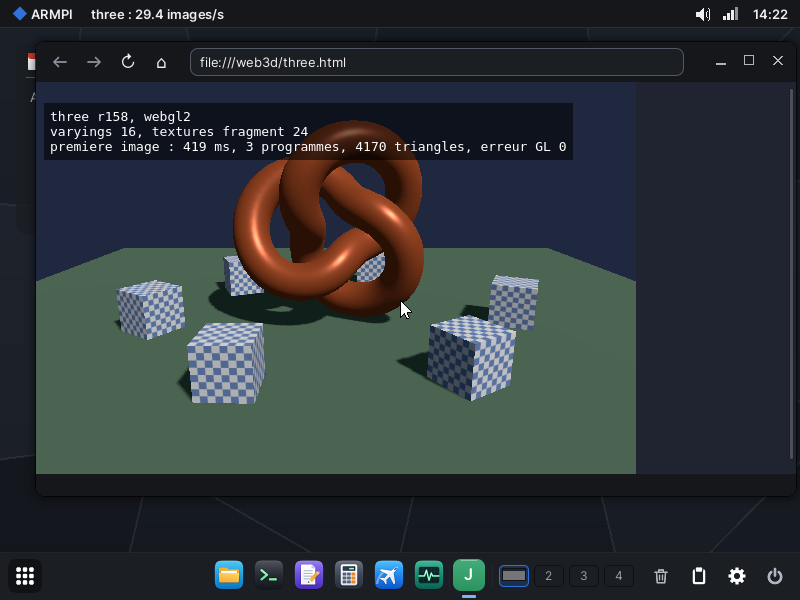

# Mesa sur ARMPI : OpenGL ES sur le GPU

Essai du 2 novembre 2026. But : donner à Skia l'accélération du V3D par Mesa et son compilateur NIR vers QPU (voie B). Test final annoncé par l'utilisateur : WebKit reconstruit, avec WebGL sur le GPU.

## Conclusion

**WebGL 2 tourne dans le navigateur, sur le vrai GPU** (étape 6) : 59 images/s sur une scène three.js avec PBR et ombres, sans que la toile passe par le processeur. Mesa 26.2 tourne dans ARMPI et il faut continuer. Le pilote `v3d` de Gallium se construit presque tel quel : cinq fichiers de Mesa touchés, une vingtaine de lignes. Sous QEMU, un programme statique ouvre un contexte OpenGL ES 3.0, compile du GLSL ES dans l'OS et bâtit de vraies listes de commandes. Le code QPU obtenu, exécuté par le simulateur d'Onyx, rend les valeurs attendues.

**Le triangle est sorti du vrai GPU du Pi, juste au pixel près**, et sans MMU GPU : 20 808 pixels à moins de 0,56 niveau du calcul, 189 images/s avec relecture. **Skia Ganesh tourne sur ce GPU** : 0,66 ms par image contre 1,48 ms sur le processeur, et 31 pixels sur 120 000 à plus de 32 niveaux du rendu du processeur. Rendu directement dans une surface d'Elegant, sur une scène de 400 × 300, une image affichée coûte 3,29 ms par le GPU contre 4,56 ms par le processeur.



| Étape | État |
|---|---|
| 1. Choix fondé sur le code | fait : `v3d` Gallium, OpenGL ES 3.0, sans MMU GPU |
| 2. Compilateur sans GPU | **prouvée** sous QEMU et au simulateur |
| 3. Winsys, triangle | **prouvée sur le Pi**, image comparée au calcul |
| 4. Skia Ganesh | **prouvée sur le Pi**, pixels comparés au rendu du processeur |
| 5. Rendu direct dans Elegant | **prouvé sur le Pi** |
| 6. WebGL dans WebKit | **prouvé sur le Pi** |

## 1. Le choix

### Version

**Mesa 26.2.0**, dernière version `.0` au 2 novembre 2026. `v3d_get_device_info` y accepte toujours V3D 4.2. OSMesa a disparu en 25.1, mais remplacer ce frontal ne demande qu'environ 200 lignes (`tools/mesa/armgl/armgl.c`).

### `v3d` (OpenGL ES) plutôt que `v3dv` (Vulkan)

| Question | `v3d` Gallium | `v3dv` Vulkan |
|---|---|---|
| Ce que le pilote exige du noyau | `CREATE_BO`, `MMAP_BO`, `GET_PARAM`, `SUBMIT_CL`, `WAIT_BO`, `GEM_CLOSE` ; TFU, CSD, perfmon, multisync et file CPU sont **facultatifs** (`v3d_screen.c`) | `device_has_expected_features` **refuse le GPU** sans TFU, CSD, cache flush, multisync et file CPU |
| Synchronisation | un syncobj vrai à tout instant suffit | `vk_sync` sur `drm_syncobj`, import et export de sync files |
| Skia m119 | Ganesh GL ; `GrGLMakeNativeInterface_none` plus interface assemblée, sans EGL ; `"OpenGL ES %d.%d Mesa %d.%d"` reconnu comme Mesa par `GrGLUtil.cpp` | Ganesh Vulkan possible ; `third_party/externals` est vide, Vulkan-Headers et l'allocateur seraient à ajouter |
| WebKit | WebGL passe par ANGLE ; voir plus bas | idem, autre backend d'ANGLE |
| Code propre au pilote (objets, avant élagage) | environ 6,5 Mo : `libmesa` 3,6, GLSL 1,2, Gallium 0,9, vtn 0,4, `v3d` 0,2 | environ 2 Mo, hors 5 fichiers de WSI qui ne compilent pas (KMS) |
| Commun aux deux | NIR 9,3 Mo, util 3,8 Mo, compilateur Broadcom 0,2 Mo | |

`v3dv` est plus léger d'environ 4 Mo, mais il demanderait d'écrire TFU, CSD, multisync et file CPU avant le premier triangle. **Décision : `v3d`.** Vulkan reste ouvert plus tard : le compilateur et le winsys sont communs.

### Ce qui dépend de Linux, et ce qui le remplace

Mesa ne parle à Linux que par `drmIoctl`, `drmSyncobj*`, un `mmap`, et quelques détections d'OS. Le faux `libdrm` de `tools/mesa/libdrm` **est** le winsys : aucun autre fichier du pilote n'a à changer.

| Linux | ARMPI |
|---|---|
| GEM : `CREATE_BO`, `GEM_CLOSE` | tranches de tampons partagés de 32 Mo (`BUF_LOW`), un allocateur par premier ajustement, car il n'y a que 128 tampons dans tout le système ; plus petits si la mémoire basse est morcelée |
| `bo->offset`, adresse dans la MMU du GPU | adresse physique |
| `mmap` d'un BO, write-combine | `armpi_v3d_bo_map` ; **`BUF_NOCACHE`** nouveau dans le noyau : même sémantique que Linux, sans maintenance du cache |
| `SUBMIT_CL` | **`V3D_OP_SUBMIT`** nouveau : le service rend la main quand le GPU a fini |
| `drm_syncobj`, sync files | tout job est fini au retour : tout est signalé |
| `GET_PARAM` | registres d'identité ajoutés à `V3D_OP_INFO` |
| TFU, CSD | refusés : Mesa passe par le rendu (`glGenerateMipmap` essayé à blanc), et se limite à ES 3.0 |
| `dlopen` | rien : tout est relié en statique |
| threads | C11 sur les pthreads de libposix ; `glthread` non utilisé |
| `__linux__` | `DETECT_OS_ARMPI` dans `detect_os.h` |

### L'absence de MMU GPU

C'était le risque principal. **Elle ne bloque pas : le Pi l'a confirmé** pour le binning, le rendu, les textures et 600 images d'affilée.

* Dans Mesa, `bo->offset` n'est qu'un `uint32_t` écrit dans les listes. Le pilote ne sait rien de la table de pages. Le commentaire « Address of the BO in our page tables » est tout ce qui la concerne.
* Onyx a prouvé sur le matériel que binner, rendu et textures marchent en adresses physiques.
* **Pas essayés sans MMU sur le matériel, ni par Onyx ni ici : TFU et CSD.** ES 3.0 s'en passe.
* Ce qu'on perd sans MMU : un shader fautif peut écrire partout dans le premier Go et planter la machine au lieu de provoquer une faute. La mémoire du GPU reste aussi limitée à ce qui est contigu dans ce premier Go.

**Activer la MMU V3D : pas maintenant.** Elle apporterait la mémoire au-delà de 1 Go et l'isolement, mais il faudrait une table de pages, identité sur le premier Go pour que GpuKit reste valable, et des registres qu'aucun code d'ARMPI ou d'Onyx n'a jamais écrits, sans moyen d'essai hors du Pi. À reconsidérer si la mémoire basse manque pour de vrai.

## 2. Le compilateur, sans GPU : prouvé

```text
gltest : armgl_init 2 (a blanc) 11 ms
gltest : Broadcom / V3D 4.2.14.0 / OpenGL ES 3.0 Mesa 26.2.0 (git-9f0a761020) / OpenGL ES GLSL ES 3.00
gltest : shaders GLSL ES compiles et lies en 377 ms
gltest : dessin 97 ms, jobs soumis : 1, glGetError 0
gltest : programme texture, jobs 3, glGetError 0
gltest : tampons non caches a 2018000
gltest : a blanc : Mesa va au bout. PASS
```

| Essai | Résultat |
|---|---|
| Construction croisée | 952 objets de Mesa avec `aarch64-onyx-elf` 14.2 et libposix, 0 échec |
| `gltest` sans GPU, QEMU | `armgl_init 0`, message, code 0 : **repli propre** |
| `gltest --dry` | contexte, GLSL ES, édition de liens, dessin, job construit, `glGetError` 0 |
| `gltest --buf` | la même chose sur de vrais tampons non cachés sous 1 Go |
| `gltri --dry --frames 5` | fenêtre et surface d'Elegant, 5 images, 5 jobs |
| Code QPU produit dans ARMPI, exécuté par `qpusim` d'Onyx | **1 200 valeurs, 0 écart** avec un calcul indépendant, sans Mesa |
| Le banc sait échouer | teinte faussée : 60 écarts ; instruction faussée : 60 écarts |
| Non-régression | `gputest` PASS, `posixtest ipc` 28 sur 28 avec le nouveau noyau |

Le banc `qpucheck` couvre le triangle (fragment et sommet) et un fragment à la manière de Skia : texture 2 × 2, `length`, `smoothstep`, teinte en uniform. Mesa y emploie `rsqrt`, `recip`, deux `thrsw` et `ldtmu` en demi-flottants. Détail qui montre un vrai compilateur : `gain` du premier fragment a été remonté dans le vertex shader.

**Limites de cette preuve.** `qpusim` est un simulateur fonctionnel écrit pour Onyx : il ne modélise ni le temps, ni les branchements, ni les vrais threads. Les temps sont ceux de QEMU, et ne disent rien du Pi. Les listes de commandes ont été lues mais pas décodées paquet par paquet : le décodeur de Mesa demande `expat`, désactivé ici.

## 3. Le winsys : prouvé sur le Pi

Dans `tools/mesa` : `libdrm/armpi_drm.c` (le winsys), `armgl/armgl.c` (le frontal), `armgl/gltest.c`, `armgl/gltri.c`. Dans l'OS : `BUF_NOCACHE` (`src/kernel/ws.asm`), `V3D_OP_SUBMIT` et l'identité dans `V3D_OP_INFO` (`src/svc/v3d/v3d.asm`, `src/inc/v3d.inc`).

`V3D_OP_SUBMIT` reprend le chemin de `V3D_OP_RUN` en adresses physiques : Mesa chaîne son BCL sur plusieurs BO, la fin peut donc précéder le début.

### Résultat sur le Pi (2 novembre 2026)

```text
gputest : PASS (GPU, comme avant)
gltest : armgl_init 1 (GPU) 0 ms
gltest : Broadcom / V3D 4.2.14.0 / OpenGL ES 3.0 Mesa 26.2.0 (git-9f0a761020) / OpenGL ES GLSL ES 3.00
gltest : shaders GLSL ES compiles et lies en 14 ms
gltest : dessin 2 ms, jobs soumis : 1, glGetError 0
gltri : 173.2 images/s
gltri : 600 images, 600 jobs. fin
```

| Point | Résultat |
|---|---|
| Identité du GPU, lue par le service | V3D 4.2.14.0, comme les valeurs du mode à blanc |
| Fond, dégradé de Gouraud, image entière | 20 808 pixels du triangle à 0,56 niveau au plus, aucun pixel faux autour, contre un calcul sans Mesa |
| Texture 2 × 2, teinte, disque, mipmaps par le rendu | les trois pixels mesurés exacts à l'octet |
| Tenue | 600 images, 600 jobs, aucun blocage |
| Écran | `gltri` : le triangle tourne dans sa fenêtre, vu par l'utilisateur |
| `gputest` | toujours PASS par le GPU avec le nouveau noyau |

`gltest` a pourtant affiché 7 FAIL : **l'erreur était dans mon essai, pas dans le GPU.** Mesa range le tampon d'une fenêtre ligne du haut d'abord, et `armgl_read` le retournait encore. Les 8 valeurs relevées sont prédites à l'octet si l'image est retournée. Corrigé et réessayé : `gltest` rend `0 ecart(s) : PASS`.

Second passage : `gltri` à 188,7 images/s, 400 × 400, soit 5,3 ms pour un seul triangle. La cause, surtout une boucle d'`armgl_read`, est à l'étape 5.

### Mode d'emploi pour le Pi

`python -I tools/mesa/pi-package.py` dépose les cinq fichiers dans `build/mesa/pi/`. Sauvegarder d'abord `kernel8.img` et `sys/svc/v3d`, puis copier sur la carte. **Fait le 2 novembre 2026 sur E:**, anciens fichiers dans `E:/mesa-avant` : pour revenir en arrière, les remettre à leur place (`v3d` dans `sys/svc`).

Le noyau d'une carte est assemblé pour son écran, pas celui de `build/`, qui vise 1024 × 768 : `pi-package.py` prend 800 × 600, le PocketTerm. Vérifié : `main` assemblé ainsi redonne octet pour octet le noyau qui était sur la carte, et `main` avec les changements de cette branche donne le noyau ci-dessous.

| CRC-32 | Octets | Fichier |
|---|---|---|
| `F6E01B2A` | 76 744 | `kernel8.img`, assemblé pour 800 × 600 |
| `03A31FF1` | 4 216 | `sys/svc/v3d` |
| `359C58A6` | 15 797 368 | `bin/gltest` |
| `53B906BF` | 15 797 368 | `bin/gltri` |
| `44887D57` | 21 164 160 | `bin/skgltest` |

Les `.mod` ne changent pas. Par FTP, vérifier chaque CRC avant de redémarrer : le Wi-Fi peut corrompre un fichier. Sans MMU, une liste fausse peut figer la machine : ne rien laisser d'important ouvert.

Ensuite, dans le terminal :

```sh
gputest
gltest
gltri --frames 600
skgltest
```

| Attendu | Si ce n'est pas le cas |
|---|---|
| `gputest : PASS`, par le GPU | le noyau ou le service ne vont plus : remettre les fichiers sauvegardés, envoyer la sortie |
| `gltest : armgl_init 1 (GPU)` | `0` : le service n'est pas le nouveau, ou le GPU est éteint |
| `V3D 4.2.14.0` ou proche, `OpenGL ES 3.0` | révision différente : à noter, pas forcément grave |
| cinq lignes PASS : fond, trois sommets, centre | une seule fausse : relever sa ligne, elle dit ce qui ne va pas |
| trois lignes PASS `texture :` | couleurs fausses : le rangement UIF, donc `UIFCFG` |
| `gltest : 0 ecart(s) : PASS` | |
| `gltri` : triangle tournant, images/s dans le terminal | fenêtre noire alors que `gltest` passe : la surface |
| `skgltest : PASS`, peu de pixels à plus de 32 niveaux | `FAIL` : regarder `SD0:/skgltest.ppm` |
| `par image : GPU ... ms, processeur ... ms` | à noter |

Si `gltest` bloque environ 0,5 s puis échoue, le service a coupé le GPU et affiche l'état des CLE (`bin/journal` écrit `SD0:/journal.txt`). Redémarrer, puis lancer `gltest --debug cl` et relever ce que le terminal affiche. `SD0:/gltest.ppm` contient l'image du triangle.

## 4. Skia Ganesh : prouvée sur le Pi

`tools/mesa/build-skia.sh` est une variante de celle d'Avalonia : même source, seulement lue, sortie dans `~/armpi-mesa/out/skia`, `tools/avalonia/` inchangé. `skia_enable_ganesh=true skia_use_gl=true skia_gl_standard="gles"`, 886 objets, 0 échec.

`skgltest` (21 151 872 octets, Skia et Mesa reliés en statique) passe par `GrGLMakeAssembledInterface` sur `armgl_proc`, puis `GrDirectContexts::MakeGL`. Il dessine la même scène sur le processeur et par Ganesh : dégradé, rectangle arrondi, cercle transparent, courbes remplie et tracée, image filtrée, texte.

```text
skgltest : armgl_init 2
skgltest : GrDirectContext pret en 270 ms, cible maxi 4096, texture maxi 4096
skgltest : police chargee
skgltest : premiere image par Ganesh 2178 ms (shaders compris), 1 jobs
skgltest : a blanc : Skia et Mesa vont au bout. PASS
```

| Essai sous QEMU | Résultat |
|---|---|
| `skgltest` sans GPU | `armgl_init 0`, repli, code 0 |
| `skgltest --dry` | `GrDirectContext` ouvert, scène complète, job construit |

Sur le Pi, la même scène de 400 × 300 :

```text
skgltest : armgl_init 1
skgltest : GrDirectContext pret en 18 ms, cible maxi 4096, texture maxi 4096
skgltest : police chargee
skgltest : premiere image par Ganesh 66 ms (shaders compris), 1 jobs
skgltest : 306 pixels sur 120000 a plus de 8 niveaux du processeur, 31 a plus de 32
skgltest : par image : GPU 0.66 ms, processeur 1.48 ms
skgltest : PASS
```

| Mesure sur le Pi | Résultat |
|---|---|
| Contexte Ganesh | 18 ms |
| Première image, tous les shaders de Skia compilés par Mesa dans l'OS | 66 ms |
| Écart au rendu du processeur | 306 pixels à plus de 8 niveaux, 31 à plus de 32, sur 120 000 |
| Temps par image, sur 200 images | GPU 0,66 ms, processeur 1,48 ms |

L'image que Ganesh a rendue sur le GPU du Pi, relue sur la carte : dégradé, arrondi, transparence, courbe remplie et tracée, image filtrée, texte. La police est un serif parce que l'essai ne choisit pas DejaVu Sans, comme Avalonia le fait.



**Ce que ces chiffres ne disent pas.**

* Le 0,66 ms s'arrête dans la mémoire du GPU : l'image affichée est mesurée à l'étape 5.
* La scène est petite et Ganesh met ses images en cache. Un écran plein et une scène chargée restent à mesurer.

Poids de Ganesh : `libskia` passe de 2,5 à 4,4 Mo de texte. Pour Avalonia, il restera à brancher les 8 fonctions GPU de `SkiaSharp.dll`, qui rendent 0 aujourd'hui dans `gen-table.py`, et à écrire le côté `GlSkiaGpu` : deux changements dans `tools/avalonia`, donc à coordonner.

## 5. Zéro copie : prouvé sur le Pi

Le GPU rend directement dans une surface d'Elegant, `armgl_read` n'intervient plus. **Rien n'a changé dans Elegant, le noyau ou le service `v3d`** : seuls `armgl` et le winsys bougent.

| Question | Réponse |
|---|---|
| Image à moitié faite (Elegant compose à tout moment) | deux images dans un tampon partagé ; `req_surface_attach` accepte déjà de rattacher le même tampon avec un autre décalage |
| Cible du GPU | l'image est importée par `resource_from_handle` (`DRM_FORMAT_MOD_LINEAR`, `GEM_OPEN` ajouté au winsys) : Mesa la traite en raster |
| Cache | tampon **caché** sous 1 Go, `DC CIVAC` après chaque image, comme les cibles de GpuKit. Une surface non cachée aurait seulement déplacé la lenteur dans Elegant, qui compose avec le processeur |
| Format | B8G8R8A8 partout : en mémoire 0xAARRGGBB, l'ordre d'Elegant |
| Après `armgl_swap` | le contenu du tampon suivant n'est pas garanti : tout redessiner |

| Essai sous QEMU, à blanc | Résultat |
|---|---|
| `gltri --dry` | fenêtre, les deux images alternent à 65 images/s, couleurs de test bien montrées |
| `skgltest --win --dry` | Skia sur le tampon par défaut d'une fenêtre, 20 images montrées |
| `gltest --dry`, `--buf`, `skgltest --dry` | toujours PASS |

**Clignotement corrigé, vérifié sur le Pi.** Dans `skgltest --win`, l'utilisateur a vu un bref balayage noir de gauche à droite au milieu de l'essai, au passage du processeur au GPU. `armgl_window` attachait aussitôt sa surface, encore vide, et la première image n'arrive qu'après la compilation des shaders de Skia, environ 66 ms. La surface n'est plus attachée qu'à la première image finie. Plus de clignement à l'essai suivant, qui donne 3,12 ms par image affichée (attente GPU 0,27, cache 0,03, rattachement 1,59) contre 4,85 ms par le processeur. Que le balayage ait été horizontal suggère un écran rafraîchi dans ce sens, ce qui n'est pas vérifié.

**Limite restante.** Pas de redimensionnement : la surface garde sa taille.

### Résultat sur le Pi

```text
gltest : 0 ecart(s) : PASS
gltri : 249.3 images/s
gltri : par image : GPU 0.21 ms, cache 0.04 ms, rattachement 3.65 ms
gltri : 15756 images, 15756 jobs. fin
skgltest : image affichee : GPU 3.29 ms (attente GPU 0.27, cache 0.02, rattachement 1.76), processeur 4.56 ms
skgltest : fenetre : PASS
```

| Une image affichée | `gltri`, 400 × 400 | `skgltest --win`, 400 × 300 |
|---|---|---|
| Attente du GPU | 0,21 ms | 0,27 ms |
| Cache | 0,04 ms | 0,02 ms |
| Rattachement | 3,65 ms | 1,76 ms |
| Reste : l'application, dont Skia qui prépare ses commandes | quasi nul | environ 1,24 ms |
| **Total** | 4,0 ms | **3,29 ms**, contre **4,56 ms** par le processeur |

* **`B8G8R8A8` et le rendu raster marchent** : `gltest` à 0 écart, 15 756 images d'affilée sans incident.
* **Le GPU et le cache ne sont plus le frein.** Ils prennent moins de 0,3 ms.
* **Le rattachement mesure Elegant, pas le GPU.** Sa boucle compose, puis répond aux requêtes : une requête arrivée pendant une composition attend qu'elle finisse, copie vers l'écran comprise. Le temps n'est pas perdu pour le processeur de l'application, qui dort, mais il borne la cadence. La régularité de 249,3 images/s ressemble à une attente de 4 ms, dont la cause exacte n'est pas établie.
* **Pas vu à l'écran :** l'aspect des fenêtres et la coupure horizontale de QEMU n'ont pas encore été confirmés.

**Une conclusion précédente était fausse.** J'avais écrit que la relecture effaçait le gain et qu'Avalonia n'y gagnerait rien sans zéro copie, en attribuant à la lecture de mémoire non cachée les 5,3 ms de `gltri`. Or `gltri --copy` a depuis fait 600 images en moins de 2 s, sans ligne d'images/s, donc moins de 3,3 ms par image. Entre les deux mesures, la boucle pixel par pixel d'`armgl_read` est devenue un `memcpy`. Le coût venait surtout de cette boucle. `--copy` et le rendu direct sont donc proches sur une si petite fenêtre, tous deux bornés par le compositeur.

**Le gain est réel mais modeste à cette taille** : 28 % sur une image affichée. Skia côté processeur prend encore 1,24 ms, contre 1,48 ms pour tout dessiner sur le processeur. Le GPU devrait gagner surtout quand les pixels augmentent, ce qui reste à mesurer.

### Une fenêtre de la taille d'Avalonia

`skgltest --big` redessine à chaque image une interface chargée en 760 × 520 : barre latérale, cartes avec ombre floue et dégradé, images filtrées, panneau transparent à sa propre couche, environ 60 lignes de texte, barres animées. Déployé par FTP sur le Pi, CRC vérifié, lancé par telnet.

```text
skgltest : 760 x 520, premiere image GPU 132 ms (shaders compris)
skgltest : image affichee : GPU 9.68 ms, processeur 11.65 ms
skgltest : GPU : programme 2.50 ms, attente GPU 1.60, cache 0.07, rattachement 5.51
skgltest : processeur : dessin 5.98 ms, recopie et attente d'Elegant 5.67
skgltest : fenetre : PASS
```

| Par image affichée | GPU | Processeur |
|---|---|---|
| Dessin | 4,10 ms : Skia 2,50, GPU 1,60 | 5,98 ms |
| Elegant et présentation | 5,58 ms | 5,67 ms |
| **Total** | **9,68 ms**, 103 images/s | **11,65 ms**, 86 images/s |
| Processeur occupé par le programme | 2,50 ms | 5,98 ms, plus la recopie |

**Piste essayée : réveiller Elegant plus vite.** Comme le pilote `sd`, dont le sommeil dans `IRQ_WAIT` coûtait de 2 à 9 ms, Elegant dort sur la fin du DMA vers l'écran. Une sonde de 2 ms avant de dormir a été essayée sur le Pi : `gltri` passe de 249 à 259 images/s, le rattachement de `skgltest --big` de 5,51 à 5,46 ms. **Presque rien : ce n'est pas un retard de réveil.** Le rattachement suit le nombre de pixels (2,05 ms pour 120 000, 3,50 ms pour 160 000, 5,46 ms pour 395 000) : c'est le travail de composition. Sonde retirée, Elegant d'origine remis sur le Pi (CRC `301DDA40`).

**Ce que cela décide.**

* **Le gain visible est modeste : 17 %.** Les deux dépassent déjà largement les 60 images/s de l'écran sur cette scène.
* **Le gain réel est ailleurs : le dessin occupe 2,4 fois moins le processeur.**
* **Le premier frein est Elegant** : plus de la moitié du temps, avec les deux chemins. L'accélérer profiterait à toutes les applications, GPU ou non.
* La scène est celle d'une interface ordinaire. Skia y garde ombres et glyphes en cache, ce qui avantage le processeur. Elle ne dit rien d'effets plus lourds, comme un flou plein écran ou une transformation de toute la scène.

**Recommandation : ne pas brancher Avalonia sur le GPU maintenant.** Le coût est certain : au moins 11 Mo de plus dans l'hôte, 32 Mo de mémoire basse réservés, deux changements dans `tools/avalonia`. Le gain est faible pour une interface déjà au-dessus de la cadence de l'écran. C'est à reprendre si une application réelle bute sur le processeur.

## 6. WebGL dans WebKit : prouvé sur le Pi

**WebGL 2.0 tourne dans le navigateur, sur le vrai GPU, à 57 images/s.** C'était le test final annoncé. Le chemin est WebKit, ANGLE, `armegl`, Mesa, service `v3d`, V3D.



```text
[ok] contexte : webgl2
version : WebGL 2.0
GLSL : WebGL GLSL ES 3.00
renderer : Apple GPU
[ok] shaders : compiles
pixel central : 99 78 79 255 ; fond : 0 0 64 255
erreur GL : 0
```

| Essai sur le Pi | Résultat |
|---|---|
| `angletest`, ANGLE seul | 4 pixels sur 4 exacts, mêmes valeurs que Mesa seul |
| `jetgl --nogpu /webgl.html` | contexte `webgl2`, shaders compilés par JavaScript, `glGetError` 0 |
| Pixels relus par `readPixels` | fond exact ; centre 99, 78, 79 pour 98, 78, 78 calculés |
| Animation | 56,9 et 57,1 images/s en 320 × 240, deux captures à deux positions du triangle |

« Apple GPU » est le masque que WebKit met sur l'identité du GPU, pas une erreur.

### De vraies scènes : three.js et A-Frame

Les bibliothèques sont prises telles quelles (three r158, A-Frame 1.5.0, `build/three.min.js` et `dist/aframe-master.min.js` de leurs paquets), sans aucune retouche. Pages : `tools/mesa/webkit/three.html`, `aframe.html`, dans `SD0:/web3d`.



| Sur le Pi, `jetgl --nogpu` | three.js r158 | A-Frame 1.5.0 |
|---|---|---|
| Scène | matériaux PBR, ombre portée 512 × 512, textures, nœud de 4 170 triangles avec le reste | cube animé, sphère, cylindre, plan, ciel |
| Taille | 600 × 400 | toute la fenêtre |
| Première image | 415 ms, 3 programmes compilés | non relevée |
| Cadence | **27 images/s** | **34,7 images/s** |
| Erreurs | erreur GL 0, aucune erreur à la console | aucune erreur de page |

Les shaders PBR de three.js sont bien plus gros que ceux d'une page d'essai et passent sans retouche : le compilateur tient. Ces chiffres sont limités aussi par la relecture de la toile, à chaque image, dans la page.

### La toile dans le compositeur de Jet

Sans `--nogpu`, la toile a sa couche et ses pixels ne passent plus par le processeur. L'image finale de la page non plus : Elegant la lit dans le tampon où le GPU l'a laissée (voir plus bas). À chaque image présentée, le GPU recopie la toile dans une texture de GpuKit, en la retournant, et le compositeur montre cette texture comme celle d'une vidéo.

| Pièce | Rôle |
|---|---|
| `gk_texture_info` (GpuKit, ajouté en fin de table) | adresse physique, taille et rangement d'une texture |
| `armgl_import`, `armgl_image`, EGL Image dans `armegl` | la texture de GpuKit, UIF, devient une cible de Mesa ; pour ANGLE, c'est un dma-buf dont le fd est un nom d'armgl |
| `GraphicsLayerOnyxContents::ExternalClient` | le compositeur fait la texture et la donne au contexte WebGL |
| `CanvasTrigger` dans `onyxCompositingTriggers` | sans lui, WebKit ne fait pas de couche pour une toile |

Mesa et GpuKit rangent leurs textures de la même façon : `tex_layout` reprend `v3d_setup_slices`.

| Sur le Pi | Relecture (`--nogpu`) | Compositeur |
|---|---|---|
| three.js r158, 600 × 400 | 27 images/s | **59,0** |
| A-Frame 1.5, toute la fenêtre | 34,7 images/s | **58,1** |

Image droite et couleurs justes dans les deux cas. Pour three.js, une image coûte 13,9 ms de page et 1,7 ms de composition. Le triangle de `webgl.html` reste à 58,8 images/s : le plafond est bien de 60.

**Le rythme de 33 ms de Jet.** Les deux scènes tombaient d'abord sur la même valeur, 29,5 images/s. Le journal de `/etc/web-gpu-debug` donnait 118 tours pour 59 images composées, et le travail tenait dans 13 ms par image : le plafond ne venait ni du GPU ni du process UI. Il avait deux causes, dans le process web.

1. La toile redemandait un tour pendant la mise à jour de la page, alors que l'image en cours la montrait déjà. Ce tour vide partait 16 ms plus tard et repoussait `m_lastFrameTime`. `renderFrame` arrête maintenant ce minuteur après la mise à jour, sauf si la page a demandé un autre tour.
2. Jet n'a pas de `DisplayRefreshMonitor`. `RenderingUpdateScheduler` lançait donc son minuteur de 16,67 ms au moment du `requestAnimationFrame`, soit après le travail de la page. Il compte maintenant depuis le début de la mise à jour précédente (`m_lastRefresh`, sous `OS(ONYX)`).

Le minuteur tombait juste après le tour vide, et la demande attendait le tour suivant : d'où les 33 ms.

Le retrait de l'attente de l'accusé du process UI (`m_isWaitingForDidRefresh`) n'a rien changé seul : 29,4 images/s. `frameInterval` et l'intervalle de la page bornent la cadence.

Ces chiffres sont ceux de la recopie par le process UI, sans accusé. Ils comptent les images de la page.

### L'image de la page sans recopie

Toute page composée, WebGL ou non, va maintenant directement du compositeur à Elegant. Le process UI ne touche plus aux pixels.

| Pièce | Rôle |
|---|---|
| La surface de WebKit | deux images l'une au-dessus de l'autre, dans un seul tampon partagé |
| `LayerTreeHost` | compose dans l'image qui n'est pas montrée, avec les changements de l'image d'avant en plus |
| `onyx_set_frame_client` | le process UI donne à Jet le tampon, le décalage et ce qui a changé, au lieu de repeindre la vue |
| `ui_surface_source` (UIKit) | Elegant compose la zone depuis ce tampon |
| `WS_SF_NOREDRAW` | même tampon, même zone : Elegant ne recompose que ce que dit `WS_OP_SURFACE_DAMAGE`, pas toute la fenêtre |

**Pourquoi deux images.** Avec une seule, Elegant lisait le tampon pendant que le compositeur l'écrivait : sous QEMU, le haut de la page apparaissait blanc pendant un défilement. L'accusé `DisplayDidRefresh` est donc revenu : il dit que l'image précédente est montrée, donc que l'autre peut être écrite. Pour qu'il ne freine pas le process web, la boucle de Jet n'attend que 1 ms pendant que des images arrivent, au lieu de 10.

Prouvé sous QEMU, où le compositeur tourne sur le processeur : page longue, élément animé, défilement et agrandissement sans image incomplète, `--nogpu` toujours bon. Sur le Pi, l'image du GPU arrive juste à l'écran et l'accusé coûte peu, alors qu'il fait tomber QEMU de 57 à 33 images/s.

### Le coût d'Elegant

Mesuré sur le Pi, par recomposition, avec le DMA attendu aussitôt pour avoir sa durée :

| | three.js, 231 000 px | A-Frame, 292 000 px |
|---|---|---|
| Copie vers le tampon arrière, avant | 2,6 ms | 2,6 ms |
| **Copie, après** | **0,72 ms** | **0,58 ms** |
| Nettoyage du cache | 0,04 ms | 0,05 ms |
| DMA vers l'écran | 3,1 ms | 3,7 ms |
| Images/s de la page | 58,6 | 58,8 |

Dans la zone d'une surface, Elegant repeignait le fond, les ombres et tout le contenu caché de la fenêtre, puis la surface. `surf_cover` trouve la fenêtre la plus en avant dont la surface couvre la zone : on ne dessine plus que cette surface et ce qui est au-dessus. Une fenêtre passée par-dessus Jet, avec son ombre, reste juste sous QEMU.

Le DMA est asynchrone : Elegant ne l'attend qu'à la recomposition suivante. Il plafonne à environ 300 Mo/s.

**Ne pas changer la rafale du DMA à l'aveugle.** Passer `TI_2D` à une rafale de 8 a bloqué le démarrage du Pi : réseau vivant, mais Elegant et les services qui le suivent absents. QEMU démarre avec ce réglage, car il n'utilise pas ce DMA. Il a fallu réparer la carte à la main.

`armgl` envoie maintenant `WS_SF_NOREDRAW` et `WS_OP_SURFACE_DAMAGE`, et `surf_cover` accepte une surface sous les boutons du cadre : il les redessine par-dessus. En grande fenêtre, `skgltest --big` reste à 10,06 ms par image, dont 5,80 de rattachement, contre 11,21 ms sur le processeur. Ce temps n'est plus de la copie : l'appel à Elegant attend la fin du DMA précédent, environ 5 ms pour 395 000 pixels.

### Avalonia sur le GPU

`tools/avalonia/desktop/ArmpiGl.cs` donne à Avalonia un contexte OpenGL ES 3.0 par `armgl`, et `dotnet-skia` lie Skia Ganesh et Mesa. Sans GPU, sous QEMU ou avec `AVALONIA_ARMPI_GPU=0`, le rendu reste sur le processeur, sans rien changer à l'application. Chaque fenêtre a une surface de la taille de l'écran : redimensionner ne change que la zone rattachée. L'hôte passe de 25 à 37 Mo.

`SD0:/home/projects/gpudemo`, ouvert dans le Studio, compilé dans l'OS par le Studio ou `pibuild`. Sur le Pi, 24 cartes tournantes, 760 × 520 :

| Images/s | GPU | Processeur |
|---|---|---|
| Sans ombres | **47** | 30 |
| Ombres floues | **12,8** | 7,4 |

Le GPU gagne environ 1,6 fois. Les ombres floues d'objets tournés restent très chères des deux côtés : environ 57 ms par image sur le GPU, pour 24 cartes. Le Studio tourne sur le GPU, agrandi, boutons justes.

Pas mesuré : la mémoire, le démarrage, un redimensionnement sur le Pi, plusieurs fenêtres ouvertes en même temps.

`gpudemo --noshadows`, `--cards n`, `--bench s` et `--cpu` refont ces mesures.

**Panne passagère, cause inconnue.** Après plusieurs redémarrages, `armgl_init` a rendu 0 alors que le service `v3d` tournait : `skgltest` et `gpudemo` sont retombés sur le processeur, sans que l'hôte soit en cause. Le service peut se dire éteint après un job bloqué, mais son journal n'a pas été lu. Le Pi a aussi eu des coupures réseau et un avertissement de surchauffe : un lien avec la chaleur ou l'alimentation n'est ni prouvé ni exclu. Les chiffres ci-dessus sont d'avant cette panne.

Après refroidissement et redémarrage, avec le système fusionné, le GPU est revenu : état 1, `gpudemo` à 13,2 images/s avec 24 cartes et ombres. `gpuinfo` donne 61,3 °C au repos, 63,7 °C après 30 s de charge, GPU à 500 MHz, ARM à 1500 MHz, aucune alerte depuis le démarrage. La cause de la panne n'est pas établie. Si elle revient, `gpuinfo` dira d'abord si le service se dit éteint (-1), et si le firmware a vu une sous-tension ou la chaleur.

**Piège du redéploiement.** Un `build/sdroot` de worktree contient des sorties plus vieilles que ses sources : après une fusion, refaire `tools/posix/build.sh`, relier les hôtes, `tools/gcc/kits.sh`, `tools/dotnet/kits.sh`, et recopier `tools/gcc/pibuild.mk` dans `build/gcc`. Sinon, l'envoi par FTP remet d'anciens fichiers sur le Pi. C'est arrivé : `pibuild.mk` sans `csbuild`, et un `dotnet` dont la `libposix` précédait le correctif de `pwrite`. Ce dernier efface les 16 premiers octets d'une DLL compilée dans l'OS, d'où `sh: erreur 22` au lancement.


**Incidents.** Pendant un envoi FTP de `jetgl`, avec une ancienne `jetgl` ouverte, le Pi a cessé de répondre au réseau. Il a fallu le redémarrer. La cause n'est pas établie. Un second arrêt a suivi, attribué à la batterie presque à plat, sans preuve. La toile elle-même a tenu depuis, le temps de deux essais d'une minute.

**Ce qu'il a fallu**

| Pièce | Fichier | Rôle |
|---|---|---|
| EGL | `tools/mesa/armgl/armegl.c` | 23 fonctions, une seule configuration, sans fenêtre ; fonctions préfixées, jamais exportées sous `egl*` |
| ANGLE | `tools/mesa/angle/armpi.patch` | deux retouches : pas de `dlopen`, pas de futex |
| ANGLE dans WebKit | `tools/mesa/webkit/PlatformOnyx-ANGLE.cmake` | le backend GL, comme GTK, ARMPI présenté comme Linux pour ANGLE seul |
| Contexte | `tools/mesa/webkit/GraphicsContextGLOnyx.cpp` | repris de `GraphicsContextGLEGL`, sans compositeur |
| WebKit | `tools/mesa/webkit/enable-webgl.py` | active l'option, ajoute les sources, écarte `PlatformDisplay` |

Jet avec WebGL est le seul Jet du projet. Il s'est d'abord appelé `jetgl`, construit à part : les essais ci-dessus portent ce nom. `tools/webkit/build-jet.sh` lie maintenant toujours ANGLE et Mesa, sur la construction de `tools/mesa/build-webkit.sh` dans `~/armpi-mesa`. La copie de `tools/webkit` reste pour `wk2test`, `wctest` et Koton, sans WebGL.

**Ce qui reste supposé ou manque**

* **Effets de bord de `CanvasTrigger` :** il s'applique aussi aux grandes toiles 2D, qui ont maintenant une couche. Non essayé.
* **`alpha`, antialias, WebGL 1 par le compositeur :** les pages essayées sont des scènes WebGL 2 opaques. Le blit de WebGL 1 passe par un autre appel, jamais exécuté.
* **Sans GPU :** `getContext` doit rendre null. Non essayé dans le navigateur, seulement `angletest`.
* **La conformité WebGL n'est pas mesurée.** Deux bibliothèques qui tournent ne remplacent pas la suite de conformité de Khronos. Aucune page du réseau n'a été essayée.
* **Plusieurs toiles, perte de contexte, longue durée :** pas essayés.
* **Taille :** Jet fait 121 Mo avec WebGL, contre 100 Mo sans.

## Poids

| | |
|---|---|
| `gltest` dépouillé, Pi 5 (V3D 7.1) compris, sans élagage de Mesa | 15 797 368 octets |
| dont texte, puis données | 6,7 Mo, puis 9,1 Mo |
| Reste à faire | enlever V3D 7.1, regarder les 9 Mo de données |

## Ce qui reste supposé ou manque

* **Cadence d'Elegant** : les 4 ms par rattachement ne sont pas expliquées en détail.
* **Mémoire basse** : un morceau de 32 Mo est réservé dès le premier BO. Le besoin réel de Skia n'est pas mesuré.
* **Un seul process** : les BO ne sont pas partagés entre process, et un contexte par thread n'a pas été essayé.
* **Lectures** : `armgl_read` lit de la mémoire non cachée. Le coût seul n'est pas mesuré.
* **GPU perdu** : Mesa continue après un job refusé et affiche une erreur. `armgl` ne prévient pas encore l'application. Un job qui ne finit pas en 500 ms déclenche une remise à zéro dans le service (ponts AXI, domaine d'alimentation, `power_on`), sans le redémarrer. Prouvé sur le Pi par `gpuhang`, un seul blocage et sans application ouverte : `-5`, état 1, une remise à zéro, puis `skgltest` et `gpudemo` sur le GPU, 12,8 images/s. Pas essayés : un blocage pendant qu'une application dessine, trois blocages de suite, le compositeur de Jet après un job perdu.
* **TFU** : chaque blit essaie puis retombe sur le rendu, avec une ligne de journal à chaque fois. À faire taire ou à implémenter dans le service.

## Autres utilisateurs de Mesa

`n64emu` se relie aussi à Mesa, avec un programme FASMARM posé dans l'édition de liens : voir « Le rendu N64 par Mesa » dans `docs/EMULATEURS.md`. `armgl_buffers` y ajoute une surface sur des images en mémoire basse et cachée, que le processeur relit.

## Suite recommandée

1. Regarder Jet à l'écran : défilement, pages ordinaires, vrai jeu.
2. `GlKit` : Mesa et `armgl` dans un kit, comme MediaKit, pour ne plus les lier dans chaque application. Il lui faut sa propre libc.
3. Si le DMA devient le frein : envoyer directement une surface écrite par le GPU vers l'écran, sans tampon arrière.

## Mesa construite, dans le dépôt

Les applications ne refont pas Mesa : elles se lient à `prebuilt/mesa`, suivi par git.

| Fichier | Contenu |
|---|---|
| `lib/libmesa_v3d.a` | les 30 archives de Mesa (minces chez meson) fusionnées en une archive pleine, sans débogage |
| `lib/libarmgl.a` | winsys et frontal (`tools/mesa/armgl`, `tools/mesa/libdrm`) |
| `lib/libz.a` | la zlib dont Mesa a besoin |
| `include/` | `EGL`, `GLES`, `GLES2`, `GLES3`, `KHR` de Mesa |
| `VERSION` | tag de Mesa, empreintes de `armpi.patch` et d'armgl |

Lier avec `-Wl,--start-group libarmgl.a libmesa_v3d.a libz.a -Wl,--end-group`. S'en servent : SDL, SuperTux et SuperTuxKart (`MESA_GL` de `tools/sdl/env.sh`), `n3dsemu` (`tools/emu/build.sh`), l'hôte d'Avalonia (`tools/avalonia/build-host.sh`, qui prend encore Skia dans `~/armpi-mesa/out/skia`) et Jet (`tools/webkit/build-jet.sh`, qui prend encore ANGLE dans `~/armpi-mesa/out/webcore`). `n64emu` et `gcemu` compilent leur propre armgl avec les en-têtes internes de Mesa : il leur faut toujours l'arbre complet.

`build-armgl.sh` refait `prebuilt/mesa` à la fin (`tools/mesa/prebuilt.sh`) : après un changement de Mesa ou d'armgl, committer `prebuilt/mesa` avec.

## Refaire

Seulement pour changer Mesa ou armgl. Dans WSL, depuis la racine du dépôt, avec `build/posix` et le sysroot de WebKit présents :

```bash
sh tools/mesa/fetch.sh
```

```bash
sh tools/mesa/configure.sh
```

```bash
sh tools/mesa/build-libs.sh
```

```bash
sh tools/mesa/build-armgl.sh
```

Sous Windows, le noyau et le service dans `build/mesa`, puis l'essai sous QEMU (ports 4481, 2381, VNC 81) :

```bash
python -I tools/mesa/testimage.py
```

```bash
python -I tools/mesa/qemu-run.py "gltest" "gltest --buf" "gltest --dry --qpu"
```

Le banc du simulateur, sur la sortie de la commande précédente :

```bash
python -I tools/mesa/qpucheck.py build/mesa/run.out build/mesa/qpu_shaders.h
```

```bash
sh tools/mesa/qpucheck.sh
```

Skia et son essai, dans WSL :

```bash
sh tools/mesa/build-skia.sh
```

```bash
sh tools/mesa/build-skgltest.sh
```

ANGLE, WebKit avec WebGL (49 minutes sur 16 cœurs) et Jet :

```bash
sh tools/mesa/build-angle.sh
```

```bash
sh tools/mesa/build-webkit.sh
```

```bash
sh tools/webkit/build-jet.sh
```

La mesure de Vulkan est dans `tools/mesa/measure-vulkan.sh`.
