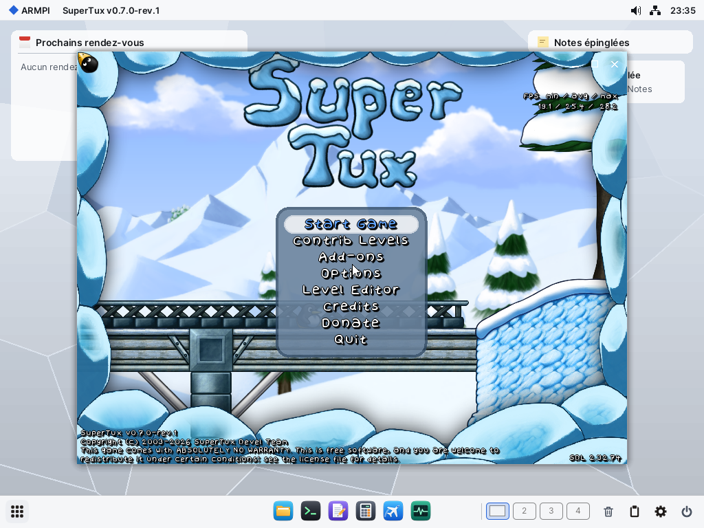

# SDL sur ARMPI : SuperTux et SuperTuxKart

Étude du 2 novembre 2026, sur le code réel des deux jeux. La demande était une étude avec des preuves à petit coût. Le code a permis d'aller plus loin : SDL est porté, et les deux jeux tournent sans une ligne changée dans leurs sources.

## Conclusion

| | Recommandation | État |
|---|---|---|
| **SDL** | **SDL 3.4.18, avec `sdl2-compat` 2.32.74 en statique.** Un seul pilote, deux API | prouvé sous QEMU et sur le Pi |
| **SuperTux 0.7** | **Le porter maintenant.** Rendu SDL_Renderer, GPU si présent | menu, clavier et musique prouvés sous QEMU ; **pas lancé sur le Pi** |
| **SuperTuxKart 1.5** | **Le porter, mais d'abord corriger le blocage du GPU avec tampon de profondeur.** Viser 800 × 600, niveaux graphiques 1 à 2 | une course entière à blanc sous QEMU ; **jamais rendu par le vrai GPU** |

**Le blocage est le point le plus important de ce rapport.** Sur le vrai GPU, un cube avec test de profondeur, dessiné dans une surface d'Elegant, a fait expirer son job, et le service `v3d` a éteint le GPU jusqu'au redémarrage. Le même cube sans profondeur passe. Tant que cela n'est pas compris, SuperTuxKart ne peut pas tourner sur le Pi, et SuperTux par OpenGL ES non plus s'il active la profondeur (son rendu 2D ne devrait pas en avoir besoin).



**Lancer SuperTuxKart sur le Pi éteindra sans doute le GPU** tant que le blocage n'est pas corrigé : voir plus bas. `main` de chaque app est un petit lanceur (`tools/sdl/launch.c`) : données, langue française, dossier utilisateur dans `SD0:/home`, plein écran à la taille de l'écran pour SuperTux (`--geometry 0x0`), fenêtre 780 × 520 et réglages bas pour SuperTuxKart.

**SuperTux sur le PocketTerm.** L'utilisateur l'a essayé sur le Pi le 3 novembre 2026 : il le trouve fluide. Depuis, il joue en plein écran, à la taille réelle de l'écran, avec les touches A (saut, valider) et B (Échap, retour, pause). Essayé sous QEMU seulement, en 1024 × 768 : le menu, la carte du monde et la pause répondent ; **pas encore envoyé sur le Pi**.

* `tools/sdl/supertux.patch` est la seule retouche du jeu : les menus ont leurs touches en dur, Échap n'est pas configurable, et une commande ne garde qu'une touche à la relecture de la config. A **remplace** donc Espace pour sauter. Échap et Entrée restent actifs.
* A et B sont pris par leur place (codes HID 4 et 5), en jeu comme dans les menus. Dans un champ de texte des menus, ils agissent aussi.
* Une ancienne config garde son saut sur Espace : y mettre `(key 4)` à la place de `(key 44)`, ce qui est à faire sur le Pi.
* F9 repasse en fenêtre. Le pilote suit `WEV_SCREEN`, un changement de résolution à chaud : **écrit, pas essayé**. La surface du GPU garde la taille de sa création, donc une résolution plus grande ne serait pas entièrement couverte par le rendu GLES.
* Sous QEMU, un appui bref et le relâchement tombent dans la même image et le jeu ne voit rien : tenir la touche par `hmp sendkey a 300`.

## Ce qui est prouvé, et ce qui ne l'est pas

| Essai | Où | Résultat |
|---|---|---|
| SDL 3 : fils, minuteur, fichiers, pixels relus | QEMU et **Pi** | PASS |
| `SDL_Renderer` sur le processeur, 400 × 300 | QEMU et **Pi** | 4 pixels sur 4 ; 553 images/s sur le Pi |
| `SDL_Renderer` en GLES 2 par Mesa, 400 × 300 | **Pi, vrai GPU** | 4 pixels sur 4 ; 235 images/s |
| Fenêtre et contexte ES 3.0 par l'API SDL 2, suite d'appels de SuperTuxKart | **Pi, vrai GPU** | `V3D 4.2.14.0`, `OpenGL ES GLSL ES 3.00` |
| Cube sans profondeur | **Pi, vrai GPU** | PASS, 201 images/s |
| **Cube avec profondeur** | **Pi, vrai GPU** | **ÉCHEC : job expiré, GPU éteint** |
| Repli sans GPU | QEMU et **Pi** | `SDL_Renderer` passe sur le processeur, le GL refuse proprement. Sur le Pi, vu après le blocage, pixels justes |
| Clavier AZERTY, souris, molette, focus | QEMU | codes et texte justes, voir plus bas |
| Trois vues : fenêtre, plein écran par F9, retour | QEMU | vu sur captures. L'agrandissement n'a pas été cliqué |
| SuperTux, rendu SDL | QEMU | menu complet, 25 images/s **sur processeur émulé**, Start Game accepté, cinématique lancée |
| Musique de SuperTux | QEMU | 4 min 40 de signal continu dans la capture, crête vers 10 000. **Mesuré, pas écouté** |
| SuperTuxKart, Mesa à blanc | QEMU | contexte ES 3.0, shaders du rendu avancé compilés, piste `sandtrack`, 602 images, 7,3 images/s, code de sortie 0 |

**Pas prouvé :**

* Aucun des deux jeux n'a tourné sur le Pi.
* À blanc, Mesa compile les shaders et bâtit les jobs, mais rien n'est rendu : l'image de SuperTuxKart n'a jamais été vue.
* Manettes : le pilote compile, aucun événement `WEV_PAD` n'a été reçu dans un essai.
* Tactile GT911 : il arrive comme une souris (HIDManager), pas essayé.
* Une partie jouée en entier, le réseau des deux jeux, le son à l'oreille.
* Les 1 439 images/s d'un second passage du cube sans profondeur, après une relecture, **ne sont pas expliquées** et sont écartées. Elles ne doivent pas servir de mesure.

## Le blocage du GPU

| Passage sur le Pi | Résultat |
|---|---|
| `sdl2test --gl --frames 600` : profondeur, relecture | `MESA: error: Draw call returned I/O error` ; pixels faux ; GPU éteint |
| `sdltest` ensuite | `armgl_init` rend 0 : repli sur le processeur |
| Après un redémarrage du Pi, `--gl --nodepth --noread` | 201 images/s, aucune erreur |
| `--gl --nodepth` | centre et coin justes |

Le test de profondeur est donc le suspect, mais **la cause n'est pas établie**, car le cas fautif n'a pas été relancé : il éteint le GPU pour toutes les sessions qui partagent ce Pi.

**Piste, trouvée à la lecture du code, pas prouvée :** ce passage est le seul à faire écrire le Z **en mémoire** par le GPU.

* `glClear` de la profondeur fait `job->store |= buffers` (`v3dx_draw.c:1792`) : le Z sera écrit à la fin du job, sauf si quelqu'un l'annule.
* Mesa l'annule par `invalidate_resource` (`v3d_context.c:132`). Sous Linux, le frontal DRI a pour cela `__DRI2_FLUSH_INVALIDATE_ANCILLARY` (`dri_drawable.c:435`).
* **`armgl_swap` ne le fait pas**, et le cube fautif a aussi relu l'image en pleine trame, ce qui vide le job.
* Sans `glClear` de la profondeur, le cube passe : rien n'écrit le Z.
* Pourquoi cette écriture bloquerait le GPU reste inconnu. Rien ne dit non plus que les essais réussis (WebGL, Skia) n'aient jamais écrit de Z : je ne l'ai pas vérifié.

**Première tâche du portage**, quand le Pi sera de nouveau disponible, sans aucune autre session dessus et en prévoyant un redémarrage à chaque échec. Le premier essai jette le Z, ce qui est aussi le bon réglage pour un jeu : `armgl_swap` devrait le faire de lui-même.

```sh
sdl2test --gl --noread --discard
sdl2test --gl --noread
```

| Résultat | Ce que cela veut dire |
|---|---|
| le premier passe, le second bloque | l'écriture du Z est en cause : jeter le Z dans `armgl_swap`, puis chercher pourquoi elle bloque, car un jeu peut encore la demander |
| les deux bloquent | le test de profondeur lui-même : regarder l'early-Z, `CFG_BITS` et le mode de rendu |
| les deux passent | la relecture en pleine trame est en cause, avec la profondeur |

`--discard` est essayé à blanc sous QEMU seulement. Il faudrait aussi que le service `v3d` puisse se relever sans redémarrage après un job expiré : tous les essais y gagneraient.

## Le choix de SDL

Les deux jeux demandent **l'API SDL 2**, pas SDL 3 : `SDL_WINDOW_SHOWN`, `SDL_GL_DeleteContext`, `SDL_GL_GetDrawableSize`, `SDL_AtomicGet`, dans `CIrrDeviceSDL.cpp` et `sdlbase_video_system.cpp`.

| | SDL 2.32 natif | **SDL 3.4 + sdl2-compat** |
|---|---|---|
| Pilote à écrire | pour SDL 2, à refaire pour SDL 3 | **un seul**, en API actuelle |
| Programmes SDL 3 | non | **oui** |
| Branche | maintenance | active |
| Liaison statique | directe | `sdl2-compat` ne l'admet que sous Linux et QNX, et passe par `dlopen`. **Résolu sans le retoucher** (plus bas) |
| Poids | | 240 Ko de plus |

**Rien de SDL ni de sdl2-compat n'est modifié.**

* SDL a des crochets pour les plateformes privées : `SDL_PLATFORM_PRIVATE`, `PRIVATE_bootstrap`, `PRIVATEAUDIO_bootstrap`, `SDL_PRIVATE_JoystickDriver`. Les pilotes vivent dans `tools/sdl/armpi`.
* Son CMake ne sait pas ARMPI : `tools/sdl/build-sdl.sh` compile sa liste de sources, avec `tools/sdl/armpi/SDL_build_config.h`.
* SDL 2 et SDL 3 exportent les mêmes noms. `objcopy --redefine-syms` les renomme `SDL3R_*` dans `libSDL3r.a`, et `-Ddlopen=... -Ddlsym=...` branche `sdl2_compat.c` sur une table de symboles (`tools/sdl/compat/sdl3table.c`).

## Ce que chaque jeu exige

Lu dans `v0.7.0-rev.1` (6970d03) et `1.5` (1fb491f).

| | SuperTux 0.7 | SuperTuxKart 1.5 |
|---|---|---|
| SDL | SDL 2, SDL_image, son fork de SDL_ttf | SDL 2 |
| Graphique | SDL_Renderer, ou GL 3.3 / 2.0 de bureau par glew ou epoxy | **OpenGL ES 3.0 officiel** (`USE_GLES2`, le défaut sur aarch64), Vulkan facultatif |
| GLSL | sans objet avec SDL_Renderer | **`#version 300 es`**, pas de compute ni de géométrie dans ce chemin |
| Son | OpenAL | OpenAL, ou MojoAL embarqué (il lui faut libsamplerate) |
| Musique | Vorbis, Ogg | Vorbis, Ogg |
| Fichiers | PhysicsFS | Irrlicht interne |
| Texte | freetype, harfbuzz | freetype, harfbuzz, SheenBidi embarqué |
| Script | Squirrel, en sous-module | AngelScript embarqué |
| Physique | | Bullet embarqué |
| Réseau | curl, facultatif (add-ons) | ENet embarqué, curl, OpenSSL |
| Autres | fmt, glm, tinygettext, sexp-cpp | jpeg, png, squish, mcpp embarqués |
| Boost | **non** | **non** |
| Fils | peu | oui : `std::thread`, gestionnaire de textures, son, réseau |
| `dlopen` | non | non : `glad` passe par `SDL_GL_GetProcAddress` |
| Données | 314 Mo sans `locale`, 293 Mo pour l'archive | **776 Mo**, dont textures 285, pistes 281, musique 68 |
| Sources | 476 `.cpp` | 855 `.c` et `.cpp`, 553 000 lignes |

**SuperTuxKart ne demande pas plus qu'OpenGL ES 3.0.** Toutes les extensions qu'il teste sont annoncées par Mesa : `GL_EXT_color_buffer_float`, `GL_EXT_texture_format_BGRA8888`, `GL_EXT_texture_compression_s3tc`, et aussi ASTC et le filtrage anisotrope. Le journal le confirme : `GLDriver: EXT Color Buffer Float Present`, skinning matériel par texture flottante.

| Binaire dépouillé | Octets |
|---|---|
| `sdltest-sw`, SDL 3 sans Mesa | 1 007 456 |
| `sdl2test-sw`, SDL 2 par sdl2-compat | 1 245 152 |
| `sdltest` avec Mesa | 16 607 456 |
| SuperTux sans Mesa | 10 383 784 |
| SuperTux avec Mesa | 25 860 688 |
| SuperTuxKart avec Mesa | 36 496 576 |

## La couche d'ARMPI

Tout est en C, dans `tools/sdl/armpi` : 885 lignes de pilotes. Elle n'a de sens qu'autour de SDL, qui est du C ; l'assembleur n'y gagnerait rien, car le coût est dans SDL et Mesa.

| Partie | Sur quoi | État |
|---|---|---|
| Fenêtres | `ui_window_ex`, cadre et couleurs du thème, `WF_GLYPH_LIGHT \| WF_BODY_DARK` comme les émulateurs | prouvé |
| Pixels du processeur | surface d'Elegant `ui_surface`, plus un tampon : Elegant ne voit que des images finies | prouvé |
| OpenGL ES | `armgl_context`, `armgl_window`, `armgl_swap`, `armgl_proc` : **pas d'EGL**, `armegl` ne sert pas | prouvé, sauf profondeur |
| Taille | une surface GL de la taille de l'écran, `armgl_window_zone` à chaque changement | comme Avalonia |
| Trois vues | fenêtre, `ui_maximize`, plein écran par F9 : fenêtre sans cadre `WF_FRAMELESS \| WF_TOP`, comme EmuKit | prouvé par captures |
| Clavier | `WEV_KEY` : le code HID est le scancode de SDL ; le caractère donne le code de touche et le texte. AZERTY juste | prouvé |
| Souris, tactile | `WEV_MOUSE`, `WEV_WHEEL` ; le GT911 arrive comme une souris | souris prouvée |
| Manettes | `WEV_PAD` au focus, mapping de HIDManager déjà appliqué, 17 boutons, 4 axes, mapping de SDL fixe | compilé seulement |
| Son | AudioKit, s16 stéréo 44,1 kHz, `ak_write`, sommeils de 2 ms | prouvé |
| Presse-papiers | `ui_clip_set`, `ui_clip_get` | compilé seulement |
| Fils, minuteurs, fichiers | les pilotes Unix de SDL sur libposix | prouvé |

Le GPU est facultatif : `armgl` est en références faibles, et seul `-Wl,-u,armgl_init` lie Mesa. Un jeu 2D peut donc rester à 1 Mo de SDL.

**Ce que `libposix` a demandé : deux lignes.** `access ("/proc")` réussit, car SDL et PhysicsFS le regardent avant `readlink ("/proc/self/exe")`, et `AF_MAX` existe pour `dns.c`. Le reste a suffi : SDL 3, deux jeux et leurs dépendances se sont liés sans autre ajout. `getifaddrs` existe, mais rend une erreur.

**Pièges**

* SDL doit recevoir `SDL_HINT_KEYCODE_OPTIONS` sans `latin_letters`, sinon il remplace la table partielle du pilote par celle du QWERTY.
* newlib n'a pas `tm_gmtoff` : `SDL_systime.c` se compile avec `-Dsun=1 -Dtimezone=_timezone`.
* Pas de `<threads.h>` complet : `-D__STDC_NO_THREADS__=1` pour OpenAL Soft.
* `USE_IPV6` doit rester actif dans SuperTuxKart, sans quoi `socket_address.cpp` ne compile plus avec son ENet.
* SuperTuxKart coupe `SUPERTUXKART_DATADIR` aux deux-points : donner `/games/stk`, pas `SD0:/games/stk`.
* `RAM0:` a refusé un dossier profond de cinq niveaux. La cause n'est pas établie : le cache des textures a été mis sur la carte d'essai.
* Le pilote lit `SDL_ARMPI_GL` : `dry` pour Mesa à blanc, `off` pour couper le GL.

**Manques connus**

| Manque | Effet | Remède |
|---|---|---|
| Pas de curseur caché (`UC_*` n'a pas de forme vide) | la flèche reste au-dessus du jeu | ajouter une forme à `ui_cursor` |
| Pas de souris relative ni de capture | sans effet sur ces deux jeux ; à revoir pour un jeu à la souris | |
| `armgl` ne détruit pas un contexte | fuite à chaque changement de rendu | ajouter `armgl_context_free` |
| Barre de titre virtuelle : un appui dans les 32 px du haut est retenu | clic retardé en haut de la fenêtre, pas en plein écran | à juger en jeu |
| SuperTux à 320 × 240 | l'image n'occupe qu'un quart : taille sous son minimum, cause non cherchée | sans effet à 800 × 600 |
| `NetworkConfig: System doesn't support IPv4` dans SuperTuxKart | pas de jeu en ligne | regarder `enet_socket_*` ; les sockets de NetKit n'ont pas d'IPv6 |

## La 2D accélérée

**Recommandation : `SDL_Renderer` en GLES 2 par Mesa pour SuperTux, le processeur en repli.** C'est le comportement par défaut du pilote si le programme est lié avec `armgl`.

| 400 × 300, scène simple, sur le Pi | Images/s |
|---|---|
| Processeur | 553 |
| GLES 2 | 235 |

Sur cette petite scène, le processeur gagne : le coût par image de Mesa et d'Elegant pèse plus que les pixels. **Ce chiffre ne se transpose pas à SuperTux**, dont les plans transparents en plein écran sont exactement ce que le processeur fait mal. Il reste à le mesurer. Si les 25 images/s du processeur émulé tiennent aussi en jeu, le rendu processeur peut suffire sur le Pi, mais c'est une supposition. C'est aussi 16 Mo de moins.

## Vitesse de SuperTuxKart sur un Pi 4

**Les chiffres publics se contredisent.**

| Source | Réglages | Résultat |
|---|---|---|
| [Igalia, février 2023](https://blogs.igalia.com/itoral) | Pi 4, réglages et résolution non dits, après une correction de Mesa (attributs flottants de 16 bits, MR 21361) | OpenGL toujours au-dessus de 30 images/s, jusqu'à 110 selon la piste ; Vulkan 35 à 50 % plus rapide là où le plafond n'est pas atteint |
| [OpenBenchmarking, novembre 2025](https://mail.openbenchmarking.org/result/2511113-NE-VIDEOCORE74&export=txt) | Pi 4, 1,8 GHz, 8 Go, Debian 13, SuperTuxKart 1.5 bêta, 1920 × 1080, Low à Ultimate | **environ 1 à 2 images/s en OpenGL**, 2 à 5 en Vulkan |

Les chiffres d'OpenBenchmarking ont été déduits des étiquettes des graphiques, pas d'une table : à vérifier sur la page avant de s'y fier. La correction d'Igalia est dans Mesa 26.2. Aucun chiffre public trouvé à 800 × 600.

**Ce que l'on peut en tirer.** 800 × 600 représente 23 % des pixels du 1080p. Elegant coûte environ 6 ms par image à cette taille, d'après la mesure à 395 000 pixels de docs/MESA.md : il ne sera pas le frein. Le GPU seul décidera. Mon estimation, **qui n'est pas une mesure** : de 20 à 40 images/s au niveau 1 sur les pistes simples, nettement moins sur les grandes pistes et dès que les lumières dynamiques sont actives.

| À réduire | Comment | Gain attendu |
|---|---|---|
| Résolution | 800 × 600, l'écran du PocketTerm ; `m_scale_rtts_factor` en dessous | le plus fort |
| Lumières dynamiques | niveau 1 ou 2, `--disable-dynamic-lights` : plus de rendu différé | très fort |
| Ombres, bloom, lumière volumétrique, MLAA, SSAO | coupés aux niveaux 1 et 2 | fort |
| Personnages animés, particules | niveau 1 | moyen |
| Textures | `--disable-hd-textures`. Le fichier `graphical_restrictions.xml` limite les Broadcom à 256 px, **mais seulement pour `os="linux"`, donc pas ici** : à forcer | mémoire surtout |
| Compression des textures | `--disable-texture-compression` : elle se fait sur le processeur au premier chargement, puis en cache sur la carte | premier lancement |

**Mémoire du GPU.** C'est le second risque. Sans MMU GPU, les tampons doivent être contigus sous 1 Go. Le jeu a fait tomber la mémoire libre d'environ 780 Mo sous QEMU, cache de fichiers et tampons à blanc compris : la part du GPU n'est pas mesurée. Il ne faut pas compter sur les 8 Go du Pi 4.

**Compilation.** Les shaders se compilent dans l'OS à chaque lancement, sans cache disque de Mesa. Sous QEMU c'était long ; sur le Pi, Skia a pris 66 ms pour ses shaders, mais ceux du jeu sont bien plus nombreux. À mesurer.

## Construction

| Étape | Où | Ordre de grandeur sur 16 cœurs, non chronométré |
|---|---|---|
| libposix, relais d'UIKit, SDL 3 | WSL | environ 2 min |
| Ogg, Vorbis, fmt, libsamplerate, OpenAL Soft, PhysicsFS, SDL_image | WSL | environ 3 min |
| SuperTux | WSL | environ 5 min |
| SuperTuxKart | WSL | environ 5 min |

Tout est en statique par `aarch64-onyx-elf` 14.2, sur `~/armpi-sdl/sysroot` : une copie du sysroot de WebKit, avec libposix de ce dépôt. Le CMake des jeux n'a pas eu besoin de patch : `tools/sdl/armpi-sdl.cmake` et `tools/sdl/shared-ok.cmake` suffisent.

**Dans l'OS :** SDL, ses dépendances et SuperTux sont du C et du C++ ordinaires que `/gcc` devrait compiler, avec `make` : **pas essayé**. SuperTuxKart est trop gros pour que ce soit utile, et Mesa exige Meson et Python, absents de l'OS. `libSDL3.a` et les en-têtes pourraient rejoindre `/gcc/lib` pour que SDL se compile dans l'OS, comme le but de la libc le veut.

## Ordre des travaux

| # | Travail | Effort | Dépend de |
|---|---|---|---|
| 1 | **Comprendre et corriger le blocage de la profondeur** ; relever le GPU sans redémarrage | 1 à 3 jours, Pi nécessaire, redémarrages | rien |
| 2 | SuperTux sur le Pi : copier 325 Mo sur la carte, processeur et GPU, mesurer, jouer | 1/2 journée | l'accord de l'utilisateur pour la carte |
| 3 | Fusion de `tools/sdl`, recette de `SD0:/apps/supertux.app`, icône, paquet | 1/2 journée | 2 |
| 4 | Curseur caché, `armgl_context_free` | 1/2 journée | rien |
| 5 | Manettes essayées sur un vrai pad, tactile, son à l'oreille | 1/2 journée | Pi |
| 6 | SuperTuxKart sur le Pi : 800 Mo, niveau 1, mesures, réglages par défaut pour ARMPI | 1 à 2 jours | 1 |
| 7 | Mémoire du GPU : mesurer, élaguer, peut-être `MMU V3D` | inconnu, jusqu'à plusieurs jours | 6 |
| 8 | Réseau de SuperTuxKart | 1 à 2 jours | 6, facultatif |
| 9 | SDL dans `/gcc/lib`, compilation dans l'OS | 1/2 journée | 3 |

## Risques

| Risque | Gravité | Parade |
|---|---|---|
| La profondeur dans une surface reste bloquée | **haute** : arrête SuperTuxKart | jeter le Z à chaque image ; chercher la cause |
| Un job fautif éteint le GPU pour tout le système | **haute** pendant les essais | relance du GPU dans `v3d`, Pi dédié aux essais |
| Mémoire basse contiguë insuffisante pour les textures de SuperTuxKart | moyenne à haute | textures 256 px, MMU V3D |
| SuperTuxKart trop lent même au niveau 1 | moyenne | résolution de rendu réduite ; sinon le garder comme démonstration |
| Pas de TFU : chaque mipmap passe par le rendu, avec une ligne de journal | moyenne | implémenter le TFU dans `v3d`, ou faire taire le message |
| Coupures Wi-Fi pendant les envois | faible | déjà connues : vérifier chaque CRC |
| Licences : les deux jeux sont en GPL 3, leurs données sous plusieurs licences | à décider | pas de paquet public sans leurs sources et leurs notices |

## Pour l'étude de Quake

SDL 3 et l'API SDL 2 sont prêts, sans modification, avec fenêtre, trois vues, clavier AZERTY et son. Un port de Quake en SDL 2 trouve donc tout sauf deux choses : **OpenGL de bureau n'existe pas ici**, seulement OpenGL ES 3.0, et il n'y a ni souris relative ni capture, indispensables à la visée. La souris relative est le premier travail à ajouter au pilote pour ce jeu. Le blocage de la profondeur le concerne aussi.

## Incidents sur le Pi

* Mon cube a éteint le GPU du Pi. Le job V3D a expiré au bout de 500 ms. Il a fallu un redémarrage, qui n'a pas été fait par cette session.
* Après ce redémarrage, deux essais sans profondeur ont été lancés sur le GPU, avant la consigne de ne plus y toucher.
* La commande `journal` a réécrit `SD0:/journal.txt` sur la carte. Rien d'autre n'a été écrit sur la carte : les essais passaient par `RAM0:`, effacé ensuite.
* Deux envois FTP ont échoué par coupure Wi-Fi. Un CRC faux a été vu, puis corrigé par un nouvel envoi.

## Refaire

Dans WSL, depuis la racine du dépôt, avec `tools/mesa` déjà construit :

```bash
sh tools/sdl/fetch.sh
```

```bash
sh tools/sdl/build-sdl.sh
```

```bash
sh tools/sdl/build-compat.sh
```

```bash
sh tools/sdl/build-deps.sh
```

```bash
sh tools/sdl/build-supertux.sh
```

```bash
sh tools/sdl/build-stk.sh
```

`GPU=1 sh tools/sdl/build-supertux.sh` lie Mesa. Pour ranger les deux jeux en apps dans `build/sdl/sdroot/apps` (1,15 Go ; l'archive de SuperTuxKart fait 726 Mo) :

```bash
sh tools/sdl/stage.sh
```

Sous Windows, l'essai sous QEMU (ports 4491, 2391, VNC 91) :

```bash
python -I tools/sdl/testimage.py --small
```

```bash
python -I tools/sdl/qemu-run.py "sdltest-sw" "sdltest --dry" "sdl2test --gl --dry"
```

Puis les icônes, par `tools/sdl/mkicon.py`, depuis `build/sdl/icon-st.png` et `icon-stk.png`. Dans ARMPI, avec l'image complète, sans `--small` :

```sh
SD0:/apps/supertux.app/main
SDL_ARMPI_GL=dry SUPERTUXKART_DATADIR=/apps/supertuxkart.app SUPERTUXKART_SAVEDIR=SD0:/home/stk HOME=SD0:/home/stk SD0:/apps/supertuxkart.app/supertuxkart --windowed --screensize=800x600 -R --track=sandtrack --numkarts=1 --laps=1 --no-sound --profile-time=5
```

Envoi sur le Pi, chaque fichier vérifié par XCRC, avec reprise après une coupure :

```bash
python -I tools/sdl/deploy.py 192.168.1.20 build/sdl/sdroot/apps/supertux.app SD0:/apps/supertux.app
```

`tools/sdl/qemu-run.py --script` accepte un script de `tools/qemu_drive.py`, et `tools/sdl/bg.py` lance un jeu sans attendre sa fin, pour agir et capturer l'écran pendant qu'il tourne.
