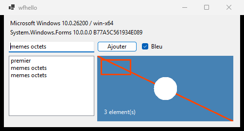
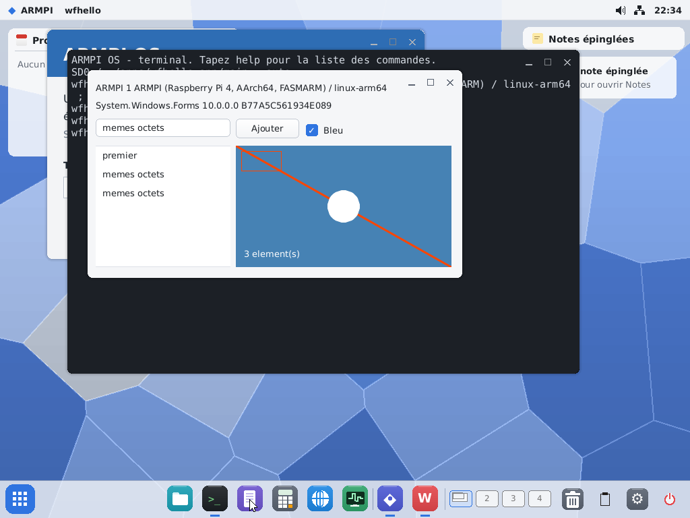

# WinForms portable : un binaire, Windows et ARMPI

Étude du 1er novembre 2026 : ce qu'il faut pour qu'une application `System.Windows.Forms`, compilée une seule fois, tourne sous Windows et sous ARMPI avec la même `.dll`.

## Conclusion

**C'est possible, et c'est prouvé sur une petite application.** `wfhello.dll` (10 752 octets, SHA-256 `63651707…b09b`) a été compilée une fois par `dotnet build`, en `net10.0-windows` avec `UseWindowsForms`, sans aucune référence à ARMPI. Les mêmes octets ouvrent une fenêtre sous Windows x64, sur le vrai WinForms, et sous ARMPI arm64 dans QEMU, sur notre WinForms et UIKit, au thème du bureau.

**Recommandation : la voie A.** Notre implémentation prend exactement l'identité d'assembly de Windows, et une application portable se compile contre la vraie référence Windows. Aucune façade et aucun sélecteur ne sont nécessaires. Le vrai travail n'est pas au chargement, qui est réglé, mais dans la surface d'API : nous couvrons 605 membres identiques sur 18 163. Il faut l'étendre au fil des applications, avec `apidiff check` comme garde-fou.

| Windows, vrai WinForms | ARMPI, notre WinForms sur UIKit |
|---|---|
|  |  |

Tout est sur la branche `claude/winforms-portable-da76f8`, rien n'est fusionné.

## Ce qui est prouvé

| Essai | Résultat |
|---|---|
| `dotnet wfhello.dll --auto` sous Windows 11 x64, runtime 10.0.12 | fenêtre, journal complet, code 0 |
| Le même fichier en `/apps/wfhello.app/main` sous QEMU, runtime 10.0.14 | fenêtre, même journal, code 0 ; SHA-256 relu dans l'image, identique |
| Même essai sous QEMU sans `--auto` | vrai clic sur le bouton, saisie au clavier, case à cocher, fermeture par la croix, code 0 |
| Sens inverse : les sources compilées contre **nos** DLL par `csc`, comme le ferait `pibuild`, avec `wfhello.runtimeconfig.json` à côté, lancées sous Windows | sur le vrai WinForms, même journal |
| `formsdemo`, `uidemo`, `studio`, `courier` et `System.3D` recompilés sur nos nouvelles DLL | 0 erreur |
| Studio recompilé, lancé sous QEMU | démarre, fenêtre correcte ([capture](assets/wfhello-studio-armpi.png)) |
| Build complet (`stage.sh`, `kits.sh`, `build.ps1`) sur la base fusionnée avec `main`, image lancée sous QEMU | `wfhello` non recompilé tourne, code 0 |
| `pibuild` dans l'OS, `tools/dotnet/uidemo`, avec le `csc.rsp` et les `.ui` compilés | code 0, l'application s'ouvre |

Le journal, identique des deux côtés hormis la ligne du système :

```text
demarre : ARMPI 1 ARMPI (Raspberry Pi 4, AArch64, FASMARM) / linux-arm64 ; System.Windows.Forms 10.0.0.0 B77A5C561934E089
ajoute : memes octets, 2 element(s)
ajoute : memes octets, 3 element(s)
etat : 3 element(s), coche, texte memes octets
fin
```

`wfhello` utilise du code tel que le Designer l'écrit : `InitializeComponent`, `SuspendLayout`, `AutoScaleDimensions`, `Padding`, un `Timer` dans un `IContainer`, `AcceptButton`. Il utilise aussi `ApplicationConfiguration.Initialize` et un `Panel` dessiné dans `Paint` avec `Graphics`, `Pen`, `SolidBrush`, `Font`.

Lancement sous QEMU : environ 40 à 50 s entre la touche Entrée et la fenêtre. Ce temps vaut pour QEMU seulement, le Pi n'a pas été essayé.

## Comment nos applications sont construites aujourd'hui

Dans `main`, avant cette branche :

* **Identité** : `System.Windows.Forms, Version=0.0.0.0, Culture=neutral, PublicKeyToken=null`.
* **Construction** : `tools/dotnet/kits.sh` lance Roslyn dans WSL, en `-nostdlib`, contre `Microsoft.NETCore.App.Ref` (`net10.0`) et `System.UIKit`. Il n'y a pas de projet SDK.
* **Fourniture** : la DLL est dans `/dotnet`, et dans `/dotnet/ref` pour `pibuild`.
* **Contenu** : tout est dans une seule DLL, y compris `Graphics`, `Pen`, `Brush`, `Font` et `Image`, écrits dans l'espace de noms `System.Drawing`.
* **Chemin vers UIKit** : `System.Windows.Forms` → `System.UIKit` (classe `UI`, générée depuis `uikit.abi` par `abi2cs.py`) → `System.Kits` → P/Invoke `libarmpi` → `armpi_call`, résolu dans l'hôte par `PINVOKE_OVERRIDE`.
* **Lancement** : AppKit voit `MZ` et lance `/dotnet/dotnet`. L'hôte `armpihost.cpp` **ne lit ni `runtimeconfig.json` ni `deps.json`** : ses assemblys de confiance sont ceux du dossier de l'application, puis ceux de `/dotnet`.

Courier et Studio sont compilés de cette façon. Courier ne va plus sur la carte, mais ses sources compilent.

## Ce qui diffère de Windows

| Point | Windows | ARMPI avant | Conséquence |
|---|---|---|---|
| `System.Windows.Forms` | `10.0.0.0`, `b77a5c561934e089` (clé ECMA de 16 octets) | `0.0.0.0`, sans clé | à aligner |
| `System.Drawing.Common` | assembly à part, `10.0.0.0`, `cc7b13ffcd2ddd51` | n'existe pas | **`Graphics` doit changer d'assembly** |
| `System.Windows.Forms.Primitives` | contient 15 types dont `Padding` et `HighDpiMode`, `b77a5c561934e089` | n'existe pas | **assembly à créer** |
| `System.Drawing.Primitives` | `Color`, `Point`, `Size`, dans `Microsoft.NETCore.App` | le même | rien à faire |
| TFM | `net10.0-windows` à la compilation ; le `runtimeconfig.json` écrit `"tfm": "net10.0"` | `net10.0` | rien à faire : le binaire tourne sous ARMPI |
| Framework partagé | `Microsoft.NETCore.App` + `Microsoft.WindowsDesktop.App` | hôte sans framework | rien à faire sous ARMPI, l'hôte ignore le fichier |
| Apphost | `wfhello.exe`, 162 Ko, natif Windows | aucun | ne pas le copier ; sous ARMPI, `main` est la DLL |
| `System.Drawing` | façade `10.0.0.0` côté Desktop, `4.0.0.0` côté NETCore | celle de NETCore | sans effet ici : le compilateur vise l'assembly qui définit le type |
| Code natif de l'application | aucun pour `wfhello` ; le vrai WinForms appelle Win32 | UIKit | le P/Invoke vers `user32` d'une application ne peut pas marcher |

**Le chargeur**, mesuré sur CoreCLR 10.0.12 sous Windows, avec une petite bibliothèque :

| Référence dans l'application | Assembly présent | Résultat |
|---|---|---|
| 10.0.0.0, avec jeton | 10.0.0.0, même jeton | chargé |
| 10.0.0.0, avec jeton | 10.0.0.0, **sans clé** | chargé |
| 10.0.0.0, avec jeton | 11.0.0.0 | chargé |
| 10.0.0.0, avec jeton | **0.0.0.0** | `FileNotFoundException` |
| 10.0.0.0, sans clé | 10.0.0.0, avec jeton | chargé |
| 0.0.0.0, sans clé | 10.0.0.0, avec jeton | chargé |

La **version** est donc obligatoire (au moins celle demandée). La clé publique n'est pas contrôlée. On la pose quand même, avec `-publicsign` et la seule clé publique (`tools/dotnet/portable/keys/`) : l'identité est alors la même pour la réflexion, comme le montre le journal, et `InternalsVisibleTo` reste cohérent. Sous ARMPI, seul le cas de la première ligne a été essayé ; les autres supposent le même chargeur.

## Les voies possibles

| Voie | Principe | Pour | Contre | Avis |
|---|---|---|---|---|
| **A** | Le binaire vise la vraie référence Windows ; ARMPI fournit nos assemblys sous la même identité | application WinForms ordinaire, projet SDK standard, Designer de Visual Studio ; aucun changement sous Windows ; prouvé | notre surface doit coller à celle de Windows, type déclarant compris | **retenue** |
| **B** | Le binaire vise nos assemblys, avec un sélecteur au lancement sous Windows | `pibuild` compile sur l'appareil | inutile en tant que sélecteur : le `runtimeconfig.json` choisit déjà le framework | c'est le sens inverse de A, il marche si notre API publique est un sous-ensemble strict de celle de Windows |
| **C** | Un petit assembly de façade, deux implémentations | isole les différences | ce n'est plus `System.Windows.Forms` : l'application ne se compile plus avec le Designer, il faut réécrire toute l'API | écartée pour WinForms, gardée pour nos extensions (plus bas) |
| **D** | Un framework partagé `Microsoft.WindowsDesktop.App` sous ARMPI | respecte le modèle de `hostfxr` | notre hôte ne lit pas ce fichier ; à ne faire que si `hostfxr` arrive un jour | inutile |
| **E** | Porter le vrai WinForms | surface complète | il repose sur Win32 ; écarté par la décision de l'utilisateur du 31/10/2026 | écartée |

Sous A, `pibuild` reste utilisable sans rien changer à sa logique. Ses binaires deviennent portables dès qu'ils n'utilisent que l'API commune, car nos DLL de référence portent la même identité. Il manque seulement le `runtimeconfig.json` à écrire pour Windows.

## Pourquoi « même nom » ne suffit pas

Un appel compilé porte le **type déclarant** et la **signature exacte** : il ne garde pas une trace de ce que le source a écrit. Voici les pièges rencontrés ou repérés, qui valent pour toute la suite.

* **Assembly du type.** `HighDpiMode` est dans `System.Windows.Forms.Primitives`. Le premier lancement sous QEMU a échoué avec `FileNotFoundException` sur cet assembly, alors que `apidiff check` ne signalait rien. L'outil contrôle maintenant l'assembly de chaque type.
* **Type de base qui fuit.** Compilé contre nos DLL, `list.Items.AddRange` visait notre `ItemCollection`, qui n'existe pas à Windows : `TypeLoadException` sous Windows. Tout membre public que nous déclarons sur un type absent de Windows a le même effet.
* **Hiérarchie.** `set_AutoScaleMode` vise `ContainerControl`, `set_UseVisualStyleBackColor` vise `ButtonBase`. Ces classes doivent exister, avec la même lignée.
* **Masquage par `new`.** Notre `Form.Show` masquait `Control.Show`. Un binaire compilé appelle `Control::Show`, donc la fenêtre ne se serait jamais ouverte. Le travail passe maintenant par `SetVisibleCore`, virtuel comme à Windows.
* **Types de retour.** `Focus` rend `bool`, `BeginInvoke` rend `IAsyncResult`, `ObjectCollection.Add` rend `int`.
* **Paramètres par défaut.** `Pen (Color, float = 1)` ne donne qu'une méthode à deux arguments, alors que Windows a deux constructeurs.
* **Champ et propriété.** Nos `Cursors.Hand` sont des champs, ceux de Windows des propriétés. `Padding.Left` a été corrigé sur la branche.
* **Types de délégué.** `FormClosed` attend un `FormClosedEventHandler` à Windows, un `EventHandler` chez nous.

Une référence sans cible ne casse pas le chargement de l'application, mais lève une exception quand le code qui l'utilise est compilé par le JIT. C'est le comportement connu de CoreCLR ; ici, seuls les échecs de type décrits plus haut ont été observés.

## Ce qui a changé sur la branche

Cette preuve a demandé peu de code, sur `tools/dotnet/` :

* `forms/primitives/` : nouvel assembly `System.Windows.Forms.Primitives` (`HighDpiMode`, `Padding`).
* `forms/drawing/` : nouvel assembly `System.Drawing.Common` (`Drawing.cs` et `Font.cs` déplacés, signatures de Windows).
* `forms/Forms.cs`, `Layout.cs` : version et clé ; `Control : Component` ; `ScrollableControl`, `ContainerControl`, `ButtonBase`, `IButtonControl` ; `Control.ControlCollection` imbriquée, sur `ArrangedElementCollection` ; `ListBox.ObjectCollection` ; `SuspendLayout`, `ResumeLayout`, `PerformLayout` ; `OnClick (EventArgs)` ; `Timer : Component` ; `SetVisibleCore`.
* `uigen`, `Markup.cs` : `Margin="4"` devient `new Padding (4)`.
* `3d/Viewport3D.cs` : `Dispose (bool)`.
* `kits.sh` : les trois assemblys, avec `-publicsign`. La preuve de l'étude a compilé sous Windows avec `portable/build-forms.sh` ; la construction normale passe par `kits.sh`, dans WSL.

Nouveaux outils : `tools/dotnet/portable/wfhello/` (l'application), `apidiff/` (`surface`, `check`, `list`).

## Surface d'API

Mesures de `apidiff surface` contre les références 10.0.12 (`System.Windows.Forms`, `.Primitives`, `System.Drawing.Common`). Un membre ne compte comme identique que si le type déclarant et la signature sont les mêmes.

| | avant | après, avec les menus et Studio du 1er novembre |
|---|---:|---:|
| Types de Windows | 1 288 | 1 288 |
| Nos types | 90 | 102 |
| Types communs | 82 | 94 |
| ...dont classe de base différente | 32 | 21 |
| Types inconnus de Windows | 8 | 8 |
| Membres de Windows | 18 163 | 18 163 |
| Nos membres identiques | 508 | 605 |
| Nos membres déclarés sur un autre type | 40 | 44 |
| Nos membres à la signature différente | 33 | 25 |
| Nos membres inconnus de Windows | 46 | 45 |

Avant ces changements, `apidiff check` trouvait 29 références sans cible sur les 85 de `wfhello`. Il en trouve 0 maintenant. Le pourcentage global dit peu de chose : une application réelle n'utilise qu'une petite part des 18 163 membres, et ce sont ces références-là qui comptent.

**Compilation de nos applications contre la vraie référence Windows**, ce qui donne ce qui manque dans l'autre sens :

| Application | Erreurs |
|---|---|
| `formsdemo` | 9 |
| `uidemo` | 4 |
| `studio` | 3 |
| `courier` | 22 (130 avant le passage de `Margin` à `Padding`) |

Ces chiffres sont des minimums : quand le générateur `.ui` échoue, le code généré manque et d'autres erreurs restent cachées. Causes trouvées : `ToolTipText`, `CodeEditor`, `StackPanel`, `SegmentedControl`, `DocumentTabs`, `System.Windows.Forms.Markup.UiLoader`, `ToolStripButton.Glyph` et `OnLayout ()` sans argument.

**Écarts qui restent à corriger**, listés en entier par `apidiff surface` :

* **Signatures** : `Application.OpenForms`, `Control.BeginInvoke`, `Control.Focus`, `Form.FormClosed`, `SplitContainer.SplitterMoved`, `TabControl.TabPages`, `ToolStrip.Items`, `ListView.Columns`, `ListViewItem.SubItems`, `TreeNodeCollection.Add`, et les collections de `DataGridView`.
* **Classes de base** : `TextBoxBase`, `CommonDialog`, `ToolStrip` et ses éléments, `UpDownBase`, `ScrollBar`, `DataGridViewBand`. `ListView` ne doit pas dériver de `ListControl`.
* **Membres déplacés** : `ReadOnly` sur `TextBoxBase`, `Items` et `SelectedItem` hors de `ListControl`, `SelectedIndexChanged` sur `ListBox` et `ComboBox`.
* **Absents de chez nous** : `Control.Handle` public en `IntPtr`, `WndProc`, `CreateParams`, `IWin32Window`, `TableLayoutPanel`, `FlowLayoutPanel`, `Brushes`, `Pens`, `Icon`, `Bitmap (Stream)`, `RichTextBox`, entre autres.

## Travail à faire pour la voie A

1. **Recompiler les programmes installés par `pibuild` avant la fusion** : ceux qui touchent à `Graphics` ne se chargeront plus. Studio et `view3d` le sont par `kits.sh`. Des renvois de types de `System.Windows.Forms` vers `System.Drawing.Common` éviteraient cette recompilation.
2. **Sortir nos extensions de `System.Windows.Forms`** vers un assembly à nous, `System.Windows.Forms.Armpi`. Cet assembly suit la voie C : même identité, implémentation sur UIKit dans `/dotnet`, implémentation sur WinForms à côté de l'application sous Windows. Sont concernés `StackPanel`, `SegmentedControl`, `CodeEditor`, `DocumentTabs`, `ThemeColors`, `UiLoader`, `Application.Redraw`, `Control.Showing`, `Control.LocationInForm`, `Image.FromBytes`. `ToolTipText` doit devenir le vrai composant `ToolTip`.
3. **Corriger les écarts de la liste précédente**, en commençant par les conteneurs et `TextBoxBase`.
4. **Rendre `apidiff` systématique** : `surface` à chaque construction de nos DLL pour interdire tout membre public en plus, `check` sur chaque application, côté PC et dans `pibuild`.
5. **Compléter la surface au fil des applications**, à partir de vraies applications Windows passées à `apidiff check`. Générer l'API entière en bouchons qui lèvent `PlatformNotSupportedException` reste une option : plus d'échec au chargement, mais une erreur plus tardive.
6. **Sortie Windows de `pibuild`** : écrire le `runtimeconfig.json` et une copie nommée `.dll`, par exemple avec une option `pibuild export`. Le lancement d'un fichier nommé `main` par `dotnet` n'a pas été essayé.
7. **Ressources du Designer** : `ComponentResourceManager`, `Bitmap (Stream)`, `Icon`. Une fenêtre avec une icône dans son `.resx` les demande dès `InitializeComponent`.
8. **Sémantique** (voir plus bas).
9. **Figer la cible** : `net10.0-windows`, pas de `PublishSingleFile`, pas de `ReadyToRun`, pas d'apphost dans le paquet ARMPI.

## Ce qui bloque, ou peut bloquer

Rien ne bloque une application WinForms qui reste dans la surface commune. Les limites sont les suivantes.

* **API qui exposent Win32** : `Control.Handle` utilisé comme HWND, `WndProc`, `CreateParams`, P/Invoke vers `user32` ou `gdi32`. Ces applications ne seront pas portables, par nature.
* **Version de .NET** : une application compilée pour une version plus récente demandera un `System.Runtime` plus récent que le nôtre. D'après le tableau du chargeur, elle ne se chargera pas.
* **Différences de comportement que la surface ne montre pas** :
  * **`Margin`** : chez nous, c'est le vide autour d'un contrôle docké ; à Windows, `Dock` l'ignore et c'est le `Padding` du parent qui compte. Le code du Designer pose souvent un `Margin` : sous ARMPI, un contrôle docké serait décalé. Les `.ui` de Courier reposent sur notre sens. Il faut adopter celui de Windows et migrer les `.ui`.
  * **Mise à l'échelle** : `AutoScaleDimensions` est lu et ignoré chez nous. Les positions du Designer sont prises en pixels, ce qui marche pour `wfhello`.
  * **Dessin** : `DrawRectangle` ignore l'épaisseur du `Pen`. Dans la capture ARMPI, seuls les côtés haut et gauche du rectangle sont visibles, alors que `ui_frame` trace les quatre. Cause non établie.
  * **Fenêtres** : `Form.Hide` reste impossible, Elegant ne cache pas une fenêtre.
  * **`Form.Size`** : chez nous, c'est la taille du contenu ; à Windows, le cadre est compris.
  * **Polices** : `Segoe UI` tombe sur DejaVu Sans, avec d'autres largeurs de texte.
  * **Couleurs** : `BackColor` et `ForeColor` sont ignorées chez nous pour suivre le thème. Le rendu ne sera jamais identique, et c'est voulu.
* **Identité d'assembly** : nos DLL portent le nom et les clés publiques de Microsoft. C'est nécessaire au chargement par nom, mais ce n'est pas une signature : `-publicsign` n'emploie que la clé publique. Avant une publication, le point mérite d'être relu avec la licence choisie pour l'OS.

## Ce qui reste supposé

* Rien n'a été essayé sur le Pi : QEMU seulement.
* Aucune application réelle de taille moyenne écrite pour Windows n'a été essayée. L'écart mesuré vient de `wfhello` et de nos propres applications.
* Courier et `formsdemo` compilent sur les nouvelles DLL mais n'ont pas été relancés. `view3d` non plus.
* Le déploiement x64 et arm64 sous Windows n'a été vu qu'en x64.
* Les estimations de charge ne sont pas données : elles dépendent de la surface que réclameront les applications visées.

## Refaire la preuve

Compiler et vérifier, sous Windows, dans Git Bash :

```bash
dotnet build tools/dotnet/portable/apidiff -c Release -o /tmp/apidiff
dotnet build tools/dotnet/portable/wfhello -c Release -o /tmp/wfhello
sh tools/dotnet/portable/build-forms.sh build/dotnet/sdroot/dotnet /tmp/forms
dotnet /tmp/apidiff/apidiff.dll check /tmp/forms "C:/Program Files/dotnet/packs/Microsoft.NETCore.App.Ref/10.0.12/ref/net10.0" /tmp/wfhello/wfhello.dll
```

Lancer sous Windows :

```bash
dotnet /tmp/wfhello/wfhello.dll --auto
```

Sous ARMPI : copier `System.Windows.Forms.dll`, `System.Windows.Forms.Primitives.dll` et `System.Drawing.Common.dll` dans `/dotnet`, copier `wfhello.dll` tel quel en `/apps/wfhello.app/main` avec un `app.txt`, vider `etc/preload.txt`, puis lancer depuis le terminal du bureau `/apps/wfhello.app/main --auto`.
