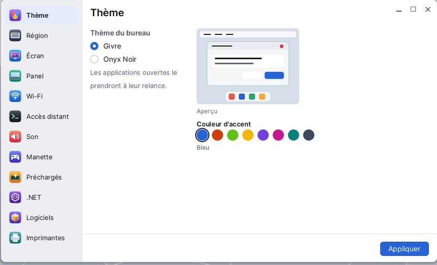

# Settings

**Settings** is the Korin OS control panel: the desktop theme, the keyboard and language, the screen resolution, the panel, Wi-Fi, remote access, sound, gamepads, printers... A single window: the list of panes on the left, the chosen pane on the right. Settings opens from the Korin OS menu, **System** category.



## The window

- **On the left**, the list of panes, each with its icon: Theme, Region, Display, Panel, Wi-Fi, Remote Access, Sound, Gamepad, Preloaded, .NET, Software, Printers. A click opens the pane. The mouse wheel scrolls the list if it is too long.
- **On the right**, the pane: its title, its settings, and at the bottom a message and the **Apply** button. Nothing changes before **Apply** (except in the panes that act at once: Wi-Fi, Preloaded, Printers).

Settings are written to files in `SD0:/etc` and kept at the next startup.

## Theme

The look of the desktop.

- **Desktop Theme**: **Givre** (light) or **Onyx Noir** (dark).
- **Accent Color**: Blue, Red Orange, Bright Green, Yellow, Purple, Fuchsia, Teal or Graphite.
- The **Preview**, on the right, shows a small desktop in the chosen colors.

**Apply**: the wallpaper, the menu bar and the panel change at once; applications already open will take the theme when they restart.

## Region

The **Region and Language** pane: keyboard, language and time of this device.

- **Keyboard Layout**: the layouts of `SD0:/res/keyb` (French AZERTY, QWERTY...). It changes as soon as you **Apply**.
- **Language**: **Français** or **English**. Each application takes it at its next start. Translation is ongoing: some applications stay in French.
- **Country (Wi-Fi)**: France, Belgium, Switzerland, Luxembourg, Canada, Germany, United Kingdom, United States. It sets the allowed Wi-Fi channels.
- **Time Zone (NTP)**: first choose a region (Europe, America, Asia...), then the city in the list below. The time comes from the network (NTP).

## Display

The screen **Resolution**, changed without restarting.

1. Choose a resolution in the list. **(native)** marks the screen's own resolution, the sharpest; **(display)** the ones the screen announces itself.
2. **Apply**: the screen changes at once.
3. A question appears: "Keep this resolution? Reverting in 15 s." Choose **Keep**, or **Revert**.

Without an answer after 15 seconds, the previous resolution comes back by itself: a black or unreadable screen cannot lock you out. A kept resolution is also used at the next startup.

## Panel

The panel is the bar at the bottom of the desktop.

- **Shortcuts**: on the left, **On the panel**, the applications that have a shortcut there; on the right, **All applications**. Choose an application on the right, then **< Add** (or double-click it). **Remove** takes the chosen shortcut away; the **^** and **v** arrows move it. Twelve shortcuts at most.
- **Desktops**: the **Count** of workspaces (from 1 to 6) and the name of each one, shown by the panel square.
- At the top of the pane: the panel **Size** (Automatic, Large, Medium, Small) and the **Trash** box.

**Apply** saves and restarts the panel; **Revert** goes back to what was saved.

## Wi-Fi

This pane acts at once, without **Apply**.

- **At the top**, the state: the network, the address, the gateway and the signal; **Disconnect** cuts the connection.
- **Visible Networks**: each network with its signal, a padlock if it is protected, a check mark on the current network. **Refresh** searches again.
- **Connect**: a click on a network unfolds its row; type its key (at least 8 characters), then **Connect**. The network is remembered.
- **Known Networks**: the remembered networks, with their **priority** (**-** and **+** buttons); **Forget** removes one.

Without a Wi-Fi chip (or under QEMU), the pane says so: "No Wi-Fi on this device".

## Remote Access

Control Korin OS from another computer.

- **Services**: four boxes. **Remote Terminal (telnet)**, **Remote Desktop (VNC)**, **Remote Windows (RDP)**, **File Sharing (FTP)**.
- **Shared Password**: type it in **Password** and **Confirm**. Empty fields: it stays the same. No space at the start or end.

**Apply** saves. Checked services start at the next startup; the password counts at once (it is read at every connection). Without a password, enabled services refuse every connection.

## Sound

- **Preferred Main Output**: **Automatic**, or a given output (USB, HDMI, headphone jack).
- **Main Volume**: the starting volume, 25 %, 50 %, 75 % or 100 %.
- **I2S Microphone (INMP441)**: starts the I2S microphone at startup (takes effect at restart).
- **Test sound when applying**: plays a short A note when you apply.

## Gamepad

The gamepad buttons seen by games and emulators.

- **Keyboard tab**: the keyboard key that stands in for each button. Touch a row, then press the key (Esc: cancel).
- **Gamepad 1, 2, 3 tabs**: what the plugged gamepad sends, live, and what applications see. **Configure** asks for each button in turn ("Press the BOTTOM button (Xbox A)"...): press it; **Esc** if your gamepad does not have this button, **Backspace** to give up. **Forget** gives the model back its default buttons.

The setting is written to `SD0:/etc/gamepad.ini` and taken at once by applications.

## Preloaded

The **Preloading** pane keeps programs in memory so that they start faster.

- On the left, **Programs**: the applications and programs of the card.
- On the right, **Preloaded**: those in the list, with their state (**preloaded** or **not yet**).
- The **→** arrow adds the program chosen on the left and loads it at once; the **←** arrow removes the one chosen on the right. **Refresh** reads both lists again.

## .NET

The **.NET Assemblies** pane: one box per `.dll` library of `SD0:/dotnet`, with its size. Checked, they are kept in memory and shared by .NET programs, which start faster. **Apply** loads them, and will do it again at each startup. If .NET is not on the card, the pane says so.

## Software

Updates and packages have their own window: choosing this pane opens [Software](help:pkgman), and the **Open** button opens it again.

## Printers

This pane acts at once.

- **Printers**: the PDF printer, always there (it asks for the file name at each print), and the added network printers. For the chosen one: **Default** makes it the default printer, **Test** prints a test page, **Check** asks the printer for its state, **Remove** removes it (not the PDF printer).
- **Add a Network Printer**: **Search** scans the network; pick one, then **Add**. Or type its **Address** (its IP address, like 192.168.1.30, or `ipp://host:631/ipp/print`) and an optional **Name**, then **Add**. IPP Everywhere and AirPrint printers work without a driver.
- **Print Queue**: the jobs and their state (waiting, preparing, sending, printing, done, failed, canceled). **Cancel** stops the chosen job; **Clear Finished** cleans up the list.

The PDF printer's test page is saved as `SD0:/home/documents/Page d'essai.pdf`.

## Opening a pane directly

The name of a pane, given as an argument, opens Settings on that pane, for example from the [Terminal](help:terminal):

```sh
control wifi
```

| Pane | Name |
|---|---|
| Theme | `theme` |
| Region | `clavier` |
| Display | `ecran` |
| Panel | `panelconf` |
| Wi-Fi | `wifi` |
| Remote Access | `remote` |
| Sound | `sound` |
| Gamepad | `padconf` |
| Preloaded | `preload` |
| .NET | `dotnet` |
| Software | `pkgman` |
| Printers | `printconf` |

## Tips

- After changing the theme or the language, close and reopen the open applications so that they take it.
- If a resolution makes the screen unreadable, touch nothing: it cancels itself after 15 seconds.
- The [PocketQI](help:pocketqi) assistant can open Settings on the right pane: "change the theme".
