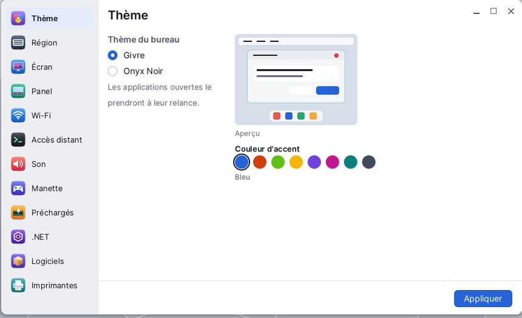

# Réglages

**Réglages** est le panneau de configuration de Korin OS : le thème du bureau, le clavier et la langue, la résolution de l'écran, le panel, le Wi-Fi, l'accès à distance, le son, les manettes, les imprimantes... Une seule fenêtre : la liste des volets à gauche, le volet choisi à droite. Réglages s'ouvre par le menu Korin OS, catégorie **Système**.



## La fenêtre

- **À gauche**, la liste des volets, chacun avec son icône : Thème, Région, Écran, Panel, Wi-Fi, Accès distant, Son, Manette, Préchargés, .NET, Logiciels, Imprimantes. Un clic ouvre le volet. La molette fait défiler la liste si elle dépasse.
- **À droite**, le volet : son titre, ses réglages, et en bas un message et le bouton **Appliquer**. Rien n'est changé avant **Appliquer** (sauf dans les volets qui agissent tout de suite : Wi-Fi, Préchargés, Imprimantes).

Les réglages sont écrits dans des fichiers de `SD0:/etc` et gardés au prochain démarrage.

## Thème

Le look du bureau.

- **Thème du bureau** : **Givre** (clair) ou **Onyx Noir** (sombre).
- **Couleur d'accent** : Bleu, Rouge orangé, Vert vif, Jaune, Violet, Fuchsia, Sarcelle ou Graphite.
- L'**Aperçu**, à droite, montre un petit bureau dans les couleurs choisies.

**Appliquer** : le fond d'écran, la barre de menus et le panel changent aussitôt ; les applications déjà ouvertes prendront le thème à leur relance.

## Région

Le volet **Région et langue** : clavier, langue et heure de cet appareil.

- **Disposition du clavier** : les dispositions de `SD0:/res/keyb` (AZERTY français, QWERTY...). Elle change dès **Appliquer**.
- **Langue** : **Français** ou **English**. Chaque application la prend à son prochain démarrage. La traduction est progressive : certaines applications restent en français.
- **Pays (Wi-Fi)** : France, Belgique, Suisse, Luxembourg, Canada, Allemagne, Royaume-Uni, États-Unis. Il fixe les canaux Wi-Fi permis.
- **Fuseau horaire (NTP)** : choisissez d'abord une région (Europe, Amérique, Asie...), puis la ville dans la liste en dessous. L'heure vient du réseau (NTP).

## Écran

La **Résolution** de l'écran, changée sans redémarrer.

1. Choisissez une résolution dans la liste. **(natif)** marque la résolution propre à l'écran, la plus nette ; **(écran)** celles que l'écran annonce lui-même.
2. **Appliquer** : l'écran change tout de suite.
3. Une question s'affiche : « Garder cette résolution ? Retour dans 15 s. » Choisissez **Garder**, ou **Revenir**.

Sans réponse au bout de 15 secondes, l'ancienne résolution revient seule : un écran noir ou illisible ne vous bloque donc pas. Une résolution gardée l'est aussi au prochain démarrage.

## Panel

Le panel est la barre du bas du bureau.

- **Raccourcis** : à gauche, **Sur le panel**, les applications qui y ont un raccourci ; à droite, **Toutes les applications**. Choisissez une application à droite, puis **< Ajouter** (ou double-cliquez dessus). **Retirer** enlève le raccourci choisi ; les flèches **^** et **v** le déplacent. Douze raccourcis au plus.
- **Bureaux** : le **Nombre** d'espaces de travail (de 1 à 6) et le nom de chacun, affiché par le carré du panel.
- En haut du volet : la **Taille** du panel (Automatique, Grande, Moyenne, Petite) et la case **Corbeille**.

**Appliquer** enregistre et relance le panel ; **Rétablir** revient à ce qui était enregistré.

## Wi-Fi

Ce volet agit tout de suite, sans **Appliquer**.

- **En haut**, l'état : le réseau, l'adresse, la passerelle et le signal ; **Déconnecter** coupe la connexion.
- **Réseaux visibles** : chaque réseau avec son signal, un cadenas s'il est protégé, une coche sur le réseau courant. **Actualiser** relance la recherche.
- **Se connecter** : un clic sur un réseau déplie sa ligne ; tapez sa clé (8 caractères au moins), puis **Se connecter**. Le réseau est mémorisé.
- **Réseaux connus** : les réseaux mémorisés, avec leur **priorité** (boutons **-** et **+**) ; **Oublier** en retire un.

Sans puce Wi-Fi (ou sous QEMU), le volet le dit : « Pas de Wi-Fi sur cet appareil ».

## Accès distant

Le volet **Accès à distance** : piloter Korin OS depuis un autre ordinateur.

- **Services** : quatre cases. **Terminal à distance (telnet)**, **Bureau à distance (VNC)**, **Fenêtres à distance (RDP)**, **Partage de fichiers (FTP)**.
- **Mot de passe commun** : tapez-le dans **Mot de passe** et **Confirmer**. Champs vides : il ne change pas. Pas d'espace au début ni à la fin.

**Appliquer** enregistre. Les services cochés démarrent au prochain démarrage ; le mot de passe compte tout de suite (il est relu à chaque connexion). Sans mot de passe, les services activés refusent toute connexion.

## Son

- **Sortie principale préférée** : **Automatique**, ou une sortie précise (USB, HDMI, prise jack).
- **Volume principal** : le volume de départ, 25 %, 50 %, 75 % ou 100 %.
- **Micro I2S (INMP441)** : démarre le micro I2S au démarrage (effet au redémarrage).
- **Son d'essai en appliquant** : joue un la court quand on applique.

## Manette

Les boutons de manette que voient les jeux et les émulateurs.

- **Onglet Clavier** : la touche du clavier qui tient lieu de chaque bouton. Touchez une ligne, puis appuyez sur la touche (Échap : annuler).
- **Onglets Manette 1, 2, 3** : ce que la manette branchée envoie, en direct, et ce que les applications voient. **Configurer** demande chaque bouton tour à tour (« Appuyez sur le bouton du BAS (Xbox A) »...) : appuyez dessus ; **Échap** si ce bouton n'existe pas sur votre manette, **Retour arrière** pour abandonner. **Oublier** rend au modèle les boutons par défaut.

Le réglage est écrit dans `SD0:/etc/gamepad.ini` et pris aussitôt par les applications.

## Préchargés

Le volet **Préchargement** garde des programmes en mémoire pour qu'ils démarrent plus vite.

- À gauche, **Programmes** : les applications et les programmes de la carte.
- À droite, **Préchargés** : ceux de la liste, avec leur état (**préchargé** ou **pas encore**).
- La flèche **→** ajoute le programme choisi à gauche et le charge tout de suite ; la flèche **←** retire celui choisi à droite. **Actualiser** relit les deux listes.

## .NET

Le volet **Assemblys .NET** : une case par bibliothèque `.dll` de `SD0:/dotnet`, avec sa taille. Cochées, elles sont gardées en mémoire et partagées par les programmes .NET, qui démarrent plus vite. **Appliquer** les charge, et le refera à chaque démarrage. Si .NET n'est pas sur la carte, le volet le dit.

## Logiciels

Les mises à jour et les paquets ont leur propre fenêtre : choisir ce volet ouvre [Logiciels](help:pkgman), et le bouton **Ouvrir** la rouvre.

## Imprimantes

Ce volet agit tout de suite.

- **Imprimantes** : l'imprimante PDF, toujours présente (elle demande le nom du fichier à chaque impression), et les imprimantes réseau ajoutées. Pour celle choisie : **Défaut** en fait l'imprimante par défaut, **Essai** imprime une page d'essai, **Vérifier** interroge l'imprimante, **Retirer** la retire (pas l'imprimante PDF).
- **Ajouter une imprimante réseau** : **Chercher** parcourt le réseau ; choisissez-en une, puis **Ajouter**. Ou tapez son **Adresse** (son adresse IP, comme 192.168.1.30, ou `ipp://hôte:631/ipp/print`) et un **Nom** facultatif, puis **Ajouter**. Les imprimantes IPP Everywhere et AirPrint marchent sans pilote.
- **File d'impression** : les travaux en cours et leur état (en attente, préparation, envoi, impression, fini, échec, annulé). **Annuler** arrête le travail choisi ; **Effacer les finis** nettoie la liste.

La page d'essai de l'imprimante PDF s'enregistre sous `SD0:/home/documents/Page d'essai.pdf`.

## Ouvrir un volet directement

Le nom d'un volet, donné en argument, ouvre Réglages sur ce volet, par exemple depuis le [Terminal](help:terminal) :

```sh
control wifi
```

| Volet | Nom |
|---|---|
| Thème | `theme` |
| Région | `clavier` |
| Écran | `ecran` |
| Panel | `panelconf` |
| Wi-Fi | `wifi` |
| Accès distant | `remote` |
| Son | `sound` |
| Manette | `padconf` |
| Préchargés | `preload` |
| .NET | `dotnet` |
| Logiciels | `pkgman` |
| Imprimantes | `printconf` |

## Astuces

- Après un changement de thème ou de langue, fermez et rouvrez les applications ouvertes pour qu'elles le prennent.
- Si une résolution rend l'écran illisible, ne touchez à rien : elle s'annule seule au bout de 15 secondes.
- L'assistante [PocketQI](help:pocketqi) sait ouvrir Réglages sur le bon volet : « change le thème ».
