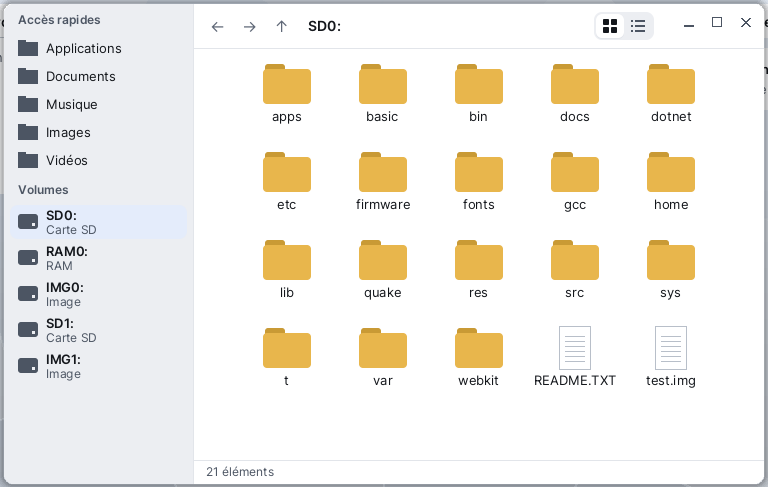

# Files

**Files** is the Korin OS file browser. On the left, the connected volumes (the SD card, a USB drive...) and the quick access places; on the right, the content of the current folder. Use it to browse the card, open a document or an application, create and delete folders, and unmount a USB drive before removing it. Files opens from the Korin OS menu, **System** category.



## The window

- **The left panel** first shows the **Quick Access** places (Applications, Documents, Music, Pictures, Videos...), then the **Volumes**. Each volume shows its name and its kind: **SD Card**, **USB Drive**, **RAM** or **Image**. A USB drive has an eject button at the right of its row. The volume list updates by itself when a drive is plugged in or removed.
- **The header**, at the top right: the ← (back), → (forward) and ↑ (parent folder) buttons, the **breadcrumb** (the path of the current folder, one segment per folder), and the view choice: icons or list.
- **The content** of the folder: folders first, then files, in alphabetical order. An application (a `.app` folder) shows with its icon and its name.
- **The status line**, at the bottom: the number of items, or the name and size of the chosen item, or the result of the last action ("Deleted", "Volume unmounted"...).

## Moving around

- **Enter a folder**: double-click it, or choose it and press Enter.
- **Go up one folder**: the ↑ button, the Backspace key, or **Go > Parent Folder**. The folder you just left stays chosen.
- **Go back, then forward**: the ← and → buttons. They are grayed out when there is nothing before or after.
- **Jump to a folder of the path**: click a segment of the breadcrumb. A path that is too long is cut on the left; the "…" leads to the folder it replaces.
- **Go to a quick access place or a volume**: click it in the left panel, or use the **Go** menu, which lists the quick access places and **SD0:**.

## Opening a file

Double-click, or Enter (menu **File > Open**). What happens depends on the item:

| Item | What opens |
|---|---|
| A folder | you enter it |
| An application (`name.app`) | the application starts |
| A program (executable file) | it is started; the status line says "Program started" |
| Any other file | the application that declares its extension, otherwise the Editor |

An application declares the extensions it can open in its manifest (`app.txt`, `opens` line). A `.txt` file, like any file no application claims, opens in the Editor.

## Creating a folder

1. Go to the folder that must contain it.
2. **File > New Folder** (Ctrl+N).

The folder is named "New Folder", or "New Folder 2", "New Folder 3"... if the name is already taken.

## Deleting

1. Choose the file or folder.
2. **File > Delete**, or the Delete key.
3. A small menu asks for confirmation: **Delete "name"** or **Cancel**.

Deleting is final: Files has no trash. A folder must be empty to be deleted; otherwise the status line says "The folder is not empty".

## Choosing the view

- **Icons**: a grid of large icons, the name under each one.
- **List**: one row per item, with the **Name**, **Size** and **Type** columns (Folder, Application, File).

Choose it in the **View** menu or with the small two-segment control in the header. In list view:

- clicking a column title sorts by that column; a second click reverses the order (a ▲ or ▼ arrow shows it);
- widen a column by dragging the separator between two titles.

The view and the column widths are remembered for next time.

## Removing a USB drive

Before unplugging a drive, unmount it so that everything is written:

- click its eject button, in the left panel;
- or, while in a folder of the drive, **Volume > Unmount Current Volume**.

The status line says "Volume unmounted". If a drive is removed without being unmounted while you were in it, Files goes back to **SD0:** ("Volume removed: back to SD0:").

## Menus and shortcuts

| Menu | Command | Shortcut |
|---|---|---|
| File | Open | Enter |
| File | New Folder | Ctrl+N |
| File | Delete | Delete |
| File | Refresh | Ctrl+L or F5 |
| File | Close | Ctrl+W |
| Go | Parent Folder | Backspace |
| Go | the quick access places, SD0: | |
| View | Icons, List | |
| Volume | Unmount Current Volume | |

With the keyboard, in the content:

| Key | Effect |
|---|---|
| Up and Down arrows | previous or next item (one row in icon view) |
| Left and Right arrows | previous or next item, in icon view |
| Home, End | first or last item |
| Enter | open |
| Backspace | parent folder |
| Delete | delete, after confirmation |

## Quick access places

The quick access list comes from the file `SD0:/etc/places.ini`, one line per place, in order:

```sh
Applications = SD0:/apps
Documents = SD0:/home/documents
Musique = SD0:/home/music
```

On the left the displayed name, on the right the folder. A folder that does not exist is not shown. You can edit this file in the Editor; **File > Refresh** reads the list again.

## Tips

- **Refresh** (Ctrl+L or F5) reads the folder and the volumes again, without losing the chosen item: useful after copying a file from the [Terminal](help:terminal).
- Files does not copy: to copy a file, use the `cp` command of the [Terminal](help:terminal).
- Installed applications are in **SD0:/apps** (the **Applications** quick access); [Software](help:pkgman) installs and removes them.
