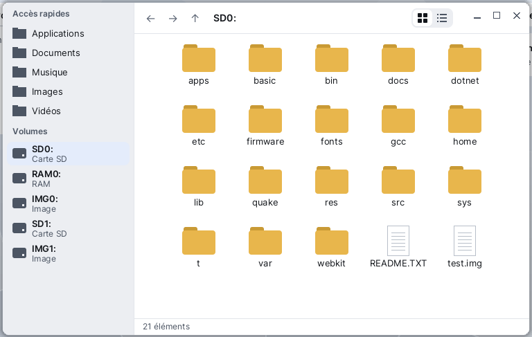

# Fichiers

**Fichiers** est le navigateur de fichiers de Korin OS. À gauche, les volumes branchés (la carte SD, une clé USB...) et les accès rapides ; à droite, le contenu du dossier courant. On y parcourt la carte, on ouvre un document ou une application, on crée et on supprime des dossiers, et on démonte une clé USB avant de la retirer. Fichiers s'ouvre par le menu Korin OS, catégorie **Système**.



## La fenêtre

- **Le panneau de gauche** montre d'abord les **Accès rapides** (Applications, Documents, Musique, Images, Vidéos...), puis les **Volumes**. Chaque volume affiche son nom et son genre : **Carte SD**, **Clé USB**, **RAM** ou **Image**. Une clé USB a un bouton d'éjection à droite de sa ligne. La liste des volumes se met à jour toute seule quand on branche ou retire une clé.
- **L'en-tête**, en haut à droite : les boutons ← (précédent), → (suivant) et ↑ (dossier parent), le **fil d'Ariane** (le chemin du dossier courant, un segment par dossier), et le choix de la vue : icônes ou liste.
- **Le contenu** du dossier : les dossiers d'abord, puis les fichiers, par ordre alphabétique. Une application (un dossier `.app`) apparaît avec son icône et son nom.
- **La ligne d'état**, en bas : le nombre d'éléments, ou le nom et la taille de l'élément choisi, ou le résultat de la dernière action (« Supprimé », « Volume démonté »...).

## Se déplacer

- **Entrer dans un dossier** : double-clic dessus, ou le choisir et appuyer sur Entrée.
- **Remonter d'un dossier** : le bouton ↑, la touche Retour arrière, ou **Aller > Dossier parent**. Le dossier qu'on vient de quitter reste choisi.
- **Revenir en arrière, puis en avant** : les boutons ← et →. Ils sont grisés quand il n'y a rien avant ou après.
- **Sauter à un dossier du chemin** : un clic sur un segment du fil d'Ariane. Un chemin trop long est coupé à gauche ; le « … » mène au dossier qu'il remplace.
- **Aller à un accès rapide ou à un volume** : un clic dans le panneau de gauche, ou le menu **Aller**, qui liste les accès rapides et **SD0:**.

## Ouvrir un fichier

Double-clic, ou Entrée (menu **Fichier > Ouvrir**). Ce qui se passe dépend de l'élément :

| Élément | Ce qui s'ouvre |
|---|---|
| Un dossier | on y entre |
| Une application (`nom.app`) | l'application démarre |
| Un programme (fichier exécutable) | il est lancé ; la ligne d'état dit « Programme lancé » |
| Un autre fichier | l'application qui déclare son extension, sinon l'Éditeur |

Une application déclare les extensions qu'elle sait ouvrir dans son manifeste (`app.txt`, ligne `opens`). Un fichier `.txt`, comme tout fichier qu'aucune application ne réclame, s'ouvre dans l'Éditeur.

## Créer un dossier

1. Allez dans le dossier qui doit le contenir.
2. **Fichier > Nouveau dossier** (Ctrl+N).

Le dossier s'appelle « Nouveau dossier », ou « Nouveau dossier 2 », « Nouveau dossier 3 »... si le nom est déjà pris.

## Supprimer

1. Choisissez le fichier ou le dossier.
2. **Fichier > Supprimer**, ou la touche Suppr.
3. Un petit menu demande confirmation : **Supprimer « nom »** ou **Annuler**.

La suppression est définitive : il n'y a pas de corbeille dans Fichiers. Un dossier doit être vide pour être supprimé ; sinon la ligne d'état dit « Le dossier n'est pas vide ».

## Choisir la vue

- **Icônes** : une grille de grandes icônes, le nom sous chacune.
- **Liste** : une ligne par élément, avec les colonnes **Nom**, **Taille** et **Type** (Dossier, Application, Fichier).

Le choix se fait dans le menu **Affichage** ou par le petit contrôle à deux segments de l'en-tête. En vue liste :

- un clic sur le titre d'une colonne trie par cette colonne ; un second clic inverse l'ordre (une flèche ▲ ou ▼ le montre) ;
- on élargit une colonne en faisant glisser le séparateur entre deux titres.

La vue et la largeur des colonnes sont retenues pour la prochaine fois.

## Retirer une clé USB

Avant de débrancher une clé, démontez-la pour que tout soit bien écrit :

- un clic sur son bouton d'éjection, dans le panneau de gauche ;
- ou, quand on est dans un dossier de la clé, **Volume > Démonter le volume courant**.

La ligne d'état dit « Volume démonté ». Si une clé est retirée sans être démontée alors qu'on y était, Fichiers revient à **SD0:** (« Volume retiré : retour à SD0: »).

## Menus et raccourcis

| Menu | Commande | Raccourci |
|---|---|---|
| Fichier | Ouvrir | Entrée |
| Fichier | Nouveau dossier | Ctrl+N |
| Fichier | Supprimer | Suppr |
| Fichier | Actualiser | Ctrl+L ou F5 |
| Fichier | Fermer | Ctrl+W |
| Aller | Dossier parent | Retour arrière |
| Aller | les accès rapides, SD0: | |
| Affichage | Icônes, Liste | |
| Volume | Démonter le volume courant | |

Au clavier, dans le contenu :

| Touche | Effet |
|---|---|
| Flèches haut et bas | élément précédent ou suivant (une rangée en vue icônes) |
| Flèches gauche et droite | élément précédent ou suivant, en vue icônes |
| Début, Fin | premier ou dernier élément |
| Entrée | ouvrir |
| Retour arrière | dossier parent |
| Suppr | supprimer, après confirmation |

## Les accès rapides

La liste des accès rapides vient du fichier `SD0:/etc/places.ini`, une ligne par accès, dans l'ordre :

```sh
Applications = SD0:/apps
Documents = SD0:/home/documents
Musique = SD0:/home/music
```

À gauche le nom affiché, à droite le dossier. Un dossier qui n'existe pas n'est pas montré. On peut modifier ce fichier dans l'Éditeur ; **Fichier > Actualiser** relit la liste.

## Astuces

- **Actualiser** (Ctrl+L ou F5) relit le dossier et les volumes, sans perdre l'élément choisi : utile après avoir copié un fichier depuis le [Terminal](help:terminal).
- Fichiers ne copie pas : pour copier un fichier, servez-vous de la commande `cp` du [Terminal](help:terminal).
- Les applications installées sont dans **SD0:/apps** (accès rapide **Applications**) ; [Logiciels](help:pkgman) les installe et les retire.
