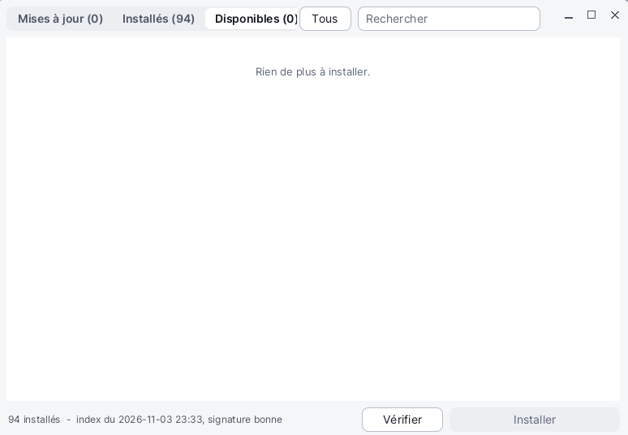

# Software

**Software** is the Korin OS package manager: it installs the applications of the repository, updates them, and removes the ones you no longer want. It also updates the system itself. It needs the network (Wi-Fi, set up in [Settings](help:control)). Software opens from the Korin OS menu, **System** category, or from the **Software** pane of Settings.



## The window

- **At the top**, three tabs, each with its number of packages: **Updates**, **Installed**, **Available**; next to them, the **All** button and the **Find** field.
- **In the middle**, the list of packages. Each row shows a check box, the icon, the name, the version (`1.2 → 1.3` when an update exists), the category and a one-sentence description, and on the right the size or the row's buttons.
- **At the bottom**, the status line (the number of installed packages, the date of the repository index and its signature, or the progress of the running job), the **Check** button and the main button (**Install**, **Remove**...), whose text follows the tab and the number of checked boxes.

When it opens, Software shows the last known index at once, then reads the repository again by itself. It opens on the **Updates** tab, or on **Available** if there is nothing to update.

## Installing an application

1. **Available** tab.
2. Type part of the name in **Find** if the list is long.
3. Click **Install**, at the end of the row.

To install several at once: check their boxes, then the bottom button, **Install 3 packages**.

The progress shows on the package row and in the status line ("Installing 2048: 40 %"). At the end, the row says **Installed** and the application appears in the Korin OS menu.

## Updating

1. **Updates** tab: each package that has a newer version in the repository, already checked (except those set to **Never**).
2. Uncheck the ones you want to leave as they are.
3. The bottom button: **Install 4 updates**.

An updated application opens in its new version the next time it starts. A running application cannot be updated: close it first.

In the **Available** tab, a package that is installed but older has an **Update** button.

## The system update

The system package (kernel, kits, desktop, services) carries the **restart** badge: it cannot change while it runs. Once installed, its row says **Ready: at restart** (**staged** badge), and a banner appears at the top of the list:

> **Restart to finish the system update**

Its **Restart** button asks for confirmation, then restarts the device. The update is put in place at startup; the old kernel is kept as `.old`. You can also restart later: the update waits.

## Removing an application

1. **Installed** tab.
2. Click **Remove**, at the end of the row.
3. Confirm: "Remove 2048 1.2? (changed settings are kept)".

To remove several: check them, then the bottom button, **Remove 2 packages**. Packages that are part of the system have neither a box nor a **Remove** button. The settings you changed stay on the card.

## Choosing how each package updates

In the **Installed** tab, each row has three choices:

| Choice | Effect |
|---|---|
| **Manual** | the update is offered in the **Updates** tab (the default) |
| **Auto** | the package updates by itself, in the background |
| **Never** | the package keeps its version; its update is not checked |

In the background, the `pkgd` service reads the repository once a day, when the network and the time are available: it installs the **Auto** packages and sends a notification for the other updates.

## Buttons and keys

| Element | Effect |
|---|---|
| **Updates**, **Installed**, **Available** | switch tabs |
| **Find** | filters the list of all three tabs |
| **All** / **None** | checks or unchecks all visible rows |
| **Check** | reads the repository index again |
| main button | installs or removes the checked packages |
| mouse wheel, or drag with a finger | scrolls the list |

One job at a time: during an installation, the buttons are grayed out. Closing the window stops the running job.

## From the Terminal

The `pkg` command does the same in the [Terminal](help:terminal):

```sh
pkg list
pkg list -a
pkg info 2048
pkg add 2048
pkg delete 2048
pkg update -a
pkg mode 2048 auto
```

`pkg list` lists the installed packages, `-a` the whole repository; `pkg check` reads the index again.

## Tips

- If the list is empty with "The repository has not been read yet: Check.", check the Wi-Fi then click **Check**.
- "That did not work.": most often, the application is still running, or the network is down.
- When Software updates itself, it restarts by itself ("The manager updated itself: it restarts...").
- The [PocketQI](help:pocketqi) assistant can open Software on the updates tab.
