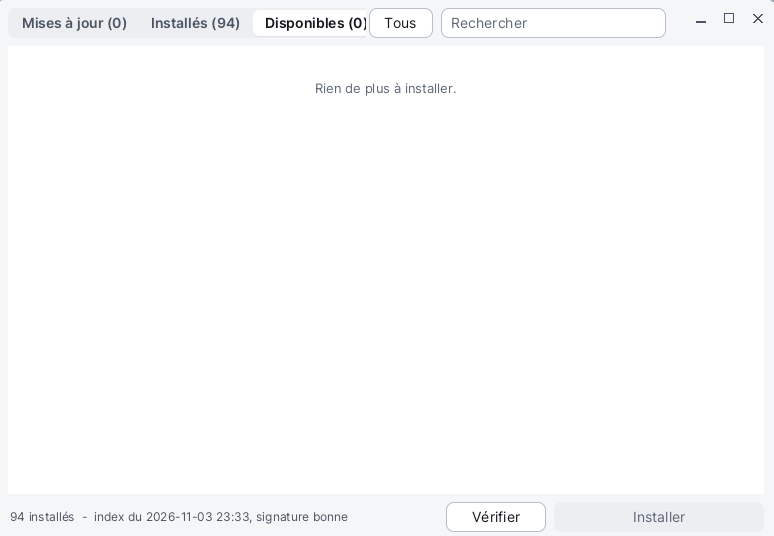

# Logiciels

**Logiciels** est le gestionnaire de paquets de Korin OS : il installe les applications du dépôt, les met à jour, et retire celles dont on ne veut plus. Il met aussi à jour le système lui-même. Il faut le réseau (le Wi-Fi, réglé dans [Réglages](help:control)). Logiciels s'ouvre par le menu Korin OS, catégorie **Système**, ou par le volet **Logiciels** des Réglages.



## La fenêtre

- **En haut**, trois onglets, chacun avec son nombre de paquets : **Mises à jour**, **Installés**, **Disponibles** ; à côté, le bouton **Tous** et le champ **Rechercher**.
- **Au milieu**, la liste des paquets. Chaque ligne montre une case à cocher, l'icône, le nom, la version (`1.2 → 1.3` quand une mise à jour existe), la catégorie et une phrase de description, et à droite la taille ou les boutons de la ligne.
- **En bas**, la ligne d'état (le nombre de paquets installés, la date de l'index du dépôt et sa signature, ou la progression du travail en cours), le bouton **Vérifier** et le bouton principal (**Installer**, **Retirer**...), dont le texte suit l'onglet et le nombre de cases cochées.

À l'ouverture, Logiciels montre aussitôt le dernier index connu, puis relit le dépôt de lui-même. Il s'ouvre sur l'onglet **Mises à jour**, ou sur **Disponibles** s'il n'y a rien à mettre à jour.

## Installer une application

1. Onglet **Disponibles**.
2. Tapez une partie du nom dans **Rechercher** si la liste est longue.
3. Un clic sur **Installer**, au bout de la ligne.

Pour en installer plusieurs d'un coup : cochez leurs cases, puis le bouton du bas, **Installer 3 paquets**.

La progression s'affiche sur la ligne du paquet et dans la ligne d'état (« Installation de 2048 : 40 % »). À la fin, la ligne dit **Installé** et l'application apparaît dans le menu Korin OS.

## Mettre à jour

1. Onglet **Mises à jour** : chaque paquet qui a une version plus récente au dépôt, déjà coché (sauf ceux réglés sur **Jamais**).
2. Décochez ceux que vous voulez laisser.
3. Le bouton du bas : **Installer 4 mises à jour**.

Une application mise à jour s'ouvre dans sa nouvelle version au prochain lancement. Une application qui tourne ne peut pas être mise à jour : fermez-la d'abord.

Dans l'onglet **Disponibles**, un paquet déjà installé mais plus ancien a un bouton **Mettre à jour**.

## La mise à jour du système

Le paquet du système (noyau, kits, bureau, services) porte le badge **redémarrage** : il ne peut pas changer pendant qu'il tourne. Une fois installé, sa ligne dit **Prêt : au redémarrage** (badge **étagé**), et un bandeau apparaît en haut de la liste :

> **Redémarrer pour finir la mise à jour du système**

Son bouton **Redémarrer** demande confirmation, puis redémarre l'appareil. La mise à jour se met en place au démarrage ; l'ancien noyau est gardé en `.old`. On peut aussi redémarrer plus tard : la mise à jour attend.

## Retirer une application

1. Onglet **Installés**.
2. Un clic sur **Retirer**, au bout de la ligne.
3. Confirmez : « Retirer 2048 1.2 ? (les réglages changés sont gardés) ».

Pour en retirer plusieurs : cochez-les, puis le bouton du bas, **Retirer 2 paquets**. Les paquets qui font partie du système n'ont ni case ni bouton **Retirer**. Les réglages que vous avez changés restent sur la carte.

## Choisir comment chaque paquet se met à jour

Dans l'onglet **Installés**, chaque ligne a trois choix :

| Choix | Effet |
|---|---|
| **Manuel** | la mise à jour est proposée dans l'onglet **Mises à jour** (par défaut) |
| **Auto** | le paquet se met à jour tout seul, en arrière-plan |
| **Jamais** | le paquet garde sa version ; sa mise à jour n'est pas cochée |

En arrière-plan, le service `pkgd` relit le dépôt une fois par jour, quand le réseau et l'heure sont là : il installe les paquets **Auto** et envoie une notification pour les autres mises à jour.

## Boutons et touches

| Élément | Effet |
|---|---|
| **Mises à jour**, **Installés**, **Disponibles** | changent d'onglet |
| **Rechercher** | filtre la liste des trois onglets |
| **Tous** / **Aucun** | coche ou décoche toutes les lignes visibles |
| **Vérifier** | relit l'index du dépôt |
| bouton principal | installe ou retire les paquets cochés |
| molette, ou glisser du doigt | fait défiler la liste |

Un seul travail à la fois : pendant une installation, les boutons sont grisés. Fermer la fenêtre arrête le travail en cours.

## Depuis le Terminal

La commande `pkg` fait la même chose dans le [Terminal](help:terminal) :

```sh
pkg list
pkg list -a
pkg info 2048
pkg add 2048
pkg delete 2048
pkg update -a
pkg mode 2048 auto
```

`pkg list` liste les paquets installés, `-a` tout le dépôt ; `pkg check` relit l'index.

## Astuces

- Si la liste est vide avec « Le dépôt n'a pas encore été lu : Vérifier. », vérifiez le Wi-Fi puis cliquez **Vérifier**.
- « Cela n'a pas marché. » : le plus souvent, l'application tourne encore, ou le réseau est coupé.
- Quand Logiciels se met à jour lui-même, il se relance tout seul (« Le gestionnaire s'est mis à jour : il redémarre... »).
- L'assistante [PocketQI](help:pocketqi) sait ouvrir Logiciels sur l'onglet des mises à jour.
