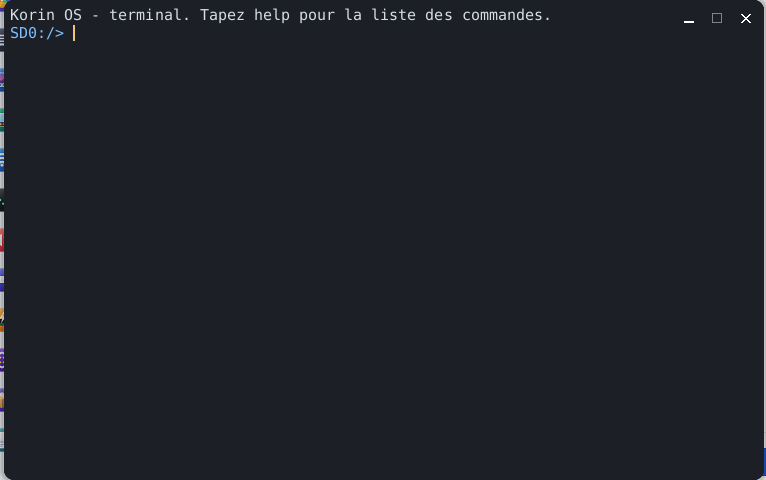

# Terminal

The **Terminal** is the Korin OS console: type commands to browse the card, read a file, see the running programs, and start any program of `SD0:/bin` or application of `SD0:/apps`, whose output is shown in the window. It opens from the Korin OS menu, **System** category.



## The window

A single text area, on a dark background:

- at the top, what has already been shown (the last 400 lines are kept);
- at the bottom, the input line, after the **prompt**: the current folder followed by `>`, for example `SD0:/home> `.

At startup, the Terminal shows "Korin OS - terminal. Type help for the list of commands." It has no menu of its own: everything is done with the keyboard.

## Typing a command

1. Type the command and its arguments, separated by spaces.
2. Press Enter.

```sh
cd SD0:/home/documents
ls
cat notes.txt
```

**help** shows the list of built-in commands. Any other name is looked up as a program (see below).

## Built-in commands

| Command | Effect |
|---|---|
| `ls [path]` | lists a folder (the current folder with no argument), with the size of each file; `dir` does the same |
| `cd [path]` | changes folder; with no argument, goes back to `SD0:/` |
| `pwd` | shows the current folder |
| `cat file` | shows the content of a file |
| `mkdir folder` | creates a folder |
| `rm path` | deletes a file or an empty folder |
| `cp source destination` | copies a file |
| `echo text` | shows the text |
| `echo text > file` | writes the text (and a line break) to the file |
| `ps` | lists the processes: number (PID), thread count, heap memory in KB, name |
| `kill pid` | ends the process with this number |
| `mem` | free and total memory, cores, load, time since startup, process count; `free` does the same |
| `clear` | clears the window |
| `exit` | closes the Terminal |
| `help` | the list of commands |

Paths are written in full (`SD0:/home/documents/letter.txt`) or from the current folder (`documents/letter.txt`).

## Starting a program

Any name that is not a built-in command starts a program, looked up in this order:

1. a full path, for example `SD0:/bin/gcc`;
2. `SD0:/bin/name`;
3. the application `SD0:/apps/name.app`.

The arguments follow the name:

```sh
pkg list
pkg info armpi
```

While a program runs:

- its output is shown in the window as it comes;
- input waits: the program does not read the Terminal's keyboard;
- **Ctrl+C** interrupts it (`^C` is shown).

At the end, if the program returns a code other than 0, the Terminal shows it: `[exit code 1]`. If the name is found nowhere: `command not found: name`.

A system program (from `SD0:/sys`) is started separately, without waiting: the Terminal shows its number and its output goes to the system log (`[started by init2: pid 42, output in the log]`).

## The sh shell

The Terminal understands its own simple commands; for a real script (variables, `if`, `for`, `|` pipes, redirections), Korin OS has the `sh` shell, a subset of POSIX. Give it a command file:

```sh
sh SD0:/home/scripts/backup.sh
```

Like any program started from the Terminal, `sh` does not read the keyboard there: the interactive `sh` session is the one of the remote terminal (telnet, to enable in [Settings](help:control), **Remote Access** pane). In `sh`, `help` lists its built-in commands.

## Keys

| Key | Effect |
|---|---|
| Enter | runs the line |
| Left and Right arrows | move the cursor in the line |
| Home, End | start or end of the line |
| Backspace, Delete | erase the character before or under the cursor |
| Up and Down arrows | recall the previous commands (the last 16) |
| Page Up, Page Down | scroll the output |
| Mouse wheel | scrolls the output, three lines per notch |
| Ctrl+C | interrupts the running program |

Any keystroke brings the view back to the bottom, on the input line.

## Tips

- `ls SD0:/apps` shows the installed applications; their name without `.app` starts them.
- `ps` then `kill` stop an application that no longer responds.
- `mem` shows at a glance the free memory and the load of the cores.
- `clear` starts again from an empty window when the output gets long.
- To browse the card with the mouse, there is [Files](help:files).
