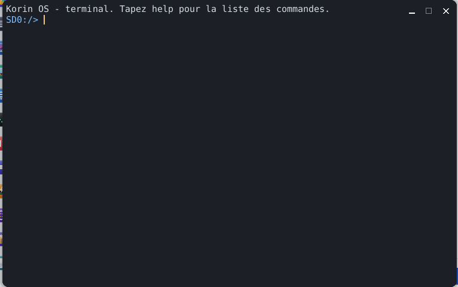

# Terminal

Le **Terminal** est la console de Korin OS : on y tape des commandes pour parcourir la carte, lire un fichier, voir les programmes qui tournent, et on y lance n'importe quel programme de `SD0:/bin` ou application de `SD0:/apps`, dont la sortie s'affiche dans la fenêtre. Il s'ouvre par le menu Korin OS, catégorie **Système**.



## La fenêtre

Une seule zone de texte, sur fond sombre :

- en haut, ce qui a déjà été affiché (les 400 dernières lignes sont gardées) ;
- en bas, la ligne de saisie, précédée de l'**invite** : le dossier courant suivi de `>`, par exemple `SD0:/home> `.

Au démarrage, le Terminal affiche « Korin OS - terminal. Tapez help pour la liste des commandes. » Il n'a pas de menu propre : tout se fait au clavier.

## Taper une commande

1. Tapez la commande et ses arguments, séparés par des espaces.
2. Appuyez sur Entrée.

```sh
cd SD0:/home/documents
ls
cat notes.txt
```

**help** affiche la liste des commandes intégrées. Tout autre nom est cherché comme programme (voir plus bas).

## Les commandes intégrées

| Commande | Effet |
|---|---|
| `ls [chemin]` | liste un dossier (le dossier courant sans argument), avec la taille de chaque fichier ; `dir` fait de même |
| `cd [chemin]` | change de dossier ; sans argument, revient à `SD0:/` |
| `pwd` | affiche le dossier courant |
| `cat fichier` | affiche le contenu d'un fichier |
| `mkdir dossier` | crée un dossier |
| `rm chemin` | supprime un fichier ou un dossier vide |
| `cp source destination` | copie un fichier |
| `echo texte` | affiche le texte |
| `echo texte > fichier` | écrit le texte (et un saut de ligne) dans le fichier |
| `ps` | liste les process : numéro (PID), nombre de threads, mémoire du tas en Ko, nom |
| `kill pid` | termine le process de ce numéro |
| `mem` | mémoire libre et totale, cœurs, charge, temps depuis le démarrage, nombre de process ; `free` fait de même |
| `clear` | efface la fenêtre |
| `exit` | ferme le Terminal |
| `help` | la liste des commandes |

Les chemins s'écrivent en entier (`SD0:/home/documents/lettre.txt`) ou à partir du dossier courant (`documents/lettre.txt`).

## Lancer un programme

Tout nom qui n'est pas une commande intégrée lance un programme, cherché dans cet ordre :

1. un chemin donné en entier, par exemple `SD0:/bin/gcc` ;
2. `SD0:/bin/nom` ;
3. l'application `SD0:/apps/nom.app`.

Les arguments suivent le nom :

```sh
pkg list
pkg info armpi
```

Pendant qu'un programme tourne :

- sa sortie s'affiche au fur et à mesure dans la fenêtre ;
- la saisie attend : le programme ne lit pas le clavier du Terminal ;
- **Ctrl+C** l'interrompt (`^C` s'affiche).

À la fin, si le programme rend un code autre que 0, le Terminal l'affiche : `[code de sortie 1]`. Si le nom n'est trouvé nulle part : `commande introuvable : nom`.

Un programme système (de `SD0:/sys`) est lancé à part, sans attendre : le Terminal affiche son numéro et sa sortie va dans le journal du système (`[lancé par init2 : pid 42, sortie dans le journal]`).

## Le shell sh

Le Terminal comprend ses commandes simples ; pour un vrai script (variables, `if`, `for`, tubes `|`, redirections), Korin OS a le shell `sh`, un sous-ensemble de POSIX. On lui donne un fichier de commandes :

```sh
sh SD0:/home/scripts/sauvegarde.sh
```

Comme tout programme lancé du Terminal, `sh` n'y lit pas le clavier : la session interactive de `sh` est celle du terminal à distance (telnet, à activer dans [Réglages](help:control), volet **Accès à distance**). Dans `sh`, `help` liste ses commandes intégrées.

## Touches

| Touche | Effet |
|---|---|
| Entrée | exécute la ligne |
| Flèches gauche et droite | déplacent le curseur dans la ligne |
| Début, Fin | début ou fin de la ligne |
| Retour arrière, Suppr | effacent le caractère avant ou sous le curseur |
| Flèches haut et bas | rappellent les commandes précédentes (les 16 dernières) |
| Page haut, Page bas | font défiler la sortie |
| Molette | fait défiler la sortie, trois lignes par cran |
| Ctrl+C | interrompt le programme en cours |

Toute frappe ramène la vue en bas, sur la ligne de saisie.

## Astuces

- `ls SD0:/apps` montre les applications installées ; leur nom sans `.app` les lance.
- `ps` puis `kill` arrêtent une application qui ne répond plus.
- `mem` donne en un coup d'œil la mémoire libre et la charge des cœurs.
- `clear` repart d'une fenêtre vide quand la sortie devient longue.
- Pour parcourir la carte à la souris, il y a [Fichiers](help:files).
