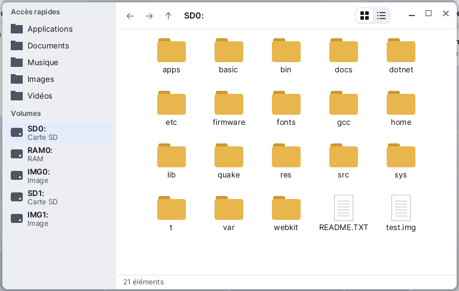

# Files

**Files** is the Korin OS file browser. On the left, the connected volumes (the SD card, a USB drive...) and the quick access places; on the right, the content of the current folder. Use it to browse the card, open a document or an application, create, copy, move, rename and delete files and folders, and unmount a USB drive before removing it. Files opens from the Korin OS menu, **System** category.



## The window

- **The left panel** first shows the **Quick Access** places (Applications, Documents, Music, Pictures, Videos...), then the **Volumes**. Each volume shows its name and its kind: **SD Card**, **USB Drive**, **RAM** or **Image**. A USB drive has an eject button at the right of its row. The volume list updates by itself when a drive is plugged in or removed.
- **The header**, at the top right: the ← (back), → (forward) and ↑ (parent folder) buttons, the **breadcrumb** (the path of the current folder, one segment per folder), and the view choice: icons or list.
- **The content** of the folder: folders first, then files, in alphabetical order. An application (a `.app` folder) shows with its icon and its name.
- **The status line**, at the bottom: the number of items, or the name and size of the chosen item, or the result of the last action ("Deleted", "Volume unmounted"...).

## Moving around

- **Enter a folder**: double-click it, or choose it and press Enter.
- **Go up one folder**: the ↑ button, the Backspace key, or **Go > Parent Folder**. The folder you just left stays chosen.
- **Go back, then forward**: the ← and → buttons. They are grayed out when there is nothing before or after.
- **Jump to a folder of the path**: click a segment of the breadcrumb. A path that is too long is cut on the left; the "…" leads to the folder it replaces.
- **Go to a quick access place or a volume**: click it in the left panel, or use the **Go** menu, which lists the quick access places and **/**.

## Opening a file

Double-click, or Enter (menu **File > Open**). What happens depends on the item:

| Item | What opens |
|---|---|
| A folder | you enter it |
| An application (`name.app`) | the application starts |
| A program (executable file) | it is started; the status line says "Program started" |
| Any other file | the application that declares its extension, otherwise the Editor |

An application declares the extensions it can open in its manifest (`app.txt`, `opens` line). A `.txt` file, like any file no application claims, opens in the Editor.

## Creating a folder

1. Go to the folder that must contain it.
2. **File > New Folder** (Ctrl+N).

The folder is named "New Folder", or "New Folder 2", "New Folder 3"... if the name is already taken.

## Renaming

1. Choose the file or folder.
2. **File > Rename…**, the **F2** key, or **Rename…** in the right-click menu.
3. A dialog asks for the new name, with the old one already typed and selected: type it, then **OK** (or Enter).

The renamed item stays chosen. A name cannot be empty or contain `/ \ : * ? " < > |` (cards and drives, in FAT32 or exFAT, refuse them), and two items of the same folder cannot have the same name, ignoring case: in these cases, a message says so and the dialog comes back. You can change only the case of a name ("photo.jpg" to "Photo.jpg").

## Deleting

1. Choose the file or folder.
2. **File > Delete**, or the Delete key.
3. A small menu asks for confirmation: **Delete "name"** or **Cancel**.

Deleting is final: Files has no trash. A folder must be empty to be deleted; otherwise the status line says "The folder is not empty".

## Copying and moving

1. Select the file or folder.
2. **Edit > Copy** (Ctrl+C) to copy it, or **Edit > Cut** (Ctrl+X) to move it; also in the right-click menu.
3. Go to the destination folder, on the same volume or another one (a USB drive, a network share, Google Drive…).
4. **Edit > Paste** (Ctrl+V), or **Paste** in the menu of a right-click on an empty spot.

You can also **drag** an item out of the window, and **drop** files on Files (from another Files window, for example): they go into the folder you release them on, otherwise into the current folder. On the same volume they are moved; from one volume to another, copied.

Moving on the same volume is instant. Otherwise Files copies, then (for **Cut**) deletes the original. Pasting into the original folder makes a copy named "name (copy)". If an item with the same name already exists, a message asks whether to **replace** it (a folder: put its contents into it), skip it (**No**) or stop everything (**Cancel**).

A copy that takes more than a moment shows its **progress**: the current item (and "file 3 of 120" for a folder), the bytes copied out of the total, the speed, the time left and a bar. The window stays responsive, even to or from a network share or Google Drive, where a read or a write can take time. **Cancel** (or Esc) stops the copy at the end of the current chunk (1 MB): the half-copied file is deleted, the items already copied stay, and for **Cut** the originals are not deleted. To Google Drive, a file is sent to Google when it is closed ("Finishing…"): this step cannot be interrupted, cancelling waits for its end.

If an error stops the copy (no space left, read-only volume, a file over 4 GB to a FAT32 USB drive…), a message tells which file and why.

## Choosing the view

- **Icons**: a grid of large icons, the name under each one.
- **List**: one row per item, with the **Name**, **Size** and **Type** columns (Folder, Application, File).

Choose it in the **View** menu or with the small two-segment control in the header. In list view:

- clicking a column title sorts by that column; a second click reverses the order (a ▲ or ▼ arrow shows it);
- widen a column by dragging the separator between two titles.

The view and the column widths are remembered for next time.

## Removing a USB drive

Before unplugging a drive, unmount it so that everything is written:

- click its eject button, in the left panel;
- or, while in a folder of the drive, **Volume > Unmount Current Volume**.

The status line says "Volume unmounted". If a drive is removed without being unmounted while you were in it, Files goes back to **/** ("Volume removed: back to /").

## Connecting to a server (network share)

**Volume > Connect to Server…** (Ctrl+K) opens a folder shared by a Windows PC, a Mac, a NAS or another Korin (SMB):

- **Address**: `smb://192.168.0.9/Share` or `\192.168.0.9\Share` (a folder may follow); the list offers the servers already known;
- **User** and **Password**: an account of the server (`name`, or `DOMAIN
ame`). Left empty, the ones already saved for this share are used.

The share becomes a volume **/net/net0** ("Server") and opens. It is **mounted again at every startup** until you unmount it (eject button, or **Volume > Unmount Current Volume**); the account stays saved (in `/etc/smbfs.ini`) for next time. To share Korin folders with Windows: Settings, **Shares** pane.

## Connecting to Google Drive

**Volume > Connect to Google Drive…** mounts your Google Drive as a volume (on the PC):

- **Drive name**: a short name of your own (`personal`, `work`…), to have several Google accounts;
- **Connect**: the browser opens on Google's page; sign in and allow Korin. The waiting window closes by itself.

The Drive becomes a volume **/net/net0** ("Google Drive") and opens, **readable and writable**: copy, create, rename, move and delete as anywhere else. A file is read as a stream (no need to wait for the whole file); a written file is sent to Google when the program closes it. Deleting moves to the Google Drive **trash** (30 days). Google Docs, Sheets and Slides do not show. The Drive is mounted again at every startup until you unmount it; no password is kept, only an encrypted token (in `HOME:/oauth`).

## Menus and shortcuts

| Menu | Command | Shortcut |
|---|---|---|
| File | Open | Enter |
| File | New Folder | Ctrl+N |
| File | Rename… | F2 |
| File | Delete | Delete |
| File | Refresh | Ctrl+L or F5 |
| File | Close | Ctrl+W |
| Edit | Cut | Ctrl+X |
| Edit | Copy | Ctrl+C |
| Edit | Paste | Ctrl+V |
| Go | Parent Folder | Backspace |
| Go | the quick access places, / | |
| View | Icons, List | |
| Volume | Connect to Server… | Ctrl+K |
| Volume | Connect to Google Drive… | |
| Volume | Unmount Current Volume | |

With the keyboard, in the content:

| Key | Effect |
|---|---|
| Up and Down arrows | previous or next item (one row in icon view) |
| Left and Right arrows | previous or next item, in icon view |
| Home, End | first or last item |
| Enter | open |
| Backspace | parent folder |
| F2 | rename |
| Delete | delete, after confirmation |

## Quick access places

The quick access list comes from the file `/etc/places.ini`, one line per place, in order:

```sh
Applications = /apps
Documents = HOME:/documents
Musique = HOME:/music
```

On the left the displayed name, on the right the folder. A folder that does not exist is not shown. You can edit this file in the Editor; **File > Refresh** reads the list again.

## Tips

- **Refresh** (Ctrl+L or F5) reads the folder and the volumes again, without losing the chosen item: useful after copying a file from the [Terminal](help:terminal).
- To copy many files chosen by a pattern (`*.jpg`), the `cp` command of the [Terminal](help:terminal) is still handy; Files copies one item at a time (a whole folder counts as one).
- Installed applications are in **/apps** (the **Applications** quick access); [Software](help:pkgman) installs and removes them.
