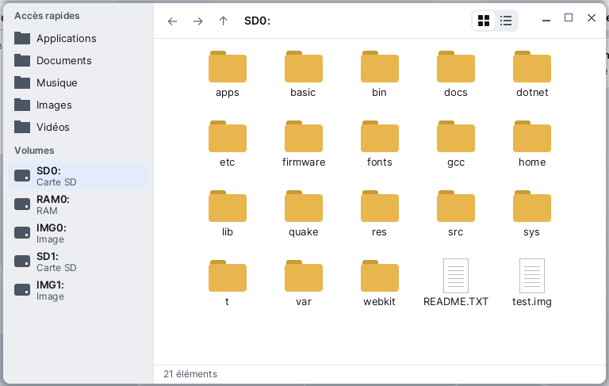

# Fichiers

**Fichiers** est le navigateur de fichiers de Korin OS. À gauche, les volumes branchés (la carte SD, une clé USB...) et les accès rapides ; à droite, le contenu du dossier courant. On y parcourt la carte, on ouvre un document ou une application, on crée, copie, déplace, renomme et supprime des fichiers et des dossiers, et on démonte une clé USB avant de la retirer. Fichiers s'ouvre par le menu Korin OS, catégorie **Système**.



## La fenêtre

- **Le panneau de gauche** montre d'abord les **Accès rapides** (Applications, Documents, Musique, Images, Vidéos...), puis les **Volumes**. Chaque volume affiche son nom et son genre : **Carte SD**, **Clé USB**, **RAM** ou **Image**. Une clé USB a un bouton d'éjection à droite de sa ligne. La liste des volumes se met à jour toute seule quand on branche ou retire une clé.
- **L'en-tête**, en haut à droite : les boutons ← (précédent), → (suivant) et ↑ (dossier parent), le **fil d'Ariane** (le chemin du dossier courant, un segment par dossier), et le choix de la vue : icônes ou liste.
- **Le contenu** du dossier : les dossiers d'abord, puis les fichiers, par ordre alphabétique. Une application (un dossier `.app`) apparaît avec son icône et son nom.
- **La ligne d'état**, en bas : le nombre d'éléments, ou le nom et la taille de l'élément choisi, ou le résultat de la dernière action (« Supprimé », « Volume démonté »...).

## Se déplacer

- **Entrer dans un dossier** : double-clic dessus, ou le choisir et appuyer sur Entrée.
- **Remonter d'un dossier** : le bouton ↑, la touche Retour arrière, ou **Aller > Dossier parent**. Le dossier qu'on vient de quitter reste choisi.
- **Revenir en arrière, puis en avant** : les boutons ← et →. Ils sont grisés quand il n'y a rien avant ou après.
- **Sauter à un dossier du chemin** : un clic sur un segment du fil d'Ariane. Un chemin trop long est coupé à gauche ; le « … » mène au dossier qu'il remplace.
- **Aller à un accès rapide ou à un volume** : un clic dans le panneau de gauche, ou le menu **Aller**, qui liste les accès rapides et **/**.

## Ouvrir un fichier

Double-clic, ou Entrée (menu **Fichier > Ouvrir**). Ce qui se passe dépend de l'élément :

| Élément | Ce qui s'ouvre |
|---|---|
| Un dossier | on y entre |
| Une application (`nom.app`) | l'application démarre |
| Un programme (fichier exécutable) | il est lancé ; la ligne d'état dit « Programme lancé » |
| Un autre fichier | l'application qui déclare son extension, sinon l'Éditeur |

Une application déclare les extensions qu'elle sait ouvrir dans son manifeste (`app.txt`, ligne `opens`). Un fichier `.txt`, comme tout fichier qu'aucune application ne réclame, s'ouvre dans l'Éditeur.

## Créer un dossier

1. Allez dans le dossier qui doit le contenir.
2. **Fichier > Nouveau dossier** (Ctrl+N).

Le dossier s'appelle « Nouveau dossier », ou « Nouveau dossier 2 », « Nouveau dossier 3 »... si le nom est déjà pris.

## Renommer

1. Choisissez le fichier ou le dossier.
2. **Fichier > Renommer…**, la touche **F2**, ou **Renommer…** dans le menu du clic droit.
3. Un dialogue demande le nouveau nom, l'ancien déjà écrit et sélectionné : tapez-le, puis **OK** (ou Entrée).

L'élément renommé reste choisi. Un nom ne peut pas être vide ni contenir `/ \ : * ? " < > |` (les cartes et les clés, en FAT32 ou exFAT, les refusent), et deux éléments d'un même dossier ne peuvent pas porter le même nom, aux majuscules près : dans ces cas, un message le dit et le dialogue revient. On peut changer seulement les majuscules d'un nom (« photo.jpg » en « Photo.jpg »).

## Supprimer

1. Choisissez le fichier ou le dossier.
2. **Fichier > Supprimer**, ou la touche Suppr.
3. Un petit menu demande confirmation : **Supprimer « nom »** ou **Annuler**.

La suppression est définitive : il n'y a pas de corbeille dans Fichiers. Un dossier doit être vide pour être supprimé ; sinon la ligne d'état dit « Le dossier n'est pas vide ».

## Copier et déplacer

1. Choisissez le fichier ou le dossier.
2. **Édition > Copier** (Ctrl+C) pour le copier, ou **Édition > Couper** (Ctrl+X) pour le déplacer ; aussi dans le menu du clic droit.
3. Allez dans le dossier de destination, sur le même volume ou un autre (une clé, un partage réseau, Google Drive…).
4. **Édition > Coller** (Ctrl+V), ou **Coller** dans le menu d'un clic droit dans le vide.

On peut aussi **faire glisser** un élément hors de la fenêtre, et **déposer** des fichiers sur Fichiers (depuis une autre fenêtre de Fichiers, par exemple) : ils vont dans le dossier sur lequel on les lâche, sinon dans le dossier courant. Sur un même volume, ils sont déplacés ; d'un volume à l'autre, copiés.

Déplacer sur un même volume est immédiat. Sinon, Fichiers copie, puis (pour **Couper**) efface l'original. Coller dans le dossier d'origine fait une copie nommée « nom (copie) ». Si un élément du même nom existe déjà, un message demande s'il faut le **remplacer** (un dossier : y mettre ce qu'il contient), le laisser (**Non**) ou tout arrêter (**Annuler**).

Une copie qui dure plus d'un instant montre sa **progression** : l'élément en cours (et « fichier 3 sur 120 » pour un dossier), les octets copiés sur le total, le débit, le temps restant et une barre. La fenêtre reste réactive, même vers ou depuis un partage réseau ou Google Drive, où une lecture ou une écriture peut prendre du temps. **Annuler** (ou Échap) arrête la copie à la fin du morceau en cours (1 Mo) : le fichier à moitié copié est supprimé, les éléments déjà copiés restent, et pour **Couper** les originaux ne sont pas effacés. Vers Google Drive, un fichier est envoyé à Google quand il est fermé (« Finalisation de… ») : cette étape ne peut pas s'interrompre, l'annulation attend sa fin.

Si une erreur arrête la copie (plus de place, volume en lecture seule, fichier de plus de 4 Go vers une clé en FAT32…), un message dit quel fichier et pourquoi.

## Choisir la vue

- **Icônes** : une grille de grandes icônes, le nom sous chacune.
- **Liste** : une ligne par élément, avec les colonnes **Nom**, **Taille** et **Type** (Dossier, Application, Fichier).

Le choix se fait dans le menu **Affichage** ou par le petit contrôle à deux segments de l'en-tête. En vue liste :

- un clic sur le titre d'une colonne trie par cette colonne ; un second clic inverse l'ordre (une flèche ▲ ou ▼ le montre) ;
- on élargit une colonne en faisant glisser le séparateur entre deux titres.

La vue et la largeur des colonnes sont retenues pour la prochaine fois.

## Retirer une clé USB

Avant de débrancher une clé, démontez-la pour que tout soit bien écrit :

- un clic sur son bouton d'éjection, dans le panneau de gauche ;
- ou, quand on est dans un dossier de la clé, **Volume > Démonter le volume courant**.

La ligne d'état dit « Volume démonté ». Si une clé est retirée sans être démontée alors qu'on y était, Fichiers revient à **/** (« Volume retiré : retour à / »).

## Se connecter à un serveur (partage réseau)

**Volume > Se connecter à un serveur…** (Ctrl+K) ouvre un dossier partagé par un PC Windows, un Mac, un NAS ou un autre Korin (SMB) :

- **Adresse** : `smb://192.168.0.9/Partage` ou `\192.168.0.9\Partage` (on peut ajouter un dossier au bout) ; la liste propose les serveurs déjà connus ;
- **Utilisateur** et **Mot de passe** : un compte du serveur (`nom`, ou `DOMAINE
om`). Laissés vides, ceux déjà enregistrés pour ce partage servent.

Le partage devient un volume **/net/net0** (genre « Serveur ») et s'ouvre. Il est **remonté à chaque démarrage**, jusqu'à ce qu'on le démonte (bouton d'éjection, ou **Volume > Démonter le volume courant**) ; le compte, lui, reste enregistré (dans `/etc/smbfs.ini`) pour la prochaine fois. Pour partager des dossiers de Korin vers Windows : Réglages, volet **Partages**.

## Se connecter à Google Drive

**Volume > Se connecter à Google Drive…** monte votre Google Drive comme un volume (sur le PC) :

- **Nom du Drive** : un nom court à vous (`perso`, `travail`…), pour avoir plusieurs comptes Google ;
- **Se connecter** : le navigateur s'ouvre sur la page de Google ; connectez-vous et autorisez Korin. La fenêtre d'attente se ferme toute seule.

Le Drive devient un volume **/net/net0** (genre « Google Drive ») et s'ouvre, **lu et écrit** : on y copie, crée, renomme, déplace et supprime comme ailleurs. Un fichier est lu en flux (on n'attend pas tout le fichier) ; un fichier écrit est envoyé à Google quand le programme le ferme. Supprimer met à la **corbeille** de Google Drive (30 jours). Les Google Docs, Sheets et Slides n'apparaissent pas. Le Drive est remonté à chaque démarrage jusqu'à ce qu'on le démonte ; aucun mot de passe n'est gardé, seulement un jeton chiffré (dans `HOME:/oauth`).

## Menus et raccourcis

| Menu | Commande | Raccourci |
|---|---|---|
| Fichier | Ouvrir | Entrée |
| Fichier | Nouveau dossier | Ctrl+N |
| Fichier | Renommer… | F2 |
| Fichier | Supprimer | Suppr |
| Fichier | Actualiser | Ctrl+L ou F5 |
| Fichier | Fermer | Ctrl+W |
| Édition | Couper | Ctrl+X |
| Édition | Copier | Ctrl+C |
| Édition | Coller | Ctrl+V |
| Aller | Dossier parent | Retour arrière |
| Aller | les accès rapides, / | |
| Affichage | Icônes, Liste | |
| Volume | Se connecter à un serveur… | Ctrl+K |
| Volume | Se connecter à Google Drive… | |
| Volume | Démonter le volume courant | |

Au clavier, dans le contenu :

| Touche | Effet |
|---|---|
| Flèches haut et bas | élément précédent ou suivant (une rangée en vue icônes) |
| Flèches gauche et droite | élément précédent ou suivant, en vue icônes |
| Début, Fin | premier ou dernier élément |
| Entrée | ouvrir |
| Retour arrière | dossier parent |
| F2 | renommer |
| Suppr | supprimer, après confirmation |

## Les accès rapides

La liste des accès rapides vient du fichier `/etc/places.ini`, une ligne par accès, dans l'ordre :

```sh
Applications = /apps
Documents = HOME:/documents
Musique = HOME:/music
```

À gauche le nom affiché, à droite le dossier. Un dossier qui n'existe pas n'est pas montré. On peut modifier ce fichier dans l'Éditeur ; **Fichier > Actualiser** relit la liste.

## Astuces

- **Actualiser** (Ctrl+L ou F5) relit le dossier et les volumes, sans perdre l'élément choisi : utile après avoir copié un fichier depuis le [Terminal](help:terminal).
- Pour copier beaucoup de fichiers choisis par un motif (`*.jpg`), la commande `cp` du [Terminal](help:terminal) reste pratique ; Fichiers copie un élément à la fois (un dossier entier compte pour un).
- Les applications installées sont dans **/apps** (accès rapide **Applications**) ; [Logiciels](help:pkgman) les installe et les retire.
