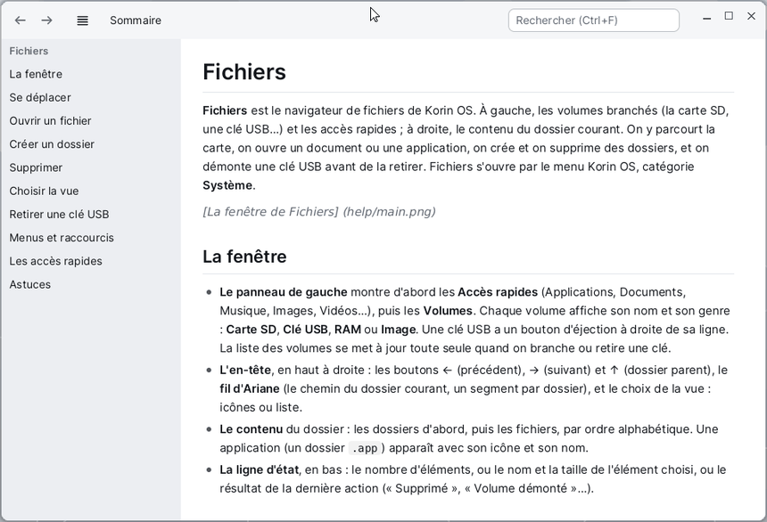

# Help

**Help** shows the help of the Korin OS apps and the developer guide. It opens in two ways:

- from the **Help** menu of the menu bar, at the top of the screen: **Help for** *the app* opens the page of the app in front;
- from the Korin OS menu, **System** category, then **Help**: the window opens on the contents page.



## The Contents Page

The contents page lists every app that has help, in alphabetical order, then the **Developer Guide** (the system API in C and C++). The **Home** button of the toolbar goes back to it from any page.

## Reading a Page

| To | Do |
|---|---|
| Scroll | the wheel, the arrows, Page Up / Page Down, Space, or drag the page with a finger |
| Go to the top, to the end | Home, End |
| Follow a link | click the coloured text |
| Go back to the previous page | the ← button, Alt+Left or Backspace |
| Go forward again | the → button, Alt+Right |
| Jump to a heading | click it in the contents list, on the left |
| Make the text larger | Ctrl and +, Ctrl and -, Ctrl and 0 (**View** menu) |

The ≡ button shows or hides the contents list; it also hides by itself in a narrow window.

## Searching

Type a word in the **Search** field (Ctrl+F), then Enter: the first line that contains it is highlighted. **F3** (**Edit** menu, **Find Next**) goes to the next one, and wraps around at the end of the page.

## Copying Code

Every code block has a **Copy** button at its top right: the whole block goes to the clipboard, ready to paste into the Editor or the Terminal.

```sh
pibuild app SD0:/home/projects/hello hello
```

**Edit > Copy the Page (Markdown)** copies the whole text of the page, as it is written.

## Opening Another File

**File > Open...** (Ctrl+O) opens any Markdown file (`.md`) on the card.

## Writing the Help of Your App

An app has help when its folder holds `help_fr.md` or `help_en.md`: the **Help** menu then appears by itself in the menu bar while the app is in front. Help opens the file of the system language, otherwise the other one. Images (PNG or BMP) go in the app's folder, for instance in `help/`. The details are in the [Developer Guide](api/index_en.md#help-for-an-app).
