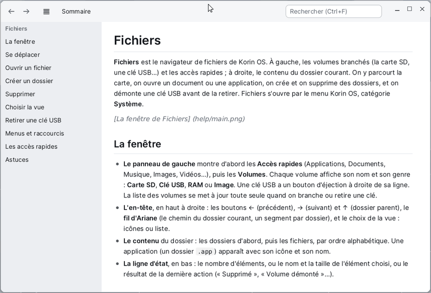

# Aide

L'**Aide** montre l'aide des applications de Korin OS et le guide du développeur. Elle s'ouvre de deux façons :

- par le menu **Aide** de la barre de menus, en haut de l'écran : **Aide de** *l'application* ouvre la page de l'application au premier plan ;
- par le menu Korin OS, catégorie **Système**, puis **Aide** : la fenêtre s'ouvre sur le sommaire.



## Le sommaire

Le sommaire liste toutes les applications qui ont une aide, par ordre alphabétique, puis le **Guide du développeur** (l'API du système en C et en C++). Le bouton **Sommaire** de la barre d'outils y revient de n'importe quelle page.

## Lire une page

| Pour | Faire |
|---|---|
| Faire défiler | la molette, les flèches, Page précédente / suivante, Espace, ou glisser la page du doigt |
| Aller au début, à la fin | Début, Fin |
| Suivre un lien | un clic sur le texte en couleur |
| Revenir à la page d'avant | le bouton ←, Alt+Gauche ou Retour arrière |
| Retourner à la page suivante | le bouton →, Alt+Droite |
| Aller à un titre | un clic dans la table des matières, à gauche |
| Agrandir le texte | Ctrl et +, Ctrl et -, Ctrl et 0 (menu **Présentation**) |

Le bouton ≡ montre ou cache la table des matières ; elle se cache aussi d'elle-même dans une fenêtre étroite.

## Chercher

Tapez un mot dans le champ **Rechercher** (Ctrl+F), puis Entrée : la première ligne qui le contient est surlignée. **F3** (menu **Édition**, **Occurrence suivante**) passe à la suivante, et revient au début à la fin de la page.

## Copier du code

Chaque bloc de code a un bouton **Copier** en haut à droite : tout le bloc va dans le presse-papiers, prêt à coller dans l'Éditeur ou le Terminal.

```sh
pibuild app SD0:/home/projets/bonjour bonjour
```

**Édition > Copier la page (Markdown)** copie tout le texte de la page, tel qu'il est écrit.

## Ouvrir un autre fichier

**Fichier > Ouvrir...** (Ctrl+O) ouvre n'importe quel fichier Markdown (`.md`) de la carte.

## Écrire l'aide de son application

Une application a une aide si son dossier contient `help_fr.md` ou `help_en.md` : le menu **Aide** apparaît alors tout seul dans la barre de menus quand elle est au premier plan. L'Aide ouvre le fichier de la langue du système, sinon l'autre. Les images (PNG ou BMP) se rangent dans le dossier de l'application, par exemple dans `help/`. Le détail est dans le [Guide du développeur](api/index_fr.md#aide-dune-application).
