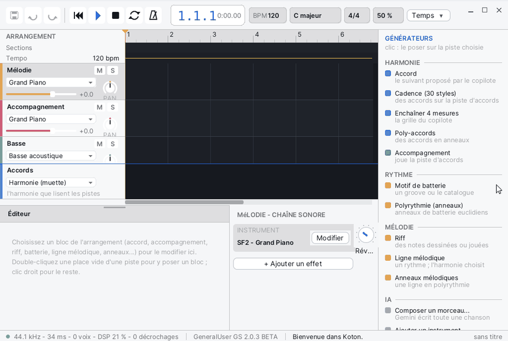

# Koton

**Koton** is a music composition studio. You don't write every note by hand: you put **blocks** on tracks (chords, accompaniments, riffs, drums, melodic lines, polyrhythmic rings), and generators make the notes from the harmony of the chord track. The whole song plays on a SoundFont, saves as `.kson` and exports as WAV.

## The window

Koton opens maximised. From top to bottom:

- **The top bar**: the Save, Undo and Redo buttons, then the transport (Back to the start, Play, Stop, Loop, Metronome); the position (bar.beat.sixteenth and the elapsed time); the **BPM**, **Key**, **Meter** and **Swing** chips (a click opens the song dialog); the **Snap** list, which makes blocks stick to the grid (Bar, Beat, 1/2 beat, 1/4 beat, Off); the **MASTER** level. In a narrow window the bar tightens: the chips lose their words, then the Meter and the Swing are only in the dialog.
- **The arrangement**, in the middle: the ruler, the **Sections** lane, the **Tempo** lane, then one lane per track. Each track has a header on the left (name, **M** for mute and **S** for solo, instrument, volume, **PAN** knob). The **chord track** is at the bottom: it is silent, it is the harmony every track reads.
- **The GENERATORS catalogue**, on the right: a click puts the generator on the selected track.
- **The editor**, at the bottom: the settings of the selected block, with the **Listen** button. Its grip, in the middle of its top edge, drags to make it taller.
- **The SOUND CHAIN**, right of the editor: the track's instrument, its effects, its reverb send and its level meter.
- **The status bar**, at the very bottom: the sound's state (rate, latency, voices, DSP load), the SoundFont, the last message, and the song's name with "(modified)" when there are unsaved changes.

A new song has five tracks: Melody, Accompaniment, Bass, Drums and Chords.

## Create a song

1. **File > New song** (Ctrl+N). If the open song has changes, Koton offers to save them.
2. **Song > Key, meter, tempo...** (Ctrl+K), or a click on a chip of the top bar, opens the **The song** dialog:
   - **Key**: the tonic and the mode;
   - **A new key**: **Transpose the song**, or **Chords follow their degrees** (the degrees stay, the chords change);
   - **Meter** (for example 3 / 4), **Tempo (bpm)** from 20 to 400, **Swing (%)** from 50 to 75, **Humanize (%)**;
   - **Length (bars)**: the song's minimum length.
3. To add tracks: **Track > Add an instrument track** or **Add a drum track**.
4. **File > Save** (Ctrl+S). Songs go into `SD0:/home/koton/songs`; Koton adds `.kson` to the name when needed.

## Lay down the harmony

Start with the chord track: the accompaniments, the melodic lines and the rings follow it.

- **Chord** (catalogue, HARMONY section): adds the chord the co-pilot suggests after the last one.
- **Cadence (30 styles)** or **Song > Cadence on the chord track...**: the **Cadence** dialog asks for the **Style**, the starting degree (**From degree**), the number of **Bars** and **Chords a bar**, then appends the chords.
- **Chain 4 bars**: extends the progression by four bars after the selected block.
- **Poly chords**: chords played in polyrhythmic rings.

A selected chord is set in the editor: **Degree**, **Root**, **Colour**, **Suspension**, **Beats**, the voicing (**Open voicing**, voice leading, inversion) and how it is played.

## Put down a block

Three ways:

- **Double-click** an empty place of a lane: Koton puts there a block of the track's usual kind (a chord on the chord track, drums on a drum track, otherwise the same kind as the track's last block, or a riff).
- **Right-click** a lane: the menu offers the kinds that fit there (**Riff here**, **Accompaniment here**, **Melodic line here**, **Melodic rings here**, **Poly chords here**; **Drums here**, **Polyrhythm here** on a drum track; **A chord here**, **Cadence...** on the chord track).
- **A click in the catalogue**: the block goes on the selected track, at the cursor when that place is free, otherwise after the last block. A drum pattern makes a drum track when there is none.

Then:

- **drag** a block to move it (it sticks to the **Snap**);
- **drag its right edge** to change its length;
- **Ctrl+D** duplicates it right after, **Del** or Backspace deletes it;
- the **Left** and **Right** arrows go to the track's previous or next block;
- **Freeze into a riff** (right-click the block) replaces a generated block with an ordinary riff holding its notes.

## Set a generator

Select a block: its editor opens at the bottom. Depending on the kind:

| Block | What you set |
|---|---|
| Riff | a piano roll: **Draw**, **Select**, **Erase** tools, snap, note length, transposition (-12, -1, +1, +12), **Fit to the chords**, **Quantise**, **Clear** |
| Accompaniment | the style, the cell, the octave, the bass, the voicing; it plays the chord of the chord track under it |
| Drum pattern | **Category**, **Motif**, **Customise (draw it)**, **Density**, **A fill on the last bar**, **Beats / bar**, **Repeats** |
| Melodic line | you draw only the rhythm; the pitches come from the harmony; **Voices**, **Contour**, the shape (continuity, tension, amplitude, ornaments) |
| Polyrhythm, Melodic rings, Poly chords | rings E(hits, steps) over one **Cycle (beats)**; **Add a ring** |
| Cadence | the style, the start, the bars; **Regenerate a variant** |
| Generator (plugin) | **Beats**, and **Open the plugin's editor** |

In the piano roll, right-clicking a note erases it; Del removes the selected notes, the arrows move them.

A drum track's kit and a track's instrument are chosen in the track header (a click on the instrument's name) or with **Track > Instrument...**: the dialog shows the General MIDI **Family** list and its instruments, and each choice plays a short sample.

## Plugins

Koton comes with plugins, listed at the end of the catalogue (**PLUGINS (IPC)**):

- instruments: **FM 2-op**, **Plucked strings**, **Subtractive**; a click puts them on the selected track;
- effects: **Chorus**, **Delay**, **Drive**, **EQ 3-band**, **Reverb**; four at most per track;
- generators: **Arpeggiator**, **Cellular automaton**, **Euclidean melody**; a click puts down a four-bar block.

In the **SOUND CHAIN**, **Change** picks the instrument, **+ Add an effect** opens the list of effects, the check box turns an effect on or off, **Edit** shows its knobs and then opens its editor, **x** removes it. A plugin's editor floats inside the Koton window. When a plugin stops, its track goes silent and a **Restart** button appears.

## Listen

- **Space** (or the Play button) plays from the cursor, and stops.
- **Esc** stops; when nothing is playing, the cursor goes back to the start.
- **Home** goes back to the start, even while playing.
- A click in the ruler sets the cursor; dragging in the ruler draws a loop; a right-click in the ruler turns it on or off.
- **Ctrl+L** (**Transport > Loop**) loops; with no loop drawn, it takes the selected block, otherwise the first four bars.
- **Transport > Metronome** adds the click.
- **Listen**, in the editor, plays the selected block alone, looping, and follows your changes.
- In a track header: **M** mutes it, **S** solos it; drag the volume bar, and drag the **PAN** knob up or down.

## Export

**File > Export as WAV...** renders the whole song into a `.wav` file (44.1 kHz, stereo, 16 bits), with two extra seconds for the sound tails. The status bar shows the progress.

## Menus and shortcuts

| Menu | Command | Shortcut |
|---|---|---|
| File | New song | Ctrl+N |
| File | Open... | Ctrl+O |
| File | Save | Ctrl+S |
| File | Save As..., Export as WAV... | |
| File | SoundFont..., Get a SoundFont... | |
| Edit | Undo | Ctrl+Z |
| Edit | Redo | Ctrl+Y |
| Edit | Duplicate the block | Ctrl+D |
| Edit | Delete the block | Del |
| Song | Key, meter, tempo... | Ctrl+K |
| Song | Cadence on the chord track... | |
| Track | Add an instrument track, Add a drum track | |
| Track | Instrument..., Rename... | |
| Transport | Play / Stop | Space |
| Transport | Stop | Esc |
| Transport | Back to the start | Home |
| Transport | Loop | Ctrl+L |
| Transport | Metronome | |
| View | Zoom in, Zoom out | |
| AI | Compose with AI... | |

| In the arrangement | Do |
|---|---|
| Scroll the tracks | the wheel |
| Scroll in time | Shift + wheel, or the scroll bars |
| Zoom | Ctrl + wheel |
| Add a section | double-click in the Sections lane (an empty name removes it) |
| Rename a track | double-click its header |
| Track menu | right-click its header: Rename, Instrument or Drum kit, Collapse, Move up, Move down, Duplicate the track, Remove every block, Delete the track |

## File formats

| Format | Read | Write |
|---|---|---|
| `.kson` (Koton song, JSON text) | yes | yes |
| `.sq` (Koton Studio song) | yes | no: **Save** asks for a `.kson` name |
| `.wav` | no | yes, with **Export as WAV...** |
| `.sf2` (SoundFont) | yes | no |

Songs are in `SD0:/home/koton/songs` (an example song, `demo.kson`, comes with it) and the settings in `SD0:/home/koton/settings.json`. A song also opens from [Files](help:files), or by dropping it onto the Koton window.

## Tips

- **The SoundFont**: Koton takes `SD0:/res/soundfonts/GeneralUser-GS.sf2`, otherwise the first `.sf2` of that folder, otherwise the system's General MIDI FM bank. **File > SoundFont...** chooses another one, used from the next start. The SoundFont loads in the background: until the status bar shows it, playing waits.
- **Get a SoundFont...** downloads nothing on Korin OS: copy a `.sf2` file into `SD0:/res/soundfonts`.
- **The AI menu** and the AI section of the catalogue answer "Not available on Korin OS".
- Undo and Redo cover blocks, tracks, the song and the plugins' state.
- On a screen less than 800 pixels wide, Koton switches to pocket mode: a single view to play and mix, and shorter menus (File, Song, Transport, Compose).
- To see all the notes of a generated part, and touch them up, use **Freeze into a riff**, then edit the riff.
