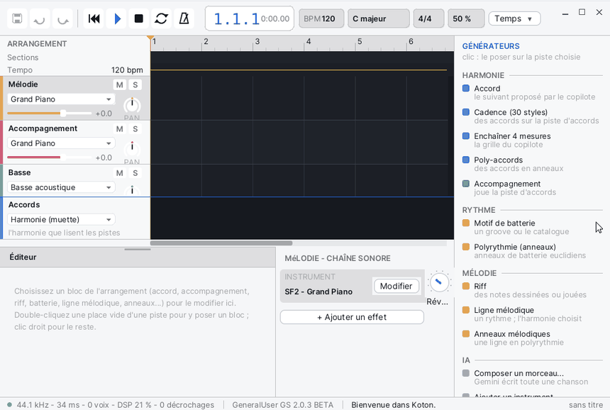

# Koton

**Koton** est un studio de composition musicale. On n'y écrit pas toutes les notes à la main : on pose des **blocs** sur des pistes (accords, accompagnements, riffs, batterie, lignes mélodiques, anneaux polyrythmiques), et des générateurs en tirent les notes à partir de l'harmonie de la piste d'accords. Le tout joue sur une SoundFont, s'enregistre en `.kson` et s'exporte en WAV.

## La fenêtre

Koton s'ouvre agrandi. De haut en bas :

- **La barre du haut** : les boutons Enregistrer, Annuler, Rétablir, puis le transport (Retour au début, Lecture, Arrêt, Boucle, Métronome) ; la position (mesure.temps.seizième et le temps écoulé) ; les pastilles **BPM**, **Tonalité**, **Mesure**, **Swing** (un clic ouvre le dialogue de la chanson) ; la liste **Grille**, qui aimante les blocs (Mesure, Temps, 1/2 temps, 1/4 temps, Aucun) ; le niveau **GÉNÉRAL**. Dans une fenêtre étroite, la barre se resserre : les pastilles perdent leurs mots, puis la Mesure et le Swing ne restent que dans le dialogue.
- **L'arrangement**, au centre : la règle, la ligne **Sections**, la ligne **Tempo**, puis une ligne par piste. Chaque piste a un en-tête à gauche (nom, boutons **M** pour muet et **S** pour solo, instrument, volume, bouton **PAN**). La **piste d'accords** est tout en bas : elle est muette, c'est l'harmonie que lisent les autres pistes.
- **Le catalogue GÉNÉRATEURS**, à droite : un clic pose le générateur sur la piste choisie.
- **L'éditeur**, en bas : les réglages du bloc sélectionné, avec le bouton **Écouter**. Sa poignée, au milieu du bord du haut, se tire pour l'agrandir.
- **La CHAÎNE SONORE**, à droite de l'éditeur : l'instrument de la piste, ses effets, son envoi de réverbération et son vumètre.
- **La barre d'état**, tout en bas : l'état du son (fréquence, latence, voix, charge du DSP), la SoundFont, le dernier message, et le nom de la chanson avec « (modifié) » s'il y a des changements non enregistrés.

Une nouvelle chanson a cinq pistes : Mélodie, Accompagnement, Basse, Batterie et Accords.

## Créer une chanson

1. **Fichier > Nouvelle chanson** (Ctrl+N). Si la chanson ouverte a des changements, Koton propose de les enregistrer.
2. **Chanson > Tonalité, mesure, tempo...** (Ctrl+K), ou un clic sur une pastille de la barre du haut, ouvre le dialogue **La chanson** :
   - **Tonalité** : la tonique et le mode ;
   - **Nouvelle tonalité** : **Transposer la chanson**, ou **Les accords suivent leurs degrés** (les degrés restent, les accords changent) ;
   - **Mesure** (par exemple 3 / 4), **Tempo (bpm)** de 20 à 400, **Swing (%)** de 50 à 75, **Humaniser (%)** ;
   - **Longueur (mesures)** : la longueur minimale de la chanson.
3. Pour ajouter des pistes : **Piste > Ajouter une piste d'instrument** ou **Ajouter une piste de batterie**.
4. **Fichier > Enregistrer** (Ctrl+S). Les chansons vont dans `SD0:/home/koton/songs` ; Koton ajoute `.kson` au nom si besoin.

## Poser l'harmonie

Commencez par la piste d'accords : les accompagnements, les lignes mélodiques et les anneaux la suivent.

- **Accord** (catalogue, rubrique HARMONIE) : ajoute l'accord que le copilote propose après le dernier.
- **Cadence (30 styles)** ou **Chanson > Cadence sur la piste d'accords...** : le dialogue **Cadence** demande le **Style**, le degré de départ (**Depuis degré**), le nombre de **Mesures** et d'**Accords/mesure**, puis ajoute les accords à la suite.
- **Enchaîner 4 mesures** : prolonge la progression de quatre mesures après le bloc choisi.
- **Poly-accords** : des accords joués en anneaux polyrythmiques.

Un accord sélectionné se règle dans l'éditeur : **Degré**, **Fondamentale**, **Couleur**, **Suspension**, **Temps**, le voicing (**Voicing ouvert**, conduite des voix, renversement) et la façon dont il est joué.

## Poser un bloc

Trois façons :

- **Double-clic** sur une place vide d'une piste : Koton y pose un bloc du genre habituel de la piste (un accord sur la piste d'accords, de la batterie sur une piste de batterie, sinon le même genre que le dernier bloc de la piste, ou un riff).
- **Clic droit** sur une piste : le menu propose les genres possibles à cet endroit (**Riff ici**, **Accompagnement ici**, **Ligne mélodique ici**, **Anneaux mélodiques ici**, **Poly-accords ici** ; **Batterie ici**, **Polyrythmie ici** sur une piste de batterie ; **Un accord ici**, **Cadence...** sur la piste d'accords).
- **Un clic dans le catalogue** : le bloc va sur la piste choisie, au curseur si la place est libre, sinon après le dernier bloc. Un motif de batterie crée une piste de batterie s'il n'y en a pas.

Ensuite :

- **glisser** un bloc le déplace (aimanté par la **Grille**) ;
- **tirer son bord droit** change sa longueur ;
- **Ctrl+D** le duplique juste après, **Suppr** ou Retour arrière le supprime ;
- les flèches **←** et **→** passent au bloc précédent ou suivant de la piste ;
- **Figer en riff** (clic droit sur le bloc) remplace un bloc généré par un riff ordinaire qui contient ses notes.

## Régler un générateur

Sélectionnez un bloc : son éditeur s'ouvre en bas. Selon le genre :

| Bloc | Ce qu'on règle |
|---|---|
| Riff | un piano à rouleaux : outils **Dessiner**, **Sélection**, **Gommer**, grille, longueur des notes, transposition (-12, -1, +1, +12), **Caler sur les accords**, **Quantifier**, **Effacer** |
| Accompagnement | le style, la cellule, l'octave, la basse, le voicing ; il joue l'accord de la piste d'accords qui est sous lui |
| Motif de batterie | **Catégorie**, **Motif**, **Personnaliser (le dessiner)**, **Densité**, **Un break à la dernière mesure**, **Temps / mesure**, **Répétitions** |
| Ligne mélodique | on dessine seulement le rythme ; les hauteurs viennent de l'harmonie ; **Voix**, **Contour**, la forme (continuité, tension, amplitude, ornements) |
| Polyrythmie, Anneaux mélodiques, Poly-accords | des anneaux E(coups, pas) sur un même **Cycle (temps)** ; **Ajouter un anneau** |
| Cadence | le style, le départ, les mesures ; **Régénérer une variante** |
| Générateur (greffon) | **Temps**, et **Ouvrir l'éditeur du greffon** |

Dans le piano à rouleaux, un clic droit sur une note la gomme ; Suppr retire les notes sélectionnées, les flèches les déplacent.

Le kit d'une piste de batterie et l'instrument d'une piste se choisissent dans l'en-tête de la piste (un clic sur le nom de l'instrument) ou par **Piste > Instrument...** : le dialogue montre les **Famille**s General MIDI et leurs instruments, et chaque choix se fait entendre.

## Les greffons

Koton est livré avec des greffons, rangés à la fin du catalogue (**GREFFONS (IPC)**) :

- instruments : **FM 2 opérateurs**, **Cordes pincées**, **Soustractif** ; un clic les met sur la piste choisie ;
- effets : **Chorus**, **Délai**, **Saturation**, **Égaliseur 3 bandes**, **Réverbération** ; quatre au plus par piste ;
- générateurs : **Arpégiateur**, **Automate cellulaire**, **Mélodie euclidienne** ; un clic pose un bloc de quatre mesures.

Dans la **CHAÎNE SONORE**, **Modifier** change l'instrument, **+ Ajouter un effet** ouvre la liste des effets, la case coche ou décoche un effet, **Édition** montre ses boutons puis ouvre son éditeur, **x** le retire. L'éditeur d'un greffon flotte dans la fenêtre de Koton. Si un greffon s'arrête, sa piste devient muette et le bouton **Relancer** apparaît.

## Écouter

- **Espace** (ou le bouton Lecture) lance la lecture depuis le curseur, et l'arrête.
- **Échap** arrête ; s'il n'y a pas de lecture, le curseur revient au début.
- **Début** revient au départ, même pendant la lecture.
- Un clic dans la règle place le curseur ; glisser dans la règle trace une boucle ; un clic droit dans la règle l'active ou la désactive.
- **Ctrl+L** (**Transport > Boucle**) boucle ; sans boucle tracée, elle prend le bloc choisi, sinon les quatre premières mesures.
- **Transport > Métronome** ajoute le clic.
- **Écouter**, dans l'éditeur, joue le bloc choisi seul, en boucle, et suit vos réglages.
- Dans l'en-tête d'une piste : **M** la rend muette, **S** l'écoute seule ; tirez la barre de volume, et tirez le bouton **PAN** vers le haut ou le bas.

## Exporter

**Fichier > Exporter en WAV...** rend toute la chanson dans un fichier `.wav` (44,1 kHz, stéréo, 16 bits), avec deux secondes de plus pour les queues de son. La barre d'état montre l'avancement.

## Menus et raccourcis

| Menu | Commande | Raccourci |
|---|---|---|
| Fichier | Nouvelle chanson | Ctrl+N |
| Fichier | Ouvrir... | Ctrl+O |
| Fichier | Enregistrer | Ctrl+S |
| Fichier | Enregistrer sous..., Exporter en WAV... | |
| Fichier | SoundFont..., Obtenir une SoundFont... | |
| Édition | Annuler | Ctrl+Z |
| Édition | Rétablir | Ctrl+Y |
| Édition | Dupliquer le bloc | Ctrl+D |
| Édition | Supprimer le bloc | Suppr |
| Chanson | Tonalité, mesure, tempo... | Ctrl+K |
| Chanson | Cadence sur la piste d'accords... | |
| Piste | Ajouter une piste d'instrument, Ajouter une piste de batterie | |
| Piste | Instrument..., Renommer... | |
| Transport | Lecture / Arrêt | Espace |
| Transport | Arrêt | Échap |
| Transport | Retour au début | Début |
| Transport | Boucle | Ctrl+L |
| Transport | Métronome | |
| Affichage | Zoom avant, Zoom arrière | |
| IA | Composer avec l'IA... | |

| Dans l'arrangement | Faire |
|---|---|
| Défiler les pistes | la molette |
| Défiler dans le temps | Maj + molette, ou les barres de défilement |
| Zoomer | Ctrl + molette |
| Ajouter une section | double-clic dans la ligne Sections (un nom vide la retire) |
| Renommer une piste | double-clic dans son en-tête |
| Menu de la piste | clic droit dans son en-tête : Renommer, Instrument ou Kit de batterie, Replier, Monter, Descendre, Dupliquer la piste, Retirer tous les blocs, Supprimer la piste |

## Formats de fichiers

| Format | Lecture | Écriture |
|---|---|---|
| `.kson` (chanson de Koton, du texte JSON) | oui | oui |
| `.sq` (chanson de Koton Studio) | oui | non : **Enregistrer** demande un nom en `.kson` |
| `.wav` | non | oui, par **Exporter en WAV...** |
| `.sf2` (SoundFont) | oui | non |

Les chansons sont dans `SD0:/home/koton/songs` (une chanson d'exemple, `demo.kson`, y est livrée) et les réglages dans `SD0:/home/koton/settings.json`. Une chanson s'ouvre aussi depuis [Fichiers](help:files), ou en la déposant sur la fenêtre de Koton.

## Astuces

- **La SoundFont** : Koton prend `SD0:/res/soundfonts/GeneralUser-GS.sf2`, sinon le premier `.sf2` de ce dossier, sinon la banque General MIDI en FM du système. **Fichier > SoundFont...** en choisit une autre, utilisée au prochain démarrage. La SoundFont se charge en arrière-plan : tant que la barre d'état ne l'affiche pas, la lecture attend.
- **Obtenir une SoundFont...** ne télécharge rien sous Korin OS : copiez un fichier `.sf2` dans `SD0:/res/soundfonts`.
- **Le menu IA** et la rubrique IA du catalogue répondent « Indisponible sur Korin OS ».
- Annuler et Rétablir couvrent les blocs, les pistes, la chanson et l'état des greffons.
- Sur un écran de moins de 800 pixels de large, Koton passe en mode de poche : une seule vue pour jouer et mixer, et des menus réduits (Fichier, Chanson, Transport, Composer).
- Pour voir toutes les notes d'une partie générée, et les retoucher, **Figer en riff** puis éditez le riff.
