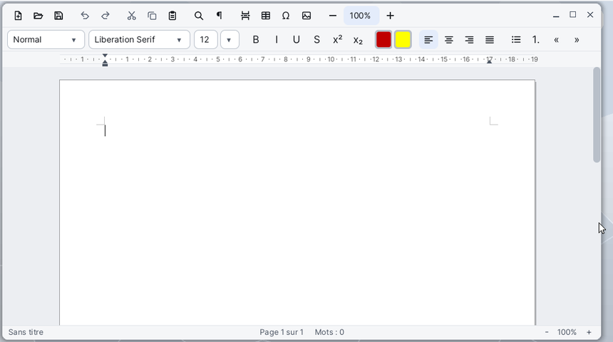

# Letters

**Letters** is the word processor of Korin OS. It writes letters and documents laid out on A4 sheets (or A5, A3, Letter, Legal): fonts, colours, paragraphs, lists, tables, images, headers and footers, page numbers, a table of contents and mail merge. It reads and saves RTF, DOCX (Word) and ODT (OpenDocument) files, and exports to PDF.

## The Window

From top to bottom:

- **the menu bar**, at the top of the screen: File, Edit, View, Insert, Format, Table, Tools;
- **the first toolbar**: new, open, save, undo, redo, cut, copy, paste, find, formatting marks, page break, table, special character, image, then the zoom (−, the value, +);
- **the second toolbar**: the paragraph style, the font, the size, bold, italic, underline, strikethrough, superscript, subscript, the text colour, the highlight, the four alignments, bullets, numbering, decrease and increase indent;
- **the ruler**: the page margins and the indents of the paragraph at the caret;
- **the page**, white like paper, on a grey background; the pages follow one another from top to bottom;
- **the status bar**: the file name (with "(modified)" when it is not saved), the current page, the word count, and the zoom with its - and + buttons.

In a narrow window, the least useful tools leave the toolbar (they stay in the menus); under 720 px wide, the ruler hides and the page follows the width of the window.

## Writing and Formatting

1. Type your text: lines wrap by themselves. **Enter** starts a new paragraph, **Shift+Enter** a simple line break.
2. Select text with the mouse (double click: a word, triple click: the paragraph, Shift+click: extend) or with the keyboard (Shift and the arrows).
3. Pick a style in the leftmost list of the second toolbar: Normal, Heading 1 to 3, Title, Subtitle, Quote, Plain Text...
4. Change the font and the size in the next two lists; the size can also be typed, followed by Enter.
5. **Ctrl+B**, **Ctrl+I**, **Ctrl+U** make text bold, italic, underlined. **Format > Font...** (Ctrl+D) sets everything at once: font, style, size, underline, strikethrough, superscript, subscript, colour and highlight.
6. **Format > Paragraph...** sets the alignment, the indents (first line, hanging), the space before and after, the line spacing (single, 1.15, 1.5, double) and the page flow (page break before, keep with next, keep lines together, widow / orphan control).

For indents, you can also drag the ruler's markers: the top triangle for the first line, the bottom one for the following lines, the small box for both at once, the right triangle for the right indent. The grey edges of the ruler move the page margins.

## Lists and Tabs

- The **•** button or **Format > Bullets** makes a bulleted list, the **1.** button or **Format > Numbering** a numbered list.
- In a list, **Tab** at the start of an item moves it down one level, **Shift+Tab** moves it back up.
- **Format > Tabs...** sets tab stops (left, centre, right, decimal) with or without a leader (dots, dashes, line). Without a stop, a tab moves 1.25 cm.

## Inserting Tables and Images

1. **Insert > Table...** asks for the number of columns and rows, and whether the heading row repeats on each page.
2. In a table, **Tab** goes to the next cell, **Shift+Tab** to the previous one; the up and down arrows move from cell to cell.
3. The **Table** menu inserts or deletes rows and columns, merges or splits cells, distributes the columns and selects the whole table.
4. **Table > Table Properties...** sets the lines (all lines, none, outline only, rows only), their width, the place on the page, the column width, the row height and the shading of the selected cells.
5. Column borders can also be dragged with the mouse, on the page or on the ruler.

**Insert > Image...** inserts a PNG, BMP or JPEG image at the caret. A click on the image selects it; drag its bottom right corner to resize it.

## Headers, Footers and Numbers

- **Insert > Page Numbers...** puts the number at the bottom or the top of the page, on the left, centre or right, as "1", "Page 1", "Page 1 of 3" or "1 / 3".
- **View > Header and Footer**, or a double click in the top or bottom margin, opens the header or footer of the page: the body text turns grey. **Esc**, a double click on the body or the menu again go back to it.
- **File > Page Setup...** sets the paper, the orientation (portrait, landscape), the margins, the place of the header and footer, a different first page and the first number.
- **Insert > Date and Time...** writes the date; tick **Update automatically (a field)** to keep it up to date. **Insert > Field...** inserts the page number, the number of pages, the date or the time.

## Table of Contents

1. Give the headings the **Heading 1**, **Heading 2** or **Heading 3** styles.
2. Put the caret where the table should go, then **Insert > Table of Contents**.
3. After changes, **Tools > Update Table of Contents** (or the right click menu inside the table) rebuilds it.

## Find and Replace

**Edit > Find and Replace...** (Ctrl+F): type the text to find and, if needed, its replacement, tick **Match case** if needed, then **Find Next**, **Replace** or **Replace All**. The dialog closes for a moment at each step to show the page, then comes back.

## Opening, Saving, Exporting

- **File > Open...** (Ctrl+O) opens a `.rtf`, `.docx`, `.odt` or `.txt` file; the folder offered is `SD0:/home/documents`. A file dropped on the window opens too.
- **File > Save** (Ctrl+S) keeps the file's format. A new document goes through **Save As...**: choose the `.rtf`, `.docx`, `.odt` or `.txt` extension; without a known extension, `.rtf` is added.
- Saved as `.txt`, a formatted document loses its formats: Letters asks first.
- **File > Export as HTML...** and **Export as Text...** write a copy; the document keeps its name.
- **File > Export as PDF...** makes a PDF of all the pages, the current page or a range (type `2-5`, or `3` for a single page), with bookmarks from the headings, a title and an author.
- **File > Print...** (Ctrl+P) opens the system's Print dialog.

If Letters is closed with unsaved changes, the document is kept: at the next start, Letters offers to open it.

## Mail Merge

Mail merge fills the same letter with each record of a **Cardfile** form.

1. Write the letter, then **Tools > Mail Merge...**.
2. **Choose...** picks a `.card` file: its fields show in the list.
3. Put the caret in the letter, pick a field and **Insert the Field** (or double click the field).
4. Tick **Preview the values** and browse the records with **<** and **>** to check.
5. Under **Merge**, choose **All the records** or **The record previewed**.
6. **Merge to a New Document** opens the result in a second Letters, one letter per page. **Merge to Files...** writes one file per record, numbered (`letter-1`, `letter-2`...) or named after a field, in the format chosen by the extension (`.rtf`, `.docx` or `.odt`).

Cardfile can also start the mail merge from its **Record > Mail Merge...** menu.

## Menus and Shortcuts

| Menu | Commands |
|---|---|
| **File** | New (Ctrl+N), Open... (Ctrl+O), Save (Ctrl+S), Save As..., Export as HTML..., Export as Text..., Export as PDF..., Page Setup..., Print... (Ctrl+P) |
| **Edit** | Undo (Ctrl+Z), Redo (Ctrl+Y), Cut (Ctrl+X), Copy (Ctrl+C), Paste (Ctrl+V), Paste Unformatted, Select All (Ctrl+A), Find and Replace... (Ctrl+F) |
| **View** | Actual Size (100%), Page Width, Whole Page, Header and Footer, Formatting Marks, Ruler in Inches / Centimetres |
| **Insert** | Page Break, Table..., Image..., Special Character..., Page Numbers..., Date and Time..., Field..., Table of Contents |
| **Format** | Font... (Ctrl+D), Paragraph..., Tabs..., Bold (Ctrl+B), Italic (Ctrl+I), Underline (Ctrl+U), Strikethrough, Superscript, Subscript, Clear Formatting, Automatic Colour, No Highlight, Align Left (Ctrl+L), Centre (Ctrl+E), Align Right (Ctrl+R), Justify (Ctrl+J), Bullets, Numbering, Increase Indent, Decrease Indent |
| **Table** | Insert Rows Above, Below, Insert Columns Left, Right, Delete Rows, Columns, Table, Merge Cells, Split Cell, Distribute Columns Evenly, Select Table, Table Properties... |
| **Tools** | Word Count..., Update Table of Contents, Mail Merge... |

On the keyboard, in the page:

| Key | Effect |
|---|---|
| Arrows | move the caret; with Ctrl, by a word or a paragraph; with Shift, select |
| Home, End | start, end of the line; with Ctrl, of the document |
| Page Up, Page Down | one screen up or down |
| Shift+Enter | line break without a new paragraph |
| Tab, Shift+Tab | next, previous cell in a table; level of a list |
| Ctrl+Backspace, Ctrl+Delete | erase a word |
| Esc | removes the selection; leaves the header or footer |

A right click in the page opens a menu: cut, copy, paste, font, paragraph, then depending on the place the table commands, updating the table of contents, leaving the header, or bullets and numbering.

## File Formats

| Format | Opened | Saved |
|---|---|---|
| RTF (`.rtf`), the default format | yes | yes |
| Word (`.docx`) | yes | yes |
| OpenDocument (`.odt`) | yes | yes |
| Plain text (`.txt`) | yes (UTF-8 or Latin-1) | yes, without formatting |
| HTML (`.html`) | no | with Export as HTML... |
| PDF (`.pdf`) | no | with Export as PDF... |

Images in a document can be PNG, BMP or JPEG.

## Tips

- The zoom button, between - and +, opens a list: Page Width, Whole Page, or 25 % to 400 %. With **Page Width**, the page follows the width of the window when you resize it.
- The **¶** button (**View > Formatting Marks**) shows spaces, tabs, line breaks and paragraph ends.
- **Tools > Word Count...** counts the pages, words, characters and lines; with a selection, only those of the selection.
- **Edit > Paste Unformatted** pastes the text alone, in the format of the place where it lands.
- **Insert > Special Character...** offers accented letters, Greek, Cyrillic, arrows, mathematical signs, currencies and other symbols.
- Three font families are drawn: DejaVu Sans, DejaVu Serif and DejaVu Sans Mono. A document that names another font (Times New Roman, for example) keeps that name when saved but shows with the closest one: its pages may break slightly differently than in Word.
