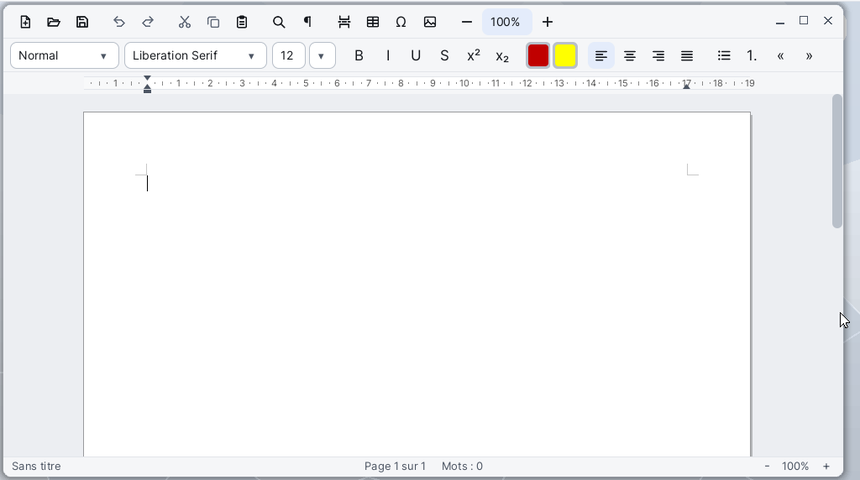

# Letters

**Letters** est le traitement de texte de Korin OS. Il rédige lettres et documents mis en page sur des feuilles A4 (ou A5, A3, Letter, Legal) : polices, couleurs, paragraphes, listes, tableaux, images, en-têtes et pieds de page, numéros de page, table des matières et publipostage. Il lit et enregistre les formats RTF, DOCX (Word) et ODT (OpenDocument), et exporte en PDF.

## La fenêtre

De haut en bas :

- **la barre de menus**, en haut de l'écran : Fichier, Édition, Affichage, Insertion, Format, Tableau, Outils ;
- **la première barre d'outils** : nouveau, ouvrir, enregistrer, annuler, rétablir, couper, copier, coller, rechercher, marques de mise en forme, saut de page, tableau, caractère spécial, image, puis le zoom (−, la valeur, +) ;
- **la seconde barre d'outils** : le style de paragraphe, la police, la taille, gras, italique, souligné, barré, exposant, indice, la couleur du texte, le surlignage, les quatre alignements, puces, numérotation, réduire et augmenter le retrait ;
- **la règle** : les marges de la page et les retraits du paragraphe où se trouve le curseur ;
- **la page**, blanche comme du papier, sur un fond gris ; les pages se suivent de haut en bas ;
- **la barre d'état** : le nom du fichier (avec « (modifié) » s'il n'est pas enregistré), la page actuelle, le nombre de mots, et le zoom avec ses boutons - et +.

Dans une fenêtre étroite, les outils les moins utiles quittent la barre (ils restent dans les menus) ; sous 720 px de large, la règle se cache et la page suit la largeur de la fenêtre.

## Écrire et mettre en forme

1. Tapez votre texte : les lignes se coupent toutes seules. **Entrée** commence un nouveau paragraphe, **Maj+Entrée** un simple retour à la ligne.
2. Sélectionnez du texte à la souris (double clic : un mot, triple clic : le paragraphe, Maj+clic : étendre) ou au clavier (Maj et les flèches).
3. Choisissez un style dans la liste de gauche de la seconde barre : Normal, Titre 1 à 3, Titre, Sous-titre, Citation, Texte brut...
4. Changez la police et la taille dans les deux listes suivantes ; la taille se tape aussi, suivie d'Entrée.
5. **Ctrl+B**, **Ctrl+I**, **Ctrl+U** mettent en gras, en italique, en souligné. **Format > Police...** (Ctrl+D) règle tout d'un coup : police, style, taille, souligné, barré, exposant, indice, couleur et surlignage.
6. **Format > Paragraphe...** règle l'alignement, les retraits (première ligne, suspendu), l'espace avant et après, l'interligne (simple, 1,15, 1,5, double) et l'enchaînement des pages (saut de page avant, lier au suivant, lignes solidaires, veuves et orphelines).

Pour les retraits, vous pouvez aussi tirer les marques de la règle : le triangle du haut pour la première ligne, celui du bas pour les lignes suivantes, le petit carré pour les deux à la fois, le triangle de droite pour le retrait droit. Les bords gris de la règle déplacent les marges de la page.

## Listes et tabulations

- Le bouton **•** ou **Format > Puces** fait une liste à puces, le bouton **1.** ou **Format > Numérotation** une liste numérotée.
- Dans une liste, **Tab** au début d'un élément le descend d'un niveau, **Maj+Tab** le remonte.
- **Format > Tabulations...** pose des taquets (gauche, centre, droite, décimale) avec ou sans points de suite (points, tirets, ligne). Sans taquet, la tabulation avance de 1,25 cm.

## Insérer des tableaux et des images

1. **Insertion > Tableau...** demande le nombre de colonnes et de lignes, et si la ligne de titre se répète sur chaque page.
2. Dans un tableau, **Tab** passe à la cellule suivante, **Maj+Tab** à la précédente ; les flèches haut et bas vont de cellule en cellule.
3. Le menu **Tableau** ajoute ou supprime lignes et colonnes, fusionne ou scinde des cellules, répartit les colonnes et sélectionne le tableau entier.
4. **Tableau > Propriétés du tableau...** règle les bordures (toutes, aucune, contour seul, lignes seules), leur épaisseur, la place sur la page, la largeur des colonnes, la hauteur des lignes et la trame des cellules choisies.
5. Les bords des colonnes se tirent aussi à la souris, sur la page ou sur la règle.

**Insertion > Image...** insère une image PNG, BMP ou JPEG à la place du curseur. Un clic sur l'image la sélectionne ; tirez son coin en bas à droite pour la redimensionner.

## En-têtes, pieds de page et numéros

- **Insertion > Numéros de page...** place le numéro en bas ou en haut de page, à gauche, au centre ou à droite, sous la forme « 1 », « Page 1 », « Page 1 sur 3 » ou « 1 / 3 ».
- **Affichage > En-tête et pied de page**, ou un double clic dans la marge du haut ou du bas, ouvre l'en-tête ou le pied de page de la page : le corps du texte devient gris. **Échap**, un double clic sur le corps ou de nouveau le menu y reviennent.
- **Fichier > Mise en page...** règle le papier, l'orientation (portrait, paysage), les marges, la place de l'en-tête et du pied, une première page différente et le premier numéro.
- **Insertion > Date et heure...** écrit la date ; cochez **Mettre à jour automatiquement (un champ)** pour qu'elle se mette à jour. **Insertion > Champ...** insère le numéro de page, le nombre de pages, la date ou l'heure.

## Table des matières

1. Donnez aux titres les styles **Titre 1**, **Titre 2** ou **Titre 3**.
2. Placez le curseur où la table doit aller, puis **Insertion > Table des matières**.
3. Après des changements, **Outils > Mettre à jour la table des matières** (ou le menu du clic droit dans la table) la refait.

## Rechercher et remplacer

**Édition > Rechercher et remplacer...** (Ctrl+F) : tapez le texte cherché et, si besoin, son remplaçant, cochez **Respecter la casse** au besoin, puis **Rechercher le suivant**, **Remplacer** ou **Tout remplacer**. Le dialogue se ferme un instant à chaque étape pour montrer la page, puis revient.

## Ouvrir, enregistrer, exporter

- **Fichier > Ouvrir...** (Ctrl+O) ouvre un fichier `.rtf`, `.docx`, `.odt` ou `.txt` ; le dossier proposé est `SD0:/home/documents`. Un fichier glissé sur la fenêtre s'ouvre aussi.
- **Fichier > Enregistrer** (Ctrl+S) garde le format du fichier. Un nouveau document passe par **Enregistrer sous...** : choisissez l'extension `.rtf`, `.docx`, `.odt` ou `.txt` ; sans extension connue, `.rtf` est ajouté.
- Enregistré en `.txt`, un document mis en forme perd ses formats : Letters le demande d'abord.
- **Fichier > Exporter en HTML...** et **Exporter en texte...** écrivent une copie ; le document reste sous son nom.
- **Fichier > Exporter en PDF...** fait un PDF de toutes les pages, de la page actuelle ou d'une plage (tapez `2-5`, ou `3` pour une seule page), avec des signets d'après les titres, un titre et un auteur.
- **Fichier > Imprimer...** (Ctrl+P) ouvre le dialogue d'impression du système.

Si Letters est fermé avec des modifications non enregistrées, le document est gardé : au lancement suivant, Letters propose de l'ouvrir.

## Publipostage

Le publipostage remplit une même lettre avec chaque fiche d'un formulaire de **Cardfile**.

1. Écrivez la lettre, puis **Outils > Publipostage...**.
2. **Choisir...** prend un fichier `.card` : ses champs s'affichent dans la liste.
3. Placez le curseur dans la lettre, choisissez un champ et **Insérer le champ** (ou double-cliquez sur le champ).
4. Cochez **Aperçu des valeurs** et parcourez les fiches avec **<** et **>** pour vérifier.
5. Dans **Fusionner**, choisissez **Toutes les fiches** ou **La fiche affichée**.
6. **Vers un nouveau document** ouvre le résultat dans un second Letters, une lettre par page. **Vers des fichiers...** écrit un fichier par fiche, numérotés (`letter-1`, `letter-2`...) ou nommés d'après un champ, au format choisi par l'extension (`.rtf`, `.docx` ou `.odt`).

Cardfile sait aussi lancer le publipostage depuis son menu **Fiche > Publipostage...**.

## Menus et raccourcis

| Menu | Commandes |
|---|---|
| **Fichier** | Nouveau (Ctrl+N), Ouvrir... (Ctrl+O), Enregistrer (Ctrl+S), Enregistrer sous..., Exporter en HTML..., Exporter en texte..., Exporter en PDF..., Mise en page..., Imprimer... (Ctrl+P) |
| **Édition** | Annuler (Ctrl+Z), Rétablir (Ctrl+Y), Couper (Ctrl+X), Copier (Ctrl+C), Coller (Ctrl+V), Coller sans mise en forme, Tout sélectionner (Ctrl+A), Rechercher et remplacer... (Ctrl+F) |
| **Affichage** | Taille réelle (100 %), Largeur de page, Page entière, En-tête et pied de page, Marques de mise en forme, Règle en pouces / centimètres |
| **Insertion** | Saut de page, Tableau..., Image..., Caractère spécial..., Numéros de page..., Date et heure..., Champ..., Table des matières |
| **Format** | Police... (Ctrl+D), Paragraphe..., Tabulations..., Gras (Ctrl+B), Italique (Ctrl+I), Souligné (Ctrl+U), Barré, Exposant, Indice, Effacer la mise en forme, Couleur automatique, Sans surlignage, Aligner à gauche (Ctrl+L), Centrer (Ctrl+E), Aligner à droite (Ctrl+R), Justifier (Ctrl+J), Puces, Numérotation, Augmenter le retrait, Réduire le retrait |
| **Tableau** | Insérer des lignes au-dessus, en dessous, Insérer des colonnes à gauche, à droite, Supprimer les lignes, les colonnes, le tableau, Fusionner les cellules, Scinder la cellule, Répartir les colonnes, Sélectionner le tableau, Propriétés du tableau... |
| **Outils** | Statistiques..., Mettre à jour la table des matières, Publipostage... |

Au clavier, dans la page :

| Touche | Effet |
|---|---|
| Flèches | déplacent le curseur ; avec Ctrl, d'un mot ou d'un paragraphe ; avec Maj, sélectionnent |
| Début, Fin | début, fin de la ligne ; avec Ctrl, du document |
| Page précédente, Page suivante | d'un écran vers le haut ou le bas |
| Maj+Entrée | retour à la ligne sans nouveau paragraphe |
| Tab, Maj+Tab | cellule suivante, précédente dans un tableau ; niveau d'une liste |
| Ctrl+Retour arrière, Ctrl+Suppr | effacent un mot |
| Échap | enlève la sélection ; quitte l'en-tête ou le pied de page |

Le clic droit dans la page ouvre un menu : couper, copier, coller, police, paragraphe, puis selon l'endroit les commandes du tableau, la mise à jour de la table des matières, la sortie de l'en-tête ou les puces et la numérotation.

## Formats de fichiers

| Format | Ouvert | Enregistré |
|---|---|---|
| RTF (`.rtf`), le format par défaut | oui | oui |
| Word (`.docx`) | oui | oui |
| OpenDocument (`.odt`) | oui | oui |
| Texte brut (`.txt`) | oui (UTF-8 ou Latin-1) | oui, sans mise en forme |
| HTML (`.html`) | non | par Exporter en HTML... |
| PDF (`.pdf`) | non | par Exporter en PDF... |

Les images d'un document peuvent être en PNG, BMP ou JPEG.

## Astuces

- Le bouton du zoom, entre - et +, ouvre une liste : Largeur de page, Page entière, ou de 25 % à 400 %. Avec **Largeur de page**, la page suit la largeur de la fenêtre quand vous la redimensionnez.
- Le bouton **¶** (**Affichage > Marques de mise en forme**) montre les espaces, les tabulations, les retours à la ligne et les fins de paragraphe.
- **Outils > Statistiques...** compte les pages, les mots, les caractères et les lignes ; avec une sélection, seulement ceux de la sélection.
- **Édition > Coller sans mise en forme** colle le texte seul, dans le format de l'endroit où il arrive.
- **Insertion > Caractère spécial...** propose les lettres accentuées, le grec, le cyrillique, les flèches, les signes mathématiques, les monnaies et d'autres symboles.
- Trois familles de polices se dessinent : DejaVu Sans, DejaVu Serif et DejaVu Sans Mono. Un document qui nomme une autre police (Times New Roman, par exemple) garde ce nom à l'enregistrement mais s'affiche avec la plus proche : ses pages peuvent couper un peu autrement que sous Word.
