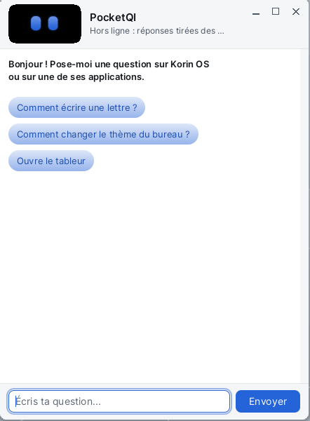

# PocketQI

**PocketQI** is the Korin OS assistant. You ask it a question **in writing** about the system or an application ("How do I change the desktop theme?", "How do I write a letter?"); it answers in a bubble and can open the application in question. It does not listen: no microphone, no wake word. Its answers come from an artificial intelligence service chosen in its settings (Mistral, Groq or your own server), or, offline, from the manifests of the installed applications.

> **Note**: PocketQI's own texts are not translated yet: its window, its menu and its settings dialog show French labels. This page gives each label as shown, followed by its meaning.

## Opening PocketQI

- **The bubble**: click the PocketQI icon in the menu bar, at the top right (a small bubble with two eyes, left of the speaker). The bubble opens under the icon, above the windows. A second click on the icon closes it, as does the Esc key.
- **The window**: from the Korin OS menu, **Accessories** category, **PocketQI**. It is an ordinary window, which you can move and resize.

## The window

- **At the top**, Pocket's face, its two eyes in the theme colors, and the state: the service that answers ("Mistral", "Groq", "Serveur local" for your own server, or "Hors ligne : réponses tirées des manifestes" when offline), then "Je réfléchis..." (thinking) while it prepares its answer. In the bubble, the **Settings** button is next to it.
- **In the middle**, the conversation: your questions and its answers.
- **At the bottom**, the field "Écris ta question..." (type your question) and the **Envoyer** (Send) button.

While the conversation is empty, PocketQI says hello and offers three questions to try: clicking one asks it.

## Asking a question

1. Type the question in the bottom field.
2. Enter, or **Envoyer** (Send).
3. PocketQI thinks, then answers in the conversation.

It remembers the last exchanges: you can follow up ("and to save it as PDF?"). After ten minutes without a question, it starts over. **PocketQI > Nouvelle conversation** (New conversation, Ctrl+N) clears the conversation at once.

## Having it open an application

Just ask: "Open the spreadsheet", "Start the terminal". When the question is about an application, PocketQI can open it for you, sometimes on the right pane or tab ("change the theme" opens [Settings](help:control) on the **Theme** pane).

It only starts installed applications, and only with the actions their manifest declares.

## What it does by itself

PocketQI does not only describe: four things it does at once, and its answer shows in the conversation. A plain sentence is enough, with a service or offline. When the system language is English, its tools answer in English.

| What | Example sentences |
|---|---|
| **The weather** (now, one day, the week) | "What's the weather in London?", "Will it rain tomorrow?", "Weather for the week", "I live in Leeds" |
| **The notes** of **Notes** | "Take a note: call the plumber on Monday", "Read my notes", "Read the note about holidays", "Print my notes" |
| **The agenda** of the **Calendar** | "Add a meeting with Paul on Friday at 3pm", "What do I have this week?", "Print my calendar for next week" |
| **The shopping list** | "Add milk and eggs to the shopping list", "Remove eggs from the shopping list", "Tick the milk on the shopping list", "Read my shopping list", "Print the shopping list" |

- **The weather** comes from Open-Meteo, a free service without an account. With no town in the sentence, PocketQI uses its own: tell it where you live, or set **Ville (météo)** (town for the weather) in its settings. Forecasts go from today to six days ahead.
- **The notes** are those of the Notes application, in `SD0:/Notes`: a note added by PocketQI shows in Notes (even while open), and PocketQI reads the ones you wrote. "Read my notes" shows the five most recent in full; "Show my notes" their titles.
- **Appointments** go into the Calendar and into the **Upcoming appointments** box of the desktop. Say the day as you think it: "tomorrow", "Friday", "December 12", "next Monday"; the time too: "3pm", "9:30", "noon". Without a day, PocketQI asks for it.
- **The shopping list** is a note of Notes titled "Shopping list" ("Liste de courses" in French), one item per line: `[ ] milk (2 litres)`, `[x] bread` once ticked. You can edit it in Notes too.
- **Printing** opens the system print window: choose the printer (or **PDF**), then **Print**. Nothing is printed without you.

## Choosing who answers

**PocketQI > Réglages...** (Settings..., or the **Settings** button of the bubble) opens the **Réglages de PocketQI** dialog (PocketQI settings).

Under **Qui répond aux questions :** (who answers questions), choose:

| Choice | What it needs |
|---|---|
| **Mistral (clé d'API)** (Mistral, API key) | a Mistral key, in **Clé Mistral** |
| **Groq (clé d'API)** (Groq, API key) | a Groq key, in **Clé Groq**; Groq is also Mistral's fallback |
| **Un serveur compatible OpenAI (adresse)** (an OpenAI-compatible server) | the address in **Adresse du serveur** (`https://.../v1/chat/completions`), and **Clé du serveur** (server key) if it needs one |
| **Personne : seulement les manifestes, hors ligne** (nobody: offline, manifests only) | nothing |

**Modèle (facultatif)** (model, optional) chooses another model than the service's default one. **Ville (météo)** (town for the weather) is used when a sentence names no town. **OK** saves, **Cancel** gives up.

Keys are typed into masked fields and kept on the card, in `SD0:/home/pocketqi/config.ini`. They only go to their own service, over HTTPS.

## Offline

With no service set, with **Personne**, or when the service does not answer, PocketQI still answers: it looks for the application closest to the question and gives its description and tips. A question that says "open" or "start" opens it.

Offline, the weather, notes, agenda and shopping list work too, for simple sentences like those in the table above (in English or French). Freer wording needs a service.

## What leaves the device

With an online service, PocketQI sends it the question, the last exchanges (with what its tools answered: a shopping list read, appointments) and the list of installed applications. Nothing else: neither your files nor the open document. For the weather, only the town goes to Open-Meteo. Offline, nothing leaves except that weather request.

## Menus and shortcuts

| Menu | Command | Shortcut |
|---|---|---|
| PocketQI | Nouvelle conversation (New conversation) | Ctrl+N |
| PocketQI | Réglages... (Settings...) | |
| PocketQI | Quit (Close in the bubble) | |

| Key | Effect |
|---|---|
| Enter | sends the question |
| Page Up, Page Down | scroll the conversation |
| Esc | closes the bubble |

## Tips

- The best questions name the application or the task: "How do I insert a picture in Letters?".
- What PocketQI knows about an application comes from its manifest (`app.txt`): description, keywords and tips. It does not see what is on the screen and does not act inside an open application, apart from its four tools.
- For complete, detailed help, the **Help** menu of each application opens its page, like this one.
