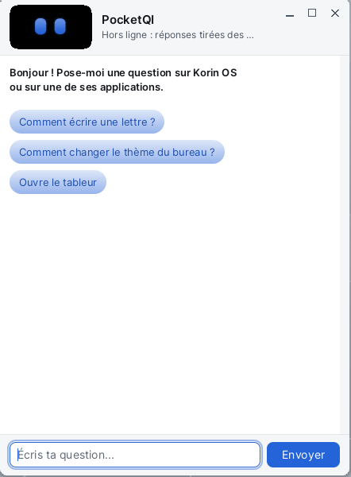

# PocketQI

**PocketQI** est l'assistante de Korin OS. On lui pose **par écrit** une question sur le système ou sur une application (« Comment changer le thème du bureau ? », « Comment écrire une lettre ? ») ; elle répond dans une bulle et peut ouvrir l'application dont il est question. Elle n'écoute pas : ni micro, ni mot d'éveil. Ses réponses viennent d'un service d'intelligence artificielle choisi dans ses réglages (Mistral, Groq ou un serveur à soi), ou, hors ligne, des fiches des applications installées.

## Ouvrir PocketQI

- **La bulle** : un clic sur l'icône de PocketQI dans la barre de menus, en haut à droite (une petite bulle avec deux yeux, à gauche du haut-parleur). La bulle s'ouvre sous l'icône, par-dessus les fenêtres. Un second clic sur l'icône la ferme, comme la touche Échap.
- **La fenêtre** : par le menu Korin OS, catégorie **Accessoires**, **PocketQI**. C'est une fenêtre ordinaire, qu'on peut déplacer et agrandir.

## La fenêtre

- **En haut**, le visage de Pocket, ses deux yeux aux couleurs du thème, et l'état : le service qui répond (« Mistral », « Groq », « Serveur local », ou « Hors ligne : réponses tirées des manifestes »), puis « Je réfléchis... » pendant qu'elle prépare sa réponse. Dans la bulle, le bouton **Réglages** est à côté.
- **Au milieu**, la conversation : vos questions et ses réponses.
- **En bas**, le champ « Écris ta question... » et le bouton **Envoyer**.

Tant que la conversation est vide, PocketQI dit bonjour et propose trois questions à essayer : un clic sur l'une la pose.

## Poser une question

1. Tapez la question dans le champ du bas.
2. Entrée, ou **Envoyer**.
3. PocketQI réfléchit, puis répond dans la conversation.

Elle se souvient des derniers échanges : on peut enchaîner (« et pour l'enregistrer en PDF ? »). Après dix minutes sans question, elle repart de zéro. **PocketQI > Nouvelle conversation** (Ctrl+N) efface la conversation tout de suite.

## Lui faire ouvrir une application

Demandez-le simplement : « Ouvre le tableur », « Lance le terminal ». Quand la question porte sur une application, PocketQI peut l'ouvrir pour vous, parfois sur le bon volet ou le bon onglet (« change le thème » ouvre [Réglages](help:control) sur le volet **Thème**).

Elle ne lance que des applications installées, et seulement avec les actions que leur fiche déclare.

## Choisir qui répond

**PocketQI > Réglages...** (ou le bouton **Réglages** de la bulle) ouvre la boîte **Réglages de PocketQI**.

Sous **Qui répond aux questions :**, choisissez :

| Choix | Ce qu'il faut |
|---|---|
| **Mistral (clé d'API)** | une clé Mistral, dans **Clé Mistral** |
| **Groq (clé d'API)** | une clé Groq, dans **Clé Groq** ; Groq sert aussi de secours à Mistral |
| **Un serveur compatible OpenAI (adresse)** | l'adresse dans **Adresse du serveur** (`https://.../v1/chat/completions`), et **Clé du serveur** s'il en faut une |
| **Personne : seulement les manifestes, hors ligne** | rien |

**Modèle (facultatif)** choisit un autre modèle que celui par défaut du service. **OK** enregistre, **Annuler** abandonne.

Les clés sont tapées dans des champs masqués et gardées sur la carte, dans `SD0:/home/pocketqi/config.ini`. Elles ne partent que vers leur service, en HTTPS.

## Hors ligne

Sans service réglé, avec **Personne**, ou quand le service ne répond pas, PocketQI répond quand même : elle cherche l'application la plus proche de la question et donne sa description et ses conseils. « Ouvre » ou « lance » dans la question l'ouvre.

## Ce qui sort de l'appareil

Avec un service en ligne, PocketQI lui envoie la question, les derniers échanges et la liste des applications installées. Rien d'autre : ni vos fichiers, ni le document ouvert. Hors ligne, rien ne sort.

## Menus et raccourcis

| Menu | Commande | Raccourci |
|---|---|---|
| PocketQI | Nouvelle conversation | Ctrl+N |
| PocketQI | Réglages... | |
| PocketQI | Quitter (Fermer dans la bulle) | |

| Touche | Effet |
|---|---|
| Entrée | envoie la question |
| Page préc., Page suiv. | font défiler la conversation |
| Échap | ferme la bulle |

## Astuces

- Les meilleures questions nomment l'application ou la tâche : « Comment insérer une image dans Letters ? ».
- Ce que PocketQI sait d'une application vient de sa fiche (`app.txt`) : description, mots-clés et conseils. Elle ne voit pas ce qui est affiché à l'écran et n'agit pas dans une application ouverte.
- Pour une aide complète et détaillée, le menu **Aide** de chaque application ouvre sa page, comme celle-ci.
