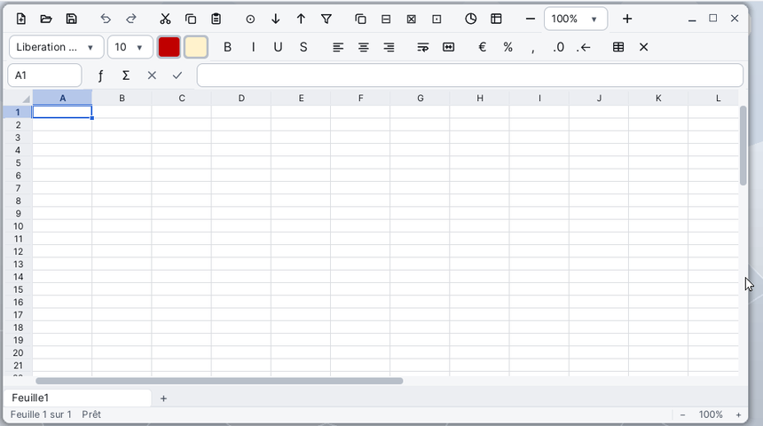

# Spreadsheet

**Spreadsheet** is the spreadsheet of Korin OS: workbooks of several sheets, cells with formulas and functions (237 functions), number and cell formatting, conditional formatting, sorting, AutoFilter and charts. It opens Excel (`.xlsx`), OpenDocument (`.ods`) and CSV files, and saves as `.xlsx` or CSV.

## The Window

From top to bottom:

- **the first toolbar**: new, open, save, undo, redo, cut, copy, paste, find, sort ascending and descending, AutoFilter, insert and delete rows or columns, chart, freeze panes, and the zoom (−, the list of percentages, +);
- **the formatting bar**: the font, its size, the font colour, the fill colour, then bold, italic, underline, strikethrough, the alignments, wrap text, merge and centre, currency, percent, thousands' separator, add or take off a decimal, borders and clear the formatting;
- **the formula bar**: on the left the **Name Box** (the cell or range chosen), the ƒ (insert function) and Σ (AutoSum) buttons, ✕ and ✓ while typing (cancel, accept), then the line that shows the cell's content;
- **the grid**: the column letters, the row numbers, the cells and the charts;
- **the sheet tabs**: a click shows a sheet, **+** adds one, a right click opens its menu;
- **the status bar**: the sheet ("Sheet 1 of 3"), the mode (Ready, Enter, Point), the sum, average and count of the cells chosen, and the zoom (−, 100%, +).

When the window is narrow, the buttons on the right of the bars hide: everything stays in the menus. The sheet stays white, like a page, whatever the desktop theme.

## Entering Data

1. Click a cell (or go there with the arrows).
2. Type: the entry starts in the cell. A number, a date, a time or a text.
3. **Enter** accepts and moves down, **Tab** accepts and moves right (Shift reverses the direction); **Esc** cancels.

The spreadsheet recognises what you type and picks the format that goes with it:

- numbers: `1234.5`, `1,234.5`, `3,5`, `-2e3`, `(42)` for a negative;
- percentages: `12.5%`; amounts: `$1,200`, `12,50 €`;
- dates, day first: `29/09/2026`, `2026-09-29`, `29/9`, `29 Sep 2026`, `Sep 29, 2026`; times: `14:30`, `2:30 PM`;
- `TRUE` and `FALSE`; an apostrophe first (`'0612`) keeps the rest as text.

To change a cell: double-click it, press **F2**, or use the line of the formula bar. **Alt+Enter** starts a new line in the cell. **Backspace** empties the cell and starts typing; **Del** clears the content of the cells chosen.

## Choosing Cells

- Dragging the mouse, or **Shift+arrows**, chooses a range; a click on a column letter or a row number chooses the whole column or row.
- **Ctrl+Space** chooses the selection's columns, **Shift+Space** its rows, **Ctrl+A** the whole sheet.
- **Ctrl+arrows** goes to the edge of the data; **Ctrl+Home** to A1, **Ctrl+End** to the last cell used.
- In the Name Box, type `B7`, `C2:F9` or `Sheet2!A1` and press Enter to go there (**Edit > Go To...**, Ctrl+G, puts the cursor there). Typing a new name gives that name to the selection.

## Filling a Series

Drag the small **handle** at the bottom right of the selection: the next cells fill. The spreadsheet carries on numbers (1, 2, 3...), dates, the English words of days and months (`Monday`, `Sep`...) and texts ending in a number (`Item 1`, `Item 2`...). A formula copied keeps its relative references moved along. **Edit > Fill Down** (Ctrl+D) and **Fill Right** (Ctrl+R) copy the first row or column of the selection.

## Formatting

- **Format > Cells...** (Ctrl+1) opens the **Format Cells** dialog, in five tabs: **Numbers** (General, Number, Currency, Percent, Scientific, Fraction, Date, Time, Text, Custom with its format code), **Font**, **Alignment** (horizontal, vertical, indent, wrap text, merge), **Borders** and **Fill**.
- The buttons of the formatting bar apply at once to the selection. The currency button offers Euro, Dollar ($), Pound, Yen, Franc (CHF); the borders button opens the list of borders.
- **Format > Row Height...**, **Column Width...**; dragging the edge of a header changes the size, a double click on that edge fits the column or row to its content.
- **Format > Conditional Formatting...**: rules over a range (the cell value compared, top or bottom values, above or below the average, duplicate or unique values, a formula that is true), with a look of your choice, a colour scale or data bars.

## Sorting and Filtering

- **Data > Sort Ascending** and **Sort Descending** sort the table by the cursor's column.
- **Data > Sort...** sorts on up to three keys (**Sort by**, **Then by**), each ascending or descending; a box says whether the first row holds the column labels.
- **Data > AutoFilter** puts buttons on the table's headers; a click on one opens the list of its values to show. The same menu takes the filters off.

## Charts

1. Choose the data, with their labels.
2. **Insert > Chart...**: choose the type (**Column**, **Bar**, **Line**, **Area**, **Pie**, **Scatter**), the title, the legend, the series in rows or columns, whether the first row or column gives the names, and the **Stacked** option.
3. The chart sits on the sheet: drag it to move it, drag its handles to size it. A double click opens its properties again, **Del** deletes it.

## Sheets

The **Sheet** menu (or a right click on a tab) inserts, deletes, renames, duplicates a sheet and moves it left or right. **Ctrl+Page Up** and **Ctrl+Page Down** go from one sheet to the next. A workbook keeps one sheet at least.

## Formulas

A formula starts with `=`. The result shows in the cell, the formula in the formula bar. **View > Formulas** (Ctrl+`) shows the formulas in the grid.

- `=SUM(B2:B9)*(1+$E$1)`
- `=IF(C2>=10,"yes","no")`
- `='My Accounts'!A1&" km"`

**References**

| Written | Meaning |
|---|---|
| `A1` | a cell, relative: it moves when the formula is copied |
| `$A$1`, `A$1`, `$A1` | absolute in column and row, in the row only, in the column only |
| `B2:D9` | a range |
| `A:A`, `3:3` | a whole column, a whole row |
| `Sheet2!A1` | a cell of another sheet |
| `'My Accounts'!B2:B9` | another sheet whose name holds spaces |
| `Total` | a name defined with **Insert > Names...** |
| `{1,2;3,4}` | an array: `,` separates the columns, `;` the rows |

While a formula is typed, the arrows or the mouse point at cells (Point mode); each reference takes a colour, and its cells are framed in the same colour. **F4** cycles the reference at the caret: `A1`, `$A$1`, `A$1`, `$A1`. **F2** switches between pointing and moving the caret in the text. References follow the rows and columns inserted or deleted.

**Separator and numbers**: arguments are separated by a comma `,`; a semicolon `;` is accepted too, and the spreadsheet then writes the formula back with commas. In a formula, a decimal number is written with a point (`0.5`). Function names are in English, as in Excel.

**Operators**, from the highest priority to the lowest:

| Operator | Meaning |
|---|---|
| `:` | range |
| `-` (in front) | negation |
| `%` | percent (`20%` is 0.2) |
| `^` | power |
| `*` `/` | multiplication, division |
| `+` `-` | addition, subtraction |
| `&` | joins two texts |
| `=` `<>` `<` `>` `<=` `>=` | comparisons (the result is TRUE or FALSE) |

Operators work on ranges too, element by element: `=SUM(A1:A5*B1:B5)`.

**Criteria** (SUMIF, COUNTIF, AVERAGEIF and the ...IFS functions): a text such as `">5"`, `"<>0"`, `"apple"`, with the wildcards `*` and `?` (`~` before a wildcard takes it literally).

**Errors**

| Value | Cause |
|---|---|
| `#DIV/0!` | division by zero |
| `#VALUE!` | an argument of the wrong type (a text where a number is needed) |
| `#REF!` | the reference points at a deleted cell |
| `#NAME?` | an unknown function or name |
| `#NUM!` | an impossible number (the square root of a negative...) |
| `#N/A` | value not found (VLOOKUP or MATCH without a result, NA()) |
| `#CIRC!` | circular reference: the formula depends on itself |

A formula written wrongly is not accepted: a message says what is wrong ("A ) is missing.") and the caret goes to the faulty place.

**Insert > Function...** opens the list of functions by category, with their arguments and what they do. Typing `=` then letters in the cell, a list offers the functions that start so (Tab or Enter picks one) and a tip shows the arguments. **Insert > AutoSum** (the Σ button) writes `=SUM(...)` of the numbers above or on the left; over a range, it adds a total under each column.

## Functions

Arguments in square brackets are optional. Several names on a line do the same (the second form is that of Excel 2010 and later).

**Mathematical**

| Function | What it does |
|---|---|
| SUM, PRODUCT, SUMSQ | sum, product, sum of the squares of the arguments |
| SUMIF, SUMIFS | sum of the cells that meet a criterion, several |
| SUMPRODUCT | multiplies arrays element by element and adds the products |
| SUBTOTAL | a subtotal (1 AVERAGE ... 11 VARP; +100: hidden rows left out) |
| ABS, SIGN | absolute value, sign (1, 0 or -1) |
| SQRT, SQRTPI, POWER, EXP | square root, root of number × pi, power, e to a power |
| LN, LOG, LOG10 | natural logarithm, to a base (10 by default), base 10 |
| PI | 3.14159265358979 |
| ROUND, ROUNDUP, ROUNDDOWN | rounds to n digits, away from zero, toward zero |
| MROUND, CEILING, CEILING.MATH, FLOOR, FLOOR.MATH | rounds to the nearest multiple, up, down |
| INT, TRUNC | integer below, decimals cut off |
| EVEN, ODD | even, odd integer above |
| MOD, QUOTIENT | remainder, integer part of a division |
| FACT, FACTDOUBLE | factorial, double factorial |
| COMBIN, COMBINA, PERMUT | combinations, with repetitions, permutations |
| GCD, LCM | greatest common divisor, least common multiple |
| RAND, RANDBETWEEN | random number between 0 and 1, integer between two bounds |
| SIN, COS, TAN, COT | trigonometric functions (radians) |
| ASIN, ACOS, ATAN, ATAN2 | their inverses; ATAN2: the angle of the point (x, y) |
| SINH, COSH, TANH, ASINH, ACOSH, ATANH | hyperbolic functions and their inverses |
| DEGREES, RADIANS | radians to degrees, degrees to radians |

**Statistical**

| Function | What it does |
|---|---|
| AVERAGE, AVERAGEA | average; AVERAGEA counts texts 0 and TRUE 1 |
| AVERAGEIF, AVERAGEIFS | average of the cells that meet a criterion, several |
| COUNT, COUNTA, COUNTBLANK | counts the numbers, the cells not empty, the empty ones |
| COUNTIF, COUNTIFS | counts the cells that meet a criterion, several |
| MAX, MAXA, MAXIFS | largest value; texts counting 0; by criteria |
| MIN, MINA, MINIFS | smallest value; texts counting 0; by criteria |
| MEDIAN, MODE, MODE.SNGL | median, most frequent value |
| LARGE, SMALL | k-th largest, smallest value |
| RANK, RANK.EQ, RANK.AVG | rank in a list; RANK.AVG averages ties |
| PERCENTILE, PERCENTILE.INC, PERCENTILE.EXC | k-th percentile (EXC: 0 and 1 excluded) |
| QUARTILE, QUARTILE.INC, QUARTILE.EXC | quartile (EXC: 0 and 4 excluded) |
| PERCENTRANK | rank of a value as a percentage |
| STDEV, STDEV.S, STDEVA | standard deviation of a sample (STDEVA: texts counting 0) |
| STDEVP, STDEV.P | standard deviation of a population |
| VAR, VAR.S, VARA | variance of a sample (VARA: texts counting 0) |
| VARP, VAR.P | variance of a population |
| AVEDEV, DEVSQ | average of the absolute deviations, sum of the squared deviations |
| GEOMEAN, HARMEAN | geometric, harmonic mean |
| CORREL, PEARSON, RSQ | correlation coefficient, its square |
| COVAR, COVARIANCE.P, COVARIANCE.S | covariance of a population, of a sample |
| SLOPE, INTERCEPT, STEYX | slope, intercept, standard error of the regression line |
| FORECAST, FORECAST.LINEAR | a value on the regression line |
| NORMDIST, NORM.DIST, NORMINV, NORM.INV | normal distribution and its inverse |
| NORMSDIST, NORM.S.DIST, NORMSINV, NORM.S.INV | standard normal distribution and its inverse |
| STANDARDIZE | a normalised value |
| BINOMDIST, BINOM.DIST | binomial distribution |
| POISSON, POISSON.DIST | Poisson distribution |
| EXPONDIST, EXPON.DIST | exponential distribution |

**Logical**

| Function | What it does |
|---|---|
| IF | one value if the condition is TRUE, another if it is FALSE |
| IFS | the value of the first condition that is TRUE |
| IFERROR, IFNA | the value, or another when it is an error, when it is #N/A |
| SWITCH | the result matching the value of an expression |
| AND, OR, XOR, NOT | and, or, exclusive or, not |
| TRUE, FALSE | the values TRUE and FALSE |

**Text**

| Function | What it does |
|---|---|
| CONCATENATE, CONCAT, TEXTJOIN | joins texts; CONCAT takes ranges; TEXTJOIN with a delimiter |
| LEN, LEFT, RIGHT, MID | length, first, last characters, characters from the middle |
| UPPER, LOWER, PROPER | capitals, small letters, each word's first letter in capitals |
| TRIM, CLEAN | takes off extra spaces, control characters |
| REPT | repeats a text |
| SUBSTITUTE, REPLACE | replaces a text with another, characters at a place |
| FIND, SEARCH | where a text is found (FIND: case matters; SEARCH: case ignored, wildcards) |
| EXACT | TRUE if two texts are exactly the same |
| CHAR, CODE | character of a Windows-1252 code, code of the first character |
| UNICHAR, UNICODE | Unicode character of a number, Unicode number of the first character |
| VALUE, NUMBERVALUE | a text read as a number (NUMBERVALUE: separators given) |
| TEXT | a value formatted as a text, with a format code |
| FIXED, DOLLAR | a number as a text with its decimals, in the currency format |
| T | the value if it is a text, else an empty text |
| HYPERLINK | a link's name (the link itself is not followed) |

**Lookup and Reference**

| Function | What it does |
|---|---|
| VLOOKUP, HLOOKUP | looks in the first column, row, of a table and returns a value of the same row, column |
| XLOOKUP | looks in a range and returns the matching item of another |
| LOOKUP | looks in a sorted row or column |
| MATCH, INDEX | position of a value in a range; value at a row and column |
| CHOOSE | a value from a list by its number |
| OFFSET, INDIRECT | a reference moved from another; the reference written in a text |
| ROW, COLUMN, ROWS, COLUMNS | row, column number; number of rows, columns |
| ADDRESS | a cell's address as a text |
| TRANSPOSE | an array with rows and columns swapped |
| FORMULATEXT | a cell's formula as a text |

**Date and Time**

| Function | What it does |
|---|---|
| DATE, TIME | serial number of a date, a time |
| TODAY, NOW | today's date, the date and time now |
| YEAR, MONTH, DAY | year, month, day of a date |
| HOUR, MINUTE, SECOND | hour, minute, second |
| WEEKDAY, WEEKNUM, ISOWEEKNUM | day of the week (1 = Sunday), week of the year, ISO week |
| EDATE, EOMONTH | the date some months away, the last day of that month |
| DAYS, DAYS360, DATEDIF | days between two dates; on 360 days; years, months or days ("Y", "M", "D") |
| NETWORKDAYS, WORKDAY | working days between two dates; the date some working days away |
| DATEVALUE, TIMEVALUE | a date, a time written as a text, as a serial number |
| YEARFRAC | fraction of a year between two dates |

**Information**

| Function | What it does |
|---|---|
| ISBLANK, ISNUMBER, ISTEXT, ISNONTEXT, ISLOGICAL | TRUE if empty, a number, a text, not a text, TRUE or FALSE |
| ISERROR, ISERR, ISNA | TRUE if an error, an error other than #N/A, #N/A |
| ISREF, ISFORMULA | TRUE if a reference, if the cell holds a formula |
| ISEVEN, ISODD | TRUE if the number is even, odd |
| NA, ERROR.TYPE | the error #N/A; an error's number |
| TYPE, N | the type (1 number, 2 text, 4 logical, 16 error, 64 array); the value as a number |
| SHEET, SHEETS | a sheet's number, the number of sheets |

**Financial**

| Function | What it does |
|---|---|
| PMT, IPMT, PPMT | payment of a loan, its interest part, its principal part |
| FV, PV | future value, present value of an investment |
| NPER, RATE | number of periods, rate per period |
| NPV, IRR | net present value, internal rate of return |
| SLN, SYD, DDB | straight-line, sum-of-years' digits, double-declining balance depreciation |
| EFFECT, NOMINAL | effective, nominal annual rate |

## Menus and Shortcuts

| Menu | Commands (shortcut) |
|---|---|
| **File** | New (Ctrl+N), Open... (Ctrl+O), Save (Ctrl+S), Save As..., Export as CSV..., Export as PDF..., Print... (Ctrl+P) |
| **Edit** | Undo (Ctrl+Z), Redo (Ctrl+Y), Cut (Ctrl+X), Copy (Ctrl+C), Paste (Ctrl+V), Paste Special..., Delete Contents (Del), Fill Down (Ctrl+D), Fill Right (Ctrl+R), Select All (Ctrl+A), Find and Replace... (Ctrl+F), Go To... (Ctrl+G) |
| **View** | Zoom In, Zoom Out, Actual Size (100%), Freeze Panes, Gridlines, Formulas |
| **Insert** | Rows Above, Columns Before, Function..., Names..., AutoSum, Chart..., Sheet, Current Date, Current Time |
| **Format** | Cells..., Conditional Formatting..., Bold (Ctrl+B), Italic (Ctrl+I), Underline (Ctrl+U), Merge and Centre, Wrap Text, Row Height..., Column Width..., Optimal Column Width, Hide Rows, Hide Columns, Show Rows and Columns, Clear Formatting, No Fill, Automatic Text Colour |
| **Sheet** | Delete Rows, Delete Columns, Insert Sheet, Delete Sheet, Rename Sheet..., Duplicate Sheet, Move Sheet Left, Move Sheet Right |
| **Data** | Sort Ascending, Sort Descending, Sort..., AutoFilter, Recalculate (F9) |

A right click on a cell, a column or row header, a tab or a chart opens a menu with the commands that apply there.

| Key | Effect |
|---|---|
| Ctrl+1 | Format Cells |
| Ctrl+; and Ctrl+. | today's date, the current time |
| Ctrl++ and Ctrl+- | inserts, deletes rows (columns when whole columns are chosen) |
| Ctrl+` | shows or hides the formulas |
| F2 | edits the cell; while typing, switches between pointing and moving the caret |
| F4 | while typing a formula, cycles `A1`, `$A$1`, `A$1`, `$A1` |
| F9 | recalculates |
| Alt+Enter | a new line in the cell |
| Ctrl+Page Up / Page Down | previous, next sheet |
| Alt+Page Up / Page Down | scrolls a screen to the left, the right |
| Ctrl+Space, Shift+Space | chooses the selection's columns, rows |
| Esc | cancels the entry; clears the dashes around a copied range |

## File Formats

| Format | Open | Save |
|---|---|---|
| Excel `.xlsx` | yes: sheets, formulas, styles, number formats, merges, conditional formatting, charts | yes, it is the spreadsheet's format |
| OpenDocument `.ods` | yes | no: **Save** offers an `.xlsx` |
| CSV `.csv`, `.txt` | yes, the separator is guessed | yes, values separated by commas |
| `.tsv` | yes | yes, values separated by tabs |

A CSV file keeps only the values of the sheet shown: no formats, no formulas, no other sheet; the spreadsheet says so before saving. **File > Export as CSV...** writes the sheet shown without changing the file open.

For a PDF: **File > Print...**, then choose the PDF printer (**Export as PDF...** says so). The sheet is cut into pages, charts included; a wide sheet goes landscape.

Documents go to `SD0:/home/documents` by default. Spreadsheet also opens from [Files](help:files) with a double click on an `.xlsx`, `.ods` or `.csv` file.

## Tips

- Dropping a file on the window opens it.
- Spreadsheet started without a file opens the last workbook again. If it was closed with unsaved changes, it offers to open the recovered workbook.
- The status bar gives the sum, average and count of the cells chosen, without writing a formula.
- **View > Freeze Panes** keeps the rows above and the columns left of the cursor in view.
- **Edit > Paste Special...** pastes values only, formats only, formulas without formats, or transposes (rows become columns).
- **Find and Replace** can match case, look at entire cells only, search in formulas and in all sheets.
- **Insert > Names...** gives a name to a range (`Sales`): `=SUM(Sales)` reads better than `=SUM(B2:B90)`.
- To write a text that starts with `=`, or a number to keep as typed (a postcode), start with an apostrophe.
- Every operation can be undone with Ctrl+Z, even deleting a sheet.
