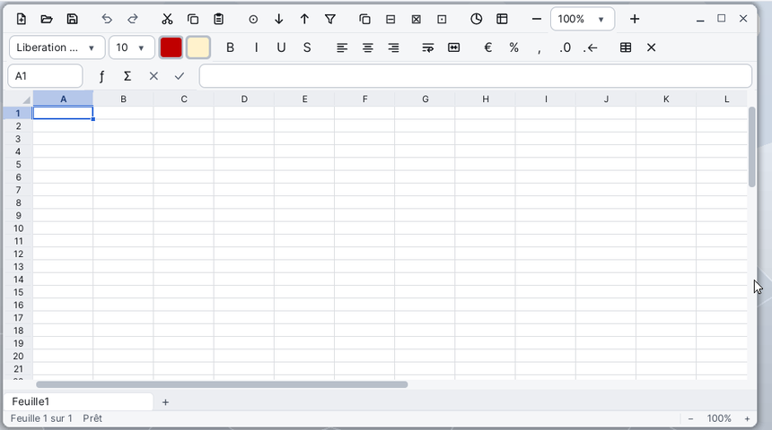

# Tableur

Le **Tableur** (Spreadsheet) est le tableur de Korin OS : des classeurs de plusieurs feuilles, des cellules avec formules et fonctions (237 fonctions), la mise en forme des nombres et des cellules, la mise en forme conditionnelle, le tri, le filtre automatique et les diagrammes. Il ouvre les fichiers Excel (`.xlsx`), OpenDocument (`.ods`) et CSV, et enregistre en `.xlsx` ou en CSV.

## La fenêtre

De haut en bas :

- **la première barre d'outils** : nouveau, ouvrir, enregistrer, annuler, rétablir, couper, copier, coller, rechercher, tri croissant et décroissant, filtre automatique, insérer et supprimer des lignes ou des colonnes, diagramme, figer les volets, et le zoom (−, la liste des pourcentages, +) ;
- **la barre de mise en forme** : la police, sa taille, la couleur du texte, la couleur de remplissage, puis gras, italique, souligné, barré, les alignements, renvoyer à la ligne, fusionner et centrer, monnaie, pourcentage, séparateur de milliers, ajouter ou retirer une décimale, bordures et effacer la mise en forme ;
- **la barre de formule** : à gauche la **zone Nom** (la cellule ou la plage choisie), les boutons ƒ (insérer une fonction) et Σ (somme automatique), ✕ et ✓ pendant la saisie (annuler, valider), puis la ligne qui montre le contenu de la cellule ;
- **la grille** : les lettres des colonnes, les numéros des lignes, les cellules et les diagrammes ;
- **les onglets des feuilles** : un clic montre une feuille, **+** en ajoute une, le clic droit ouvre son menu ;
- **la barre d'état** : la feuille (« Feuille 1 sur 3 »), le mode (Prêt, Saisie, Pointage), la somme, la moyenne et le nombre des cellules choisies, et le zoom (−, 100 %, +).

Quand la fenêtre est étroite, les boutons de droite des barres se cachent : tout reste dans les menus. La feuille reste blanche, comme une page, quel que soit le thème du bureau.

## Saisir des données

1. Cliquez dans une cellule (ou allez-y avec les flèches).
2. Tapez : la saisie commence dans la cellule. Un nombre, une date, une heure ou un texte.
3. **Entrée** valide et descend, **Tab** valide et passe à droite (Maj inverse le sens) ; **Échap** annule.

Le tableur reconnaît ce que vous tapez et choisit le format qui va avec :

- nombres : `1234,5`, `1,234.5`, `-2e3`, `(42)` pour un négatif ;
- pourcentages : `12,5%` ; montants : `$1,200`, `12,50 €` ;
- dates, le jour d'abord : `29/09/2026`, `2026-09-29`, `29/9`, `29 Sep 2026` ; heures : `14:30`, `2:30 PM` ;
- `TRUE` et `FALSE` ; une apostrophe en tête (`'0612`) garde le reste comme texte.

Pour modifier une cellule : double-clic, **F2**, ou la ligne de la barre de formule. **Alt+Entrée** passe à la ligne dans la cellule. **Retour arrière** vide la cellule et commence la saisie ; **Suppr** efface le contenu des cellules choisies.

## Choisir des cellules

- Glisser la souris, ou **Maj+flèches**, choisit une plage ; un clic sur une lettre de colonne ou un numéro de ligne choisit la colonne ou la ligne entière.
- **Ctrl+Espace** choisit les colonnes de la sélection, **Maj+Espace** ses lignes, **Ctrl+A** toute la feuille.
- **Ctrl+flèches** va au bord des données ; **Ctrl+Début** en A1, **Ctrl+Fin** à la dernière cellule utilisée.
- Dans la zone Nom, tapez `B7`, `C2:F9` ou `Feuille2!A1` puis Entrée pour y aller (**Édition > Atteindre...**, Ctrl+G, y place le curseur). Taper un nouveau nom donne ce nom à la sélection.

## Remplir une série

Tirez la petite **poignée** en bas à droite de la sélection : les cellules suivantes se remplissent. Le tableur continue les nombres (1, 2, 3...), les dates, les mots en anglais des jours et des mois (`Monday`, `Sep`...) et les textes qui finissent par un nombre (`Article 1`, `Article 2`...). Une formule recopiée garde ses références relatives décalées. **Édition > Remplir vers le bas** (Ctrl+D) et **Remplir à droite** (Ctrl+R) recopient la première ligne ou colonne de la sélection.

## Mettre en forme

- **Format > Cellules...** (Ctrl+1) ouvre le dialogue **Format de cellule**, en cinq onglets : **Nombres** (Standard, Nombre, Monnaie, Pourcentage, Scientifique, Fraction, Date, Heure, Texte, Personnalisé avec son code de format), **Police**, **Alignement** (horizontal, vertical, retrait, renvoyer à la ligne, fusionner), **Bordures** et **Remplissage**.
- Les boutons de la barre de mise en forme s'appliquent tout de suite à la sélection. Le bouton Monnaie propose Euro, Dollar ($), Livre, Yen, Franc (CHF) ; le bouton Bordures ouvre la liste des bordures.
- **Format > Hauteur de ligne...**, **Largeur de colonne...** ; tirer le bord d'un en-tête change la taille, un double-clic sur ce bord ajuste la colonne ou la ligne à son contenu.
- **Format > Mise en forme conditionnelle...** : des règles sur une plage (valeur de la cellule comparée, plus hautes ou plus basses, au-dessus ou en dessous de la moyenne, valeurs en double ou uniques, formule vraie), avec un aspect au choix, une échelle de couleurs ou des barres de données.

## Trier et filtrer

- **Données > Tri croissant** et **Tri décroissant** trient le tableau d'après la colonne du curseur.
- **Données > Trier...** trie sur trois clés au plus (**Trier par**, **Puis par**), chacune croissante ou décroissante ; une case dit si la première ligne contient les titres des colonnes.
- **Données > Filtre automatique** pose des boutons sur les en-têtes du tableau ; un clic sur l'un d'eux ouvre la liste de ses valeurs à montrer. Le même menu retire les filtres.

## Diagrammes

1. Choisissez les données, avec leurs titres.
2. **Insertion > Diagramme...** : choisissez le type (**Colonnes**, **Barres**, **Ligne**, **Aires**, **Secteurs**, **Nuage de points**), le titre, la légende, les séries en lignes ou en colonnes, si la première ligne ou colonne donne les noms, et l'option **Empilé**.
3. Le diagramme se pose sur la feuille : tirez-le pour le déplacer, tirez ses poignées pour le redimensionner. Un double-clic rouvre ses propriétés, **Suppr** l'efface.

## Feuilles

Le menu **Feuille** (ou le clic droit sur un onglet) insère, supprime, renomme, duplique une feuille et la déplace à gauche ou à droite. **Ctrl+Page précédente** et **Ctrl+Page suivante** passent d'une feuille à l'autre. Un classeur garde au moins une feuille.

## Les formules

Une formule commence par `=`. Le résultat s'affiche dans la cellule, la formule dans la barre de formule. **Affichage > Formules** (Ctrl+`) montre les formules dans la grille.

- `=SUM(B2:B9)*(1+$E$1)`
- `=IF(C2>=10,"oui","non")`
- `='Mes comptes'!A1&" km"`

**Références**

| Écriture | Sens |
|---|---|
| `A1` | une cellule, relative : elle se décale quand la formule est recopiée |
| `$A$1`, `A$1`, `$A1` | absolue en colonne et en ligne, en ligne seulement, en colonne seulement |
| `B2:D9` | une plage |
| `A:A`, `3:3` | une colonne entière, une ligne entière |
| `Feuille2!A1` | une cellule d'une autre feuille |
| `'Mes comptes'!B2:B9` | une autre feuille dont le nom contient des espaces |
| `Total` | un nom défini par **Insertion > Noms...** |
| `{1,2;3,4}` | une matrice : `,` sépare les colonnes, `;` les lignes |

Pendant la saisie d'une formule, les flèches ou la souris désignent les cellules (mode Pointage) ; chaque référence prend une couleur, et ses cellules sont encadrées de la même couleur. **F4** fait tourner la référence sous le curseur : `A1`, `$A$1`, `A$1`, `$A1`. **F2** bascule entre pointer et déplacer le curseur dans le texte. Les références suivent les lignes et colonnes insérées ou supprimées.

**Séparateur et nombres** : les arguments se séparent par une virgule `,` ; le point-virgule `;` est accepté aussi, le tableur réécrit alors la formule avec des virgules. Dans une formule, un nombre décimal s'écrit avec un point (`0.5`). Les noms des fonctions restent en anglais, comme dans Excel.

**Opérateurs**, du plus prioritaire au moins prioritaire :

| Opérateur | Sens |
|---|---|
| `:` | plage |
| `-` (devant) | négation |
| `%` | pourcentage (`20%` vaut 0,2) |
| `^` | puissance |
| `*` `/` | multiplication, division |
| `+` `-` | addition, soustraction |
| `&` | assemble deux textes |
| `=` `<>` `<` `>` `<=` `>=` | comparaisons (le résultat est TRUE ou FALSE) |

Les opérateurs marchent aussi sur des plages, élément par élément : `=SUM(A1:A5*B1:B5)`.

**Critères** (SUMIF, COUNTIF, AVERAGEIF et les fonctions en ...IFS) : un texte comme `">5"`, `"<>0"`, `"pomme"`, avec les jokers `*` et `?` (`~` devant un joker le prend à la lettre).

**Erreurs**

| Valeur | Cause |
|---|---|
| `#DIV/0!` | division par zéro |
| `#VALUE!` | un argument du mauvais type (un texte là où il faut un nombre) |
| `#REF!` | la référence pointe une cellule supprimée |
| `#NAME?` | une fonction ou un nom inconnu |
| `#NUM!` | un nombre impossible (racine d'un négatif...) |
| `#N/A` | valeur introuvable (VLOOKUP ou MATCH sans résultat, NA()) |
| `#CIRC!` | référence circulaire : la formule dépend d'elle-même |

Une formule mal écrite n'est pas acceptée : un message dit ce qui ne va pas (« Il manque une ). ») et le curseur se place à l'endroit fautif.

**Insertion > Fonction...** ouvre la liste des fonctions par catégorie, avec leurs arguments et ce qu'elles font. En tapant `=` puis des lettres dans la cellule, une liste propose les fonctions qui commencent ainsi (Tab ou Entrée choisit) et une bulle montre les arguments. **Insertion > Somme automatique** (bouton Σ) écrit `=SUM(...)` des nombres au-dessus ou à gauche ; sur une plage, elle ajoute un total sous chaque colonne.

## Les fonctions

Les arguments entre crochets sont facultatifs. Plusieurs noms sur une ligne font la même chose (la seconde forme est celle d'Excel 2010 et suivants).

**Mathématiques**

| Fonction | Ce qu'elle fait |
|---|---|
| SUM, PRODUCT, SUMSQ | somme, produit, somme des carrés des arguments |
| SUMIF, SUMIFS | somme des cellules qui répondent à un critère, à plusieurs |
| SUMPRODUCT | multiplie des matrices élément par élément et additionne |
| SUBTOTAL | sous-total (1 AVERAGE ... 11 VARP ; +100 : sans les lignes masquées) |
| ABS, SIGN | valeur absolue, signe (1, 0 ou -1) |
| SQRT, SQRTPI, POWER, EXP | racine carrée, racine de nombre × pi, puissance, e puissance |
| LN, LOG, LOG10 | logarithme népérien, dans une base (10 par défaut), en base 10 |
| PI | 3,14159265358979 |
| ROUND, ROUNDUP, ROUNDDOWN | arrondit à n chiffres, en s'éloignant de zéro, vers zéro |
| MROUND, CEILING, CEILING.MATH, FLOOR, FLOOR.MATH | arrondit au multiple le plus proche, supérieur, inférieur |
| INT, TRUNC | entier inférieur, retire les décimales |
| EVEN, ODD | entier pair, impair supérieur |
| MOD, QUOTIENT | reste, partie entière d'une division |
| FACT, FACTDOUBLE | factorielle, double factorielle |
| COMBIN, COMBINA, PERMUT | combinaisons, avec répétitions, permutations |
| GCD, LCM | plus grand commun diviseur, plus petit commun multiple |
| RAND, RANDBETWEEN | nombre aléatoire entre 0 et 1, entier entre deux bornes |
| SIN, COS, TAN, COT | fonctions trigonométriques (radians) |
| ASIN, ACOS, ATAN, ATAN2 | leurs inverses ; ATAN2 : angle du point (x, y) |
| SINH, COSH, TANH, ASINH, ACOSH, ATANH | fonctions hyperboliques et leurs inverses |
| DEGREES, RADIANS | radians en degrés, degrés en radians |

**Statistiques**

| Fonction | Ce qu'elle fait |
|---|---|
| AVERAGE, AVERAGEA | moyenne ; AVERAGEA compte les textes 0 et TRUE 1 |
| AVERAGEIF, AVERAGEIFS | moyenne des cellules qui répondent à un critère, à plusieurs |
| COUNT, COUNTA, COUNTBLANK | compte les nombres, les cellules non vides, les vides |
| COUNTIF, COUNTIFS | compte les cellules qui répondent à un critère, à plusieurs |
| MAX, MAXA, MAXIFS | plus grande valeur ; avec textes à 0 ; selon des critères |
| MIN, MINA, MINIFS | plus petite valeur ; avec textes à 0 ; selon des critères |
| MEDIAN, MODE, MODE.SNGL | médiane, valeur la plus fréquente |
| LARGE, SMALL | k-ième plus grande, plus petite valeur |
| RANK, RANK.EQ, RANK.AVG | rang dans une liste ; RANK.AVG fait la moyenne des ex æquo |
| PERCENTILE, PERCENTILE.INC, PERCENTILE.EXC | k-ième centile (EXC : 0 et 1 exclus) |
| QUARTILE, QUARTILE.INC, QUARTILE.EXC | quartile (EXC : 0 et 4 exclus) |
| PERCENTRANK | rang d'une valeur en pourcentage |
| STDEV, STDEV.S, STDEVA | écart type d'un échantillon (STDEVA : textes à 0) |
| STDEVP, STDEV.P | écart type d'une population |
| VAR, VAR.S, VARA | variance d'un échantillon (VARA : textes à 0) |
| VARP, VAR.P | variance d'une population |
| AVEDEV, DEVSQ | moyenne des écarts absolus, somme des carrés des écarts |
| GEOMEAN, HARMEAN | moyenne géométrique, harmonique |
| CORREL, PEARSON, RSQ | coefficient de corrélation, son carré |
| COVAR, COVARIANCE.P, COVARIANCE.S | covariance d'une population, d'un échantillon |
| SLOPE, INTERCEPT, STEYX | pente, ordonnée à l'origine, erreur type de la droite de régression |
| FORECAST, FORECAST.LINEAR | une valeur sur la droite de régression |
| NORMDIST, NORM.DIST, NORMINV, NORM.INV | loi normale et son inverse |
| NORMSDIST, NORM.S.DIST, NORMSINV, NORM.S.INV | loi normale centrée réduite et son inverse |
| STANDARDIZE | valeur centrée réduite |
| BINOMDIST, BINOM.DIST | loi binomiale |
| POISSON, POISSON.DIST | loi de Poisson |
| EXPONDIST, EXPON.DIST | loi exponentielle |

**Logique**

| Fonction | Ce qu'elle fait |
|---|---|
| IF | une valeur si la condition est TRUE, une autre si elle est FALSE |
| IFS | la valeur de la première condition TRUE |
| IFERROR, IFNA | la valeur, ou une autre si c'est une erreur, si c'est #N/A |
| SWITCH | le résultat qui correspond à la valeur d'une expression |
| AND, OR, XOR, NOT | et, ou, ou exclusif, non |
| TRUE, FALSE | les valeurs TRUE et FALSE |

**Texte**

| Fonction | Ce qu'elle fait |
|---|---|
| CONCATENATE, CONCAT, TEXTJOIN | assemble des textes ; CONCAT prend des plages ; TEXTJOIN avec un séparateur |
| LEN, LEFT, RIGHT, MID | longueur, premiers, derniers caractères, caractères du milieu |
| UPPER, LOWER, PROPER | majuscules, minuscules, initiale de chaque mot en majuscule |
| TRIM, CLEAN | retire les espaces en trop, les caractères de contrôle |
| REPT | répète un texte |
| SUBSTITUTE, REPLACE | remplace un texte par un autre, des caractères à un endroit |
| FIND, SEARCH | position d'un texte (FIND : selon la casse ; SEARCH : sans, avec jokers) |
| EXACT | TRUE si deux textes sont identiques |
| CHAR, CODE | caractère d'un code Windows-1252, code du premier caractère |
| UNICHAR, UNICODE | caractère Unicode d'un nombre, numéro Unicode du premier caractère |
| VALUE, NUMBERVALUE | un texte lu comme un nombre (NUMBERVALUE : séparateurs donnés) |
| TEXT | une valeur mise en forme en texte, avec un code de format |
| FIXED, DOLLAR | un nombre en texte avec ses décimales, au format monétaire |
| T | la valeur si c'est un texte, sinon un texte vide |
| HYPERLINK | le nom d'un lien (le lien n'est pas suivi) |

**Recherche et référence**

| Fonction | Ce qu'elle fait |
|---|---|
| VLOOKUP, HLOOKUP | cherche dans la première colonne, ligne, d'un tableau et renvoie une valeur de la même ligne, colonne |
| XLOOKUP | cherche dans une plage et renvoie l'élément correspondant d'une autre |
| LOOKUP | cherche dans une ligne ou une colonne triée |
| MATCH, INDEX | position d'une valeur dans une plage ; valeur à une ligne et une colonne |
| CHOOSE | une valeur d'une liste d'après son numéro |
| OFFSET, INDIRECT | une référence décalée ; la référence écrite dans un texte |
| ROW, COLUMN, ROWS, COLUMNS | numéro de ligne, de colonne ; nombre de lignes, de colonnes |
| ADDRESS | l'adresse d'une cellule en texte |
| TRANSPOSE | une matrice, lignes et colonnes échangées |
| FORMULATEXT | la formule d'une cellule en texte |

**Date et heure**

| Fonction | Ce qu'elle fait |
|---|---|
| DATE, TIME | numéro de série d'une date, d'une heure |
| TODAY, NOW | la date du jour, la date et l'heure actuelles |
| YEAR, MONTH, DAY | année, mois, jour d'une date |
| HOUR, MINUTE, SECOND | heure, minute, seconde |
| WEEKDAY, WEEKNUM, ISOWEEKNUM | jour de la semaine (1 = dimanche), semaine de l'année, semaine ISO |
| EDATE, EOMONTH | la date quelques mois plus loin, le dernier jour de ce mois |
| DAYS, DAYS360, DATEDIF | jours entre deux dates ; sur 360 jours ; années, mois ou jours ("Y", "M", "D") |
| NETWORKDAYS, WORKDAY | jours ouvrés entre deux dates ; la date quelques jours ouvrés plus loin |
| DATEVALUE, TIMEVALUE | une date, une heure écrite en texte, en numéro de série |
| YEARFRAC | fraction d'année entre deux dates |

**Information**

| Fonction | Ce qu'elle fait |
|---|---|
| ISBLANK, ISNUMBER, ISTEXT, ISNONTEXT, ISLOGICAL | TRUE si vide, nombre, texte, pas un texte, TRUE ou FALSE |
| ISERROR, ISERR, ISNA | TRUE si erreur, erreur autre que #N/A, #N/A |
| ISREF, ISFORMULA | TRUE si référence, si la cellule contient une formule |
| ISEVEN, ISODD | TRUE si le nombre est pair, impair |
| NA, ERROR.TYPE | l'erreur #N/A ; le numéro d'une erreur |
| TYPE, N | le type (1 nombre, 2 texte, 4 logique, 16 erreur, 64 matrice) ; la valeur en nombre |
| SHEET, SHEETS | numéro d'une feuille, nombre de feuilles |

**Finances**

| Fonction | Ce qu'elle fait |
|---|---|
| PMT, IPMT, PPMT | remboursement d'un emprunt, sa part d'intérêts, sa part de capital |
| FV, PV | valeur future, valeur actuelle d'un placement |
| NPER, RATE | nombre de périodes, taux par période |
| NPV, IRR | valeur actuelle nette, taux de rentabilité interne |
| SLN, SYD, DDB | amortissement linéaire, proportionnel à l'ordre inverse des années, dégressif à taux double |
| EFFECT, NOMINAL | taux annuel effectif, nominal |

## Menus et raccourcis

| Menu | Commandes (raccourci) |
|---|---|
| **Fichier** | Nouvelle (Ctrl+N), Ouvrir... (Ctrl+O), Enregistrer (Ctrl+S), Enregistrer sous..., Exporter en CSV..., Exporter en PDF..., Imprimer... (Ctrl+P) |
| **Édition** | Annuler (Ctrl+Z), Rétablir (Ctrl+Y), Couper (Ctrl+X), Copier (Ctrl+C), Coller (Ctrl+V), Collage spécial..., Effacer le contenu (Suppr), Remplir vers le bas (Ctrl+D), Remplir à droite (Ctrl+R), Tout sélectionner (Ctrl+A), Rechercher et remplacer... (Ctrl+F), Atteindre... (Ctrl+G) |
| **Affichage** | Zoom avant, Zoom arrière, Taille réelle (100 %), Figer les volets, Quadrillage, Formules |
| **Insertion** | Lignes au-dessus, Colonnes avant, Fonction..., Noms..., Somme automatique, Diagramme..., Feuille, Date du jour, Heure actuelle |
| **Format** | Cellules..., Mise en forme conditionnelle..., Gras (Ctrl+B), Italique (Ctrl+I), Souligné (Ctrl+U), Fusionner et centrer, Renvoyer à la ligne, Hauteur de ligne..., Largeur de colonne..., Largeur de colonne optimale, Masquer les lignes, Masquer les colonnes, Afficher les lignes et les colonnes, Effacer la mise en forme, Sans remplissage, Couleur de texte automatique |
| **Feuille** | Supprimer les lignes, Supprimer les colonnes, Insérer une feuille, Supprimer la feuille, Renommer la feuille..., Dupliquer la feuille, Déplacer la feuille à gauche, Déplacer la feuille à droite |
| **Données** | Tri croissant, Tri décroissant, Trier..., Filtre automatique, Recalculer (F9) |

Le clic droit sur une cellule, un en-tête de colonne ou de ligne, un onglet ou un diagramme ouvre un menu avec les commandes qui s'y appliquent.

| Touche | Effet |
|---|---|
| Ctrl+1 | Format de cellule |
| Ctrl+; et Ctrl+. | la date du jour, l'heure actuelle |
| Ctrl++ et Ctrl+- | insère, supprime des lignes (des colonnes si des colonnes entières sont choisies) |
| Ctrl+` | montre ou cache les formules |
| F2 | modifie la cellule ; en saisie, bascule entre pointer et déplacer le curseur |
| F4 | en saisie d'une formule, fait tourner `A1`, `$A$1`, `A$1`, `$A1` |
| F9 | recalcule |
| Alt+Entrée | passe à la ligne dans la cellule |
| Ctrl+Page précédente / suivante | feuille précédente, suivante |
| Alt+Page précédente / suivante | défile d'un écran vers la gauche, la droite |
| Ctrl+Espace, Maj+Espace | choisit les colonnes, les lignes de la sélection |
| Échap | annule la saisie ; efface les tirets d'une plage copiée |

## Formats de fichiers

| Format | Ouvrir | Enregistrer |
|---|---|---|
| Excel `.xlsx` | oui : feuilles, formules, styles, formats de nombres, fusions, mise en forme conditionnelle, diagrammes | oui, c'est le format du tableur |
| OpenDocument `.ods` | oui | non : **Enregistrer** propose un `.xlsx` |
| CSV `.csv`, `.txt` | oui, le séparateur est deviné | oui, valeurs séparées par des virgules |
| `.tsv` | oui | oui, valeurs séparées par des tabulations |

Un fichier CSV ne garde que les valeurs de la feuille affichée : ni formats, ni formules, ni autres feuilles ; le tableur le rappelle avant d'enregistrer. **Fichier > Exporter en CSV...** écrit la feuille affichée sans changer le fichier ouvert.

Pour un PDF : **Fichier > Imprimer...**, puis choisissez l'imprimante PDF (**Exporter en PDF...** le rappelle). La feuille est découpée en pages, diagrammes compris ; une feuille large part en paysage.

Les documents vont par défaut dans `SD0:/home/documents`. Le Tableur s'ouvre aussi depuis [Fichiers](help:files) par un double-clic sur un `.xlsx`, `.ods` ou `.csv`.

## Astuces

- Déposer un fichier sur la fenêtre l'ouvre.
- Le Tableur lancé sans fichier rouvre le dernier classeur. S'il a été fermé avec des modifications non enregistrées, il propose d'ouvrir le classeur récupéré.
- La barre d'état donne la somme, la moyenne et le nombre des cellules choisies, sans écrire de formule.
- **Affichage > Figer les volets** garde visibles les lignes au-dessus et les colonnes à gauche du curseur.
- **Édition > Collage spécial...** colle les valeurs seulement, les formats seulement, les formules sans les formats, ou transpose (les lignes deviennent des colonnes).
- **Rechercher et remplacer** peut respecter la casse, ne chercher que les cellules entières, chercher dans les formules et dans toutes les feuilles.
- **Insertion > Noms...** donne un nom à une plage (`Ventes`) : `=SUM(Ventes)` est plus lisible que `=SUM(B2:B90)`.
- Pour écrire un texte qui commence par `=` ou un nombre à garder tel quel (un code postal), commencez par une apostrophe.
- Toute opération s'annule avec Ctrl+Z, même la suppression d'une feuille.
