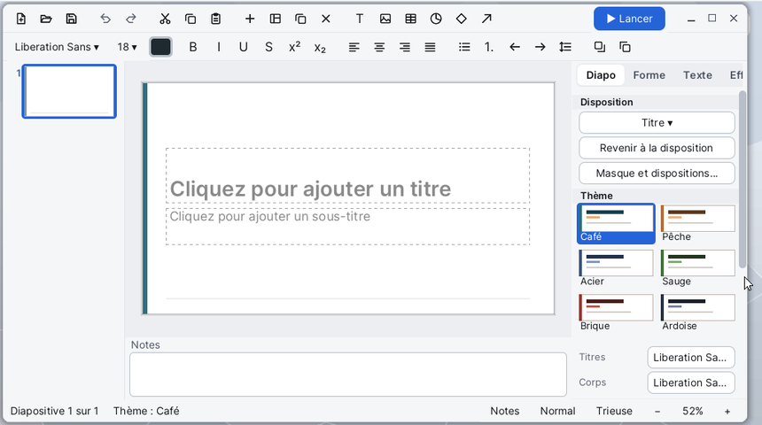

# Slides

**Slides** makes and shows presentations: slides with text, pictures, tables, shapes and charts, transitions and animation effects. It reads and writes `.odp` (LibreOffice Impress) and `.pptx` (PowerPoint) files, exports to PDF and PNG, prints, and shows full screen, with or without the presenter view.

## The window

- **The toolbar** at the top: New, Open, Save, Undo, Redo, Cut, Copy, Paste, then New slide (+), the slide's layout, Duplicate and Delete the slide, Text box (T), picture, table, chart, Shapes and Arrow. The **▶ Show** button starts the show.
- **The format bar**, just below: the font, the size, the text colour, Bold, Italic, Underline, Strikethrough, Superscript and Subscript, the four alignments, Bullets, Numbering, decrease and increase the level, line spacing, Bring to front and Send to back.
- **The thumbnails**, at the left: every slide, grouped by section.
- **The slide** in the middle, where you draw and type; **the speaker's notes** just under it.
- **The sidebar**, at the right, in four tabs: **Slide**, **Shape**, **Text**, **Fx**.
- **The status bar**, at the bottom: the current slide, the theme, then the **Notes**, **Normal**, **Sorter** buttons and the zoom (−, the percentage, +).

Each button shows a tip when the mouse rests on it. The menus are in the menu bar, at the top of the screen. In a small window the columns shrink and the notes hide: **View > Notes** brings them back.

## Making a presentation

1. **File > New** (Ctrl+N): an empty presentation with a title slide.
2. Click into **Click to add a title** and type the title; the same for the subtitle.
3. **Insert > New Slide** (Ctrl+M) adds a slide after the current one. **Insert > New Slide with a Layout...** first asks for its layout: Title, Title and content, Two contents, Comparison, Section header, Title only, Picture and text or Blank.
4. In the sidebar's **Slide** tab, choose the **Theme** (Café, Peach, Steel, Sage, Brick, Slate), the heading and body fonts, the background and the slide size (16:9 widescreen, 4:3 standard, A4 landscape).

## Opening a presentation

- **File > Open...** (Ctrl+O): choose an `.odp` or `.pptx` file, in `SD0:/home/documents` by default.
- You can also drag an `.odp` or `.pptx` file from [Files](help:files) onto the window.

If the current presentation has changes, Slides first asks whether to save them.

## Typing and formatting text

- A **double click** on a text box or a shape (or Enter, or F2 when it is selected) puts the caret in its text. Typing while a box is selected writes at the end of its text. **Esc** leaves the text.
- **Insert > Text Box**, or the **T** button: draw the frame on the slide, then type.
- In a list, **Tab** raises the paragraph's level, **Shift+Tab** lowers it.
- Bold, italic, underline: Ctrl+B, Ctrl+I, Ctrl+U, or the format bar's buttons. The sidebar's **Text** tab sets the character, the paragraph, the list, the level, the spacing before and after, the anchor (Top, Middle, Bottom), the **Autofit** (None, Shrink the text, Grow the box) and text wrapping.
- The line spacing button steps to the next value at each click.

## Inserting objects

- **Picture...**: a PNG, JPEG or BMP file. If the slide has an empty picture placeholder, the picture goes into it. You can also drag a picture from Files onto the window.
- **Table...**: the number of rows and columns. The table takes the place of an empty text placeholder if there is one. In a cell, **Tab** goes to the next one (and adds a row at the end), **Shift+Tab** goes back.
- **Chart...**: choose the type (Bars, Lines, Pie, Area), then fill in the **Chart Data** table: a series a row, a category a column. To change it later: right-click the chart, **Chart Data...**
- **Shape...**: choose a shape in the list (rectangle, ellipse, star, arrows, callout, cloud...), then draw it on the slide. **Arrow** and **Line** are drawn the same way.
- **Header and Footer...**: the footer text on every slide (empty: none).

## Moving and adjusting objects

| To | Do |
|---|---|
| Select an object | a click; Shift+click adds or removes one; or drag a frame around |
| Go to the next object | Tab (Shift+Tab: the previous one) |
| Move | drag; the guides snap to edges and middles; Alt: freely |
| Move with the keyboard | the arrows; with Ctrl, finely |
| Resize | drag a handle; Shift keeps the ratio |
| Turn | drag the turning handle; Shift turns by 15 degrees |
| Delete | Delete or Backspace |
| Drop the tool, the selection | Esc |

The sidebar's **Shape** tab sets the fill (None, Solid, Gradient), the transparency, the line (Solid, Dashes, Dots), the arrow heads, the corners, the shadow, the position and size in cm, the rotation, the order; for a table, the heading row and banded rows; for a chart, its type, the legend and the values on the bars.

A **right click** on the slide opens a menu: Cut, Copy, Paste, Delete, Edit Text, Bring to Front, Send to Back, Format..., Animate...; with nothing selected: Paste, New Slide, Layout..., Background...

## Organizing the slides

- In the thumbnails, a click goes to a slide, a drag moves it. The arrows, Page Up and Page Down, Home and End move through them; **Enter** adds a slide, **Delete** deletes this one.
- A **right click** on a thumbnail: New Slide, Duplicate Slide, Delete Slide, Hide (or Show) Slide, Layout..., Add Section Here... (or Rename Section...), Remove Section, Copy, Paste.
- A **section** groups the slides that follow it; a click on its title folds or unfolds it.
- **View > Slide Sorter** (or the **Sorter** button) shows the whole presentation as a grid. Ctrl+click selects several slides, Shift+click a run; drag them to move them. A double click or Enter goes back to the normal view on that slide.
- A **hidden** slide stays in the file but is not shown, exported to PDF or printed.

## Master and layouts

**View > Master and Layouts** opens the master as a series of slides. The first is the **master**: what sits on it (shapes, pictures, lines) appears on every slide, and the formatting of its two samples (the title and the body's five levels) becomes the style of all the text. The next ones are the **layouts**: a text box drawn on a layout becomes a text placeholder, a picture a picture placeholder. The sidebar's **Close the master view** button, or the same menu, goes back to the slides; the whole visit is undone by a single Ctrl+Z.

## Transitions and effects

In the sidebar's **Fx** tab:

- **Transition to this slide**: Fade, Push, Wipe, Cover, Uncover, Split, Zoom, Dissolve, with its direction and duration. **Next slide**: On click or After a time. **Apply to every slide** copies these settings everywhere.
- **Effects on this slide**: select an object, then **Add an effect...**: an entrance (appear, fade, fly in, wipe, zoom, float in), an emphasis (pulse, grow, spin) or an exit (fade, fly out, zoom). Each effect starts On click, With previous or After previous, with a delay and a duration; a text can be animated paragraph by paragraph.
- **Play the slide from here** plays the slide's effects in the window.

## Giving the show

- **Show > From the Beginning** (F5) or the **▶ Show** button: full screen from the first slide.
- **Show > From This Slide** (Shift+F5): from the current slide.

| Key | Effect |
|---|---|
| Space, Enter, →, ↓, Page Down, N, a click | next effect, then next slide |
| ←, ↑, Page Up, Backspace, P, a right click | previous slide |
| Home, End | first, last slide |
| a number then Enter | go to that slide |
| B or full stop | black screen (again: back) |
| W or comma | white screen (again: back) |
| Esc | end of the show |

After the last slide a screen tells the show is over: a click or a key goes back to the window.

### Presenter view

**Show > Presenter View** shows a console on the same screen: the current slide at the left, the **Next** one at the right, the notes large below, and at the top the slide's number, its section, the time elapsed and the clock. The keys are those of the show.

## Saving, exporting, printing

- **File > Save** (Ctrl+S) writes to the open file; a new presentation goes through **Save As...**
- **Save As...**: the format follows the name's extension, `.odp` or `.pptx`; without one, `.odp` (or `.pptx` if the original file was one).
- **Export as PDF...**: a page for each visible slide, each a picture 1280 pixels wide.
- **Export Slide as PNG...**: the current slide as a picture 1920 pixels wide.
- **Print...** (Ctrl+P): the system's print dialog, a page for each visible slide.

If Slides is closed with unsaved changes, the presentation is kept in `SD0:/home/slides/recovered.odp` and offered at the next start.

## Menus and shortcuts

| Menu | Command | Shortcut |
|---|---|---|
| File | New | Ctrl+N |
| File | Open... | Ctrl+O |
| File | Save | Ctrl+S |
| File | Save As..., Export as PDF..., Export Slide as PNG... | |
| File | Print... | Ctrl+P |
| Edit | Undo, Redo | Ctrl+Z, Ctrl+Y |
| Edit | Cut, Copy, Paste | Ctrl+X, Ctrl+C, Ctrl+V |
| Edit | Duplicate | Ctrl+D |
| Edit | Delete | Delete |
| Edit | Select All | Ctrl+A |
| Edit | Find and Replace... | Ctrl+F |
| View | Normal, Slide Sorter, Notes, Thumbnails, Sidebar, Master and Layouts | |
| View | Fit the Window, Zoom In, Zoom Out | Ctrl+wheel |
| Insert | New Slide | Ctrl+M |
| Insert | New Slide with a Layout..., Duplicate Slide | |
| Insert | Text Box, Picture..., Table..., Chart..., Shape..., Arrow, Line | |
| Insert | Header and Footer... | |
| Format | Bold, Italic, Underline | Ctrl+B, Ctrl+I, Ctrl+U |
| Format | Bullets, Numbering | |
| Format | Bring to Front, Bring Forward, Send Backward, Send to Back | |
| Slide | Layout..., Delete Slide, Hide / Show Slide | |
| Slide | Add Section..., Remove Section | |
| Show | From the Beginning | F5 |
| Show | From This Slide | Shift+F5 |
| Show | Presenter View | |

**Find and Replace** searches the text of every slide: **Find Next**, **Replace**, **Replace All**, with the **Match case** option.

## File formats

| Format | Read | Written |
|---|---|---|
| `.odp` (OpenDocument, LibreOffice Impress) | yes | yes (the default) |
| `.pptx` (PowerPoint) | yes | yes |
| `.pdf` | no | export, a picture a page |
| `.png` | as an inserted picture | export of a slide |
| `.jpg`, `.jpeg`, `.bmp` | as an inserted picture | no |

> **Note**: Slides has only three fonts, DejaVu Sans, Serif and Mono; the document's font name is kept and written back, and the closest of the three is used on screen. A line may therefore break elsewhere than in PowerPoint. GIF or WebP pictures in a document show as a placeholder frame but are kept in the file.

## Tips

- The application's folder, `SD0:/apps/slides.app`, holds `cafe-2026.pptx` and `cafe-2026.odp`, two complete samples to open to see themes, effects and transitions.
- Write the speaker's notes under each slide, then show in **Presenter View** to read them large.
- During a show, type `5` then Enter to jump to the fifth visible slide.
- Hide a spare slide rather than deleting it: it stays in the file without being shown.
- With nothing selected, the arrows and the wheel change slides; Ctrl+wheel zooms.
- For a document to read outside Korin OS, save as `.pptx` or export to PDF.
