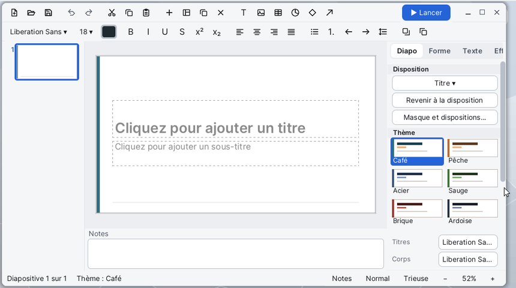

# Slides

**Slides** crée et projette des présentations : des diapositives avec du texte, des images, des tableaux, des formes et des diagrammes, des transitions et des effets d'animation. Il lit et écrit les fichiers `.odp` (LibreOffice Impress) et `.pptx` (PowerPoint), exporte en PDF et en PNG, imprime, et projette en plein écran, avec ou sans le mode présentateur.

## La fenêtre

- **La barre d'outils** du haut : Nouveau, Ouvrir, Enregistrer, Annuler, Rétablir, Couper, Copier, Coller, puis Nouvelle diapositive (+), la disposition, Dupliquer et Supprimer la diapositive, Zone de texte (T), image, tableau, diagramme, Formes et Flèche. Le bouton **▶ Lancer** démarre le diaporama.
- **La barre de format**, juste dessous : la police, la taille, la couleur du texte, Gras, Italique, Souligné, Barré, Exposant et Indice, les quatre alignements, Puces, Numérotation, baisser et monter le niveau, l'interligne, Mettre au premier plan et Mettre à l'arrière-plan.
- **Les miniatures**, à gauche : toutes les diapositives, groupées par section.
- **La diapositive** au centre, où l'on dessine et écrit ; **les notes** de l'orateur juste dessous.
- **Le panneau latéral**, à droite, en quatre onglets : **Diapo**, **Forme**, **Texte**, **Effets**.
- **La barre d'état**, en bas : la diapositive en cours, le thème, puis les boutons **Notes**, **Normal**, **Trieuse**, et le zoom (−, le pourcentage, +).

Chaque bouton montre une bulle d'aide quand la souris s'y arrête. Les menus sont dans la barre de menus, en haut de l'écran. Dans une petite fenêtre, les colonnes rétrécissent et les notes se cachent : **Affichage > Notes** les ramène.

## Créer une présentation

1. **Fichier > Nouveau** (Ctrl+N) : une présentation vide, avec une diapositive de titre.
2. Cliquez dans **Cliquez pour ajouter un titre** et tapez le titre ; de même pour le sous-titre.
3. **Insertion > Nouvelle diapositive** (Ctrl+M) ajoute une diapositive après la diapositive en cours. **Insertion > Nouvelle diapositive avec une disposition...** demande d'abord sa mise en page : Titre, Titre et contenu, Deux contenus, Comparaison, En-tête de section, Titre seul, Image et texte ou Vide.
4. Dans l'onglet **Diapo** du panneau, choisissez le **Thème** (Café, Pêche, Acier, Sauge, Brique, Ardoise), les polices des titres et du corps, l'arrière-plan et la taille de la diapositive (16:9 large, 4:3 standard, A4 paysage).

## Ouvrir une présentation

- **Fichier > Ouvrir...** (Ctrl+O) : choisissez un fichier `.odp` ou `.pptx`, dans `SD0:/home/documents` par défaut.
- On peut aussi glisser un fichier `.odp` ou `.pptx` depuis [Fichiers](help:files) sur la fenêtre.

Si la présentation en cours a des modifications, Slides demande d'abord s'il faut les enregistrer.

## Écrire et mettre en forme le texte

- Un **double clic** sur une zone de texte ou une forme (ou Entrée, ou F2 quand elle est choisie) place le curseur dans son texte. Taper au clavier quand une zone est choisie écrit à la fin de son texte. **Échap** sort du texte.
- **Insertion > Zone de texte**, ou le bouton **T** : tracez le cadre sur la diapositive, puis écrivez.
- Dans une liste, **Tab** monte le niveau du paragraphe, **Maj+Tab** le baisse.
- Gras, italique, souligné : Ctrl+B, Ctrl+I, Ctrl+U, ou les boutons de la barre de format. L'onglet **Texte** du panneau règle le caractère, le paragraphe, la liste, le niveau, l'espacement avant et après, l'ancrage (Haut, Milieu, Bas), l'**Ajustement** (Aucun, Réduire le texte, Agrandir la zone) et le renvoi à la ligne.
- Le bouton d'interligne passe à la valeur suivante à chaque clic.

## Insérer des objets

- **Image...** : un fichier PNG, JPEG ou BMP. Si la diapositive a un espace vide pour une image, l'image s'y place. On peut aussi glisser une image depuis Fichiers sur la fenêtre.
- **Tableau...** : le nombre de lignes et de colonnes. Le tableau prend la place d'un espace de texte vide s'il y en a un. Dans une cellule, **Tab** passe à la suivante (et ajoute une ligne à la fin), **Maj+Tab** revient.
- **Diagramme...** : choisissez le type (Barres, Courbes, Secteurs, Aires), puis remplissez le tableau des **Données du diagramme** : une série par ligne, une catégorie par colonne. Pour le modifier plus tard : clic droit sur le diagramme, **Données du diagramme...**
- **Forme...** : choisissez une forme dans la liste (rectangle, ellipse, étoile, flèches, bulle, nuage...), puis tracez-la sur la diapositive. **Flèche** et **Ligne** se tracent de même.
- **En-tête et pied de page...** : le texte du pied de page de chaque diapositive (vide : aucun).

## Déplacer et régler les objets

| Pour | Faire |
|---|---|
| Choisir un objet | un clic ; Maj+clic en ajoute ou en retire ; ou tracer un cadre autour |
| Passer à l'objet suivant | Tab (Maj+Tab : le précédent) |
| Déplacer | glisser ; les guides alignent sur les bords et les milieux ; Alt : librement |
| Déplacer au clavier | les flèches ; avec Ctrl, finement |
| Redimensionner | glisser une poignée ; Maj garde les proportions |
| Tourner | glisser la poignée de rotation ; Maj tourne par pas de 15 degrés |
| Supprimer | Suppr ou Retour arrière |
| Abandonner l'outil, la sélection | Échap |

L'onglet **Forme** du panneau règle le remplissage (Aucun, Plein, Dégradé), la transparence, le trait (Plein, Tirets, Pointillés), les extrémités de flèche, les coins, l'ombre, la position et la taille en cm, la rotation, l'ordre ; pour un tableau, la ligne d'en-tête et les lignes alternées ; pour un diagramme, son type, la légende et les valeurs sur les barres.

Un **clic droit** sur la diapositive ouvre un menu : Couper, Copier, Coller, Supprimer, Modifier le texte, Mettre au premier plan, Mettre à l'arrière-plan, Mise en forme..., Animer... ; sans objet choisi : Coller, Nouvelle diapositive, Disposition..., Arrière-plan...

## Organiser les diapositives

- Dans les miniatures, un clic va à une diapositive, un glisser la déplace. Les flèches, Page précédente et Page suivante, Début et Fin s'y déplacent ; **Entrée** ajoute une diapositive, **Suppr** supprime celle-ci.
- Un **clic droit** sur une miniature : Nouvelle diapositive, Dupliquer la diapositive, Supprimer la diapositive, Masquer (ou Afficher) la diapositive, Disposition..., Ajouter une section ici... (ou Renommer la section...), Retirer la section, Copier, Coller.
- Une **section** regroupe les diapositives qui la suivent ; un clic sur son titre la replie ou la déplie.
- **Affichage > Trieuse de diapositives** (ou le bouton **Trieuse**) montre toute la présentation en grille. Ctrl+clic choisit plusieurs diapositives, Maj+clic une suite ; glissez-les pour les déplacer. Un double clic ou Entrée revient à la vue normale sur cette diapositive.
- Une diapositive **masquée** reste dans le fichier mais n'est ni projetée, ni exportée en PDF, ni imprimée.

## Masque et dispositions

**Affichage > Masque et dispositions** ouvre le masque comme une suite de diapositives. La première est le **masque** : ce qui y est posé (formes, images, lignes) apparaît sur chaque diapositive, et la mise en forme de ses deux exemples (le titre et les cinq niveaux du corps) devient le style de tout le texte. Les suivantes sont les **dispositions** : une zone de texte tracée sur une disposition devient un espace pour du texte, une image un espace pour une image. Le bouton **Fermer la vue du masque** du panneau, ou le même menu, revient aux diapositives ; toute la visite s'annule d'un seul Ctrl+Z.

## Transitions et effets

Dans l'onglet **Effets** du panneau :

- **Transition vers cette diapositive** : Fondu, Poussée, Balayage, Recouvrement, Découverte, Fractionnement, Zoom, Dissolution, avec sa direction et sa durée. **Diapositive suivante** : Au clic ou Après un délai. **Appliquer à toutes les diapositives** copie ces réglages partout.
- **Effets de cette diapositive** : choisissez un objet, puis **Ajouter un effet...** : une entrée (apparition, fondu, vol, balayage, zoom, flottement), un accent (pulsation, agrandissement, rotation) ou une sortie (fondu, vol, zoom). Chaque effet démarre Au clic, Avec la précédente ou Après la précédente, avec un délai et une durée ; un texte peut s'animer paragraphe par paragraphe.
- **Lire la diapositive d'ici** joue les effets de la diapositive dans la fenêtre.

## Projeter le diaporama

- **Diaporama > Depuis le début** (F5) ou le bouton **▶ Lancer** : la projection en plein écran depuis la première diapositive.
- **Diaporama > Depuis cette diapositive** (Maj+F5) : depuis la diapositive en cours.

| Touche | Effet |
|---|---|
| Espace, Entrée, →, ↓, Page suivante, N, un clic | effet suivant, puis diapositive suivante |
| ←, ↑, Page précédente, Retour arrière, P, un clic droit | diapositive précédente |
| Début, Fin | première, dernière diapositive |
| un numéro puis Entrée | aller à cette diapositive |
| B ou point | écran noir (encore une fois : retour) |
| W ou virgule | écran blanc (encore une fois : retour) |
| Échap | fin du diaporama |

Après la dernière diapositive, un écran annonce la fin : un clic ou une touche ramène à la fenêtre.

### Mode présentateur

**Diaporama > Mode présentateur** projette sur le même écran une console : la diapositive en cours à gauche, la **Suivante** à droite, les notes en grand dessous, et en haut le numéro de la diapositive, sa section, le temps écoulé et l'heure. Les touches sont celles du diaporama.

## Enregistrer, exporter, imprimer

- **Fichier > Enregistrer** (Ctrl+S) écrit dans le fichier ouvert ; une présentation nouvelle passe par **Enregistrer sous...**
- **Enregistrer sous...** : le format suit l'extension du nom, `.odp` ou `.pptx` ; sans extension, `.odp` (ou `.pptx` si le fichier d'origine l'était).
- **Exporter en PDF...** : une page par diapositive visible, chacune en image de 1280 pixels de large.
- **Exporter la diapositive en PNG...** : la diapositive en cours en image de 1920 pixels de large.
- **Imprimer...** (Ctrl+P) : le dialogue d'impression du système, une page par diapositive visible.

Si Slides se ferme avec des modifications non enregistrées, la présentation est gardée dans `SD0:/home/slides/recovered.odp` et proposée au lancement suivant.

## Menus et raccourcis

| Menu | Commande | Raccourci |
|---|---|---|
| Fichier | Nouveau | Ctrl+N |
| Fichier | Ouvrir... | Ctrl+O |
| Fichier | Enregistrer | Ctrl+S |
| Fichier | Enregistrer sous..., Exporter en PDF..., Exporter la diapositive en PNG... | |
| Fichier | Imprimer... | Ctrl+P |
| Édition | Annuler, Rétablir | Ctrl+Z, Ctrl+Y |
| Édition | Couper, Copier, Coller | Ctrl+X, Ctrl+C, Ctrl+V |
| Édition | Dupliquer | Ctrl+D |
| Édition | Supprimer | Suppr |
| Édition | Tout sélectionner | Ctrl+A |
| Édition | Rechercher et remplacer... | Ctrl+F |
| Affichage | Normal, Trieuse de diapositives, Notes, Miniatures, Panneau latéral, Masque et dispositions | |
| Affichage | Ajuster à la fenêtre, Zoom avant, Zoom arrière | Ctrl+molette |
| Insertion | Nouvelle diapositive | Ctrl+M |
| Insertion | Nouvelle diapositive avec une disposition..., Dupliquer la diapositive | |
| Insertion | Zone de texte, Image..., Tableau..., Diagramme..., Forme..., Flèche, Ligne | |
| Insertion | En-tête et pied de page... | |
| Format | Gras, Italique, Souligné | Ctrl+B, Ctrl+I, Ctrl+U |
| Format | Puces, Numérotation | |
| Format | Mettre au premier plan, Avancer, Reculer, Mettre à l'arrière-plan | |
| Diapositive | Disposition..., Supprimer la diapositive, Masquer / afficher la diapositive | |
| Diapositive | Ajouter une section..., Retirer la section | |
| Diaporama | Depuis le début | F5 |
| Diaporama | Depuis cette diapositive | Maj+F5 |
| Diaporama | Mode présentateur | |

**Rechercher et remplacer** cherche dans le texte de toutes les diapositives : **Rechercher le suivant**, **Remplacer**, **Tout remplacer**, avec l'option **Respecter la casse**.

## Formats de fichiers

| Format | Lu | Écrit |
|---|---|---|
| `.odp` (OpenDocument, LibreOffice Impress) | oui | oui (le format par défaut) |
| `.pptx` (PowerPoint) | oui | oui |
| `.pdf` | non | export, une image par page |
| `.png` | comme image insérée | export d'une diapositive |
| `.jpg`, `.jpeg`, `.bmp` | comme image insérée | non |

> **Remarque** : Slides n'a que trois polices, DejaVu Sans, Serif et Mono ; le nom de police du document est gardé et réécrit, la plus proche des trois sert à l'écran. Une ligne peut donc se couper ailleurs que dans PowerPoint. Les images GIF ou WebP d'un document s'affichent comme un cadre de remplacement mais sont gardées dans le fichier.

## Astuces

- Le dossier de l'application, `SD0:/apps/slides.app`, contient `cafe-2026.pptx` et `cafe-2026.odp`, deux exemples complets à ouvrir pour voir thèmes, effets et transitions.
- Préparez les notes de l'orateur sous chaque diapositive, puis projetez en **Mode présentateur** pour les lire en grand.
- Pendant une projection, tapez `5` puis Entrée pour sauter à la cinquième diapositive visible.
- Masquez une diapositive de secours plutôt que de la supprimer : elle reste dans le fichier sans être projetée.
- Sans objet choisi, les flèches et la molette changent de diapositive ; Ctrl+molette zoome.
- Pour un document à lire hors de Korin OS, enregistrez en `.pptx` ou exportez en PDF.
