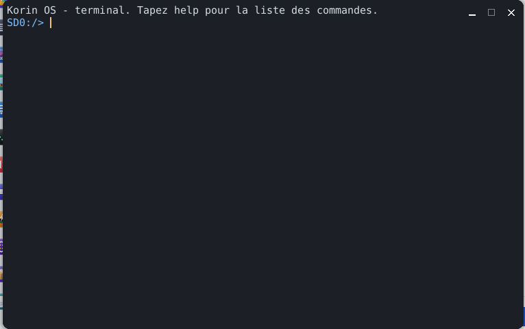

# Terminal

The **Terminal** is the Korin OS console: a VT/xterm terminal emulator running the `sh` shell. Type commands to browse the card, read a file, see the running programs, and start any program of `SD0:/bin` or application of `SD0:/apps`; full-screen programs and programs that read the keyboard key by key work too. It opens from the Korin OS menu, **System** category.



## The window

A single text area, on a dark background:

- at the top, what has already been shown (the 1,000 lines that left through the top are kept);
- at the bottom, the shell **prompt**: the current folder followed by `>`, for example `SD0:/home> `.

At startup, the Terminal opens a pseudo-terminal and starts `sh` on it, which shows its banner. The Terminal has no menu of its own: everything is done with the keyboard. `exit` (or Ctrl+D on an empty line) ends the shell, and the Terminal closes with it.

The window can be resized (edges, maximize button): the number of rows and columns follows, and the running program is told the new size (`SIGWINCH`). Lines already written are not reflowed: they are cut, or extended with blanks.

## Typing a command

1. Type the command and its arguments, separated by spaces.
2. Press Enter.

```sh
cd SD0:/home/documents
ls
cat notes.txt
```

The line can be edited before Enter: Backspace erases the last character, Ctrl+W the last word, Ctrl+U the whole line. **help** shows the list of the shell's built-in commands. Any other name is looked up as a program (see below).

## Commands

They are those of the `sh` shell:

| Command | Effect |
|---|---|
| `ls [path]` | lists a folder (the current folder with no argument), with the size of each file; `dir` does the same |
| `cd [path]` | changes folder |
| `pwd` | shows the current folder |
| `cat file` | shows the content of a file |
| `mkdir folder` | creates a folder |
| `rm path` | deletes a file or an empty folder |
| `cp source destination` | copies a file |
| `echo text` | shows the text; `echo text > file` writes it to the file |
| `ps` | lists the processes: number (PID), thread count, heap memory in KB, name |
| `kill pid` | ends the process with this number |
| `mem` | free and total memory, cores, load, time since startup, process count; `free` does the same |
| `clear` | clears the window |
| `exit` | ends the shell and closes the Terminal |
| `help` | the list of built-in commands |

The shell also understands variables, `|` pipes, `< > >>` redirections, `if`, `for`, `while`... Paths are written in full (`SD0:/home/documents/letter.txt`) or from the current folder (`documents/letter.txt`).

## Starting a program

Any name that is not a built-in command starts a program, looked up in the `PATH` (`/bin`, `/gcc/bin`), then as the application `SD0:/apps/name.app`; a full path (`SD0:/bin/gcc`) works too. The arguments follow the name:

```sh
pkg list
pkg info armpi
```

While a program runs:

- its output is shown in the window as it comes, with its colours and cursor moves (see below);
- it reads the keyboard: what is typed goes to it, line by line or key by key as it asks;
- **Ctrl+C** interrupts it (signal `SIGINT`); the shell stays.

If the program returns a code other than 0, the shell shows it (`[code de sortie 1]`), and a name found nowhere gives `commande introuvable : name`.

## Sequences understood

The Terminal is a VT/xterm emulator: a program can colour its text and place the cursor with ANSI escape sequences. It understands:

- simple controls: backspace, tab, line feed, carriage return;
- the cursor: `ESC [ A B C D E F G H f d`, saved and restored by `ESC 7` / `ESC 8` and `ESC [ s` / `ESC [ u`, hidden and shown by `ESC [ ?25 l` / `h`;
- erasing: `ESC [ J`, `ESC [ K`, `ESC [ X`; inserting and deleting lines (`L`, `M`) and characters (`@`, `P`); scrolling `S`, `T` and the scroll region `ESC [ top ; bottom r`;
- colours and attributes `ESC [ ... m`: bold, dim, underline, reverse, hidden, strike-through; 16 colours (30-37, 90-97, backgrounds 40-47, 100-107), 256 colours (`38;5;n`, `48;5;n`) and 24-bit (`38;2;r;g;b`, `48;2;r;g;b`);
- the alternate screen of full-screen programs: `ESC [ ?1049 h` / `l` (and `?47`, `?1047`);
- bracketed paste `ESC [ ?2004 h` / `l` is recorded.

Unknown sequences and titles (`ESC ] ... BEL`) are swallowed: nothing is shown. Text is read as UTF-8, one character per cell. The Terminal answers the programs' questions about the cursor position (`ESC [ 6 n`) and its type (`ESC [ c`). The `ansitest` program shows each family of sequences with what it should give.

## The sh shell

The Terminal's shell is `sh`, a subset of POSIX: variables, `if`, `for`, `|` pipes, redirections. It also runs a command file:

```sh
sh SD0:/home/scripts/backup.sh
```

The same shell is used remotely (telnet, to enable in [Settings](help:control), **Remote Access** pane). In `sh`, `help` lists its built-in commands.

## Keys

| Key | Effect |
|---|---|
| Enter | runs the line |
| Backspace | erases the character before the cursor |
| Ctrl+W, Ctrl+U | erase the last word, the whole line |
| Ctrl+C | interrupts the running program (at the prompt: drops the line) |
| Ctrl+D | on an empty line: end of input (at the prompt: closes the shell and the Terminal) |
| Shift+Page Up, Shift+Page Down | scroll the output |
| Mouse wheel | scrolls the output, three lines per notch |
| Arrows, Home, End, Page Up, Page Down, F1-F12, Esc | sent to the program (xterm sequences) |

Any keystroke brings the view back to the bottom.

## Tips

- `ls SD0:/apps` shows the installed applications; their name without `.app` starts them.
- `ps` then `kill` stop an application that no longer responds.
- `mem` shows at a glance the free memory and the load of the cores.
- `clear` starts again from an empty window when the output gets long.
- To browse the card with the mouse, there is [Files](help:files).
