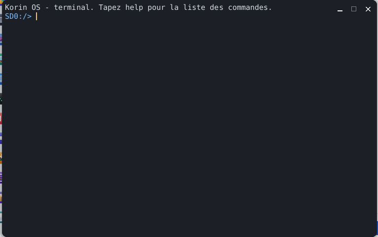

# Terminal

Le **Terminal** est la console de Korin OS : un émulateur de terminal VT/xterm dans lequel tourne le shell `sh`. On y tape des commandes pour parcourir la carte, lire un fichier, voir les programmes qui tournent, et on y lance n'importe quel programme de `SD0:/bin` ou application de `SD0:/apps` ; les programmes plein écran et ceux qui lisent le clavier touche par touche y marchent aussi. Il s'ouvre par le menu Korin OS, catégorie **Système**.



## La fenêtre

Une seule zone de texte, sur fond sombre :

- en haut, ce qui a déjà été affiché (les 1 000 lignes sorties par le haut sont gardées) ;
- en bas, l'**invite** du shell : le dossier courant suivi de `>`, par exemple `SD0:/home> `.

Au démarrage, le Terminal ouvre un pseudo-terminal et y lance `sh`, qui affiche « Korin OS - sh. Tapez help pour la liste des commandes. » Le Terminal n'a pas de menu propre : tout se fait au clavier. `exit` (ou Ctrl+D sur une ligne vide) termine le shell, et le Terminal se ferme avec lui.

La fenêtre se redimensionne (bords, bouton agrandir) : le nombre de lignes et de colonnes suit, et le programme en cours est prévenu de la nouvelle taille (`SIGWINCH`). Les lignes déjà écrites ne sont pas remises en forme : elles sont coupées, ou allongées de blancs.

## Taper une commande

1. Tapez la commande et ses arguments, séparés par des espaces.
2. Appuyez sur Entrée.

```sh
cd SD0:/home/documents
ls
cat notes.txt
```

La ligne s'édite avant Entrée : Retour arrière efface le dernier caractère, Ctrl+W le dernier mot, Ctrl+U toute la ligne. **help** affiche la liste des commandes intégrées du shell. Tout autre nom est cherché comme programme (voir plus bas).

## Les commandes

Ce sont celles du shell `sh` :

| Commande | Effet |
|---|---|
| `ls [chemin]` | liste un dossier (le dossier courant sans argument), avec la taille de chaque fichier ; `dir` fait de même |
| `cd [chemin]` | change de dossier |
| `pwd` | affiche le dossier courant |
| `cat fichier` | affiche le contenu d'un fichier |
| `mkdir dossier` | crée un dossier |
| `rm chemin` | supprime un fichier ou un dossier vide |
| `cp source destination` | copie un fichier |
| `echo texte` | affiche le texte ; `echo texte > fichier` l'écrit dans le fichier |
| `ps` | liste les process : numéro (PID), nombre de threads, mémoire du tas en Ko, nom |
| `kill pid` | termine le process de ce numéro |
| `mem` | mémoire libre et totale, cœurs, charge, temps depuis le démarrage, nombre de process ; `free` fait de même |
| `clear` | efface la fenêtre |
| `exit` | termine le shell et ferme le Terminal |
| `help` | la liste des commandes intégrées |

Le shell comprend aussi les variables, les tubes `|`, les redirections `< > >>`, `if`, `for`, `while`... Les chemins s'écrivent en entier (`SD0:/home/documents/lettre.txt`) ou à partir du dossier courant (`documents/lettre.txt`).

## Lancer un programme

Tout nom qui n'est pas une commande intégrée lance un programme, cherché dans le `PATH` (`/bin`, `/gcc/bin`), puis comme application `SD0:/apps/nom.app` ; un chemin complet (`SD0:/bin/gcc`) marche aussi. Les arguments suivent le nom :

```sh
pkg list
pkg info armpi
```

Pendant qu'un programme tourne :

- sa sortie s'affiche au fur et à mesure dans la fenêtre, avec ses couleurs et ses déplacements du curseur (voir plus bas) ;
- il lit le clavier : ce qui est tapé lui va, ligne par ligne ou touche par touche selon ce qu'il demande ;
- **Ctrl+C** l'interrompt (signal `SIGINT`) ; le shell reste.

Si le programme rend un code autre que 0, le shell l'affiche : `[code de sortie 1]`. Si le nom n'est trouvé nulle part : `commande introuvable : nom`.

## Les séquences comprises

Le Terminal est un émulateur VT/xterm : un programme peut colorer son texte et placer le curseur avec les séquences d'échappement ANSI. Il comprend :

- les commandes simples : retour arrière, tabulation, saut de ligne, retour chariot ;
- le curseur : `ESC [ A B C D E F G H f d`, sauvé et rendu par `ESC 7` / `ESC 8` et `ESC [ s` / `ESC [ u`, caché et montré par `ESC [ ?25 l` / `h` ;
- l'effacement : `ESC [ J`, `ESC [ K`, `ESC [ X` ; insertion et suppression de lignes (`L`, `M`) et de caractères (`@`, `P`) ; défilement `S`, `T` et zone de défilement `ESC [ haut ; bas r` ;
- les couleurs et attributs `ESC [ ... m` : gras, atténué, souligné, inverse, caché, barré ; 16 couleurs (30-37, 90-97, fonds 40-47, 100-107), 256 couleurs (`38;5;n`, `48;5;n`) et 24 bits (`38;2;r;g;b`, `48;2;r;g;b`) ;
- l'écran alternatif des programmes plein écran : `ESC [ ?1049 h` / `l` (et `?47`, `?1047`) ;
- le collage encadré `ESC [ ?2004 h` / `l` est noté.

Les séquences inconnues et les titres (`ESC ] ... BEL`) sont avalés : rien ne s'affiche. Le texte est lu en UTF-8, un caractère par case. Le Terminal répond aux questions des programmes sur la position du curseur (`ESC [ 6 n`) et sur son type (`ESC [ c`). Le programme `ansitest` montre chaque famille de séquences avec ce qu'elle doit donner.

## Le shell sh

Le shell du Terminal est `sh`, un sous-ensemble de POSIX : variables, `if`, `for`, tubes `|`, redirections. Il exécute aussi un fichier de commandes :

```sh
sh SD0:/home/scripts/sauvegarde.sh
```

Le même shell sert à distance (telnet, à activer dans [Réglages](help:control), volet **Accès à distance**). Dans `sh`, `help` liste ses commandes intégrées.

## Touches

| Touche | Effet |
|---|---|
| Entrée | exécute la ligne |
| Retour arrière | efface le caractère avant le curseur |
| Ctrl+W, Ctrl+U | effacent le dernier mot, toute la ligne |
| Ctrl+C | interrompt le programme en cours (à l'invite : abandonne la ligne) |
| Ctrl+D | sur une ligne vide : fin de l'entrée (à l'invite : ferme le shell et le Terminal) |
| Maj+Page haut, Maj+Page bas | font défiler la sortie |
| Molette | fait défiler la sortie, trois lignes par cran |
| Flèches, Début, Fin, Page haut, Page bas, F1-F12, Échap | envoyées au programme (séquences de xterm) |

Toute frappe ramène la vue en bas.

## Astuces

- `ls SD0:/apps` montre les applications installées ; leur nom sans `.app` les lance.
- `ps` puis `kill` arrêtent une application qui ne répond plus.
- `mem` donne en un coup d'œil la mémoire libre et la charge des cœurs.
- `clear` repart d'une fenêtre vide quand la sortie devient longue.
- Pour parcourir la carte à la souris, il y a [Fichiers](help:files).
