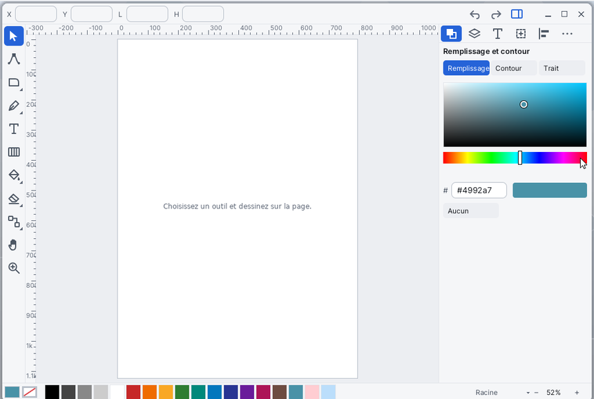

# Vector

**Vector** is the vector drawing editor of Korin OS. You draw shapes, paths and text, colour them (flat colours, gradients), arrange them in layers, combine them with boolean operations, and add filters and path effects. Its format is SVG: a drawing is saved as `.svg` and exported to PNG, PDF, EPS, DXF or HPGL.

## The window

- **The tool rail**, on the left, in a column: one cell per family of tools. A cell marked with a small triangle holds several; a click on the cell already active (or a right click) opens the list. Hovering a cell shows the tool's name.
- **The top bar** shows the settings of the current tool and a line of help. With the **Selector**, it shows the **X**, **Y**, **L** and **H** fields of the selection: type a value to move or resize. On the right: **Undo**, **Redo** and the button that opens or closes the panels.
- **The page**, in the middle, with rulers at the top and on the left (**Alt+R** shows or hides them).
- **The panels**, on the right (**Tab** key). Their tabs: **Fill and Stroke**, **Layers and Objects**, **Text and Font**, **Transform**, **Align and Distribute**, and **⋯**, which gives **Filters**, **Path Effects**, **XML Editor** and **Document**.
- **The bottom line**: the current fill and stroke swatches (a click opens **Fill and Stroke**), the colour palette, the name of the current layer (a click: the list of layers and **New Layer**), the zoom with **−** and **+** (a click on the percentage: 50 %, 100 %, 200 %, Selection, Drawing, Page), and a coloured dot when the drawing is not saved.

## The tools

| Tool | Key | What it does |
|---|---|---|
| Selector | V | Click to select, drag to move; the handles scale and turn. Shift+click adds to the selection, a frame dragged over empty space selects several objects. |
| Nodes | A | Edits the nodes of a path: drag a node, double-click a segment to add a node. |
| Rectangle | R | Drag to create. Ctrl: square. Alt: from the centre. |
| Ellipse | E | Drag to create. Ctrl: circle. Alt: from the centre. |
| Star, Polygon | Y | Drag to create; Ctrl: angle by steps of 15°. The bar chooses Star or Polygon and the number of points. |
| Spiral | S | The drag sets the size and the end; the bar sets the number of turns. |
| Pen | P | Click: a corner. Drag: a curve. Enter: finish. Backspace: removes the last point. Esc: gives up. |
| Pencil | N | Drag to draw freehand. |
| Calligraphy | B | Drag to draw: a fast stroke is thinner. The bar sets the width and the angle of the nib. |
| Text | T | Click to write, click a text to edit it. Enter: new line. Esc: done. |
| Gradient | G | Drag over an object to give it a gradient; Ctrl: angle by steps of 15°. |
| Bucket | F | Click a closed area to fill it. The bar sets the tolerance. |
| Dropper | I | Click an object: its colour becomes the fill. Shift: the stroke. |
| Eraser | W | **Delete** mode: the objects touched go. **Cut** mode: cuts the shapes under the eraser. |
| Shape Builder | K | Drag over the regions of the selected shapes to join them (Alt: to leave them out), then Enter or **Apply**. |
| Tweak | U | Drag over selected paths to push them. |
| Spray | J | Select an object, then drag to spray **Copies** or **Clones** of it. |
| Connector | L | Drag from one object to another: the line follows them when they move. **Straight** or **Elbow**. |
| Measure | Q | Drag to measure a distance. |
| Hand | H | Drag to move the view; double-click: the whole page. |
| Zoom | Z | Click: zoom in. Shift+click: zoom out. |

Esc goes back to the Selector (or deselects). Holding the **space bar** gives the Hand for the length of a drag.

## Drawing a shape and colouring it

1. Choose **Rectangle** (R key) and drag on the page.
2. Click a colour in the palette, at the bottom: it becomes the fill. **Shift+click** gives it to the stroke.
3. For an exact colour, open **Fill and Stroke** (C key or Ctrl+Shift+F). The **Fill** and **Stroke** pages have a colour field, a hue bar, a `#rrggbb` field and the **None** button. The **Style** page sets the width, the opacity, the caps (**Butt**, **Round**, **Square**), the joins (**Miter**, **Round**, **Bevel**) and the **Blend** mode.
4. The **X** key swaps fill and stroke.

## Drawing a path

1. Choose the **Pen** (P). Click to place corners, drag to make curves.
2. Press Enter to finish.
3. To touch it up, take the **Nodes** tool (A) or double-click the path with the Selector. The top bar offers **Insert**, **Delete**, **Join**, **Break**, **Corner**, **Smooth**, **Symmetric** and **Auto**. The arrow keys move the chosen nodes.

## Writing text

1. Choose **Text** (T), click on the page, then type.
2. Esc finishes. A double-click on a text with the Selector opens it again.
3. The **Text and Font** panel (Ctrl+T) sets the size, the font, bold (**B**) and italic (**I**).
4. **Path > Object to Path** (Ctrl+Shift+C) turns the text into a path.

## Combining shapes

1. Select at least two shapes (Shift+click).
2. In the **Path** menu: **Union** (Ctrl+Alt+U), **Difference** (Ctrl+Alt+D), **Intersection** (Ctrl+Alt+I), **Exclusion** (Ctrl+Alt+E) or **Division** (Ctrl+Alt+B).
3. To choose region by region, take the **Shape Builder** (K) instead. The **Keep the rest** or **Drop the rest** button says what becomes of the regions not chosen.

## Layers, order and alignment

- **Object > New Layer** (Ctrl+Shift+N) asks for a name. **Layers and Objects** (Ctrl+L) lists layers and objects: the eye hides, the padlock locks; at the bottom, **+**, **−** and the arrows add, delete, raise and lower.
- **Object > Raise**, **Lower**, **To Front**, **To Back** change the stacking order.
- **Group** (Ctrl+G) and **Ungroup** (Ctrl+Shift+G).
- **Align and Distribute**: six alignment buttons and two distribution buttons, relative to the selection (at least two objects).
- **Transform**: **Move X**, **Move Y**, **Scale, %** and **Rotation, degrees**, then **Apply**.

## Filters and path effects

- **Filters** (menu **Text > Filters...**) is applied at once to the selection: **Soft blur**, **Drop shadow**, **Glow**, **Black and white**, **Warm**, **Negative**, **Rough edges**, **Paper grain**, **Raised**, **Outline glow**. **Remove the filter** takes it off.
- **Path Effects** (a shape or path selected): **Corners**, **Offset**, **Mirror**, **Rotate copies**, **Roughen**, **Simplify**, **Taper stroke**, **Wave**, **Dashes**. Each effect has its settings, changed with **−** and **+**; the effect stays editable afterwards.

## Opening, saving, exporting

1. **File > Open...** (Ctrl+O) opens a `.svg` file. A double-click on a `.svg` in [Files](help:files) also opens it in Vector.
2. **File > Save** (Ctrl+S); **Save As...** (Ctrl+Shift+S) adds `.svg` to the name if it is missing. The folder offered is `SD0:/home/documents`.
3. **File > Import...** (Ctrl+I) adds a PNG, JPEG or WebP image, or the content of another SVG, to the current layer.
4. **Export PNG...** (Ctrl+E) and **Export PDF...** write the whole page. For EPS, DXF or HPGL, find **Export Other...** with Ctrl+K, then type the format: `svg`, `eps`, `dxf` or `plt`.

If the drawing has changed, Vector asks whether to save it before opening another one.

## Menus and shortcuts

| Menu | Commands |
|---|---|
| File | New (Ctrl+N), Open... (Ctrl+O), Save (Ctrl+S), Save As... (Ctrl+Shift+S), Import... (Ctrl+I), Export PNG... (Ctrl+E), Export PDF... |
| Edit | Undo (Ctrl+Z), Redo (Ctrl+Y or Ctrl+Shift+Z), Cut (Ctrl+X), Copy (Ctrl+C), Paste (Ctrl+V), Paste in Place (Ctrl+Shift+V), Duplicate (Ctrl+D), Delete (Backspace or Delete), Select All (Ctrl+A), Deselect (Ctrl+Shift+A) |
| View | Zoom In (=), Zoom Out (-), Zoom 100% (1), Fit Selection (3), Fit Drawing (4), Fit Page (5), Outlines (Alt+C), Panels (Tab) |
| Object | Group (Ctrl+G), Ungroup (Ctrl+Shift+G), Raise, Lower, To Front, To Back, Flip Horizontal (Shift+H), Flip Vertical (Shift+V), New Layer (Ctrl+Shift+N), Layers... (Ctrl+L) |
| Path | Object to Path (Ctrl+Shift+C), Stroke to Path (Ctrl+Alt+C), Union, Difference, Intersection, Exclusion, Division, Simplify (Ctrl+Alt+L), Trace Image... |
| Text | Filters..., Path Effects..., Fill and Stroke... (Ctrl+Shift+F), Text and Font... (Ctrl+T), Extensions..., XML Editor... (Ctrl+Shift+X), Document... (Ctrl+Shift+E) |
| Help | Search Commands... (Ctrl+K), About Vector |

### Commands outside the menus

The menu bar has no room for everything. These commands are found with **Ctrl+K** or by their key:

| Command | Key |
|---|---|
| Export Other... | |
| Rotate Right, Rotate Left | Shift+R, Shift+L |
| Combine, Break Apart | Ctrl+Alt+K, Ctrl+Shift+K |
| Reverse | Ctrl+Alt+R |
| Clone, Unlink Clone | Alt+D, Alt+Shift+D |
| Clip by Top Object, Mask by Top Object, Release Clip and Mask | |
| Grid, Guides, Snapping, Rulers | Alt+G, Alt+U, Alt+A, Alt+R |
| Add Vertical Guide, Add Horizontal Guide | |
| Zoom 200% | 2 |

### On the page

| To | Do |
|---|---|
| Zoom | the mouse wheel, under the pointer |
| Scroll | Shift+wheel (horizontal), Ctrl+wheel (vertical), the arrow keys with nothing selected, or the space bar held |
| Move the selection | the arrow keys: 1 px; Shift: 10 px; Alt: one screen pixel |
| Turn the selection | Ctrl+Left, Ctrl+Right: 15°; with Shift: 1° |
| Enlarge, shrink the selection | Ctrl+Up, Ctrl+Down |
| Move along one axis only | Ctrl while dragging |
| Create a guide | drag out of a ruler |

## File formats

| Format | Read | Write |
|---|---|---|
| SVG (`.svg`) | Open, Import | Save; **svg** in Export Other (plain SVG, without Inkscape's additions) |
| PNG | Import (image) | Export PNG |
| JPEG, WebP | Import (image) | — |
| PDF | — | Export PDF |
| EPS, DXF, HPGL (`.plt`) | — | Export Other |

Layers, guides and the grid are kept in the SVG the way Inkscape does it: the file stays readable elsewhere. EPS, DXF and HPGL have neither gradients nor filters: they are reduced to a flat colour or left out.

## Tips

- **Ctrl+K** finds any command: type a few letters, in English or in French, then Enter.
- **Outlines** (Alt+C) shows the drawing as a wireframe, handy to catch a hidden object.
- The **Document** panel (Ctrl+Shift+E) sets the page width and height and the grid step, and turns on grid, guides, snapping and rulers. Snapping aims at the corners of objects first, then the guides, the grid and the centres.
- **Trace Image...** turns a selected image into paths: from 1 to 8 levels of grey.
- **XML Editor** shows the tree of the file and the attributes of the selected object, one `name=value` line each; **Apply** writes them.
- **Extensions...** offers **Quadrillage** (a grid) and **Engrenage** (a gear). An extension is an Inkscape `.inx` file, stored in `SD0:/apps/vector.app/ext/` or `SD0:/home/vector/ext/`.
- Copy and paste go through the clipboard as SVG: a drawing pastes into another Vector window.
