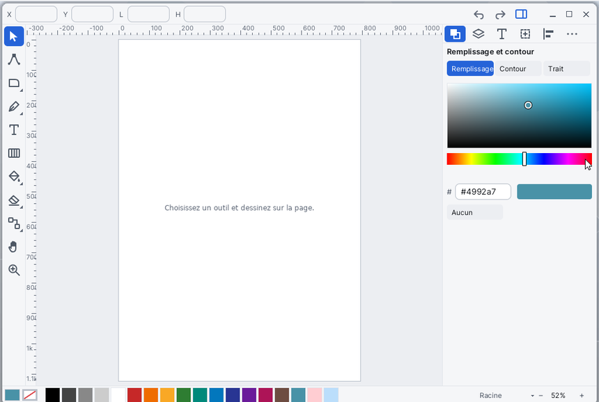

# Vector

**Vector** est l'éditeur de dessin vectoriel de Korin OS. On y dessine des formes, des chemins et du texte, on les colore (couleurs unies, dégradés), on les range en calques, on les combine par des opérations booléennes et on leur ajoute des filtres et des effets de chemin. Son format est le SVG : un dessin s'enregistre en `.svg` et s'exporte en PNG, en PDF, en EPS, en DXF ou en HPGL.

## La fenêtre

- **La barre d'outils**, à gauche, en colonne : une case par famille d'outils. Une case marquée d'un petit triangle en contient plusieurs ; un clic sur la case déjà active (ou un clic droit) ouvre la liste. Survoler une case montre le nom de l'outil.
- **La barre du haut** montre les réglages de l'outil en cours et une phrase d'aide. Avec le **Sélecteur**, elle montre les champs **X**, **Y**, **L** et **H** de la sélection : tapez une valeur pour déplacer ou redimensionner. À droite : **Annuler**, **Rétablir** et le bouton qui ouvre ou ferme les panneaux.
- **La page**, au centre, avec des règles en haut et à gauche (**Alt+R** les montre ou les cache).
- **Les panneaux**, à droite (touche **Tab**). Leurs onglets : **Remplissage et contour**, **Calques et objets**, **Texte et police**, **Transformer**, **Aligner et distribuer**, et **⋯** qui donne **Filtres**, **Effets de chemin**, **Éditeur XML** et **Document**.
- **La ligne du bas** : les cases du remplissage et du contour en cours (un clic ouvre **Remplissage et contour**), la palette de couleurs, le nom du calque courant (un clic : la liste des calques et **Nouveau calque**), le zoom avec **−** et **+** (un clic sur le pourcentage : 50 %, 100 %, 200 %, Sélection, Dessin, Page) et un point de couleur quand le dessin n'est pas enregistré.

## Les outils

| Outil | Touche | Ce qu'il fait |
|---|---|---|
| Sélecteur | V | Cliquer pour choisir, glisser pour déplacer ; les poignées agrandissent et tournent. Maj+clic ajoute à la sélection, un cadre tiré dans le vide choisit plusieurs objets. |
| Nœuds | A | Modifie les nœuds d'un chemin : glisser un nœud, double-clic sur un segment pour ajouter un nœud. |
| Rectangle | R | Glisser pour créer. Ctrl : carré. Alt : depuis le centre. |
| Ellipse | E | Glisser pour créer. Ctrl : cercle. Alt : depuis le centre. |
| Étoile, Polygone | Y | Glisser pour créer ; Ctrl : angle par pas de 15°. La barre choisit Étoile ou Polygone et le nombre de branches. |
| Spirale | S | Le glisser règle la taille et la fin ; la barre règle le nombre de tours. |
| Stylo | P | Clic : un coin. Glisser : une courbe. Entrée : termine. Retour arrière : retire le dernier point. Échap : abandonne. |
| Crayon | N | Glisser pour tracer à main levée. |
| Calligraphie | B | Glisser pour tracer : un trait rapide est plus fin. La barre règle l'épaisseur et l'angle de la plume. |
| Texte | T | Cliquer pour écrire, cliquer un texte pour le modifier. Entrée : nouvelle ligne. Échap : terminé. |
| Dégradé | G | Glisser sur un objet pour lui donner un dégradé ; Ctrl : angle par pas de 15°. |
| Seau | F | Cliquer une zone fermée pour la remplir. La barre règle la tolérance. |
| Pipette | I | Cliquer un objet : sa couleur devient le remplissage. Maj : le contour. |
| Gomme | W | Mode **Supprimer** : les objets touchés disparaissent. Mode **Couper** : découpe les formes sous la gomme. |
| Constructeur de formes | K | Glisser sur les régions des formes choisies pour les réunir (Alt : les retirer), puis Entrée ou **Appliquer**. |
| Ajustement | U | Glisser sur les chemins choisis pour les pousser. |
| Pulvérisation | J | Choisir un objet, puis glisser pour en semer des **Copies** ou des **Clones**. |
| Connecteur | L | Glisser d'un objet à l'autre : le trait les suit quand on les déplace. **Droit** ou **Coudé**. |
| Mesure | Q | Glisser pour mesurer une distance. |
| Main | H | Glisser pour déplacer la vue ; double-clic : toute la page. |
| Zoom | Z | Clic : zoom avant. Maj+clic : zoom arrière. |

Échap revient au Sélecteur (ou désélectionne). Tenir la **barre d'espace** donne la Main le temps d'un glisser.

## Dessiner une forme et la colorer

1. Choisissez **Rectangle** (touche R) et glissez sur la page.
2. Cliquez une couleur de la palette, en bas : elle devient le remplissage. **Maj+clic** la donne au contour.
3. Pour une couleur précise, ouvrez **Remplissage et contour** (touche C ou Ctrl+Shift+F). Les pages **Remplissage** et **Contour** ont un nuancier, une barre des teintes, un champ `#rrggbb` et le bouton **Aucun**. La page **Trait** règle l'épaisseur, l'opacité, les bouts (**Plat**, **Rond**, **Carré**), les angles (**Angle**, **Rond**, **Biseau**) et le mode de **Mélange**.
4. La touche **X** échange le remplissage et le contour.

## Tracer un chemin

1. Choisissez le **Stylo** (P). Cliquez pour poser des coins, glissez pour faire des courbes.
2. Appuyez sur Entrée pour terminer.
3. Pour retoucher, prenez l'outil **Nœuds** (A) ou double-cliquez le chemin avec le Sélecteur. La barre du haut propose **Insérer**, **Supprimer**, **Joindre**, **Couper**, **Coin**, **Lisse**, **Symétrique** et **Auto**. Les flèches déplacent les nœuds choisis.

## Écrire du texte

1. Choisissez **Texte** (T) et cliquez sur la page, puis tapez.
2. Échap termine. Un double-clic sur un texte avec le Sélecteur le rouvre.
3. Le panneau **Texte et police** (Ctrl+T) règle la taille, la police, le gras (**B**) et l'italique (**I**).
4. **Chemin > Objet vers chemin** (Ctrl+Shift+C) change le texte en chemin.

## Combiner des formes

1. Choisissez au moins deux formes (Maj+clic).
2. Dans le menu **Chemin** : **Union** (Ctrl+Alt+U), **Différence** (Ctrl+Alt+D), **Intersection** (Ctrl+Alt+I), **Exclusion** (Ctrl+Alt+E) ou **Division** (Ctrl+Alt+B).
3. Pour choisir région par région, prenez plutôt le **Constructeur de formes** (K). Le bouton **Garder le reste** ou **Retirer le reste** dit ce que deviennent les régions non choisies.

## Calques, ordre et alignement

- **Objet > Nouveau calque** (Ctrl+Shift+N) demande un nom. **Calques et objets** (Ctrl+L) liste calques et objets : l'œil cache, le cadenas verrouille ; en bas, **+**, **−** et les flèches ajoutent, suppriment, montent et descendent.
- **Objet > Monter**, **Descendre**, **Premier plan**, **Arrière-plan** changent l'ordre d'empilement.
- **Grouper** (Ctrl+G) et **Dégrouper** (Ctrl+Shift+G).
- **Aligner et distribuer** : six boutons d'alignement et deux de répartition, relatifs à la sélection (au moins deux objets).
- **Transformer** : **Déplacer X**, **Déplacer Y**, **Échelle, %** et **Rotation, degrés**, puis **Appliquer**.

## Filtres et effets de chemin

- **Filtres** (menu **Texte > Filtres...**) s'applique aussitôt à la sélection : **Flou doux**, **Ombre portée**, **Lueur**, **Noir et blanc**, **Tons chauds**, **Négatif**, **Bords rugueux**, **Grain de papier**, **Relief**, **Halo**. **Retirer le filtre** l'enlève.
- **Effets de chemin** (une forme ou un chemin choisi) : **Coins**, **Décalage**, **Miroir**, **Copies en rotation**, **Rugosité**, **Simplifier**, **Trait effilé**, **Onde**, **Tirets**. Chaque effet a ses réglages, modifiables par **−** et **+** ; l'effet reste modifiable ensuite.

## Ouvrir, enregistrer, exporter

1. **Fichier > Ouvrir...** (Ctrl+O) ouvre un fichier `.svg`. Un double-clic sur un `.svg` dans [Fichiers](help:files) l'ouvre aussi dans Vector.
2. **Fichier > Enregistrer** (Ctrl+S) ; **Enregistrer sous...** (Ctrl+Shift+S) ajoute `.svg` au nom s'il manque. Le dossier proposé est `SD0:/home/documents`.
3. **Fichier > Importer...** (Ctrl+I) ajoute une image PNG, JPEG ou WebP, ou le contenu d'un autre SVG, dans le calque courant.
4. **Exporter en PNG...** (Ctrl+E) et **Exporter en PDF...** écrivent la page entière. Pour EPS, DXF ou HPGL, cherchez **Exporter autrement...** par Ctrl+K, puis tapez le format : `svg`, `eps`, `dxf` ou `plt`.

Si le dessin a changé, Vector demande s'il faut l'enregistrer avant d'en ouvrir un autre.

## Menus et raccourcis

| Menu | Commandes |
|---|---|
| Fichier | Nouveau (Ctrl+N), Ouvrir... (Ctrl+O), Enregistrer (Ctrl+S), Enregistrer sous... (Ctrl+Shift+S), Importer... (Ctrl+I), Exporter en PNG... (Ctrl+E), Exporter en PDF... |
| Édition | Annuler (Ctrl+Z), Rétablir (Ctrl+Y ou Ctrl+Shift+Z), Couper (Ctrl+X), Copier (Ctrl+C), Coller (Ctrl+V), Coller sur place (Ctrl+Shift+V), Dupliquer (Ctrl+D), Supprimer (Retour arrière ou Suppr), Tout sélectionner (Ctrl+A), Désélectionner (Ctrl+Shift+A) |
| Vue | Zoom avant (=), Zoom arrière (-), Zoom 100 % (1), Ajuster à la sélection (3), Ajuster au dessin (4), Ajuster à la page (5), Contours (Alt+C), Panneaux (Tab) |
| Objet | Grouper (Ctrl+G), Dégrouper (Ctrl+Shift+G), Monter, Descendre, Premier plan, Arrière-plan, Miroir horizontal (Maj+H), Miroir vertical (Maj+V), Nouveau calque (Ctrl+Shift+N), Calques et objets... (Ctrl+L) |
| Chemin | Objet vers chemin (Ctrl+Shift+C), Contour vers chemin (Ctrl+Alt+C), Union, Différence, Intersection, Exclusion, Division, Simplifier (Ctrl+Alt+L), Vectoriser une image... |
| Texte | Filtres..., Effets de chemin..., Remplissage et contour... (Ctrl+Shift+F), Texte et police... (Ctrl+T), Extensions..., Éditeur XML... (Ctrl+Shift+X), Document... (Ctrl+Shift+E) |
| Aide | Rechercher une commande... (Ctrl+K), À propos de Vector |

### Commandes hors des menus

La barre de menus n'a pas la place pour tout. Ces commandes se trouvent par **Ctrl+K** ou par leur touche :

| Commande | Touche |
|---|---|
| Exporter autrement... | |
| Quart de tour à droite, à gauche | Maj+R, Maj+L |
| Combiner, Séparer | Ctrl+Alt+K, Ctrl+Shift+K |
| Inverser le sens | Ctrl+Alt+R |
| Cloner, Délier le clone | Alt+D, Alt+Shift+D |
| Découper par l'objet du dessus, Masquer par l'objet du dessus, Retirer découpe et masque | |
| Grille, Guides, Aimantation, Règles | Alt+G, Alt+U, Alt+A, Alt+R |
| Ajouter un guide vertical, horizontal | |
| Zoom 200 % | 2 |

### Sur la page

| Pour | Faire |
|---|---|
| Zoomer | la molette, sous le pointeur |
| Faire défiler | Maj+molette (horizontal), Ctrl+molette (vertical), les flèches sans sélection, ou la barre d'espace tenue |
| Déplacer la sélection | les flèches : 1 px ; Maj : 10 px ; Alt : un pixel de l'écran |
| Tourner la sélection | Ctrl+Gauche, Ctrl+Droite : 15° ; avec Maj : 1° |
| Agrandir, réduire la sélection | Ctrl+Haut, Ctrl+Bas |
| Déplacer sur un seul axe | Ctrl pendant le glisser |
| Créer un guide | tirer depuis une règle |

## Formats de fichiers

| Format | Lecture | Écriture |
|---|---|---|
| SVG (`.svg`) | Ouvrir, Importer | Enregistrer ; **svg** dans Exporter autrement (SVG simple, sans les ajouts d'Inkscape) |
| PNG | Importer (image) | Exporter en PNG |
| JPEG, WebP | Importer (image) | — |
| PDF | — | Exporter en PDF |
| EPS, DXF, HPGL (`.plt`) | — | Exporter autrement |

Les calques, les guides et la grille sont gardés dans le SVG à la manière d'Inkscape : le fichier reste lisible ailleurs. EPS, DXF et HPGL n'ont ni dégradés ni filtres : ils sont réduits à une couleur unie ou laissés de côté.

## Astuces

- **Ctrl+K** trouve toute commande : tapez quelques lettres, en français ou en anglais, puis Entrée.
- **Contours** (Alt+C) montre le dessin en fil de fer, pratique pour attraper un objet caché.
- Le panneau **Document** (Ctrl+Shift+E) règle la largeur et la hauteur de la page, le pas de la grille, et allume grille, guides, aimantation et règles. L'aimantation vise les coins des objets, puis les guides, la grille et les centres.
- **Vectoriser une image...** change une image choisie en chemins : de 1 à 8 niveaux de gris.
- **Éditeur XML** montre l'arbre du fichier et les attributs de l'objet choisi, une ligne `nom=valeur` chacun ; **Appliquer** les écrit.
- **Extensions...** propose **Quadrillage** et **Engrenage**. Une extension est un fichier `.inx` d'Inkscape, rangé dans `SD0:/apps/vector.app/ext/` ou `SD0:/home/vector/ext/`.
- Copier-coller passe par le presse-papiers en SVG : un dessin se colle dans une autre fenêtre de Vector.
