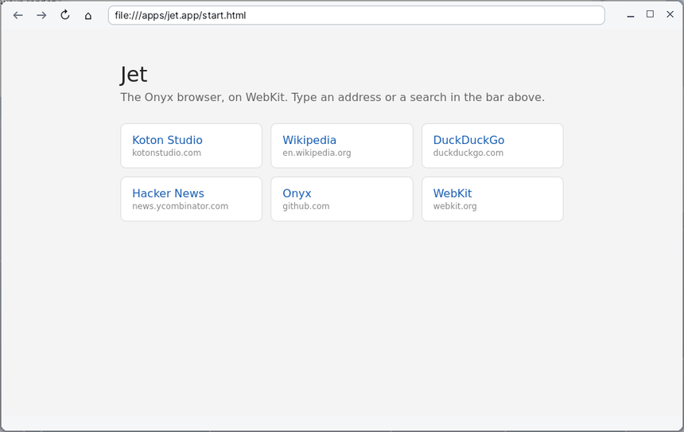

# Jet

**Jet** is the web browser of Korin OS. It shows websites and the HTML pages on the card with the **WebKit** engine, the one behind Safari: modern style sheets, JavaScript, forms, downloads, and even WebGL 2 drawn by the Raspberry Pi's graphics processor. Jet comes from Onyx; it lives in a simple window, one page per window.

## The window

From top to bottom:

- **the toolbar**, on the left: four buttons;
  - **←** goes back to the previous page;
  - **→** goes forward to the next page;
  - **↻** reloads the page; while a page is loading, the same button stops it;
  - **⌂** opens Jet's start page;
- **the address bar**, to the right of the buttons: it shows the page's address and is where you type another one (the grey hint "Adresse ou recherche" (Address or search) shows when it is empty);
- **the page** itself, which fills most of the window;
- **the status bar**, at the bottom: the loading progress ("Chargement… 40 %" (Loading… 40 %)), the address of the link under the pointer, downloads and errors.

Jet's own texts are in French only; this page gives them as they appear, with a translation in brackets.

The window title is the title of the page shown. The ← and → buttons are greyed out when there is no page to go to. Resize the window by its edges or with the maximize button; the page follows.

## The start page

When started without an address, and with the **⌂** button, Jet opens its start page (`SD0:/apps/jet.app/start.html`). It offers a few sites in one click: Koton Studio, Wikipedia, DuckDuckGo, Hacker News, the Onyx repository on GitHub and the WebKit website.

## Going to a website

1. Click in the address bar, or press **Ctrl+L**: the whole address is selected, and what you type replaces it.
2. Type the address, for example `en.wikipedia.org`.
3. Press **Enter**. The page loads; the status bar shows the progress.

To give up without loading anything, press **Esc**: the keyboard goes back to the page and the address bar shows the current address again.

Jet understands what you type this way:

| You type | Jet opens |
|---|---|
| a full address (`https://...`, `http://...`) | that address as it is |
| a word with a dot and no space (`example.com`) | the site over `https://` |
| a path starting with `/` (`/docs/page.html`) | that file on the card |
| a path with a drive (`SD0:/docs/page.html`, `RAM0:/test.html`) | that file on that drive |
| `about:blank`, a `data:` address | that address as it is |
| anything else (words, a question) | a DuckDuckGo search |

## Searching the web

Just type your words in the address bar, for example `pancake recipe`, then **Enter**: Jet opens DuckDuckGo's results (its light version, fast on the Pi).

## Opening an HTML page from the card

- From [Files](help:files): double-click a `.html` or `.htm` file to open it in Jet.
- From Jet: type its path in the address bar (`SD0:/folder/page.html` or `/folder/page.html`), then **Enter**.

Relative links, images and style sheets stored next to the file are found as usual.

## Browsing

- Click a link to follow it; the pointer turns into a hand over a link, and the link's address shows in the status bar.
- The mouse wheel scrolls the page under the pointer.
- From the keyboard, the page gets the keys: arrows, Page Up / Page Down, Home, End and Space scroll as in any browser.
- **←** (or **Alt+Left**) goes back, **→** (or **Alt+Right**) goes forward.
- A drop-down list in a form opens as a menu below the field: pick a line, or click elsewhere to close it without changing anything.
- A page's messages (`alert`) and questions (`confirm`) show in a dialog box with **OK** or **OK / Cancel**.

## Opening a new window

A link that asks for a new window (an "open in a new window" link, or a window opened by the page) opens a **second Jet window**. Each window is independent, with its own history; switch between them from the panel at the bottom. Jet has no tabs.

## Downloading a file

When a link leads to a file Jet cannot show (an archive, an installer...) or the site sends it as an attachment, Jet downloads it on its own:

1. Click the link.
2. The status bar shows "Téléchargement :" (Download:) followed by the file's path.
3. When it is done, it shows "Téléchargé :" (Downloaded:) and the path; if something goes wrong, "Téléchargement échoué :" (Download failed:) and the reason.

Files go to the `/Downloads` folder. If a file with the same name is already there, Jet adds a number: `manual (1).pdf`, `manual (2).pdf`...

## Reloading, stopping

- **↻**, **Ctrl+R** or **F5** reloads the page.
- While a page is loading, **↻** stops it.
- If a page could not load, the status bar shows "Échec :" (Failed:) with the address and the reason (no network, name not found...).
- If the page stopped abruptly, the status bar says so: "Le process web s'est arrêté : Recharger relance la page." (The web process stopped: Reload restarts the page.) Click **↻**.

## Menus and shortcuts

Jet has no menu of its own in the menu bar: it holds the application menu and the **Help** menu.

| Menu | Command | Shortcut |
|---|---|---|
| **Jet** | **Quit** | Ctrl+Q |
| **Help** | **Help for Jet** (this page) | |
| **Help** | **Help Contents** | |

The window's shortcuts:

| To | Key |
|---|---|
| Go to the address bar (select all) | Ctrl+L |
| Load the typed address | Enter (in the address bar) |
| Give the keyboard back to the page without loading | Esc (in the address bar) |
| Reload | Ctrl+R, F5 |
| Previous page | Alt+Left, Backspace |
| Next page | Alt+Right |
| Scroll | wheel, arrows, Page Up / Page Down, Home, End, Space |

> **Note**: the page sees keys first. Ctrl+R, F5, Alt+Left, Alt+Right and Backspace only work for Jet when the page does not use them: in a text field, Backspace deletes a character, it does not go back. Ctrl+L always works.

## Tips

- **Typing on a French keyboard**: characters made with AltGr (`@`, `#`, `{`, `€`...) reach the pages' fields correctly.
- **Mobile versions of sites**: Jet introduces itself to sites as the browser of an Android phone. Sites then send their light version, faster on the Pi and better suited to a small screen. To get the desktop versions, create an empty file `SD0:/etc/web-desktop-ua` (its content does not matter), then start Jet again.
- **Language of sites**: Jet tells sites the language and country chosen in the system settings; sites that take it into account show up in your language.
- **Graphics processor**: by default, Jet composes the page with the Pi's GPU; scrolling is smooth and WebGL is fast. If the display looks wrong, create an empty file `SD0:/etc/web-nogpu`: Jet then paints the page with the processor only.
- **Opening an address from the Terminal**: `SD0:/apps/jet.app/main https://example.com` opens a Jet window on that address; `--nogpu` or `--gpu` before the address chooses how to paint for that window only.
- **First start**: WebKit is a large program; the first start takes a few seconds ("Démarrage de WebKit…" (Starting WebKit…) in the status bar). Later windows open faster.
- **A local page that does not show**: check the typed path; a path without a drive (`/folder/page.html`) is looked up on the default drive.
