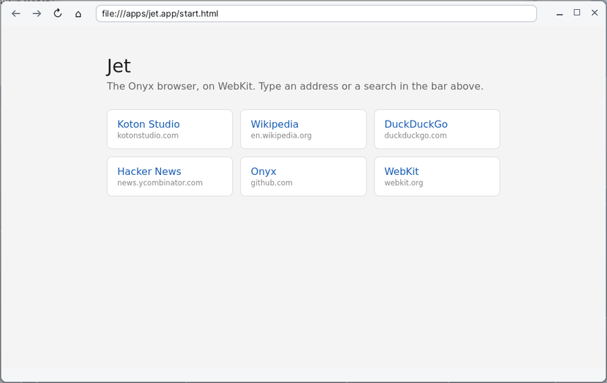

# Jet

**Jet** is the web browser of Korin OS. It shows websites and the HTML pages on the card with the **WebKit** engine, the one behind Safari: modern style sheets, JavaScript, forms, downloads, sound and video (WebM and MP4 in VP8, VP9, AV1), and even WebGL 2 drawn by the graphics processor. Jet comes from Onyx; its pages open in **tabs**, as in Safari.

Jet's own texts are in French only; this page gives them as they appear, with a translation in brackets.

## The window

From top to bottom:

- **the toolbar**:
  - **←** goes back to the previous page;
  - **→** goes forward to the next page;
  - **↻** reloads the page; while a page is loading, the same button stops it;
  - **⌂** opens Jet's start page;
  - **the address bar**: it shows the page's address and is where you type another one, or words to search for (the grey hint "Rechercher avec Google ou saisir une adresse" (Search with Google or type an address) shows when it is empty);
  - **⌕**, to the right of the address: the choice of the search engine, and clearing the cookies and site data;
- **the tab row**, across the whole width: one tab per open page, with the page's title; on the right, the **<** and **>** buttons and the **+** button;
- **the page** of the chosen tab, which fills most of the window;
- **the status bar**, at the bottom: the loading progress ("Chargement… 40 %" (Loading… 40 %)), the address of the link under the pointer, downloads and errors.

The window title is the title of the page shown. The ← and → buttons are greyed out when there is no page to go to. Resize the window by its edges or with the maximize button; the page follows.

## Tabs

Each tab has its page, its history and its own web process: a page that crashes or is stopped takes only itself down.

- **Open a tab**: the **+** button at the end of the row, **Ctrl+T**, or **Fichier > Nouvel onglet** (File > New tab). The new tab shows the start page and the address bar waits for what you type.
- **Switch tabs**: click the tab, **Ctrl+Tab** (next), **Ctrl+Shift+Tab** (previous), or **Ctrl+Page Down / Ctrl+Page Up**.
- **Close a tab**: the **×** to the left of its title (it shows on the chosen tab and on the one under the pointer), a **middle-button** click on the tab, **Ctrl+W**, or **Fichier > Fermer l'onglet** (File > Close tab). When the last tab closes, Jet opens a new one on the start page.
- **Open a link in a tab**: click it with the **middle button**, or **Ctrl+click**: the link opens in a tab placed right after, behind the one you are reading. A link that asks for a new window (`target="_blank"`, a window opened by the page) also opens in a tab, shown at once.
- **Many tabs**: tabs share the width; past a minimum width, the row scrolls. The **<** and **>** buttons scroll it (they are greyed out when there is nothing on that side), and so does the wheel when the pointer is over the row. The chosen tab is always brought into view.
- While a page loads, a small circle of dots turns to the right of its tab's title.

If a tab's web process stops (a crash, or stopped with `kill`), **that tab closes** and the status bar says so; the other tabs go on.

## The start page

When started without an address, in a new tab and with the **⌂** button, Jet opens its start page (`SD0:/apps/jet.app/start.html`). It offers a few sites in one click: Koton Studio, Wikipedia, DuckDuckGo, Hacker News, the Onyx repository on GitHub and the WebKit website.

## Going to a website

1. Click in the address bar, or press **Ctrl+L**: the whole address is selected, and what you type replaces it.
2. Type the address, for example `en.wikipedia.org`.
3. Press **Enter**. The page loads; the status bar shows the progress.

To give up without loading anything, press **Esc**: the keyboard goes back to the page and the address bar shows the current address again.

Jet understands what you type this way:

| You type | Jet opens |
|---|---|
| an address with its scheme (`https://...`, `http://...`, `file:`, `about:blank`, `data:`...) | that address as it is |
| a site name, no space, with a dot and a plausible ending (`example.com`, `en.wikipedia.org/wiki/Paris`) | the site over `https://` |
| `localhost` or an IPv4 address, with or without a port (`localhost:8080`, `192.168.1.10/admin`) | the site over `http://` |
| a path starting with `/` (`/docs/page.html`) | that file on the card |
| a path with a drive (`SD0:/docs/page.html`, `RAM0:/test.html`) | that file on that drive |
| anything else: words, a question, a word without a dot, text starting with `?` | a search with the chosen engine |

## Searching the web

Just type your words in the address bar, for example `pancake recipe`, then **Enter**: Jet opens the results page of the chosen search engine. To search for a word that looks like an address (`node.js`), start with `?`: `? node.js`.

**Choosing the search engine**: the **⌕** button to the right of the address bar, or the **Réglages** (Settings) menu. To choose from: **Google** (the default), **Bing**, **DuckDuckGo**, **Yahoo**, **Qwant**, **Ecosia**, **Startpage** and **Brave Search**. The chosen engine is checked, and stays chosen for the next starts (file `SD0:/home/jet/settings.ini`).

## Sound and video

Pages play sound and video: `<audio>` and `<video>` elements, and Media Source (how video sites such as YouTube play).

| Kind | Formats |
|---|---|
| Video | WebM and MP4 in **VP8**, **VP9** (8 bits) or **AV1** (8 bits), with **Opus** sound |
| Sound | **MP3**, **FLAC**, **WAV**, **Opus** in a WebM |

Not played: H.264, H.265, AAC (the MP4 videos of many sites: they then usually offer VP9 or AV1), Ogg (Vorbis, Opus in an `.ogg` file), protected videos (DRM: Netflix...). Sound goes to the system's sound output; one page at a time is heard.

## Cookies and site data

Jet keeps the sites' cookies and their data (local storage, IndexedDB databases, service workers, cache) from one start to the next: you stay signed in to your accounts (a mailbox, a forum...) after closing Jet or restarting. This data is shared by all tabs. "Session" cookies (without an expiry date) are forgotten when Jet closes, as in any browser.

It is stored in `SD0:/home/jet/webkit` (the cookies in `cookies.db`) and the cache in `SD0:/home/jet/cache`.

**Clearing everything**: **Réglages > Effacer les cookies et données des sites…** (Settings > Clear cookies and site data…) (or the **⌕** button, at the bottom of its menu), then **OK**. You are then signed out of every site; open pages may need a reload.

## Opening an HTML page from the card

- From [Files](help:files): double-click a `.html` or `.htm` file to open it in Jet.
- From Jet: type its path in the address bar (`SD0:/folder/page.html` or `/folder/page.html`), then **Enter**.

Relative links, images and style sheets stored next to the file are found as usual.

## Browsing

- Click a link to follow it; the pointer turns into a hand over a link, and the link's address shows in the status bar.
- The mouse wheel scrolls the page under the pointer.
- From the keyboard, the page gets the keys: arrows, Page Up / Page Down, Home, End and Space scroll as in any browser.
- **←** (or **Alt+Left**) goes back, **→** (or **Alt+Right**) goes forward.
- A drop-down list in a form opens as a menu below the field: pick a line, or click elsewhere to close it without changing anything.
- A page's messages (`alert`) and questions (`confirm`) show in a dialog box with **OK** or **OK / Cancel**.

## Downloading a file

When a link leads to a file Jet cannot show (an archive, an installer...) or the site sends it as an attachment, Jet downloads it on its own:

1. Click the link.
2. The status bar shows "Téléchargement :" (Download:) followed by the file's path.
3. When it is done, it shows "Téléchargé :" (Downloaded:) and the path; if something goes wrong, "Téléchargement échoué :" (Download failed:) and the reason.

Files go to the `SD0:/Downloads` folder. If a file with the same name is already there, Jet adds a number: `manual (1).pdf`, `manual (2).pdf`...

## Reloading, stopping

- **↻**, **Ctrl+R** or **F5** reloads the page.
- While a page is loading, **↻** stops it.
- If a page could not load, the status bar shows "Échec :" (Failed:) with the address and the reason (no network, name not found...).

## Menus and shortcuts

| Menu | Command | Shortcut |
|---|---|---|
| **Fichier** (File) | **Nouvel onglet** (New tab) | Ctrl+T |
| **Fichier** | **Nouvelle fenêtre** (New window: a second Jet window) | |
| **Fichier** | **Fermer l'onglet** (Close tab) | Ctrl+W |
| **Fichier** | **Quitter** (Quit) | |
| **Navigation** | **Précédente**, **Suivante** (Back, Forward) | Alt+Left, Alt+Right |
| **Navigation** | **Recharger** (Reload) | Ctrl+R, F5 |
| **Navigation** | **Accueil** (Home) | |
| **Navigation** | **Onglet suivant**, **Onglet précédent** (Next tab, Previous tab) | Ctrl+Tab, Ctrl+Shift+Tab |
| **Navigation** | **Aller à l'adresse** (Go to address) | Ctrl+L |
| **Réglages** (Settings) | **Rechercher avec** (Search with) Google, Bing, DuckDuckGo... (the chosen engine is checked) | |
| **Réglages** | **Effacer les cookies et données des sites…** (Clear cookies and site data…) | |
| **Help** | **Help for Jet** (this page), **Help Contents** | |

The window's other shortcuts:

| To | Key |
|---|---|
| Load the typed address | Enter (in the address bar) |
| Give the keyboard back to the page without loading | Esc (in the address bar) |
| Next, previous tab | Ctrl+Page Down, Ctrl+Page Up |
| Previous page | Backspace |
| Open a link in a tab | middle button, Ctrl+click |
| Close a tab | middle button on the tab |
| Scroll | wheel, arrows, Page Up / Page Down, Home, End, Space |

> **Note**: the tab shortcuts (Ctrl+T, Ctrl+W, Ctrl+Tab) and Ctrl+L always work. Ctrl+R, F5, Alt+Left, Alt+Right and Backspace only work for Jet when the page does not use them: in a text field, Backspace deletes a character, it does not go back. As in Korin's other programs, a shortcut letter is the one of the key's position on a US keyboard (on a French AZERTY keyboard, Ctrl+W is the key right of A: Z).

## Tips

- **Typing on a French keyboard**: characters made with AltGr (`@`, `#`, `{`, `€`...) reach the pages' fields correctly.
- **Mobile or desktop versions of sites**: on the Raspberry Pi, Jet introduces itself to sites as the browser of an Android phone: sites send their light version, faster on the Pi. On a PC, it introduces itself as Safari on a Mac: sites send their desktop version. To get WebKit's own identity, create an empty file `SD0:/etc/web-desktop-ua` (its content does not matter), then start Jet again.
- **Language of sites**: Jet tells sites the language and country chosen in the system settings; sites that take it into account show up in your language.
- **Graphics processor**: on the Pi, Jet composes the page with the GPU; scrolling is smooth and WebGL is fast. If the display looks wrong, create an empty file `SD0:/etc/web-nogpu`: Jet then paints the page with the processor only.
- **Opening addresses from the Terminal**: `SD0:/apps/jet.app/main https://example.com https://en.wikipedia.org` opens a Jet window with one tab per address; `--nogpu` or `--gpu` before the addresses chooses how to paint for that window only.
- **First start**: WebKit is a large program; the first start takes a few seconds ("Démarrage de WebKit…" (Starting WebKit…) in the status bar). Later tabs and windows open faster.
- **A local page that does not show**: check the typed path; a path without a drive (`/folder/page.html`) is looked up on `SD0:`.
