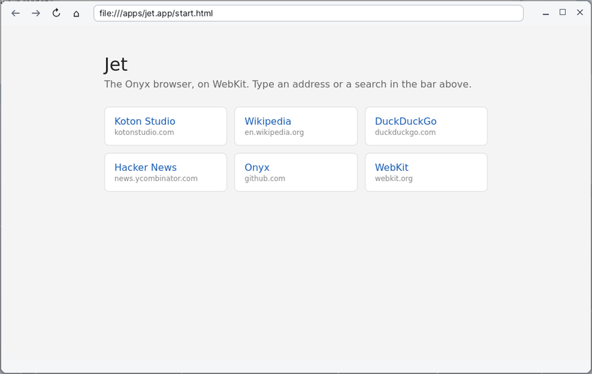

# Jet

**Jet** est le navigateur web de Korin OS. Il affiche les sites et les pages HTML de la carte avec le moteur **WebKit**, celui de Safari : feuilles de style modernes, JavaScript, formulaires, téléchargements, et même WebGL 2 dessiné par le processeur graphique du Raspberry Pi. Jet vient d'Onyx ; il tient dans une fenêtre simple, une page par fenêtre.

## La fenêtre

De haut en bas :

- **la barre d'outils**, à gauche : quatre boutons ;
  - **←** revient à la page précédente ;
  - **→** retourne à la page suivante ;
  - **↻** recharge la page ; pendant un chargement, le même bouton l'arrête ;
  - **⌂** ouvre la page d'accueil de Jet ;
- **la barre d'adresse**, à droite des boutons : elle montre l'adresse de la page et sert à en taper une autre (le texte grisé « Adresse ou recherche » l'indique quand elle est vide) ;
- **la page** elle-même, qui occupe presque toute la fenêtre ;
- **la barre d'état**, en bas : la progression du chargement (« Chargement… 40 % »), l'adresse du lien sous le pointeur, les téléchargements et les erreurs.

Le titre de la fenêtre est celui de la page affichée. Les boutons ← et → sont grisés quand il n'y a pas de page où aller. La fenêtre se redimensionne par ses bords ou par le bouton d'agrandissement ; la page suit.

## La page d'accueil

Au lancement sans adresse, et par le bouton **⌂**, Jet ouvre sa page d'accueil (`SD0:/apps/jet.app/start.html`). Elle propose quelques sites en un clic : Koton Studio, Wikipedia, DuckDuckGo, Hacker News, le dépôt d'Onyx sur GitHub et le site de WebKit.

## Aller sur un site

1. Cliquez dans la barre d'adresse, ou appuyez sur **Ctrl+L** : toute l'adresse est choisie, ce que vous tapez la remplace.
2. Tapez l'adresse, par exemple `fr.wikipedia.org`.
3. Appuyez sur **Entrée**. La page se charge ; la barre d'état montre la progression.

Pour renoncer sans rien charger, appuyez sur **Échap** : le clavier revient à la page et la barre d'adresse reprend l'adresse affichée.

Jet comprend ce que vous tapez ainsi :

| Vous tapez | Jet ouvre |
|---|---|
| une adresse complète (`https://...`, `http://...`) | cette adresse telle quelle |
| un mot avec un point et sans espace (`example.com`) | le site en `https://` |
| un chemin qui commence par `/` (`/docs/page.html`) | ce fichier de la carte |
| un chemin avec un lecteur (`SD0:/docs/page.html`, `RAM0:/essai.html`) | ce fichier sur ce lecteur |
| `about:blank`, une adresse `data:` | cette adresse telle quelle |
| autre chose (des mots, une question) | une recherche sur DuckDuckGo |

## Chercher sur le web

Tapez simplement vos mots dans la barre d'adresse, par exemple `recette crêpes`, puis **Entrée** : Jet ouvre les résultats de DuckDuckGo (sa version légère, rapide sur le Pi).

## Ouvrir une page HTML de la carte

- Depuis [Fichiers](help:files) : un double-clic sur un fichier `.html` ou `.htm` l'ouvre dans Jet.
- Depuis Jet : tapez son chemin dans la barre d'adresse (`SD0:/dossier/page.html` ou `/dossier/page.html`), puis **Entrée**.

Les liens relatifs, les images et les feuilles de style rangés à côté du fichier sont trouvés normalement.

## Naviguer

- Un clic sur un lien le suit ; le pointeur devient une main au-dessus d'un lien, et l'adresse du lien s'affiche dans la barre d'état.
- La molette fait défiler la page sous le pointeur.
- Au clavier, la page reçoit les touches : flèches, Page précédente / suivante, Début, Fin, Espace font défiler comme dans tout navigateur.
- **←** (ou **Alt+Gauche**) revient en arrière, **→** (ou **Alt+Droite**) va en avant.
- Une liste déroulante d'un formulaire s'ouvre en menu sous le champ : choisissez une ligne, ou cliquez ailleurs pour la refermer sans rien changer.
- Les messages d'une page (`alert`) et ses questions (`confirm`) s'affichent dans une boîte de dialogue **OK** ou **OK / Annuler**.

## Ouvrir une nouvelle fenêtre

Un lien qui demande une nouvelle fenêtre (un lien « ouvrir dans une nouvelle fenêtre », ou une fenêtre ouverte par la page) ouvre une **deuxième fenêtre Jet**. Chaque fenêtre est indépendante, avec son propre historique ; on passe de l'une à l'autre par le panneau du bas. Jet n'a pas d'onglets.

## Télécharger un fichier

Quand un lien mène à un fichier que Jet ne sait pas afficher (une archive, un programme d'installation...) ou que le site l'envoie comme pièce jointe, Jet le télécharge tout seul :

1. Cliquez sur le lien.
2. La barre d'état affiche « Téléchargement : » suivi du chemin du fichier.
3. À la fin, elle affiche « Téléchargé : » et le chemin ; en cas de problème, « Téléchargement échoué : » et la raison.

Les fichiers vont dans le dossier `/Downloads`. Si un fichier du même nom y est déjà, Jet ajoute un numéro : `notice (1).pdf`, `notice (2).pdf`...

## Recharger, arrêter

- **↻**, **Ctrl+R** ou **F5** recharge la page.
- Pendant un chargement, **↻** l'arrête.
- Si une page n'a pas pu se charger, la barre d'état affiche « Échec : » avec l'adresse et la raison (pas de réseau, nom introuvable...).
- Si la page s'est arrêtée brutalement, la barre d'état le dit : « Le process web s'est arrêté : Recharger relance la page. » Cliquez sur **↻**.

## Menus et raccourcis

Jet n'a pas de menu à lui dans la barre de menus : on y trouve le menu de l'application et le menu **Aide**.

| Menu | Commande | Raccourci |
|---|---|---|
| **Jet** | **Quitter** | Ctrl+Q |
| **Aide** | **Aide de Jet** (cette page) | |
| **Aide** | **Sommaire de l'aide** | |

Les raccourcis de la fenêtre :

| Pour | Touche |
|---|---|
| Aller dans la barre d'adresse (tout choisir) | Ctrl+L |
| Charger l'adresse tapée | Entrée (dans la barre d'adresse) |
| Rendre le clavier à la page sans charger | Échap (dans la barre d'adresse) |
| Recharger | Ctrl+R, F5 |
| Page précédente | Alt+Gauche, Retour arrière |
| Page suivante | Alt+Droite |
| Faire défiler | molette, flèches, Page précédente / suivante, Début, Fin, Espace |

> **Remarque** : la page voit les touches en premier. Ctrl+R, F5, Alt+Gauche, Alt+Droite et Retour arrière ne servent à Jet que si la page ne s'en sert pas : dans un champ de texte, Retour arrière efface un caractère, il ne revient pas en arrière. Ctrl+L marche toujours.

## Astuces

- **Taper au clavier français** : les caractères faits avec AltGr (`@`, `#`, `{`, `€`...) arrivent bien dans les champs des pages.
- **Sites en version mobile** : Jet se présente aux sites comme le navigateur d'un téléphone Android. Les sites envoient alors leur version légère, plus rapide sur le Pi et mieux adaptée à un petit écran. Pour avoir les versions de bureau, créez un fichier vide `SD0:/etc/web-desktop-ua` (son contenu ne compte pas), puis relancez Jet.
- **Langue des sites** : Jet annonce aux sites la langue et le pays choisis dans les réglages du système ; les sites qui en tiennent compte s'affichent dans votre langue.
- **Processeur graphique** : par défaut, Jet compose la page avec le GPU du Pi ; le défilement est fluide et le WebGL va vite. En cas d'affichage défectueux, créez un fichier vide `SD0:/etc/web-nogpu` : Jet peint alors la page avec le processeur seulement.
- **Ouvrir une adresse depuis le Terminal** : `SD0:/apps/jet.app/main https://example.com` ouvre une fenêtre Jet sur cette adresse ; `--nogpu` ou `--gpu` avant l'adresse choisit la manière de peindre pour cette fenêtre seulement.
- **Premier lancement** : WebKit est un gros programme ; le premier démarrage prend quelques secondes (« Démarrage de WebKit… » dans la barre d'état). Les fenêtres suivantes s'ouvrent plus vite.
- **Une page locale qui ne s'affiche pas** : vérifiez le chemin tapé ; un chemin sans lecteur (`/dossier/page.html`) est cherché sur le lecteur par défaut.
