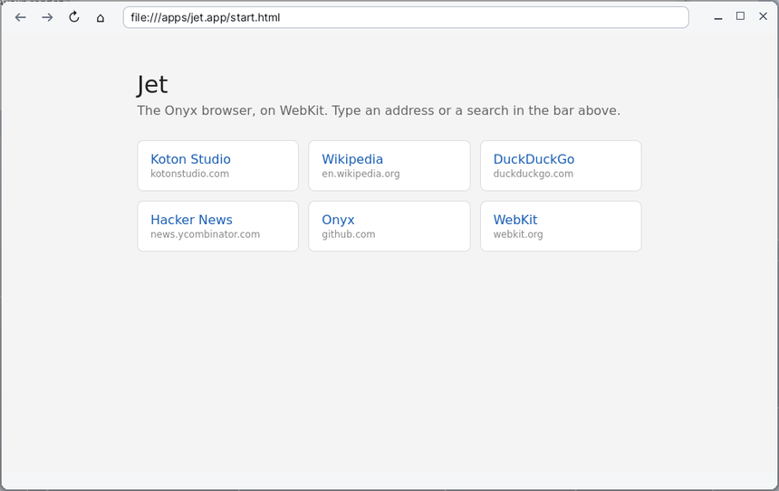

# Jet

**Jet** est le navigateur web de Korin OS. Il affiche les sites et les pages HTML de la carte avec le moteur **WebKit**, celui de Safari : feuilles de style modernes, JavaScript, formulaires, téléchargements, son et vidéo (WebM et MP4 en VP8, VP9, AV1), et même WebGL 2 dessiné par le processeur graphique. Jet vient d'Onyx ; ses pages s'ouvrent dans des **onglets**, comme dans Safari.

## La fenêtre

De haut en bas :

- **la barre d'outils** :
  - **←** revient à la page précédente ;
  - **→** retourne à la page suivante ;
  - **↻** recharge la page ; pendant un chargement, le même bouton l'arrête ;
  - **⌂** ouvre la page d'accueil de Jet ;
  - **la barre d'adresse** : elle montre l'adresse de la page et sert à en taper une autre, ou des mots à chercher (le texte grisé « Rechercher avec Google ou saisir une adresse » le rappelle quand elle est vide) ;
  - **⌕**, à droite de l'adresse : le choix du moteur de recherche, et l'effacement des cookies et données des sites ;
- **la rangée des onglets**, sur toute la largeur : un onglet par page ouverte, avec le titre de la page ; à droite, les boutons **<** et **>** et le bouton **+** ;
- **la page** de l'onglet choisi, qui occupe presque toute la fenêtre ;
- **la barre d'état**, en bas : la progression du chargement (« Chargement… 40 % »), l'adresse du lien sous le pointeur, les téléchargements et les erreurs.

Le titre de la fenêtre est celui de la page affichée. Les boutons ← et → sont grisés quand il n'y a pas de page où aller. La fenêtre se redimensionne par ses bords ou par le bouton d'agrandissement ; la page suit.

## Les onglets

Chaque onglet a sa page, son historique et son propre process web : une page qui plante ou qu'on arrête n'emporte qu'elle.

- **Ouvrir un onglet** : le bouton **+** au bout de la rangée, **Ctrl+T**, ou **Fichier > Nouvel onglet**. Le nouvel onglet montre la page d'accueil ; sa barre d'adresse est vide, avec l'invite « Rechercher avec … ou saisir une adresse », et attend ce que vous tapez. En revenant sur un onglet, la barre montre son adresse à lui.
- **Passer d'un onglet à l'autre** : un clic sur l'onglet, **Ctrl+Tab** (le suivant), **Ctrl+Maj+Tab** (le précédent), ou **Ctrl+Page suivante / Ctrl+Page précédente**.
- **Fermer un onglet** : la croix **×** à gauche de son titre (elle apparaît sur l'onglet choisi et sur celui que survole le pointeur), un clic du **bouton du milieu** sur l'onglet, **Ctrl+W**, ou **Fichier > Fermer l'onglet**. Quand le dernier onglet se ferme, Jet en ouvre un neuf sur la page d'accueil.
- **Ouvrir un lien dans un onglet** : un clic du **bouton du milieu** sur le lien, ou **Ctrl+clic** : le lien s'ouvre dans un onglet placé juste après, derrière celui que vous lisez. Un lien qui demande une nouvelle fenêtre (`target="_blank"`, une fenêtre ouverte par la page) s'ouvre aussi dans un onglet, montré tout de suite.
- **Beaucoup d'onglets** : les onglets se partagent la largeur ; au-delà d'une largeur minimale, la rangée défile. Les boutons **<** et **>** la font défiler (ils sont grisés quand il n'y a rien de ce côté), la molette aussi quand le pointeur est sur la rangée. L'onglet choisi est toujours ramené en vue.
- Pendant le chargement d'une page, un petit cercle de points tourne à droite du titre de son onglet.

Si le process web d'un onglet s'arrête (un plantage, ou arrêté avec `kill`), **cet onglet se ferme** et la barre d'état le dit ; les autres onglets continuent.

## La page d'accueil

Au lancement sans adresse, dans un nouvel onglet et par le bouton **⌂**, Jet ouvre sa page d'accueil (`/apps/jet.app/start.html`). Elle propose quelques sites en un clic : Koton Studio, Wikipedia, DuckDuckGo, Hacker News, le dépôt d'Onyx sur GitHub et le site de WebKit.

## Aller sur un site

1. Cliquez dans la barre d'adresse, ou appuyez sur **Ctrl+L** : toute l'adresse est choisie, ce que vous tapez la remplace.
2. Tapez l'adresse, par exemple `fr.wikipedia.org`.
3. Appuyez sur **Entrée**. La page se charge ; la barre d'état montre la progression.

Pour renoncer sans rien charger, appuyez sur **Échap** : le clavier revient à la page et la barre d'adresse reprend l'adresse affichée.

Jet comprend ce que vous tapez ainsi :

| Vous tapez | Jet ouvre |
|---|---|
| une adresse avec son protocole (`https://...`, `http://...`, `file:`, `about:blank`, `data:`...) | cette adresse telle quelle |
| un nom de site, sans espace, avec un point et une extension plausible (`example.com`, `fr.wikipedia.org/wiki/Paris`) | le site en `https://` |
| `localhost` ou une adresse IPv4, avec ou sans port (`localhost:8080`, `192.168.1.10/admin`) | le site en `http://` |
| un chemin qui commence par `/` (`/docs/page.html`) | ce fichier de la carte |
| un chemin avec un lecteur (`/docs/page.html`, `/tmp/essai.html`) | ce fichier sur ce lecteur |
| autre chose : des mots, une question, un mot sans point, un texte qui commence par `?` | une recherche avec le moteur choisi |

## Chercher sur le web

Tapez simplement vos mots dans la barre d'adresse, par exemple `recette crêpes`, puis **Entrée** : Jet ouvre la page de résultats du moteur de recherche choisi. Pour chercher un mot qui ressemble à une adresse (`node.js`), commencez par `?` : `? node.js`.

**Choisir le moteur de recherche** : le bouton **⌕** à droite de la barre d'adresse, ou le menu **Réglages**. Au choix : **Google** (le moteur par défaut), **Bing**, **DuckDuckGo**, **Yahoo**, **Qwant**, **Ecosia**, **Startpage** et **Brave Search**. Le moteur choisi est coché, il reste choisi aux lancements suivants (fichier `HOME:/jet/settings.ini`).

## Son et vidéo

Les pages jouent le son et la vidéo : les éléments `<audio>` et `<video>`, et Media Source (la lecture des sites de vidéo comme YouTube).

| Sorte | Formats |
|---|---|
| Vidéo | WebM et MP4 en **VP8**, **VP9** (8 bits) ou **AV1** (8 bits), avec le son en **Opus** |
| Son | **MP3**, **FLAC**, **WAV**, **Opus** dans un WebM |

Ne sont pas lus : H.264, H.265, AAC (les vidéos MP4 de beaucoup de sites : ils proposent alors en général VP9 ou AV1), Ogg (Vorbis, Opus dans un fichier `.ogg`), les vidéos protégées (DRM : Netflix...). Le son sort par la sortie son du système ; une seule page à la fois se fait entendre.

## Cookies et données des sites

Jet garde les cookies des sites et leurs données (stockage local, bases IndexedDB, travailleurs de service, cache) d'un lancement à l'autre : vous restez connecté à vos comptes (une messagerie, un forum...) après avoir fermé Jet ou redémarré. Ces données sont communes à tous les onglets. Les cookies « de session » (sans date d'expiration) sont oubliés à la fermeture, comme dans tout navigateur.

Elles sont rangées dans `HOME:/jet/webkit` (les cookies dans `cookies.db`) et le cache dans `HOME:/jet/cache`.

**Tout effacer** : **Réglages > Effacer les cookies et données des sites…** (ou le bouton **⌕**, en bas du menu), puis **OK**. Vous êtes alors déconnecté de tous les sites ; les pages ouvertes devront peut-être être rechargées.

## Ouvrir une page HTML de la carte

- Depuis [Fichiers](help:files) : un double-clic sur un fichier `.html` ou `.htm` l'ouvre dans Jet.
- Depuis Jet : tapez son chemin dans la barre d'adresse (`/dossier/page.html` ou `/dossier/page.html`), puis **Entrée**.

Les liens relatifs, les images et les feuilles de style rangés à côté du fichier sont trouvés normalement.

## Naviguer

- Un clic sur un lien le suit ; le pointeur devient une main au-dessus d'un lien, et l'adresse du lien s'affiche dans la barre d'état.
- La molette fait défiler la page sous le pointeur.
- Au clavier, la page reçoit les touches : flèches, Page précédente / suivante, Début, Fin, Espace font défiler comme dans tout navigateur.
- **←** (ou **Alt+Gauche**) revient en arrière, **→** (ou **Alt+Droite**) va en avant.
- Une liste déroulante d'un formulaire s'ouvre en menu sous le champ : choisissez une ligne, ou cliquez ailleurs pour la refermer sans rien changer.
- Les messages d'une page (`alert`) et ses questions (`confirm`) s'affichent dans une boîte de dialogue **OK** ou **OK / Annuler**.

## Télécharger un fichier

Quand un lien mène à un fichier que Jet ne sait pas afficher (une archive, un programme d'installation...) ou que le site l'envoie comme pièce jointe, Jet le télécharge tout seul :

1. Cliquez sur le lien.
2. La barre d'état affiche « Téléchargement : » suivi du chemin du fichier.
3. À la fin, elle affiche « Téléchargé : » et le chemin ; en cas de problème, « Téléchargement échoué : » et la raison.

Les fichiers vont dans le dossier `/Downloads`. Si un fichier du même nom y est déjà, Jet ajoute un numéro : `notice (1).pdf`, `notice (2).pdf`...

## Recharger, arrêter

- **↻**, **Ctrl+R** ou **F5** recharge la page.
- Pendant un chargement, **↻** l'arrête.
- Si une page n'a pas pu se charger, la barre d'état affiche « Échec : » avec l'adresse et la raison (pas de réseau, nom introuvable...).

## Menus et raccourcis

| Menu | Commande | Raccourci |
|---|---|---|
| **Fichier** | **Nouvel onglet** | Ctrl+T |
| **Fichier** | **Nouvelle fenêtre** (une deuxième fenêtre Jet) | |
| **Fichier** | **Fermer l'onglet** | Ctrl+W |
| **Fichier** | **Quitter** | |
| **Navigation** | **Précédente**, **Suivante** | Alt+Gauche, Alt+Droite |
| **Navigation** | **Recharger** | Ctrl+R, F5 |
| **Navigation** | **Accueil** | |
| **Navigation** | **Onglet suivant**, **Onglet précédent** | Ctrl+Tab, Ctrl+Maj+Tab |
| **Navigation** | **Aller à l'adresse** | Ctrl+L |
| **Réglages** | **Rechercher avec** Google, Bing, DuckDuckGo... (le moteur choisi est coché) | |
| **Réglages** | **Effacer les cookies et données des sites…** | |
| **Aide** | **Aide de Jet** (cette page), **Sommaire de l'aide** | |

Les autres raccourcis de la fenêtre :

| Pour | Touche |
|---|---|
| Charger l'adresse tapée | Entrée (dans la barre d'adresse) |
| Rendre le clavier à la page sans charger | Échap (dans la barre d'adresse) |
| Onglet suivant, précédent | Ctrl+Page suivante, Ctrl+Page précédente |
| Page précédente | Retour arrière |
| Ouvrir un lien dans un onglet | bouton du milieu, Ctrl+clic |
| Fermer un onglet | bouton du milieu sur l'onglet |
| Faire défiler | molette, flèches, Page précédente / suivante, Début, Fin, Espace |

> **Remarque** : les raccourcis des onglets (Ctrl+T, Ctrl+W, Ctrl+Tab) et Ctrl+L marchent toujours. Ctrl+R, F5, Alt+Gauche, Alt+Droite et Retour arrière ne servent à Jet que si la page ne s'en sert pas : dans un champ de texte, Retour arrière efface un caractère, il ne revient pas en arrière. Comme dans les autres programmes de Korin, une lettre de raccourci est celle de la position de la touche sur un clavier américain (Ctrl+W est la touche à droite de A sur un clavier AZERTY : Z).

## Astuces

- **Taper au clavier français** : les caractères faits avec AltGr (`@`, `#`, `{`, `€`...) arrivent bien dans les champs des pages.
- **Sites en version mobile ou de bureau** : sur le Raspberry Pi, Jet se présente aux sites comme le navigateur d'un téléphone Android : les sites envoient leur version légère, plus rapide sur le Pi. Sur un PC, il se présente comme Safari sur Mac : les sites envoient leur version de bureau. Pour avoir la présentation propre à WebKit, créez un fichier vide `/etc/web-desktop-ua` (son contenu ne compte pas), puis relancez Jet.
- **Langue des sites** : Jet annonce aux sites la langue et le pays choisis dans les réglages du système ; les sites qui en tiennent compte s'affichent dans votre langue.
- **Processeur graphique** : sur le Pi, et sur un PC à GPU Intel, Jet compose la page avec le GPU ; le défilement est fluide, la vidéo et le WebGL vont vite. En cas d'affichage défectueux, créez un fichier vide `/etc/web-nogpu` : Jet peint alors la page avec le processeur seulement.
- **Ouvrir des adresses depuis le Terminal** : `/apps/jet.app/main https://example.com https://fr.wikipedia.org` ouvre une fenêtre Jet avec un onglet par adresse ; `--nogpu` ou `--gpu` avant les adresses choisit la manière de peindre pour cette fenêtre seulement.
- **Premier lancement** : WebKit est un gros programme ; le premier démarrage prend quelques secondes (« Démarrage de WebKit… » dans la barre d'état). Les onglets et fenêtres suivants s'ouvrent plus vite.
- **Vidéos trop lourdes** : si une vidéo saccade ou fige la page, créez le fichier `/etc/web-video-max` avec une hauteur maximale (`480` ou `360`) : les sites (YouTube) choisissent alors une vidéo plus petite. Jet montre de toute façon moins d'images plutôt que de figer la page quand la peinture ne suit pas.
- **Traces pour un rapport** : `/apps/jet.app/main --trace-media` écrit au journal du système, chaque seconde pendant une vidéo, les images décodées, peintes et sautées, les tampons et l'état du lecteur (lignes `web: media: trace`) ; `--trace-net` y écrit chaque requête du réseau avec son adresse entière. Lancez ensuite `journal` au Terminal et joignez le fichier `journal.txt`. Sans ces options, le journal ne garde que les onglets, les process et les erreurs, sans les adresses complètes.
- **Une page locale qui ne s'affiche pas** : vérifiez le chemin tapé ; un chemin sans lecteur (`/dossier/page.html`) est cherché sur `/`.
